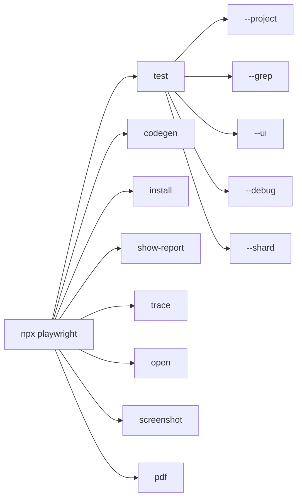

# 🧠 Topic: Playwright CLI Commands

> [!abstract] Executive Summary (ELI5)
> Playwright ships a command-line tool that does more than run tests. It installs browsers, generates tests from your clicks, runs the suite in many modes, opens debug viewers, and even captures screenshots or PDFs — all from `npx playwright`.

---

## 🎯 The "Why"

- **Problem Solved:** You need one entry point for the whole testing lifecycle — setup, authoring, execution, debugging, and reporting — without switching tools.
- **Alternatives:** You can run tests through package scripts, CI pipelines, or the VS Code extension, but the CLI is the canonical interface that everything else wraps.
- **Trade-offs:** CLI flags override config defaults, which is powerful but can create "works on my machine" drift if teammates run tests with different flags. Prefer persistent config changes for behavior you want everywhere.

## 💡 Mental Model & Analogy

- **Analogy:** The Playwright CLI is the Swiss Army knife of the framework. One handle (`npx playwright`) exposes many blades: a screwdriver for setup, a pen for code generation, a stopwatch for running tests, and a magnifying glass for debugging.
- **Visual/Diagram:**



## 🛠️ Core Principles & Code Snippets

### `npx playwright test` — Run the suite

The workhorse command. It reads `playwright.config.ts`, discovers tests in `testDir`, and executes them.

```bash
# Run all tests
npx playwright test

# Run a specific file or pattern
npx playwright test tests/auth.spec.ts

# Run only the chromium project
npx playwright test --project=chromium

# Filter by test name or tag
npx playwright test --grep @smoke
npx playwright test --grep-invert @slow

# Run in headed mode (visible browser)
npx playwright test --headed

# Interactive UI mode with time-travel debugging
npx playwright test --ui

# Step-through debugging
npx playwright test --debug

# Override retries and workers for this run
npx playwright test --retries=2 --workers=4

# Force tracing on every test
npx playwright test --trace on

# List tests without running them
npx playwright test --list

# Run a specific shard on CI
npx playwright test --shard=2/3

# Use a different config file
npx playwright test --config=playwright.ci.config.ts

# Override reporter for a single run
npx playwright test --reporter=line
```

### `npx playwright codegen` — Generate tests from clicks

Launches a browser and the Playwright Inspector. Every click, type, and navigation becomes test code.

```bash
# Start codegen against a URL
npx playwright codegen https://demo.playwright.dev/todomvc

# Generate a specific language and save to file
npx playwright codegen https://example.com \
  --target=playwright-test \
  --output=tests/generated.spec.ts \
  --test-id-attribute=data-testid
```

### `npx playwright install` — Manage browsers

```bash
# Install default browsers (chromium, firefox, webkit)
npx playwright install

# Install only chromium
npx playwright install chromium

# Install browsers and OS dependencies (common in Docker/CI)
npx playwright install --with-deps

# List installed browsers
npx playwright install --list
```

### `npx playwright show-report` — Open HTML report

After a run with `reporter: 'html'`, open the report locally.

```bash
npx playwright show-report
npx playwright show-report path/to/report
```

### `npx playwright trace` — Inspect trace files

Useful for post-mortem debugging of failing or flaky tests.

```bash
# Open a trace in the Trace Viewer
npx playwright show-trace test-results/example-chromium/trace.zip

# Legacy command syntax
npx playwright trace open test-results/example-chromium/trace.zip

# Print actions in a trace
npx playwright trace actions --grep="expect" test-results/example-chromium/trace.zip
```

### Utility commands

```bash
# Open a page in a Playwright-managed browser
npx playwright open https://example.com
npx playwright open -b webkit https://example.com

# Capture a screenshot
npx playwright screenshot https://example.com example.png --full-page

# Save a page as PDF
npx playwright pdf https://example.com example.pdf
```

## Common CLI Flags Reference

| Flag | Purpose |
|---|---|
| `--project <name>` | Run only the named project from config. |
| `--grep <pattern>` | Run tests whose title matches the regex. |
| `--grep-invert <pattern>` | Skip tests whose title matches. |
| `--headed` | Show the browser window. |
| `--headless` | Force headless even if config says headed. |
| `--debug` | Run tests with the Playwright Inspector paused. |
| `--ui` | Launch UI mode for interactive debugging. |
| `--trace <mode>` | Override trace collection: `on`, `off`, `retain-on-failure`, `on-first-retry`. |
| `--reporter <name>` | Override reporter for this run. |
| `--workers <n>` | Override worker count. |
| `--retries <n>` | Override retries. |
| `--shard <index>/<total>` | Run a subset of tests for parallel CI jobs. |
| `--list` | Print matching tests without executing. |
| `--config <path>` | Use a non-default config file. |

> [!tip] Implementation Note
> Use `--ui` for local debugging and `--debug` only when you need to step through a single failing test. UI mode is faster for exploratory investigation; debug mode is slower but precise.

## ⚠️ Pitfalls & Anti-patterns

- **Different flags per environment:** If a test only passes with `--retries=3 --workers=1`, encode that in `playwright.config.ts` instead of relying on CLI muscle memory.
- **Codegen overproduction:** Generated tests are a starting point, not a final suite. Refactor selectors into page objects and add assertions.
- **Running `--debug` in CI:** Debug mode is interactive and will hang in automated environments.
- **Forgetting browser install:** `npx playwright test` fails fast if browsers are missing. Run `npx playwright install` after version bumps or in fresh CI images.

## 🔗 Deep Connections

- **Parent Topic:** [[Playwright-Configuration]]
- **Related Concepts:** [[GitHub Actions — Workflow файлы и CI-CD архитектура]], [[Chromatic — Визуальная регрессия и CI-CD flow]]
- **Prerequisites:** Node.js/npm basics, terminal familiarity.

## ❓ Active Recall Questions

> [!faq]- When would you use `--grep` instead of `--project`?
> `--project` chooses the environment/browser; `--grep` filters by test title or tag. Use them together to run only smoke tests on WebKit, for example.

> [!faq]- What is the difference between `--debug` and `--ui`?
> `--debug` pauses at breakpoints and lets you step through a test. `--ui` runs tests inside an interactive viewer with traces, logs, and time travel.

> [!faq]- Why shard a test suite on CI?
> Sharding splits the suite across multiple machines so the wall-clock time scales down with the number of runners.

---

## 📝 Related Notes

- [[Playwright-Configuration]]
- [[GitHub Actions — Workflow файлы и CI-CD архитектура]]
- [[Chromatic — Визуальная регрессия и CI-CD flow]]
