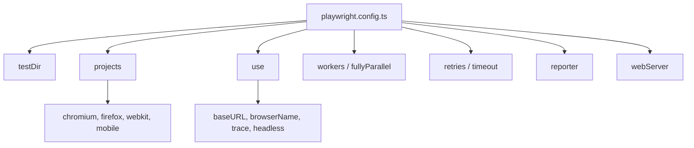

# 🧠 Topic: Playwright Configuration (`playwright.config.ts`)

> [!abstract] Executive Summary (ELI5)
> `playwright.config.ts` is the control panel for your test suite. It tells Playwright where your tests live, which browsers to use, how long to wait, how many tests to run at once, and what to do when a test fails — all in one place so you do not repeat setup in every test file.

---

## 🎯 The "Why"

- **Problem Solved:** Without a central config, every test file would need its own browser launch options, base URL, timeouts, and reporters. The config file removes duplication and makes the suite reproducible across local machines and CI.
- **Alternatives:** You can override many options per test or per file with `test.use()`, `test.describe.configure()`, or environment variables, but the config is the default contract for the whole suite.
- **Trade-offs:** A rich config makes the suite easy to run, but it can hide behavior from someone reading a single test file. Keep project-wide defaults in config and test-specific overrides close to the test.

## 💡 Mental Model & Analogy

- **Analogy:** The config file is like the settings on a washing machine. You pick temperature (browser), spin speed (workers), cycle length (timeout), and detergent (reporter). Individual garments (tests) can still get special treatment, but most loads run on the same default program.
- **Visual/Diagram:**



## 🛠️ Core Principles & Code Snippets

A typical config looks like this:

```typescript
import { defineConfig, devices } from '@playwright/test';

export default defineConfig({
  testDir: './tests',
  timeout: 30_000,
  globalTimeout: 600_000,
  expect: { timeout: 10_000 },

  fullyParallel: true,
  forbidOnly: !!process.env.CI,
  retries: process.env.CI ? 2 : 0,
  workers: process.env.CI ? 1 : undefined,

  reporter: [['html', { open: 'never' }], ['list']],

  use: {
    baseURL: 'http://localhost:3000',
    browserName: 'chromium',
    headless: true,
    trace: 'on-first-retry',
    screenshot: 'only-on-failure',
    video: 'retain-on-failure',
  },

  projects: [
    { name: 'chromium', use: { ...devices['Desktop Chrome'] } },
    { name: 'firefox', use: { ...devices['Desktop Firefox'] } },
    { name: 'webkit', use: { ...devices['Desktop Safari'] } },
  ],

  webServer: {
    command: 'npm run dev',
    url: 'http://localhost:3000',
    reuseExistingServer: !process.env.CI,
    timeout: 120_000,
  },
});
```

### Main Config Properties

| Property | What it controls | Typical value |
|---|---|---|
| `testDir` | Where Playwright looks for `*.spec.ts` files. | `'./tests'` |
| `timeout` | Max milliseconds for a single test. | `30_000` |
| `globalTimeout` | Max milliseconds for the entire test run. | `600_000` |
| `expect.timeout` | How long web-first assertions retry before failing. | `10_000` |
| `fullyParallel` | Run individual tests in parallel, not just files. | `true` |
| `workers` | Number of parallel worker processes. | `undefined` (auto) or `1` on CI |
| `retries` | How many times to rerun failed tests. | `process.env.CI ? 2 : 0` |
| `forbidOnly` | Fail if `.only` is left in code — great for CI. | `!!process.env.CI` |
| `reporter` | How results are rendered/exported. | `'html'`, `'list'`, `'json'`, `'junit'` |
| `use` | Global default options for every test. | `baseURL`, `browserName`, `trace`, etc. |
| `projects` | Browser/environment matrix. | `chromium`, `firefox`, `webkit`, `mobile` |
| `webServer` | Start a dev server before tests. | `{ command, url, reuseExistingServer }` |
| `globalSetup` / `globalTeardown` | Run code once before/after the whole suite. | Path to a setup module |

### Key `use:` Options

- `baseURL` — Makes `page.goto('/')` resolve to the configured origin.
- `browserName` — Default browser: `'chromium'`, `'firefox'`, or `'webkit'`.
- `headless` — Run without a visible browser window.
- `trace` — Save trace files. `'on-first-retry'` is the sweet spot for CI.
- `screenshot` / `video` — Capture artifacts on failure for debugging.
- `storageState` — Load saved cookies/localStorage (common after auth setup).

### Projects Are Your Multi-Browser Matrix

Projects let you reuse the same tests against different contexts without copying files:

```typescript
projects: [
  { name: 'setup', testMatch: /.*\.setup\.ts/ },
  {
    name: 'chromium',
    use: { ...devices['Desktop Chrome'], storageState: 'playwright/.auth/user.json' },
    dependencies: ['setup'],
  },
  {
    name: 'Mobile Safari',
    use: { ...devices['iPhone 13'] },
  },
];
```

> [!tip] Implementation Note
> Prefer `trace: 'on-first-retry'` instead of `'on'` in CI. Traces are large; collecting them only when a test needs a retry keeps artifact storage reasonable while preserving debuggability.

## ⚠️ Pitfalls & Anti-patterns

- **Hard-coding CI behavior:** Avoid `workers: 1` for everyone. Use `process.env.CI` so local runs stay fast.
- **Over-using global setup:** Global setup runs once per worker, not once per test. Prefer fixtures for per-test setup.
- **Leaking `.only` to CI:** Always set `forbidOnly: !!process.env.CI` so skipped suites do not silently pass in production.
- **Confusing timeouts:** `timeout` is per test, `expect.timeout` is per assertion retry loop, and `globalTimeout` caps the whole run. Pick values deliberately.
- **Retainers without quotas:** `trace: 'on'`, `screenshot: 'on'`, and `video: 'on'` can explode artifact size. Use `*-on-failure` or `on-first-retry`.

## 🔗 Deep Connections

- **Parent Topic:** [[Playwright-Overview]] (create when ready)
- **Related Concepts:** [[Playwright Browser Context]] (`storageState` and `projects` are built on top of contexts — see how to create and seed them), [[GitHub Actions — Workflow файлы и CI-CD архитектура]], [[Chromatic — Визуальная регрессия и CI-CD flow]], [[Bootcamp — GitHub Actions + Chromatic]]
- **Prerequisites:** Basic TypeScript, understanding of async/await, familiarity with end-to-end testing goals.

## ❓ Active Recall Questions

> [!faq]- What is the difference between `timeout` and `expect.timeout`?
> `timeout` caps the entire test execution. `expect.timeout` caps how long a web-first assertion retries before giving up.

> [!faq]- When should you use `projects` instead of duplicating test files?
> Use projects when the same tests must run against different browsers, viewports, or environments. The test logic stays identical; only the context changes.

> [!faq]- Why is `forbidOnly` useful on CI?
> A forgotten `test.only` would skip the rest of the suite. `forbidOnly` turns that silent risk into a hard failure.

---

## 📝 Related Notes

- [[Bootcamp — GitHub Actions + Chromatic]]
- [[Chromatic — Визуальная регрессия и CI-CD flow]]
- [[GitHub Actions — Workflow файлы и CI-CD архитектура]]
