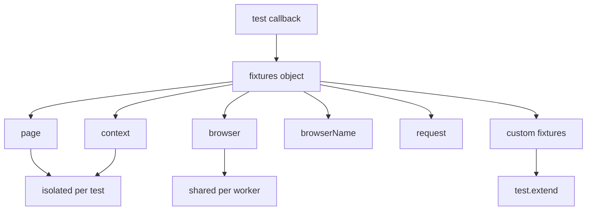

# 🧠 Topic: Playwright Test Object & Fixtures

> [!abstract] Executive Summary (ELI5)
> In Playwright, a test does not create its own browser, page, or HTTP client manually. Instead, Playwright hands the test a bag of ready-made tools called fixtures. The most common ones are `page` and `context`, and you can build your own fixtures to share setup logic across tests.

---

## 🎯 The "Why"

- **Problem Solved:** Manually launching a browser, creating a context, and closing everything in every test creates boilerplate and leaks resources. Fixtures move that plumbing into the framework.
- **Alternatives:** You can use `beforeEach`/`afterEach` hooks, but fixtures are cleaner because they declare dependencies explicitly and handle lifecycle automatically.
- **Trade-offs:** Fixtures add a layer of abstraction. Newcomers sometimes struggle to debug what is "magic" versus what they defined. Custom fixtures also require TypeScript type declarations if you want autocomplete.

## 💡 Mental Model & Analogy

- **Analogy:** Fixtures are like the tools a dentist picks up before treating a patient: the light, mirror, and drill are already sterilized and ready. The dentist does not build the drill every appointment; they just ask for the fixtures they need.
- **Visual/Diagram:**



## 🛠️ Core Principles & Code Snippets

### The Test Function Signature

Every Playwright test receives a single object argument that holds fixtures:

```typescript
import { test, expect } from '@playwright/test';

test('basic test', async ({ page, context, browser, browserName, request }) => {
  await page.goto('/');
  await expect(page).toHaveTitle(/Welcome/);
});
```

You destructure only what you need. Playwright creates the rest lazily.

### Built-in Fixtures

| Fixture | Scope | What it gives you |
|---|---|---|
| `page` | test | An isolated `Page` inside a fresh `BrowserContext`. |
| `context` | test | The isolated `BrowserContext` that owns `page`. |
| `browser` | worker | A shared `Browser` instance for the worker. |
| `browserName` | worker | The current browser project name: `'chromium'`, `'firefox'`, or `'webkit'`. |
| `request` | test | An isolated `APIRequestContext` for API-only testing. |
| `playwright` | worker | The Playwright module instance, useful for advanced API calls. |
| `baseURL` | test | The configured base URL from `use.baseURL`. |

### Test Isolation by Default

Each test gets a fresh `context` and `page`, so tests do not leak cookies, localStorage, or DOM state:

```typescript
import { test } from '@playwright/test';

test('test A', async ({ page }) => {
  await page.goto('/');
  await page.evaluate(() => localStorage.setItem('key', 'A'));
});

test('test B', async ({ page }) => {
  await page.goto('/');
  // localStorage is empty here; page is completely new.
});
```

### Fixture Scopes

- **Test scope (default):** Created and torn down for every test. Use for page, context, request.
- **Worker scope:** Created once per worker process and reused across tests in that worker. Use for expensive setup like authentication state or seeded accounts.

```typescript
import { test as base } from '@playwright/test';

export const test = base.extend<{ myFixture: string }, { workerFixture: string }>({
  // Test-scoped fixture
  myFixture: async ({ page }, use) => {
    await use('value');
  },

  // Worker-scoped fixture
  workerFixture: [async ({ browser }, use) => {
    const value = await expensiveSetup();
    await use(value);
    await cleanup(value);
  }, { scope: 'worker' }],
});
```

### Custom Fixtures with `test.extend`

Extend the base test to inject domain-specific setup:

```typescript
import { test as base, expect } from '@playwright/test';

// Define the shape of your custom fixtures
type MyFixtures = {
  loginPage: LoginPage;
  authenticatedPage: Page;
};

export const test = base.extend<MyFixtures>({
  // Page Object fixture
  loginPage: async ({ page }, use) => {
    await use(new LoginPage(page));
  },

  // Pre-authenticated page fixture
  authenticatedPage: async ({ page }, use) => {
    await page.goto('/login');
    await page.getByLabel('Email').fill('user@example.com');
    await page.getByLabel('Password').fill('secret');
    await page.getByRole('button', { name: 'Sign in' }).click();
    await expect(page.getByText('Dashboard')).toBeVisible();
    await use(page);
  },
});

export { expect } from '@playwright/test';
```

Then consume it in a test:

```typescript
import { test, expect } from '../fixtures';

test('dashboard loads', async ({ authenticatedPage }) => {
  await expect(authenticatedPage.getByRole('heading')).toHaveText('Dashboard');
});
```

### Auto Fixtures

Add `auto: true` to run a fixture for every test without the test explicitly requesting it:

```typescript
export const test = base.extend<{ _cleanup: void }>({
  _cleanup: [async ({}, use) => {
    await use();
    // Runs after every test
    console.log('cleanup after', test.info().title);
  }, { auto: true }],
});
```

> [!tip] Implementation Note
> Keep fixtures focused on one responsibility. A fixture that both seeds the database, logs in, and navigates to a page is hard to reuse. Split them into `dbSeed`, `authenticatedUser`, and `dashboardPage`.

## ⚠️ Pitfalls & Anti-patterns

- **Sharing state across tests:** Do not put shared mutable state in a test-scoped fixture and expect it to survive. Use worker-scoped fixtures or external state stores.
- **Heavy setup in test scope:** Database migrations or browser installs should be worker-scoped, otherwise every test pays the cost.
- **Forgetting cleanup:** Always `await use(value)` first, then run teardown code after it. Code before `use` is setup; code after is teardown.
- **Circular fixture dependencies:** Playwright detects these and throws. Design fixtures as a DAG.
- **Ignoring TypeScript types:** Without declaring fixture types, you lose autocomplete and compile-time checks for custom fixtures.

## 🔗 Deep Connections

- **Parent Topic:** [[Playwright-Configuration]]
- **Related Concepts:** [[Playwright-CLI-Commands]], [[Playwright Browser Context]] (the full `Browser` → `BrowserContext` → `Page` hierarchy, popups, multi-tab scenarios), [[Page Object Model]] (create when ready)
- **Prerequisites:** Understanding of async/await, basic Playwright test structure.

## ❓ Active Recall Questions

> [!faq]- Why is `page` isolated per test but `browser` shared per worker?
> Creating a new browser is expensive. Playwright reuses one `Browser` process and gives each test a fresh, cheap `BrowserContext` inside it. Contexts are fully isolated at the browser level.

> [!faq]- When should you use a worker-scoped fixture?
> Use worker scope for setup that is slow and safe to share across tests in the same worker, such as authentication state or seeded test accounts.

> [!faq]- What does `auto: true` do in a fixture?
> It makes the fixture run automatically for every test, even if the test does not destructure it. Useful for setup/cleanup hooks.

---

## 📝 Related Notes

- [[Playwright-Configuration]]
- [[Playwright-CLI-Commands]]
- [[Playwright Browser Context]]
- [[GitHub Actions — Workflow файлы и CI-CD архитектура]]
