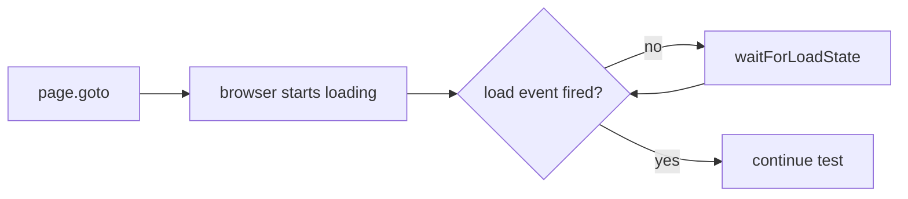

# 🧠 Topic: Waiting for Load State

> [!abstract] Executive Summary (ELI5)
> Browsers fire events when a page finishes loading. Playwright's `waitForLoadState` lets your test pause until a specific load event has fired, so you do not interact with a page that is still building itself.

---

## 🎯 The "Why"

- **Problem Solved:** Tests can fail if they run assertions or actions before the page is ready. Waiting for a load state prevents race conditions caused by scripts, styles, or data still being fetched.
- **Alternatives:** You can wait for a specific element with `locator.waitFor()`, wait for a URL with `page.waitForURL()`, or rely on auto-waiting built into actions and assertions.
- **Trade-offs:** `waitForLoadState` is a blunt tool. It guarantees a global page condition but does not prove that the specific UI you care about is ready. Prefer locator-level or assertion-level waiting when possible.

## 💡 Mental Model & Analogy

- **Analogy:** Waiting for a load state is like waiting for a restaurant to finish its morning setup before you order. You know the doors are open and the kitchen is ready, but you still have to wait for your specific dish to arrive. The load state tells you the restaurant is operational; the locator tells you your dish is on the table.
- **Visual/Diagram:**



## 🛠️ Core Principles & Code Snippets

### `page.waitForLoadState`

```typescript
import { test, expect } from '@playwright/test';

test('page load events', async ({ page }) => {
  await page.goto('/dashboard');

  // Wait until the DOM is parsed and ready
  await page.waitForLoadState('domcontentloaded');

  // Wait until the full page and resources are loaded
  await page.waitForLoadState('load');

  // Wait until there are no network connections for at least 500 ms
  await page.waitForLoadState('networkidle');
});
```

### Load State Options

| State | Meaning | When to use |
|-------|---------|-------------|
| `load` | `load` event fired: the whole page and its resources are loaded. | Default, safe general-purpose wait. |
| `domcontentloaded` | `DOMContentLoaded` event fired: the HTML is parsed and DOM is ready. | When you need to interact with static markup quickly. |
| `networkidle` | No network requests for ~500 ms. | When you want to wait for background API calls to finish. |

### Default Auto-Waiting on Navigation

Many actions already wait for `load` automatically.

```typescript
await page.goto('/dashboard'); // waits for load by default
await page.click('a'); // waits for the navigation to finish before returning
await page.reload(); // waits for load by default
```

You usually do not need explicit `waitForLoadState` after `page.goto` because `goto` already waits for `load`.

### Waiting for a Specific URL

```typescript
await page.goto('/login');
await page.getByRole('button', { name: 'Sign in' }).click();

// Wait until the navigation to /dashboard completes
await page.waitForURL('/dashboard');
await expect(page).toHaveURL('/dashboard');
```

### Waiting for a Specific Element

This is usually more meaningful than waiting for a global load state.

```typescript
// Wait until the chart appears, then assert
await page.getByTestId('revenue-chart').waitFor();
await expect(page.getByTestId('revenue-chart')).toBeVisible();

// Wait for an element with options
await page.locator('.toast').waitFor({ state: 'hidden', timeout: 10_000 });
```

### Waiting for a Network Response

```typescript
const responsePromise = page.waitForResponse('**/api/user');
await page.getByRole('button', { name: 'Load profile' }).click();
const response = await responsePromise;
expect(response.ok()).toBe(true);
```

> [!tip] Implementation Note
> Treat `networkidle` as a last resort. Modern single-page apps keep connections alive for analytics, websockets, or long-polling, so `networkidle` may never fire. Wait for a specific request or element instead.

## ⚠️ Pitfalls & Anti-patterns

- **Using `networkidle` by default:** It is unreliable in SPAs and can make tests slow or flaky. Prefer `waitForResponse` or `locator.waitFor`.
- **Waiting for `load` before every action:** Most actions already auto-wait. Extra `waitForLoadState` calls add time without adding stability.
- **Waiting for a state instead of waiting for the condition you care about:** Just because the page is loaded does not mean your data is rendered. A web-first assertion like `toHaveText` is usually better.
- **Forgetting the timeout:** `waitForLoadState` uses the default navigation timeout. If you need a different timeout, pass it explicitly: `{ timeout: 30_000 }`.
- **Combining multiple wait states unnecessarily:** Each call adds delay. Choose the one that matches the actual readiness condition you need.

## 🔗 Deep Connections

- **Parent Topic:** [[Playwright-Test-Object-and-Fixtures]]
- **Related Concepts:** [[Playwright Locators]], [[Playwright-Assertions]], [[Playwright-Configuration]]
- **Prerequisites:** Navigation, page lifecycle, async/await.

## ❓ Active Recall Questions

> [!faq]- What is the difference between `load` and `domcontentloaded`?
> `load` waits for the entire page and its resources (images, styles, scripts) to finish. `domcontentloaded` waits only until the HTML is parsed and the DOM is ready.

> [!faq]- When should you avoid `networkidle`?
> Avoid it in single-page applications that keep background connections alive. Use `waitForResponse` or wait for a specific element instead.

> [!faq]- Does `page.goto` require a separate `waitForLoadState`?
> Usually no. `page.goto` waits for the `load` event by default, so an explicit wait is redundant unless you need `domcontentloaded` or `networkidle` specifically.

> [!faq]- What is usually better than waiting for a global page state?
> Waiting for the specific locator or condition you care about, such as `locator.waitFor()` or a web-first assertion like `toHaveText`.

> [!faq]- How do you wait for a specific API call to finish?
> Use `page.waitForResponse('**/api/endpoint')` and await the promise around the action that triggers the request.

---

## 📝 Related Notes

- [[Playwright-Test-Object-and-Fixtures]]
- [[Playwright Locators]]
- [[Playwright-Assertions]]
- [[Playwright-Configuration]]
