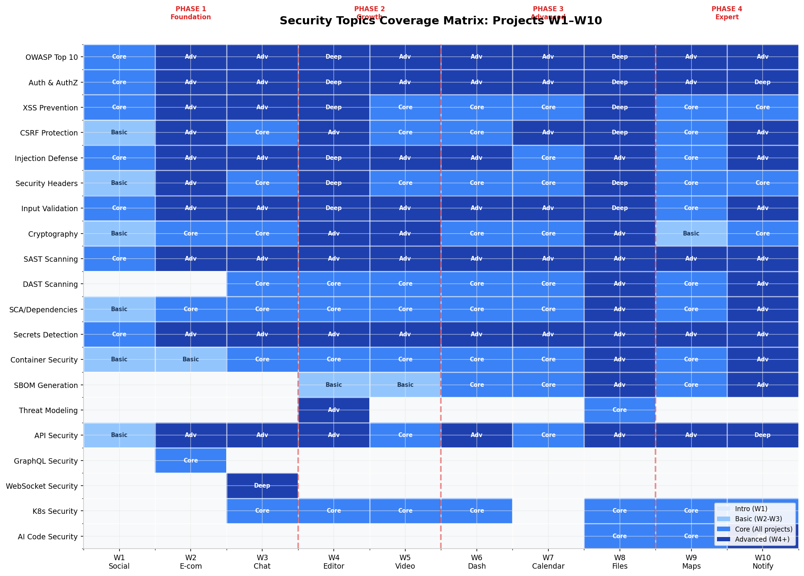
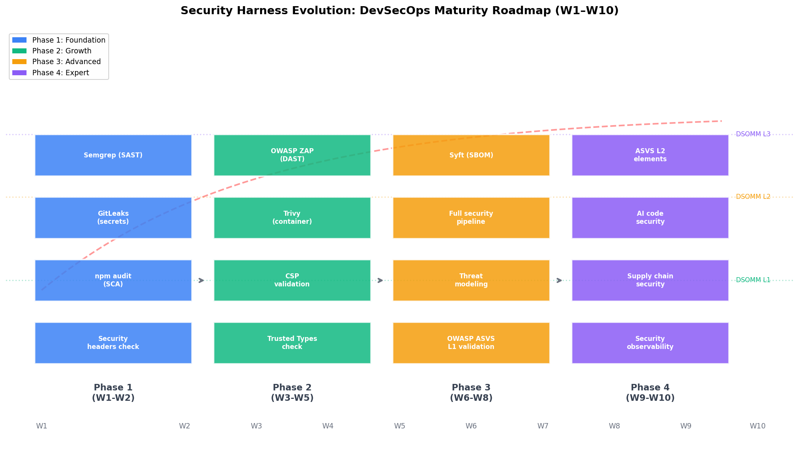

# Security Harness для Fullstack AI-разработки: Roadmap W1–W10

## TL;DR

Для 10-проектного fullstack-курса на GitHub Actions с free-tier инструментами рекомендуется **четырёхфазная эволюция security harness**. **Phase 1 (W1–W2)** — SAST (Semgrep) + secrets detection (GitLeaks) + SCA (npm audit) + security headers check. **Phase 2 (W3–W5)** — добавляем DAST (OWASP ZAP), container scanning (Trivy), CSP и Trusted Types validation. **Phase 3 (W6–W8)** — full security pipeline: SBOM (Syft), threat modeling (STRIDE), OWASP ASVS Level 1 validation. **Phase 4 (W9–W10)** — ASVS Level 2 элементы, AI-generated code security checks, supply chain security, security observability. Ключевой принцип: **"Не добавлять security без причины"** — каждая новая проверка появляется, когда проект вырастает из предыдущего уровня защиты. Все инструменты — **open-source/free tier**, совместимы с GitHub Actions и не требуют лицензионных затрат.

---

## 1. Security-топики для Senior/Staff Fullstack-интервью

### 1.1. Какие security-темы спрашивают на интервью

На основе анализа собеседований Senior и Staff уровня в компаниях Meta, Google, Netflix, Amazon, а также данных из  [(Source)](https://www.tryexponent.com/blog/security-engineer-interview-prep) ,  [(Source)](https://www.techinterview.org/post/3233474144/system-design-web-security-owasp-xss-csrf-sql-injection-cors-csp-authentication-authorization-jwt-oauth/)  и  [(Source)](https://trent.ai/blog/stride-threat-model/) , выделяем **топ-20 security-тем**, которые необходимо знать fullstack-разработчику в 2026 году. Этот список отражает не теоретические пожелания, а реальные вопросы, которые задают на system design и coding раундах.

| # | Тема | Частота на интервью | Уровень | Ключевые подтемы |
|---|------|:---:|:---:|---|
| 1 | **OWASP Top 10 2025** | ★★★★★ | Middle+ | Broken Access Control (#1), Security Misconfiguration (#2), Supply Chain (#3), Injection (#5)  [(Source)](https://owasp.org/Top10/2025/0x00_2025-Introduction/)  |
| 2 | **Authentication & Authorization** | ★★★★★ | Middle+ | JWT vs Sessions, OAuth 2.0/OIDC, RBAC/ABAC, MFA, passkeys/WebAuthn  [(Source)](https://medium.com/@shivanimutke2501/day-41-system-design-concept-authorization-and-authentication-technique-4f6bd21cc40e)  |
| 3 | **XSS Prevention** | ★★★★★ | Middle+ | Output encoding, CSP, Trusted Types, DOM XSS vs Reflected XSS  [(Source)](https://cheatsheetseries.owasp.org/cheatsheets/Cross_Site_Scripting_Prevention_Cheat_Sheet.html)  |
| 4 | **CSRF Protection** | ★★★★☆ | Middle | Tokens, SameSite cookies, double-submit pattern  [(Source)](https://www.smhuda.com/blog/appsec-interview-prep)  |
| 5 | **Injection Attacks** | ★★★★★ | Middle+ | SQL/NoSQL injection, parameterized queries, ORM security  [(Source)](https://www.techinterview.org/post/3233474144/system-design-web-security-owasp-xss-csrf-sql-injection-cors-csp-authentication-authorization-jwt-oauth/)  |
| 6 | **Security Headers** | ★★★★☆ | Middle | HSTS, CSP, X-Frame-Options, X-Content-Type-Options, Referrer-Policy  [(Source)](https://aiqamonkey.com/blog/security-headers-guide.php)  |
| 7 | **Input Validation & Output Encoding** | ★★★★★ | Middle | Schema validation, sanitization, allowlist vs blocklist  [(Source)](https://www.aikido.dev/learn/compliance/compliance-frameworks/owasp-asvs)  |
| 8 | **Cryptography Basics** | ★★★★☆ | Senior | Hashing (bcrypt/Argon2), encryption at rest/transit, TLS 1.3, key management  [(Source)](https://reintech.io/blog/owasp-top-10-2025-what-changed-and-how-to-address-each-vulnerability)  |
| 9 | **Session Management** | ★★★★☆ | Middle | Secure cookies (HttpOnly, Secure, SameSite), session fixation, timeout  [(Source)](https://reintech.io/blog/owasp-top-10-2025-what-changed-and-how-to-address-each-vulnerability)  |
| 10 | **API Security** | ★★★★★ | Senior+ | Rate limiting, BOLA/IDOR, input validation, auth at gateway + service level  [(Source)](https://zuplo.com/learning-center/owasp-cheat-sheet-guide)  |
| 11 | **GraphQL Security** | ★★★☆☆ | Senior | Depth limiting, complexity analysis, introspection, field-level auth  [(Source)](https://www.apisec.ai/blog/graphql-security-testing-guide)  |
| 12 | **WebSocket Security** | ★★★☆☆ | Senior | Auth during handshake, origin validation, message validation, rate limiting  [(Source)](https://websocket.org/guides/security/)  |
| 13 | **Container Security** | ★★★★☆ | Senior+ | Non-root, read-only FS, distroless, capability dropping, image scanning  [(Source)](https://eastondev.com/blog/en/posts/dev/20251218-docker-security-nonroot/)  |
| 14 | **Kubernetes Security** | ★★★☆☆ | Staff | RBAC, NetworkPolicy, Pod Security Standards, secrets management  [(Source)](https://medium.com/@ramesh.thangaraj/owasp-top-10-best-practices-to-follow-in-kubernetes-de5a5570ed26)  |
| 15 | **Microservices Security** | ★★★★☆ | Staff | mTLS, service mesh, zero trust, service-to-service auth  [(Source)](https://konghq.com/blog/engineering/10-ways-microservices-create-new-security-challenges)  |
| 16 | **Threat Modeling (STRIDE)** | ★★★☆☆ | Staff | Spoofing, Tampering, Repudiation, Info Disclosure, DoS, Elevation  [(Source)](https://trent.ai/blog/stride-threat-model/)  |
| 17 | **DevSecOps & CI/CD Security** | ★★★★☆ | Senior+ | SAST, DAST, SCA, secrets scanning, security gates  [(Source)](https://www.getastra.com/blog/dast/integrating-dast-in-devops-workflow/)  |
| 18 | **Supply Chain Security** | ★★★★☆ | Senior+ | SBOM, dependency scanning, provenance, signing  [(Source)](https://appsecsanta.com/sca-tools/sbom-tools-comparison)  |
| 19 | **AI-Generated Code Security** | ★★★☆☆ | Senior+ | OWASP LLM Top 10, slopsquatting, prompt injection risks  [(Source)](https://cycode.com/blog/ai-security-vulnerabilities/)  |
| 20 | **Security Observability** | ★★★☆☆ | Staff | Security logging, audit trails, anomaly detection, incident response  [(Source)](https://www.wiz.io/academy/application-security/devsecops-maturity-model-dsomm)  |

### 1.2. Как темы привязаны к грейдам

На основе анализа требований к Middle, Senior и Staff инженерам  [(Source)](https://www.tryexponent.com/blog/security-engineer-interview-prep) , security-компетенции распределяются по уровням следующим образом. Это распределение определяет, на каком проекте какую глубину знаний ожидать от студента.

**Middle (3-5 лет):** Фундаментальная безопасность — OWASP Top 10, XSS/CSRF prevention, input validation, secure cookies, basic authentication (JWT), security headers, parameterized queries. Это **минимальный набор**, без которого нельзя выпускать fullstack-разработчика.

**Senior (6-10 лет):** Архитектурная безопасность — threat modeling basics, OAuth 2.0/OIDC implementation, RBAC/ABAC design, API security (rate limiting, BOLA), container security, CI/CD security integration, cryptography decisions (когда хешировать, когда шифровать), CSP/Trusted Types implementation.

**Staff (10+ лет):** Платформенная безопасность — zero trust architecture, service mesh security, supply chain security (SBOM, SLSA), security governance, incident response planning, security observability at scale, AI-generated code risk management, threat modeling as practice.

---

## 2. Матрица: Security-топики × Проекты (W1–W10)

### 2.1. Принцип покрытия

Каждый security-топик вносится в проект не абстрактно, а через **конкретную feature или уязвимость**, которую нужно закрыть. Например, XSS prevention в W1 — это защита от XSS в пользовательских постах социальной ленты; CSP в W4 — это strict CSP для collaborative editor с user-generated content.



### 2.2. Детальная матрица по проектам

| Security-топик | W1 Social | W2 E-com | W3 Chat | W4 Editor | W5 Video | W6 Dash | W7 Calendar | W8 Files | W9 Maps | W10 Notify |
|:---|:---:|:---:|:---:|:---:|:---:|:---:|:---:|:---:|:---:|:---:|
| **OWASP Top 10 awareness** | Core | Core | Core | Deep | Core | Core | Core | Deep | Core | Core |
| **Auth & AuthZ (JWT/OAuth)** | Core | Core | Core | Deep | Core | Core | Core | Deep | Core | Deep |
| **XSS Prevention** | Core | Core | Core | Deep | Core | Core | Core | Deep | Core | Core |
| **CSRF Protection** | Basic | Core | Core | Adv | Core | Core | Adv | Deep | Core | Adv |
| **Injection Defense** | Core | Core | Core | Deep | Core | Core | Core | Adv | Core | Adv |
| **Security Headers** | Basic | Core | Core | Deep | Core | Core | Core | Deep | Core | Core |
| **Input Validation** | Core | Core | Core | Deep | Core | Core | Core | Deep | Core | Adv |
| **Cryptography** | Basic | Core | Core | Adv | Adv | Core | Core | Adv | Basic | Core |
| **API Security** | Basic | Adv | Adv | Adv | Core | Adv | Core | Adv | Adv | Deep |
| **GraphQL Security** | — | Core | — | — | — | — | — | — | — | — |
| **WebSocket Security** | — | — | Deep | — | — | — | — | — | — | — |
| **Container Security** | Basic | Basic | Core | Core | Core | Core | Core | Adv | Core | Adv |
| **K8s Security** | — | — | Core | Core | Core | Core | — | Core | Core | Core |
| **Threat Modeling (STRIDE)** | — | — | — | Adv | — | — | — | Core | — | — |
| **SAST (Semgrep)** | Core | Core | Core | Core | Core | Core | Core | Core | Core | Core |
| **DAST (ZAP)** | — | — | Core | Core | Core | Core | Core | Adv | Core | Adv |
| **SCA (npm audit/Trivy)** | Basic | Core | Core | Core | Core | Core | Core | Adv | Core | Adv |
| **Secrets Detection** | Core | Core | Core | Core | Core | Core | Core | Core | Core | Core |
| **SBOM Generation** | — | — | — | Basic | Basic | Core | Core | Adv | Core | Adv |
| **AI Code Security** | — | — | — | — | — | — | — | Core | Core | Adv |

*Legenda: Basic = первое знакомство, Core = глубокое изучение, Adv = advanced применение, Deep = комплексная защита, — = не применимо*

### 2.3. Обоснование покрытия по ключевым проектам

**W1 Social Feed** — первый проект, security на уровне **осознанности**. Студент знакомится с OWASP Top 10, учится валидировать input для постов, защищать от XSS в user-generated content, настраивать базовые security headers. CI pipeline включает Semgrep и GitLeaks — минимальный набор для привычки "security check на каждый PR".

**W2 E-commerce** — security становится **критичным**. Checkout flow требует CSP для защиты payment forms, CSRF для cart operations, Trusted Types для предотвращения DOM XSS в checkout. GraphQL API требует depth limiting и complexity analysis для защиты от resource exhaustion. Первый проект, где security напрямую влияет на бизнес-логику.

**W3 Chat** — первый проект с **WebSocket** и реальным real-time. WebSocket security: аутентификация при handshake, валидация origin, rate limiting сообщений, санитизация входящих сообщений от XSS. Микрофронтенды через Module Federation требуют изоляции и контрактов безопасности.

**W4 Collaborative Editor** — **security-first проект**. CRDT-редактор с user-generated content = максимальная поверхность атаки XSS. Trusted Types — обязательны. Strict CSP — обязателен. Feature flags для gradual rollout security features. Первый проект с формальным threat modeling (STRIDE).

**W8 File Manager** — второй **security-first проект**. File upload security: валидация по magic numbers (не расширению!), sandboxed preview через iframe, CSP strict mode. CSRF для upload/delete операций. Offline-first архитектура требует защиты Service Worker от подделки.

**W10 Notifications** — **капстоун** с полным security pipeline. Микрофронтенды, BroadcastChannel для cross-tab sync (секьюрити импликации), multi-channel delivery с разными security требованиями. Полный DevSecOps pipeline со всеми проверками.

---

## 3. Таблица ранжирования: Security-проверки в CI/CD

### 3.1. Полная таблица ранжирования

| # | Проверка | Инструмент | Стадия CI | Критичность | W1 | W2 | W3 | W4 | W5 | W6 | W7 | W8 | W9 | W10 |
|:---:|---|---|:---:|:---:|:---:|:---:|:---:|:---:|:---:|:---:|:---:|:---:|:---:|:---:|
| 1 | **SAST** | Semgrep CE | Build | **Must** | ✅ | ✅ | ✅ | ✅ | ✅ | ✅ | ✅ | ✅ | ✅ | ✅ |
| 2 | **Secrets Detection** | GitLeaks | Pre-commit + Build | **Must** | ✅ | ✅ | ✅ | ✅ | ✅ | ✅ | ✅ | ✅ | ✅ | ✅ |
| 3 | **SCA / Dependencies** | npm audit + Trivy | Build | **Must** | ✅ | ✅ | ✅ | ✅ | ✅ | ✅ | ✅ | ✅ | ✅ | ✅ |
| 4 | **Security Headers** | Custom script/helmet | Test | **Must** | ✅ | ✅ | ✅ | ✅ | ✅ | ✅ | ✅ | ✅ | ✅ | ✅ |
| 5 | **Input Validation Lint** | Custom ESLint rules | Build | **Must** | ✅ | ✅ | ✅ | ✅ | ✅ | ✅ | ✅ | ✅ | ✅ | ✅ |
| 6 | **Container Scanning** | Trivy | Build | **Must** | — | — | ✅ | ✅ | ✅ | ✅ | ✅ | ✅ | ✅ | ✅ |
| 7 | **DAST** | OWASP ZAP | Deploy (staging) | **Should** | — | — | ✅ | ✅ | ✅ | ✅ | ✅ | ✅ | ✅ | ✅ |
| 8 | **CSP Validation** | csp-evaluator | Test | **Should** | — | ✅ | ✅ | ✅ | — | — | — | ✅ | — | — |
| 9 | **Trusted Types Check** | Custom linter | Build | **Should** | — | — | — | ✅ | — | — | — | ✅ | — | — |
| 10 | **SBOM Generation** | Syft | Build | **Should** | — | — | — | ✅ | ✅ | ✅ | ✅ | ✅ | ✅ | ✅ |
| 11 | **CodeQL** | GitHub CodeQL | Build | **May** | — | — | ✅ | ✅ | ✅ | ✅ | ✅ | ✅ | ✅ | ✅ |
| 12 | **Fuzzing** | CI Fuzz CLI | Test | **May** | — | — | — | — | — | — | — | ✅ | — | — |
| 13 | **Threat Model Check** | STRIDE checklist | Design | **May** | — | — | — | ✅ | — | — | — | ✅ | — | — |
| 14 | **OWASP ASVS L1** | ASVS checklist | Test | **May** | — | — | — | — | — | ✅ | ✅ | ✅ | ✅ | ✅ |
| 15 | **OWASP ASVS L2** | ASVS checklist | Test | **May** | — | — | — | — | — | — | — | — | — | ✅ |
| 16 | **K8s Security Scan** | Trivy/Kube-bench | Deploy | **Should** | — | — | ✅ | ✅ | ✅ | ✅ | — | ✅ | ✅ | ✅ |
| 17 | **AI Code Security** | Custom rules | Build | **May** | — | — | — | — | — | — | — | ✅ | ✅ | ✅ |

### 3.2. Обоснование ранжирования

**Must-проверки** — это минимальный набор, без которого код не должен попадать в main ни в одном проекте. Semgrep (SAST) находит OWASP Top 10 уязвимости в коде на этапе сборки, GitLeaks предотвращает утечку секретов, npm audit + Trivy сканируют зависимости на известные CVE, security headers check валидирует ответы сервера. Эти четыре проверки формируют **Level 1 DevSecOps** по модели DSOMM  [(Source)](https://cloudaware.com/blog/devsecops-maturity-model/)  и обеспечивают базовую защиту без каких-либо затрат.

**Should-проверки** добавляются, когда проект вырастает из базового уровня. DAST через OWASP ZAP необходим для WebSocket-проектов (W3) и проектов с file upload (W8), потому что только runtime-тестирование находит уязвимости, видимые извне. CSP и Trusted Types validation — must-have для security-first проектов (W2, W4, W8). SBOM generation требуется для всех проектов с контейнеризацией начиная с W4, поскольку это основа supply chain security  [(Source)](https://appsecsanta.com/sca-tools/sbom-tools-comparison) .

**May-проверки** — продвинутые практики для Staff-уровня. CodeQL от GitHub (бесплатен для публичных репо) предоставляет semantic analysis, но требует больше времени на исполнение  [(Source)](https://github.com/PMDevSolutions/Nerva/issues/13) . Fuzzing через CI Fuzz CLI находит edge-case уязвимости, но сложен в настройке  [(Source)](https://owasp.org/www-community/Free_for_Open_Source_Application_Security_Tools) . Threat modeling и ASVS validation — процессы, а не автоматические проверки, они формализуют security-мышление.

---

## 4. Эволюция Security Harness по фазам



### 4.1. Phase 1: Foundation (W1–W2) — DSOMM Level 1

**Цель:** Сформировать привычку "security на каждый PR" с минимальным набором инструментов.

| Компонент | Инструмент | Что проверяет | Когда запускается |
|---|---|---|---|
| SAST | Semgrep CE | OWASP Top 10 patterns, XSS sinks, SQL injection | На каждый PR |
| Secrets Detection | GitLeaks | API keys, tokens, passwords в коде | Pre-commit + PR |
| SCA | npm audit | Известные CVE в npm-зависимостях | На каждый PR |
| Security Headers | helmet.js + custom check | HSTS, CSP, X-Frame-Options, etc. | E2E тесты |
| Input Validation | Custom ESLint rules | Отсутствие input validation, dangerouslySetInnerHTML | На каждый PR |

**Почему именно эти инструменты:** Semgrep CE — единственный SAST-инструмент с бесплатной версией, который поддерживает 40+ языков, запускается за секунды и имеет 3000+ community rules  [(Source)](https://appsecsanta.com/semgrep) . GitLeaks — single binary, 25.9k GitHub stars, интеграция с pre-commit и GitHub Actions  [(Source)](https://appsecsanta.com/gitleaks) . npm audit — встроен в Node.js, zero config. Helmet — middleware для Express/Next.js, 9.2M weekly downloads на npm.

**Обучающая ценность Phase 1:** Студент видит, как security-чеки блокируют PR с уязвимостями. Учится читать отчёты Semgrep и npm audit. Понимает, почему `dangerouslySetInnerHTML` — красный флаг. Формируется **security mindset**: "Мой код проверяется на безопасность автоматически, и это норма".

### 4.2. Phase 2: Growth (W3–W5) — DSOMM Level 2

**Цель:** Добавить runtime-проверки и защиту специфичных поверхностей атаки.

| Компонент | Инструмент | Что проверяет | Когда запускается |
|---|---|---|---|
| DAST | OWASP ZAP | XSS, SQLi, CSRF, misconfigurations в runtime | Deploy на staging |
| Container Scan | Trivy | CVE в Docker image, OS packages | Build |
| CSP Validation | csp-evaluator.withgoogle.com | Синтаксис и строгость CSP политики | Test |
| Trusted Types | Custom linter + tt.polifyfill | Использование Trusted Types API | Build |
| WebSocket Security | Custom checks | Origin validation, auth handshake, message validation | E2E tests |

**Почему добавляем DAST:** SAST находит уязвимости в коде, но не проверяет runtime-конфигурацию. OWASP ZAP — единственный полнофункциональный DAST-инструмент с нулевой стоимостью, имеет CLI и Docker-образ для CI  [(Source)](https://www.msppentesting.com/blog-posts/web-application-security-testing-tools) . Для WebSocket-проекта (W3) DAST критичен, потому что WebSocket endpoint не виден статическому анализу.

**Почему Trusted Types на W4:** Collaborative editor — проект с максимальным риском DOM XSS: пользователи вводят rich text, который рендерится в браузере. Trusted Types API — единственный механизм, который **полностью устраняет** класс DOM XSS, а не просто смягчает  [(Source)](https://cheatsheetseries.owasp.org/cheatsheets/Cross_Site_Scripting_Prevention_Cheat_Sheet.html) . Это must-know для Senior frontend-инженера.

### 4.3. Phase 3: Advanced (W6–W8) — DSOMM Level 3

**Цель:** Внедрить supply chain security, threat modeling и формальную верификацию.

| Компонент | Инструмент | Что проверяет | Когда запускается |
|---|---|---|---|
| SBOM Generation | Syft | Software Bill of Materials (CycloneDX/SPDX) | Build + Release |
| Full Security Pipeline | Semgrep + ZAP + Trivy + GitLeaks | Все проверки в едином workflow | На каждый PR + deploy |
| Threat Modeling | STRIDE checklist | Systematic threat enumeration | Design phase |
| OWASP ASVS L1 | ASVS checklist (350 requirements) | Verification of security controls | Pre-release |
| K8s Security | Trivy/Kube-bench | RBAC, NetworkPolicy, Pod Security | Deploy |

**Почему SBOM:** Supply chain attacks стали #3 в OWASP Top 10 2025  [(Source)](https://owasp.org/Top10/2025/0x00_2025-Introduction/) . Syft генерирует SBOM за секунды, поддерживает CycloneDX и SPDX, интегрируется через GitHub Action  [(Source)](https://appsecsanta.com/sca-tools/sbom-tools-comparison) . Для проектов W6-W8 (dashboard, calendar, file manager) SBOM — основа visibility в зависимостях.

**Почему Threat Modeling:** На W4 (collaborative editor) и W8 (file manager) security-first архитектура требует систематического подхода к поиску угроз. STRIDE — фреймворк Microsoft, ставший индустриальным стандартом  [(Source)](https://trent.ai/blog/stride-threat-model/) . На интервью Staff-уровня кандидата часто просят провести threat modeling для системы — это **must-have skill**.

### 4.4. Phase 4: Expert (W9–W10) — DSOMM Level 4

**Цель:** Полный DevSecOps с AI-code security и платформенной безопасностью.

| Компонент | Инструмент | Что проверяет | Когда запускается |
|---|---|---|---|
| AI Code Security | Custom Semgrep rules | Slopsquatting, insecure AI patterns, missing input validation | Build |
| Supply Chain Security | Syft + SLSA provenance | Artifact signing, build provenance | Build |
| OWASP ASVS L2 | ASVS checklist | Advanced verification requirements | Pre-release |
| Security Observability | Custom metrics | Security event logging, failed auth, rate limit hits | Runtime |
| Full Pipeline Integration | Все инструменты в unified workflow | Comprehensive coverage | Every PR + deploy |

**Почему AI Code Security:** 40-62% AI-generated кода содержит security-уязвимости  [(Source)](https://sqmagazine.co.uk/ai-coding-security-vulnerability-statistics/) . Студенты используют AI-агентов для генерации кода — harness должен проверять output на типичные AI-уязвимости: отсутствие input validation, небезопасные зависимости, slopsquatting (hallucinated packages)  [(Source)](https://www.kusari.dev/blog/ai-coding-assistants-in-2026-4x-faster-10x-riskier-the-hidden-security-cost) .

---

## 5. Security-as-Code: Спецификация для Harness

### 5.1. Принцип формализации

Security-as-Code означает, что security-требования записываются в machine-readable формате, который AI-агент может читать, проверять и обновлять. Это не просто документация — это **исполняемый контракт** между security-спецификацией и реализацией.

На основе анализа опыта OpenAI  [(Source)](https://blog.detectify.com/industry-insights/understanding-the-owasp-top-10-2025-for-modern-application-security/)  и best practices GitHub/GitLab  [(Source)](https://github.com/aws-actions/configure-aws-credentials) , оптимальный формат — **YAML с переменными подстановки**, который агент читает при старте и обновляет при завершении feature.

### 5.2. Спецификация security-harness

```yaml
spec_version: "1.0"
domain: "security-harness"
purpose: "Security checks and validation for AI-generated fullstack projects"

# ─────────────────────────────────────────────
# LAYER 1: Security Requirements (Must/Should/May)
# ─────────────────────────────────────────────
requirements:
  must:
    - id: SEC-M-001
      name: "SAST scan on every PR"
      tool: "semgrep"
      rule_set: "p/owasp-top-ten"
      block_on: ["ERROR", "WARNING"]
      run_on: ["pull_request", "push_main"]
      
    - id: SEC-M-002
      name: "Secrets detection pre-commit"
      tool: "gitleaks"
      mode: ["pre-commit", "ci"]
      block_on: ["findings"]
      
    - id: SEC-M-003
      name: "Dependency vulnerability scan"
      tool: "npm-audit"
      severity_threshold: "moderate"
      auto_fix: true
      
    - id: SEC-M-004
      name: "Security headers validation"
      tool: "custom-script"
      headers:
        - "Strict-Transport-Security"
        - "X-Content-Type-Options: nosniff"
        - "X-Frame-Options"
        - "Referrer-Policy"
      
    - id: SEC-M-005
      name: "Input validation lint"
      tool: "eslint-custom"
      rules:
        - "no-dangerously-set-inner-html"
        - "require-input-validation"
        - "no-eval"

  should:
    - id: SEC-S-001
      name: "DAST scan on staging"
      tool: "owasp-zap"
      target: "${STAGING_URL}"
      scan_type: "baseline"
      run_on: ["deploy_staging"]
      
    - id: SEC-S-002
      name: "Container image scan"
      tool: "trivy"
      scan_targets: ["os", "libraries"]
      severity: ["HIGH", "CRITICAL"]
      
    - id: SEC-S-003
      name: "CSP validation"
      tool: "csp-evaluator"
      policy_source: "headers"
      
    - id: SEC-S-004
      name: "SBOM generation"
      tool: "syft"
      formats: ["cyclonedx-json", "spdx-json"]
      attach_to_release: true

  may:
    - id: SEC-A-001
      name: "CodeQL semantic analysis"
      tool: "github-codeql"
      languages: ["javascript", "typescript"]
      
    - id: SEC-A-002
      name: "Threat modeling checklist"
      tool: "stride-checklist"
      run_on: ["design_review"]
      
    - id: SEC-A-003
      name: "OWASP ASVS validation"
      level: 1
      tool: "asvs-checklist"

# ─────────────────────────────────────────────
# LAYER 2: Project-Specific Security Profiles
# ─────────────────────────────────────────────
project_profiles:
  w1_social_feed:
    phase: 1
    dsomm_level: 1
    requirements:
      must: [SEC-M-001, SEC-M-002, SEC-M-003, SEC-M-004, SEC-M-005]
      should: []
      may: []
    security_focus:
      - "XSS prevention in user posts"
      - "Input validation for post content"
      - "Rate limiting for API endpoints"
    interview_topics:
      - "OWASP Top 10 basics"
      - "XSS types and prevention"
      - "JWT authentication"

  w2_ecommerce:
    phase: 1
    dsomm_level: 1
    requirements:
      must: [SEC-M-001, SEC-M-002, SEC-M-003, SEC-M-004, SEC-M-005]
      should: [SEC-S-003]
      may: []
    security_focus:
      - "CSP for checkout flow"
      - "CSRF protection for cart"
      - "GraphQL depth limiting"
      - "Input validation for checkout"
    interview_topics:
      - "CSP configuration"
      - "CSRF tokens vs SameSite cookies"
      - "GraphQL security"

  w3_chat:
    phase: 2
    dsomm_level: 2
    requirements:
      must: [SEC-M-001, SEC-M-002, SEC-M-003, SEC-M-004, SEC-M-005]
      should: [SEC-S-001, SEC-S-002]
      may: []
    security_focus:
      - "WebSocket authentication"
      - "Message validation and sanitization"
      - "Origin validation"
      - "Rate limiting per connection"
    interview_topics:
      - "WebSocket security"
      - "Real-time app authentication"
      - "Micro-frontend isolation"

  w4_editor:
    phase: 2
    dsomm_level: 2
    requirements:
      must: [SEC-M-001, SEC-M-002, SEC-M-003, SEC-M-004, SEC-M-005]
      should: [SEC-S-001, SEC-S-002, SEC-S-003]
      may: [SEC-A-002]
    security_focus:
      - "Trusted Types enforcement"
      - "Strict CSP for user-generated content"
      - "Feature flags for security rollout"
      - "Threat modeling (STRIDE)"
    interview_topics:
      - "Trusted Types API"
      - "DOM XSS elimination"
      - "Threat modeling with STRIDE"
      - "Zero-downtime security updates"

  w8_file_manager:
    phase: 3
    dsomm_level: 3
    requirements:
      must: [SEC-M-001, SEC-M-002, SEC-M-003, SEC-M-004, SEC-M-005]
      should: [SEC-S-001, SEC-S-002, SEC-S-003, SEC-S-004]
      may: [SEC-A-002, SEC-A-003]
    security_focus:
      - "File upload security (magic numbers)"
      - "Sandboxed file preview"
      - "CSP strict mode"
      - "CSRF for upload/delete"
      - "Service Worker security"
    interview_topics:
      - "File upload security"
      - "CSP strict configuration"
      - "Offline-first security"
      - "ASVS Level 1 requirements"

  w10_notifications:
    phase: 4
    dsomm_level: 4
    requirements:
      must: [SEC-M-001, SEC-M-002, SEC-M-003, SEC-M-004, SEC-M-005]
      should: [SEC-S-001, SEC-S-002, SEC-S-003, SEC-S-004]
      may: [SEC-A-001, SEC-A-002, SEC-A-003]
    security_focus:
      - "Cross-tab security (BroadcastChannel)"
      - "Multi-channel auth"
      - "Micro-frontend contract security"
      - "AI-generated code validation"
      - "Full security observability"
    interview_topics:
      - "Microservices security"
      - "Supply chain security"
      - "AI code security risks"
      - "Security governance"

# ─────────────────────────────────────────────
# LAYER 3: Security Quality Gates
# ─────────────────────────────────────────────
quality_gates:
  pr_gate:
    description: "Must pass before PR can be merged"
    checks:
      - semgrep_scan: "zero high-severity findings"
      - gitleaks_scan: "zero secrets detected"
      - npm_audit: "zero moderate+ CVEs"
      - security_headers: "all required headers present"
      - input_validation_lint: "zero violations"
    
  deploy_gate:
    description: "Must pass before deploy to staging/production"
    checks:
      - all_pr_gate_checks: true
      - container_scan: "zero HIGH/CRITICAL CVEs"
      - dast_scan: "zero high-risk findings"
      - sbom_generated: true

# ─────────────────────────────────────────────
# LAYER 4: AI-Agent Security Instructions
# ─────────────────────────────────────────────
ai_agent_rules:
  code_generation:
    - "Never use dangerouslySetInnerHTML without Trusted Types policy"
    - "Always validate and sanitize user input"
    - "Use parameterized queries for database access"
    - "Set secure cookie flags (HttpOnly, Secure, SameSite)"
    - "Never commit secrets or API keys"
    - "Apply principle of least privilege for permissions"
    
  security_review:
    - "Check for XSS sinks in all user-facing output"
    - "Verify CSRF protection on state-changing endpoints"
    - "Confirm input validation on all API endpoints"
    - "Validate security headers in HTTP responses"
    - "Review dependency changes for known CVEs"
    
  fix_recommendations:
    xss: "Use output encoding or Trusted Types instead of innerHTML"
    csrf: "Add CSRF token or verify SameSite cookie"
    injection: "Use parameterized queries or ORM"
    secrets: "Move to environment variables or secret manager"
    headers: "Add missing security headers via helmet/middleware"
```

---

## 6. Примеры CI/CD конфигураций

### 6.1. Минимальный security-harness: W1 (Social Feed)

```yaml
# .github/workflows/security.yml
name: Security Checks

on:
  pull_request:
    branches: [main, develop]
  push:
    branches: [main]

jobs:
  sast:
    name: SAST (Semgrep)
    runs-on: ubuntu-latest
    steps:
      - uses: actions/checkout@v4
      - uses: semgrep/semgrep-action@v1
        with:
          config: >-
            p/owasp-top-ten
            p/security-audit
          generateSarif: "1"
      - uses: github/codeql-action/upload-sarif@v3
        if: always()
        with:
          sarif_file: semgrep.sarif

  secrets:
    name: Secrets Detection
    runs-on: ubuntu-latest
    steps:
      - uses: actions/checkout@v4
        with:
          fetch-depth: 0
      - uses: gitleaks/gitleaks-action@v2
        env:
          GITHUB_TOKEN: ${{ secrets.GITHUB_TOKEN }}

  sca:
    name: Dependency Scan
    runs-on: ubuntu-latest
    steps:
      - uses: actions/checkout@v4
      - uses: actions/setup-node@v4
        with:
          node-version: '22'
      - run: npm audit --audit-level=moderate
      - run: npm audit fix --dry-run  # Show what would be fixed

  headers:
    name: Security Headers Check
    runs-on: ubuntu-latestn    needs: [build]
    steps:
      - uses: actions/checkout@v4
      - run: npm ci
      - run: npm run build
      - run: npm start &
      - run: |
          sleep 5
          curl -s -I http://localhost:3000 | grep -E \
            "strict-transport-security|x-frame-options|x-content-type-options|referrer-policy\" || exit 1
```

### 6.2. Расширенный security-harness: W4 (Collaborative Editor)

```yaml
# .github/workflows/security-full.yml
name: Full Security Pipeline

on:
  pull_request:
    branches: [main, develop]
  push:
    branches: [main]
  schedule:
    - cron: '0 6 * * 1'  # Weekly on Monday

jobs:
  sast:
    name: SAST (Semgrep + CodeQL)
    runs-on: ubuntu-latest
    permissions:
      security-events: write
    steps:
      - uses: actions/checkout@v4
      # Semgrep for fast PR feedback
      - uses: semgrep/semgrep-action@v1
        with:
          config: >-
            p/owasp-top-ten
            p/security-audit
            p/trusted-types
      # CodeQL for deep semantic analysis
      - uses: github/codeql-action/init@v3
        with:
          languages: javascript-typescript
      - uses: github/codeql-action/analyze@v3

  secrets:
    name: Secrets Scan
    runs-on: ubuntu-latest
    steps:
      - uses: actions/checkout@v4
        with:
          fetch-depth: 0
      - uses: gitleaks/gitleaks-action@v2
        env:
          GITHUB_TOKEN: ${{ secrets.GITHUB_TOKEN }}

  sca:
    name: SCA (npm audit + Trivy FS)
    runs-on: ubuntu-latest
    steps:
      - uses: actions/checkout@v4
      - uses: actions/setup-node@v4
        with:
          node-version: '22'
      - run: npm audit --audit-level=moderate
      - uses: aquasecurity/trivy-action@master
        with:
          scan-type: 'fs'
          format: 'sarif'
          output: 'trivy-results.sarif'

  container:
    name: Container Scan
    runs-on: ubuntu-latest
    steps:
      - uses: actions/checkout@v4
      - run: docker build -t app:test .
      - uses: aquasecurity/trivy-action@master
        with:
          image-ref: 'app:test'
          format: 'sarif'
          output: 'trivy-image-results.sarif'

  dast:
    name: DAST (OWASP ZAP)
    runs-on: ubuntu-latest
    needs: [deploy-staging]
    steps:
      - uses: zaproxy/action-baseline@v0.12.0
        with:
          target: 'https://staging-editor.example.com'
          rules_file_name: '.zap/rules.tsv'

  sbom:
    name: SBOM Generation
    runs-on: ubuntu-latest
    steps:
      - uses: actions/checkout@v4
      - run: docker build -t app:sbom .
      - uses: anchore/sbom-action@v0
        with:
          image: app:sbom
          format: cyclonedx-json
          output-file: sbom.cyclonedx.json
      - uses: actions/upload-artifact@v4
        with:
          name: sbom
          path: sbom.cyclonedx.json

  csp-validation:
    name: CSP & Trusted Types Check
    runs-on: ubuntu-latest
    steps:
      - uses: actions/checkout@v4
      - run: npm ci && npm run build
      - name: Check CSP header
        run: |
          npm start &
          sleep 5
          CSP=$(curl -s -I http://localhost:3000 | grep -i content-security-policy)
          echo "CSP: $CSP"
          [[ "$CSP" == *"trusted-types"* ]] || exit 1
          [[ "$CSP" == *"require-trusted-types-for"* ]] || exit 1
```

### 6.3. Lefthook configuration (pre-commit)

```yaml
# lefthook.yml
pre-commit:
  parallel: true
  commands:
    lint:
      glob: '*.{ts,tsx}'
      run: npx eslint --max-warnings=0 {staged_files}
    typecheck:
      glob: '*.{ts,tsx}'
      run: npx tsc --noEmit
    secrets:
      run: gitleaks protect --staged
    security-lint:
      glob: '*.{ts,tsx}'
      run: |
        # Custom security lint rules
        ! grep -r "dangerouslySetInnerHTML" {staged_files} || \
          (echo "ERROR: Use Trusted Types instead of dangerouslySetInnerHTML" && exit 1)
        ! grep -r "eval(" {staged_files} || \
          (echo "ERROR: eval() is forbidden" && exit 1)
```

---

## 7. AI-агент vs специализированный инструмент: что кем проверяется

### 7.1. Что делает AI-агент

| Задача | Как агент выполняет | Почему это работает |
|---|---|---|
| **Security code review** | Анализирует PR на security anti-patterns (XSS sinks, missing input validation, hardcoded secrets) | LLM хорошо распознаёт паттерны в коде, может объяснить, почему паттерн опасен  [(Source)](https://cycode.com/blog/ai-security-vulnerabilities/)  |
| **Threat modeling** | Помогает составить STRIDE-анализ для feature, задаёт уточняющие вопросы | LLM может систематически перебирать категории STRIDE и предлагать угрозы  [(Source)](https://trent.ai/blog/stride-threat-model/)  |
| **Fix recommendations** | Получает SARIF-отчёт от Semgrep/ZAP и предлагает конкретный фикс | Агент читает structured data (SARIF) и генерирует code fix  [(Source)](https://www.kusari.dev/blog/ai-coding-assistants-in-2026-4x-faster-10x-riskier-the-hidden-security-cost)  |
| **Security spec generation** | Генерирует YAML security spec для нового проекта на основе feature_list.json | Агент читает structured spec и применяет шаблоны |
| **CSP policy design** | Подбирает CSP директивы под конкретный проект | Требует понимания архитектуры, что LLM делает хорошо |

### 7.2. Что требует специализированного инструмента

| Задача | Инструмент | Почему агент не справляется |
|---|---|---|
| **SAST (статический анализ)** | Semgrep, CodeQL | Требует AST-анализа, taint tracking, cross-file analysis — LLM не масштабируется на большие кодбазы  [(Source)](https://appsecsanta.com/semgrep)  |
| **DAST (динамическое тестирование)** | OWASP ZAP | Требует runtime-взаимодействия с приложением, отправки payloads, анализа ответов  [(Source)](https://www.msppentesting.com/blog-posts/web-application-security-testing-tools)  |
| **Secrets detection** | GitLeaks, TruffleHog | Требует энтропийного анализа и regex-поиска по git history — LLM пропустит obfuscated secrets  [(Source)](https://appsecsanta.com/gitleaks)  |
| **SCA (dependency scanning)** | npm audit, Trivy, Snyk | Требует базы данных CVE, анализа transitive dependencies — LLM не имеет актуальной базы уязвимостей  [(Source)](https://appsecsanta.com/sca-tools/sca-tools-for-nodejs)  |
| **Container scanning** | Trivy, Clair | Требует анализа OS packages, layer-by-layer сканирования image — LLM не имеет доступа к vulnerability feeds  [(Source)](https://rafter.so/blog/vulnerability-scanning-tools-free)  |
| **SBOM generation** | Syft, Trivy | Требует точного парсинга package manifests и lock files — LLM может галлюцинировать версии  [(Source)](https://appsecsanta.com/sca-tools/sbom-tools-comparison)  |

### 7.3. Гибридная модель: агент + инструменты

Оптимальный workflow для AI-агента в security harness:

```
1. Агент пишет код / генерирует feature
   ↓
2. CI запускает специализированные инструменты (Semgrep, GitLeaks, npm audit)
   ↓
3. Инструменты генерируют SARIF/JSON отчёты
   ↓
4. Агент читает отчёты и предлагает фиксы
   ↓
5. Агент применяет фиксы → commit
   ↓
6. CI перезапускает проверки → цикл до clean scan
```

Этот workflow реализует **shift-left security**: уязвимости находятся и исправляются до merge, без участия human reviewer.

---

## 8. Поэтапный план внедрения security в курс

### 8.1. Week 0: Подготовка инфраструктуры (до W1)

| Действие | Артефакт | Ответственный |
|---|---|---|
| Создать базовый security workflow | `.github/workflows/security.yml` | Агент по спеке |
| Настроить Semgrep с OWASP rules | `.semgrep.yml` | Агент |
| Настроить GitLeaks pre-commit hook | `lefthook.yml` | Агент |
| Создать security spec template | `.harness/security-spec.yml` | Агент |
| Настроить npm audit в CI | Встроено в workflow | Агент |
| Написать AGENTS.md security раздел | `AGENTS.md` (security subsection) | Агент |

### 8.2. W1–W2: Phase 1 — Foundation

**Цель:** Студент привыкает к тому, что каждый PR проходит security-проверки.

| Неделя | Что добавляется | Что учит студент |
|---|---|---|
| **W1** | Semgrep + GitLeaks + npm audit | Читать отчёты SAST/SCA, понимать OWASP Top 10, не коммитить секреты |
| **W2** | CSP validation + GraphQL depth limit | Настраивать CSP для checkout, защищать GraphQL от DoS |

**Ключевые уроки:**
- Как XSS работает в социальной ленте (user posts)
- Почему `dangerouslySetInnerHTML` — антипаттерн
- Как JWT хранить безопасно (httpOnly cookies, не localStorage)
- Зачем нужны security headers

### 8.3. W3–W5: Phase 2 — Growth

**Цель:** Runtime-проверки и защита специфичных поверхностей.

| Неделя | Что добавляется | Что учит студент |
|---|---|---|
| **W3** | OWASP ZAP (DAST) + WebSocket security checks | Что DAST находит то, что SAST не видит; как защищать WebSocket |
| **W4** | Trusted Types enforcement + Threat modeling | Как полностью устранить DOM XSS; как систематически искать угрозы |
| **W5** | Trivy container scan + SBOM intro | Зачем сканировать Docker image; что такое SBOM |

**Ключевые уроки:**
- WebSocket аутентификация отличается от HTTP
- Trusted Types API — единственный способ гарантированно убить DOM XSS
- STRIDE threat modeling для collaborative editor
- Container image = тоже поверхность атаки

### 8.4. W6–W8: Phase 3 — Advanced

**Цель:** Supply chain security и формальная верификация.

| Неделя | Что добавляется | Что учит студент |
|---|---|---|
| **W6** | Full security pipeline + K8s security scan | Как все инструменты работают вместе; RBAC и NetworkPolicy в K8s |
| **W7** | OWASP ASVS Level 1 validation | Что такое security requirements и как их верифицировать |
| **W8** | SBOM generation (Syft) + Fuzzing intro | Как документировать зависимости; что такое fuzzing |

**Ключевые уроки:**
- Supply chain attacks — реальная угроза (#3 в OWASP Top 10 2025)
- ASVS — не просто чеклист, а verification standard
- K8s security — это не только образы, но и RBAC, NetworkPolicy, Pod Security

### 8.5. W9–W10: Phase 4 — Expert

**Цель:** AI-code security и платформенное мышление.

| Неделя | Что добавляется | Что учит студент |
|---|---|---|
| **W9** | AI code security rules + CodeQL | Как AI-генератор кода создаёт уязвимости; semantic analysis |
| **W10** | ASVS Level 2 elements + Security observability | Governance-level security; security monitoring и alerting |

**Ключевые уроки:**
- AI-generated code имеет в 2.7x больше уязвимостей  [(Source)](https://sqmagazine.co.uk/ai-coding-security-vulnerability-statistics/) 
- Slopsquatting — новый supply chain вектор
- Security observability = не просто логи, а detection и response
- Staff-инженер думает о security governance, не just implementation

---

## 9. Итоговая матрица: Security × Интервью × Проект

### 9.1. Какие темы какому грейду нужны

| Тема | Middle | Senior | Staff | Покрывается в проектах |
|---|---|---|---|---|
| OWASP Top 10 | Must | Must | Must | W1-W10 |
| XSS/CSRF prevention | Must | Must | Must | W1-W10 |
| Input validation | Must | Must | Must | W1-W10 |
| JWT vs Sessions | Must | Must | Must | W1-W10 |
| Security headers | Must | Must | Must | W1-W10 |
| SQL injection defense | Must | Must | Must | W1-W10 |
| CSP / Trusted Types | Basic | Must | Must | W2, W4, W8 |
| API security (rate limiting, BOLA) | Basic | Must | Must | W2-W10 |
| GraphQL security | — | Must | Must | W2 |
| WebSocket security | — | Must | Must | W3 |
| Container security | Basic | Must | Must | W3-W10 |
| K8s security | — | Basic | Must | W3-W6, W8-W10 |
| Threat modeling (STRIDE) | — | Basic | Must | W4, W8 |
| DevSecOps / CI/CD security | Basic | Must | Must | W1-W10 |
| Supply chain / SBOM | — | Basic | Must | W4-W10 |
| AI code security | — | Basic | Must | W8-W10 |
| Microservices security | — | Basic | Must | W3, W10 |
| Security observability | — | — | Must | W10 |

### 9.2. Ключевые метрики зрелости harness

| Метрика | W1 | W5 | W10 |
|---|---|---|---|
| **Security checks в CI** | 4 | 8 | 15+ |
| **DSOMM Level** | 1 | 2 | 4 |
| **OWASP ASVS Level** | — | L1 (частично) | L2 (элементы) |
| **SAST инструменты** | Semgrep | Semgrep | Semgrep + CodeQL |
| **DAST инструменты** | — | ZAP | ZAP |
| **SCA инструменты** | npm audit | npm audit + Trivy | npm audit + Trivy + Syft |
| **Security gates** | Soft (warn) | Hard (block on critical) | Hard (block on high+) |
| **Interview topics covered** | 5 | 12 | 18+ |

---

## 10. Выводы и рекомендации

### 10.1. Ключевые принципы

**1. Security — не отдельный предмет, а качество каждого проекта.** Каждый из 10 проектов включает security-темы не потому что "надо бы", а потому что конкретная feature требует конкретной защиты. XSS в социальной ленте, CSP для checkout, Trusted Types для редактора — security вытекает из функциональности.

**2. Прогрессивное усложнение, а не big bang.** Phase 1 начинается с 4 проверок, которые запускаются за секунды и не замедляют CI. К W10 pipeline включает 15+ проверок, но студент вырос вместе с ними — каждая новая проверка добавляется тогда, когда предыдущих уже недостаточно.

**3. Инструменты — только open-source/free tier.** Semgrep CE, GitLeaks, OWASP ZAP, Trivy, Syft, npm audit — все эти инструменты бесплатны и имеют официальные GitHub Actions. Нет лицензионных затрат, нет vendor lock-in.

**4. AI-агент — orchestrator, не замена инструментам.** Агент читает spec, генерирует конфиги, анализирует отчёты, предлагает фиксы. Но SAST, DAST, secrets detection, SCA — задачи для специализированных инструментов, которые агент не может выполнить сам.

**5. Каждый security-check — обучающий момент.** Когда Semgrep блокирует PR с XSS-уязвимостью, агент объясняет студенту, почему это опасно и как исправить. Security harness — не просто gatekeeper, а **обучающий инструмент**.

### 10.2. Что делает этот подход уникальным

| Аспект | Традиционный курс | Этот harness |
|---|---|---|
| **Security** | Отдельная лекция | Интегрирована в каждый проект |
| **Инструменты** | Теория | Реальные инструменты в CI/CD |
| **Проверки** | Ручной review | Автоматические quality gates |
| **AI-агент** | Не используется | Генерирует и анализирует security-конфиги |
| **Интервью** | Отдельная подготовка | Темы покрываются проектами |
| **DSOMM** | Не применяется | Прогрессия от Level 1 до Level 4 |

### 10.3. Следующие шаги

1. **Создать шаблоны security workflow** для каждой phase (4 YAML-файла)
2. **Написать custom Semgrep rules** для типичных AI-generated уязвимостей
3. **Создать STRIDE checklist** для каждого security-first проекта (W4, W8)
4. **Настроить DefectDojo** (open-source) для централизованного tracking найденных уязвимостей
5. **Написать security skills** для AI-агента (`.claude/skills/security-review/SKILL.md`)
