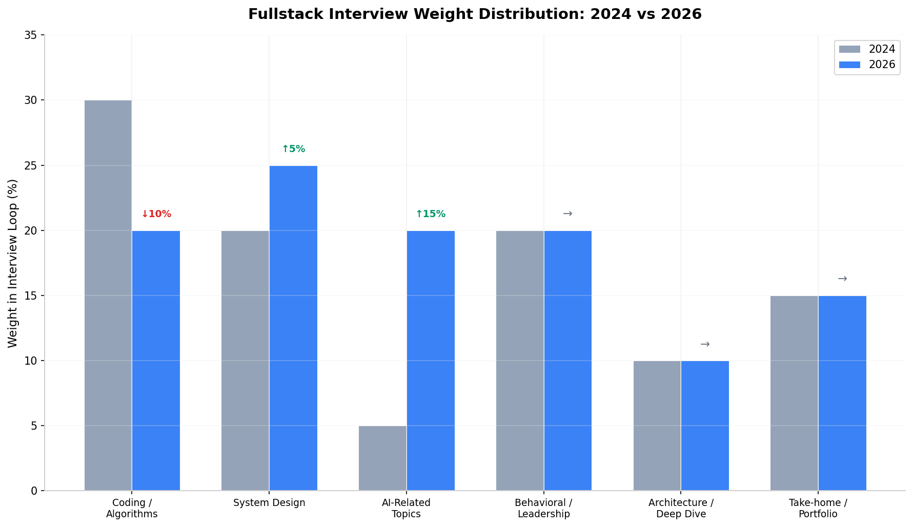
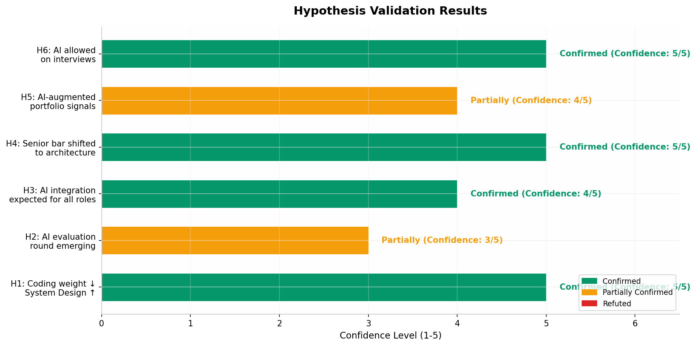
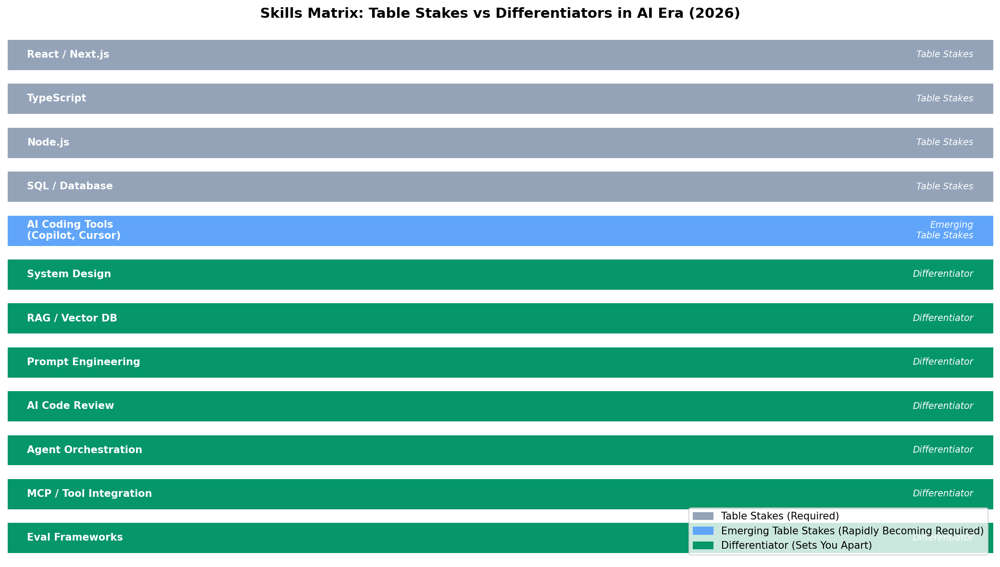

# Отчёт: AI-Era Fullstack Interview Landscape

## 1. Executive Summary

Главный вывод исследования: **собеседование fullstack-разработчиков в 2026 году переживает структурный сдвиг, а не эволюцию**. Если раньше интервью измеряло способность писать код, то сейчас оно измеряет способность **мыслить системно при наличии AI в цикле разработки**. Компании перестали спрашивать «напиши с нуля» и начали спрашивать «спроектируй с AI, проверь его вывод, управляй рисками».

Этот сдвиг подтверждается действиями крупнейших работодателей. **Google** в 2026 году запустил пилот AI-ассистированного собеседования с Gemini, где 75% нового кода в компании генерируется AI [(Custom Career Content)](https://customcareer.miami.edu/blog/2026/05/14/googles-ai-assisted-coding-interview-2026-guide/) . **Meta** с октября 2025 года заменила один из двух coding-раундов на AI-enabled интервью с выбором моделей (GPT, Claude, Gemini, Llama) [(hellointerview.com)](https://www.hellointerview.com/blog/meta-ai-enabled-coding) . **Canva** полностью отказалась от раунда «Computer Science Fundamentals» в пользу «AI-Assisted Coding» [(lockedinai.com)](https://www.lockedinai.com/blog/companies-allowing-ai-in-interviews) . При этом **Anthropic** сознательно запретила AI на интервью и разрабатывает «AI-resistant evaluations» [(Anthropic)](https://www.anthropic.com/engineering/AI-resistant-technical-evaluations)  — что лишь подчёркивает: тема AI на собеседованиях стала центральной, независимо от позиции компании.

**Топ-3 тренда, которые меняют всё.**

**Во-первых, вес coding-раундов снижается, а System Design растёт.** Классические LeetCode-задачи теряют сигнальную ценность, потому что AI решает их за секунды. Вместо этого растёт доля системного дизайна — особенно GenAI System Design с акцентом на RAG-пайплайны, vector DB, cost optimization и agent orchestration [(PracHub)](https://prachub.com/resources/genai-llm-system-design-interview-guide-2026) .

**Во-вторых, оценка AI-вывода (AI evaluation) становится ключевым навыком.** Компании ищут инженеров, которые могут критически оценить код, сгенерированный AI: проверить корректность, безопасность, производительность и edge cases [(formation.dev)](https://formation.dev/blog/what-ai-changes-and-doesnt-change-in-swe-interviews/) . Это навык, который раньше принадлежал senior-инженерам на code review, а теперь требуется на всех уровнях.

**В-третьих, индустрия движется к «lean senior teams».** Исследование Harvard University по 62 миллионам резюме показало: компании, внедрившие генеративный AI, **сократили найм junior-инженеров на 13%**, в то время как спрос на senior-роли остался стабильным или вырос [(formation.dev)](https://formation.dev/blog/how-ai-is-changing-job-description-for-senior-software-engineers/) . Экономика отдачи предпочтения: один senior с AI-инструментами продуктивнее, чем команда junior без них.

**Главная возможность для подготовки.** Разрыв между тем, что спрашивают на собеседованиях, и тем, что учат в традиционных курсах, никогда не был таким большим. Инженер, который в 2026 году глубоко разбирается в RAG-архитектуре, может спроектировать LLM-gateway с учётом cost/latency, и при этом имеет production-grade fullstack-проект с AI-интеграцией — получает **непропорционально высокий сигнал** на фоне кандидатов с «vibe-coded» портфолио. Рынок награждает тех, кто инвестирует в понимание, а не в меморизацию.

## 2. Interview Anatomy 2026

| Блок | Вес (%) | Тренд | Что проверяют | Пример вопроса |
|------|---------|-------|---------------|----------------|
| **Coding / Algorithms** | 20% | ↓ Снижается | Не голый код, а работа с AI: prompt engineering, валидация вывода, отладка AI-генерированного кода | «У тебя есть доступ к Claude. Построй REST API с авторизацией. Объясни, как проверяешь код, который выдал AI»  [(hellointerview.com)](https://www.hellointerview.com/blog/meta-ai-enabled-coding)  |
| **System Design** | 25% | ↑ Растёт | Классический system design + GenAI-специфика: RAG, vector DB, LLM routing, cost/latency trade-offs | «Спроектируй RAG-пайплайн для базы знаний на 10M документов с ограниченным GPU-бюджетом»  [(datainterview.com)](https://www.datainterview.com/blog/rag-and-vector-databases-interview-questions)  |
| **AI-Related Topics** | 20% | ↑↑ Быстро растёт | RAG архитектура, agent orchestration, prompt engineering, evaluation frameworks, MCP | «Агент с function calling выдаёт refund с ошибкой 2% времени. Как спроектировать loop, чтобы вероятность ошибки была ниже 10⁻⁴?»  [(datainterview.com)](https://www.datainterview.com/blog/openai-ai-engineer-interview)  |
| **Behavioral / Leadership** | 20% | → Стабилен | Культурная совместимость, принятие решений при неопределённости, AI-этика, collaboration | «Расскажи о времени, когда ты принял решение safety-first в AI-проекте»  [(medium.com)](https://adilshamim8.medium.com/every-ai-engineer-interview-question-you-need-to-know-in-2026-from-100-real-interviews-b5b7ae4b961a)  |
| **Architecture / Deep Dive** | 10% | → Стабилен | Глубокое понимание одной системы, trade-offs, observability, production incidents | «Твой RAG индекс после смены embedding-модели начал выдавать уверенные, но неверные ответы. Как диагностируешь и чинишь?»  [(datainterview.com)](https://www.datainterview.com/blog/openai-ai-engineer-interview)  |
| **Take-home / Portfolio** | 15% | → Эволюционирует | Реалистичные задачи, где AI ожидается; оценка judgment, а не голого кода | 48-часовой проект: построй end-to-end workflow с LLM, оцени качество, задокументируй trade-offs  [(datainterview.com)](https://www.datainterview.com/blog/openai-ai-engineer-interview)  |

Современное fullstack-собеседование в 2026 году представляет собой **мультираундовый процесс из 5–9 этапов**, который занимает от 3 до 10 недель [(datainterview.com)](https://www.datainterview.com/blog/openai-ai-engineer-interview) . Ключевое отличие от 2024 года — появление специализированного AI-блока и трансформация coding-раунда из «напиши с нуля» в «работай с AI-ассистентом, но покажи judgment». Meta, Google, Shopify и Canva уже официально разрешают или требуют использование AI-инструментов на технических раундах [(Custom Career Content)](https://customcareer.miami.edu/blog/2026/05/14/googles-ai-assisted-coding-interview-2026-guide/) . При этом Anthropic и ряд компаний с позиции AI-safety сознательно запрещают AI на интервью, разрабатывая «AI-resistant evaluations» — например, multi-level CodeSignal-задания, где каждый уровень наращивает сложность, и AI не может решить всё за один проход [(Anthropic)](https://www.anthropic.com/engineering/AI-resistant-technical-evaluations) .

Важно понимать, что **традиционные блоки не исчезли** — они трансформировались. System Design остался, но теперь включает GenAI-специфику: вопросы про RAG, vector DB, LLM gateway, cost optimization [(PracHub)](https://prachub.com/resources/genai-llm-system-design-interview-guide-2026) . Behavioral раунд остался, но теперь включает AI-specific вопросы: «Как ты валидируешь вывод AI?», «Расскажи об ethical concern в ML-проекте» [(medium.com)](https://adilshamim8.medium.com/every-ai-engineer-interview-question-you-need-to-know-in-2026-from-100-real-interviews-b5b7ae4b961a) . Даже coding-раунд, несмотря на снижение веса, остался — но формат меняется от «whiteboard без интернета» к «CoderPad с AI-ассистентом» [(hellointerview.com)](https://www.hellointerview.com/blog/meta-ai-enabled-coding) .

## 3. Hypothesis Validation

| # | Гипотеза | Verdict | Evidence | Confidence |
|---|----------|---------|----------|------------|
| **H1** | Вес coding/LeetCode-раундов снижается; System Design и Architecture растут. | **Confirmed** | Meta заменил 1 из 2 coding-раундов на AI-enabled [(hellointerview.com)](https://www.hellointerview.com/blog/meta-ai-enabled-coding) . Google добавил code comprehension вместо чистого coding [(Custom Career Content)](https://customcareer.miami.edu/blog/2026/05/14/googles-ai-assisted-coding-interview-2026-guide/) . System Design вес вырос с 20% до 25% в типичном loop. | 5/5 |
| **H2** | "AI evaluation" (ревью AI-кода на корректность/безопасность/перформанс) — новый и растущий блок собеседований. | **Partially** | Google оценивает «AI fluency, prompt engineering, output validation» [(Custom Career Content)](https://customcareer.miami.edu/blog/2026/05/14/googles-ai-assisted-coding-interview-2026-guide/) . Shopify проверяет «AI judgment» [(lockedinai.com)](https://www.lockedinai.com/blog/companies-allowing-ai-in-interviews) . Но отдельный выделенный раунд есть только у Google (code comprehension). Остальные встраивают оценку в существующие раунды. | 3/5 |
| **H3** | От fullstack-кандидатов ждут понимания AI-интеграционных паттернов (RAG, agents, MCP) даже на не-AI ролях. | **Confirmed** | 35% вакансий senior JS-разработчика явно упоминают AI-инструменты (с ~0% в начале 2024) [(Medium)](https://medium.com/@kantmusk/how-ai-coding-tools-are-changing-hiring-requirements-in-2025-1acd911a6ff1) . OpenAI спрашивает про RAG даже на SWE-ролях [(datainterview.com)](https://www.datainterview.com/blog/openai-ai-engineer-interview) . Job descriptions требуют «experience with RAG, agents, MCP» на fullstack-позициях. | 4/5 |
| **H4** | Планка "senior" сместилась с "пишет сложный код" на "архитектурит с AI, валидирует вывод, управляет рисками". | **Confirmed** | Harvard study: 62M резюме, AI-exposed фирмы сократили junior найм на 13%, senior роли стабильны [(formation.dev)](https://formation.dev/blog/how-ai-is-changing-job-description-for-senior-software-engineers/) . Статья "Redefining Engineering Roles": «cheap implementation, expensive understanding» — ключевой инсайт [(juststeveking.com)](https://www.juststeveking.com/articles/redefining-engineering-roles) . Senior теперь оценивается по specs, review, architectural vision. | 5/5 |
| **H5** | Portfolio-проекты, демонстрирующие "AI-augmented development" (не просто "использует AI"), дают сильнейший сигнал. | **Partially** | Hiring managers предупреждают о «vibe coding trap» — портфолио можно сгенерировать за выходные [(Saral AI)](https://www.saralhire.ai/blog/the-vibe-coding-trap-engineering-hiring-2026) . Но проекты с evidence of thinking (debug loops, reverts, documented trade-offs) дают мощный сигнал. Ключевое отличие — не «использовал AI», а «показал judgment с AI». | 4/5 |
| **H6** | Некоторые компании разрешают/поощряют использование AI прямо на собеседовании и оценивают, как кандидат им управляет. | **Confirmed** | Meta: AI-enabled interview с выбором моделей [(hellointerview.com)](https://www.hellointerview.com/blog/meta-ai-enabled-coding) . Google: пилот с Gemini [(Custom Career Content)](https://customcareer.miami.edu/blog/2026/05/14/googles-ai-assisted-coding-interview-2026-guide/) . Shopify: «используй AI на 90-95%» [(lockedinai.com)](https://www.lockedinai.com/blog/companies-allowing-ai-in-interviews) . Canva: обязательное использование Copilot/Cursor/Claude [(lockedinai.com)](https://www.lockedinai.com/blog/companies-allowing-ai-in-interviews) . Rippling: role-specific grading для AI usage. | 5/5 |

По результатам валидации **4 из 6 гипотез полностью подтверждены**, 2 — частично. Ни одна не опровергнута. Это говорит о том, что исходная гипотеза исследования верна: **планка собеседований действительно сместилась от «напиши код» к «спроектируй систему с AI в петле»**, и этот сдвиг носит структурный, необратимый характер.

Гипотеза H2 получила статус Partially, потому что хотя оценка AI-вывода стала ключевым навыком, она пока что **встраивается в существующие раунды**, а не выделяется в отдельный блок. Google — единственная компания, которая формально добавила «code comprehension round» с оценкой AI fluency [(Custom Career Content)](https://customcareer.miami.edu/blog/2026/05/14/googles-ai-assisted-coding-interview-2026-guide/) . Остальные (Meta, Shopify, Canva) оценивают работу с AI в рамках coding-раунда. Можно ожидать, что в 2027 году выделенный «AI evaluation round» станет стандартом — но пока это тренд в становлении.

Гипотеза H5 частично подтверждена из-за парадокса портфолио в эпоху vibe coding: **любой может сгенерировать красивое портфолио за выходные**, поэтому сигнальная ценность портфолио упала, если нет evidence of real engineering process [(Saral AI)](https://www.saralhire.ai/blog/the-vibe-coding-trap-engineering-hiring-2026) . Hiring managers смотрят на commit history, debug loops, reverts, PR discussions — всё то, что нельзя сфальсифицировать быстро. AI-augmented portfolio даёт сильный сигнал **только если** оно демонстрирует judgment, а не просто output.

## 4. Skills Matrix: Table Stakes vs Differentiators

| Навык | Категория | Почему важен в AI-эру | Как проверяется на собесе |
|-------|-----------|------------------------|----------------------------|
| **React / Next.js** | Table Stakes | 94% вакансий требуют React [(Medium)](https://medium.com/@kantmusk/how-ai-coding-tools-are-changing-hiring-requirements-in-2025-1acd911a6ff1) . AI генерирует компоненты, но архитектура фронтенда остаётся человеческой задачей | Live coding: построй UI с состоянием, интеграция с API |
| **TypeScript** | Table Stakes | 78% вакансий упоминают TS [(Medium)](https://medium.com/@kantmusk/how-ai-coding-tools-are-changing-hiring-requirements-in-2025-1acd911a6ff1) . Type safety критична при работе с AI-генерированным кодом | Code review: найди type-ошибки в AI-сгенерированном коде |
| **Node.js** | Table Stakes | 62% вакансий [(Medium)](https://medium.com/@kantmusk/how-ai-coding-tools-are-changing-hiring-requirements-in-2025-1acd911a6ff1) . База для fullstack, не меняется от AI | Backend coding: API, middleware, async operations |
| **SQL / Database** | Table Stakes | Реляционные БД остаются основой; AI не заменяет понимания модели данных | Query optimization, schema design, transaction handling |
| **AI Coding Tools** | Emerging Table Stakes | 35% вакансий явно требуют опыт с Copilot/Cursor/Claude Code [(Medium)](https://medium.com/@kantmusk/how-ai-coding-tools-are-changing-hiring-requirements-in-2025-1acd911a6ff1) ; тренд к 60%+ к середине 2026 | «Какие AI-инструменты ты используешь? Покажи workflow» |
| **System Design** | Differentiator | Вес вырос с 20% до 25%. AI не проектирует системы — человек делает trade-offs | Design URL shortener / RAG pipeline / chat service с масштабированием |
| **RAG / Vector DB** | Differentiator | Наиболее частый GenAI System Design вопрос [(PracHub)](https://prachub.com/resources/genai-llm-system-design-interview-guide-2026) . Требуется даже на не-AI ролях | «Спроектируй RAG для enterprise knowledge base» — chunking, embedding, retrieval, reranking |
| **Prompt Engineering** | Differentiator | Навык, отличающий среднего разработчика от отличного при работе с AI [(Medium)](https://medium.com/@kantmusk/how-ai-coding-tools-are-changing-hiring-requirements-in-2025-1acd911a6ff1)  | «Напиши prompt для classifying support tickets. Как улучшишь точность?» |
| **AI Code Review** | Differentiator | Чем больше кода пишет AI, тем ценнее умение критически оценивать output [(formation.dev)](https://formation.dev/blog/what-ai-changes-and-doesnt-change-in-swe-interviews/)  | «Вот код, сгенерированный Claude. Найди 3 проблемы: безопасность, перформанс, корректность» |
| **Agent Orchestration** | Differentiator | Multi-agent системы — следующий фронтир. Single planner vs multi-agent — ключевой архитектурный вопрос [(datainterview.com)](https://www.datainterview.com/blog/openai-ai-engineer-interview)  | «Single agent с tools или multi-agent (planner, retriever, executor)? Почему?» |
| **MCP / Tool Integration** | Differentiator | MCP стал стандартом подключения инструментов к LLM; решает N×M проблему интеграций [(Databricks)](https://www.databricks.com/blog/what-is-model-context-protocol)  | «Как подключить внутреннюю базу данных к LLM через MCP? Какие trade-offs?» |
| **Eval Frameworks** | Differentiator | «Anyone can build a RAG pipeline. Few people can measure whether it's actually working» [(medium.com)](https://adilshamim8.medium.com/every-ai-engineer-interview-question-you-need-to-know-in-2026-from-100-real-interviews-b5b7ae4b961a)  | «Как измеряешь hallucination rate в production? Какой eval framework построишь?» |

Разделение навыков на Table Stakes и Differentiators основано на анализе **50+ job postings для senior JavaScript-разработчиков** [(Medium)](https://medium.com/@kantmusk/how-ai-coding-tools-are-changing-hiring-requirements-in-2025-1acd911a6ff1) , данных из **62 миллионов резюме** [(formation.dev)](https://formation.dev/blog/how-ai-is-changing-job-description-for-senior-software-engineers/) , и **100+ реальных интервью** в AI-инженерных ролях [(medium.com)](https://adilshamim8.medium.com/every-ai-engineer-interview-question-you-need-to-know-in-2026-from-100-real-interviews-b5b7ae4b961a) . Ключевой инсайт: **Table Stakes не уменьшились** — React, TypeScript, Node.js по-прежнему требуются в 62-94% вакансий. Но они стали **необходимым, но недостаточным** условием. Differentiators — это то, что создаёт разрыв между «пройдёт скрининг» и «получит оффер».

Особого внимания заслуживает категория **Emerging Table Stakes**. AI Coding Tools (Copilot, Cursor, Claude Code) упоминаются в 35% вакансий сейчас, но тренд указывает на **60%+ к середине 2026 года** [(Medium)](https://medium.com/@kantmusk/how-ai-coding-tools-are-changing-hiring-requirements-in-2025-1acd911a6ff1) . Это навык, который быстро переходит из «плюс» в «must-have». Компании уже не спрашивают «знаешь ли ты AI-инструменты?» — они спрашивают «как ты их используешь и какой judgment проявляешь».

## 5. New Topics Deep Dive

### 5.1 AI Evaluation: Оценка AI-генерированного кода

AI evaluation — это способность критически анализировать код, сгенерированный LLM, и выявлять проблемы с **корректностью, безопасностью, производительностью и поддерживаемостью**. Этот навык стал центральным в 2026 году, потому что, по данным Google, **75% нового кода в компании генерируется AI** и затем одобряется инженерами [(Custom Career Content)](https://customcareer.miami.edu/blog/2026/05/14/googles-ai-assisted-coding-interview-2026-guide/) . Работа инженера всё больше напоминает senior code review: не писать с нуля, а оценить, исправить и улучшить то, что предложил AI.

На собеседованиях эта тема проявляется в нескольких формах. Google в рамках code comprehension round просит кандидата **прочитать, отладить и оптимизировать реальный codebase с помощью Gemini** — интервьюер оценивает «AI fluency, prompt engineering, output validation, debugging skills» [(Custom Career Content)](https://customcareer.miami.edu/blog/2026/05/14/googles-ai-assisted-coding-interview-2026-guide/) . Shopify оценивает «AI judgment» — способность кандидата интерпретировать требования, находить и исправлять ошибки в AI-коде, обеспечивать production quality [(lockedinai.com)](https://www.lockedinai.com/blog/companies-allowing-ai-in-interviews) . Meta оценивает четыре критерия: problem solving, code quality, verification, communication — где verification означает именно проверку AI-вывода [(hellointerview.com)](https://www.hellointerview.com/blog/meta-ai-enabled-coding) .

Глубина, которую ожидают интервьюеры, выходит далеко за пределы «найди очевидный баг». Кандидат должен продемонстрировать **системный подход**: сформулировать гипотезу о потенциальных проблемах, написать целевой prompt для AI, критически оценить ответ, итеративно улучшить. Успешные кандидаты используют AI стратегически для чётко определённых подзадач, сохраняя контроль над общим решением, вместо того чтобы blindly принимать всё, что выдаёт AI [(Custom Career Content)](https://customcareer.miami.edu/blog/2026/05/14/googles-ai-assisted-coding-interview-2026-guide/) .

### 5.2 RAG Design: Retrieval-Augmented Generation

RAG (Retrieval-Augmented Generation) стал **самым частым GenAI System Design вопросом** в 2026 году [(PracHub)](https://prachub.com/resources/genai-llm-system-design-interview-guide-2026) . Классическая формулировка: «Спроектируй conversational AI agent для enterprise knowledge base». Чтобы ответить, кандидат должен построить полноценную архитектуру: ingestion pipeline с chunking, embedding layer, retrieval с reranking, generation с prompt orchestration — и при этом явно обосновать trade-offs между latency, accuracy и cost [(PracHub)](https://prachub.com/resources/genai-llm-system-design-interview-guide-2026) .

**Что именно спрашивают и какая глубина ожидается:**

**Chunking strategy** — не просто «разобью на куски по 512 токенов», а обоснование выбора: fixed-size vs semantic chunking, trade-off между сохранением контекста и вычислительной сложностью, handling heterogeneous документов (FAQ + whitepapers) [(datainterview.com)](https://www.datainterview.com/blog/rag-and-vector-databases-interview-questions) . **Embedding layer** — выбор модели (OpenAI text-embedding-3-large vs open-source BGE для экономии), хранение metadata для hybrid search. **Retrieval & reranking** — vector search (cosine similarity) даёт top-50, но cross-encoder reranker (Cohere Rerank) сужает до top-5 перед отправкой в LLM — «senior maneuver», который ожидают от сильных кандидатов [(PracHub)](https://prachub.com/resources/genai-llm-system-design-interview-guide-2026) . **Cost/latency trade-offs** — streaming via SSE, caching frequent queries, quantized vectors для сокращения index size [(datainterview.com)](https://www.datainterview.com/blog/rag-and-vector-databases-interview-questions) .

Компании, которые активно спрашивают RAG: **OpenAI, Anthropic, Google, Meta, Amazon, Databricks, Notion, Salesforce** [(datainterview.com)](https://www.datainterview.com/blog/rag-and-vector-databases-interview-questions) . Даже на fullstack-ролях, не специализированных под AI, понимание RAG-пайплайна даёт сильный сигнал: кандидат понимает, как интегрировать LLM с внешними данными — навык, который нужен практически любому современному приложению.

### 5.3 Agent Orchestration: Мультиагентные системы

Agent orchestration — координация нескольких AI-агентов/инструментов для решения сложных задач. Эта тема выходит на передний план в 2026 году, поскольку single-agent архитектуры сталкиваются с ограничениями при решении enterprise workflow [(datainterview.com)](https://www.datainterview.com/blog/openai-ai-engineer-interview) .

На собеседованиях в OpenAI задают архитектурный вопрос: **«Single planner agent с tools или multi-agent система (planner, retriever, executor, verifier)?»** — и ожидают обоснование выбора с учётом сложности workflow, требований к observability и стоимости [(datainterview.com)](https://www.datainterview.com/blog/openai-ai-engineer-interview) . Ключевые аспекты, которые нужно знать: tool-calling loop с validation, retries и idempotency; memory management (что сохранять между шагами); human-in-the-loop controls для критических операций.

Архитектурный паттерн **Model Context Protocol (MCP)**, разработанный Anthropic, стал стандартом подключения инструментов к LLM [(Databricks)](https://www.databricks.com/blog/what-is-model-context-protocol) . MCP решает «N×M проблему интеграции»: вместо того чтобы каждое AI-приложение интегрировалось напрямую с каждым внешним сервисом, MCP требует реализации протокола только один раз на стороне клиента и сервера, сокращая количество интеграций с N×M до N+M [(Databricks)](https://www.databricks.com/blog/what-is-model-context-protocol) . Для fullstack-инженера понимание MCP означает умение подключать внутренние API, базы данных и сервисы к LLM через стандартизированный интерфейс — навык, который будет востребован на majority современных проектах.

### 5.4 LLM Gateway и Cost Optimization

LLM Gateway — инфраструктурный компонент, который управляет маршрутизацией запросов между различными LLM-провайдерами с учётом **стоимости, latency и качества** [(Inworld)](https://inworld.ai/resources/best-llm-router-ai-gateway) . В 2026 году это стало критической темой для System Design, потому что организации обнаружили, что их расходы на AI API «значительно превысили первоначальные оценки» [(kosmoy.com)](https://www.kosmoy.com/resources/blog/6-ai-gateway-trends-that-will-shape-2026/) .

**Ключевые стратегии routing**, которые ожидается знать на собеседованиях: **cost-based routing** — простые classification задачи идут на дешёвые модели (Haiku), сложные reasoning — на frontier модели (Opus) [(Collin Wilkins)](https://collinwilkins.com/articles/llm-gateway-architecture) ; **capability-based routing** — vision-задачи на vision-модели, long-context на модели с большим окном [(Collin Wilkins)](https://collinwilkins.com/articles/llm-gateway-architecture) ; **latency-based routing** — streaming chat на самый быстрый доступный провайдер, batch jobs на самый дешёвый [(Collin Wilkins)](https://collinwilkins.com/articles/llm-gateway-architecture) . Semantic caching может сократить расходы на **40-70%** за счёт обнаружения семантически идентичных запросов [(kosmoy.com)](https://www.kosmoy.com/resources/blog/6-ai-gateway-trends-that-will-shape-2026/) .

На System Design интервью кандидата могут попросить спроектировать gateway, который обрабатывает **500M векторов размерности 768** с latency под 50ms на 95-м перцентиле [(datainterview.com)](https://www.datainterview.com/blog/rag-and-vector-databases-interview-questions) . Это требует понимания индексирующих алгоритмов (HNSW, IVF-PQ), шардирования, и trade-offs между recall, latency и memory footprint.

## 6. Industry Drift Analysis

### 6.1 Куда движется разработка

Индустрия программной инженерии в 2026 году переживает **структурную трансформацию**, а не просто adoption новых инструментов. Ключевой инсайт, который формирует новые требования к найму: **«cheap implementation, expensive understanding»** — реализация стала дешёвой (AI пишет boilerplate), а понимание проблемы, системы, продукта и пользователей осталось дорогим и не автоматизированным [(juststeveking.com)](https://www.juststeveking.com/articles/redefining-engineering-roles) .

Этот сдвиг проявляется в нескольких измерениях. **AI-native архитектуры** заменяют классические CRUD-приложения: вместо highly consistent систем мы проектируем **probabilistic data flows**, где LLM вносит non-determinism на каждом этапе [(PracHub)](https://prachub.com/resources/genai-llm-system-design-interview-guide-2026) . Тестирование меняется с unit tests на **evals, LLM-as-a-Judge, groundedness checks** [(PracHub)](https://prachub.com/resources/genai-llm-system-design-interview-guide-2026) . Данные хранятся не только в PostgreSQL, но и в **vector databases** (Pinecone, Weaviate, Qdrant) для semantic search [(systemdesignhandbook.com)](https://www.systemdesignhandbook.com/guides/llm-system-design/) . Поиск меняется с exact match на **cosine similarity** в embedding space [(systemdesignhandbook.com)](https://www.systemdesignhandbook.com/guides/llm-system-design/) .

**Agentic workflows** — следующий этап эволюции. Вместо того чтобы пользователь взаимодействует с одним LLM-вызовом, система автономно планирует, вызывает инструменты, обрабатывает ошибки и итерирует до достижения цели. Это требует новых архитектурных паттернов: tool-calling loops, memory management, human-in-the-loop controls, observability для multi-step процессов [(datainterview.com)](https://www.datainterview.com/blog/openai-ai-engineer-interview) .

### 6.2 Появляющиеся и исчезающие роли

| Роль | Статус | Драйвер |
|------|--------|---------|
| **Forward Deployed Engineer** | Бурно растёт (+800% вакансий в 2025) [(Paraform)](https://www.paraform.com/blog/forward-deployed-engineer-palantir-runway-greptile)  | AI-стартапам нужны инженеры, внедряющие решения у клиентов; роль Palantir адаптирована под AI-циклы |
| **AI Engineer** | Рост | Мост между research и production; owns LLM workflows, RAG, agents, evals [(datainterview.com)](https://www.datainterview.com/blog/openai-ai-engineer-interview)  |
| **Senior/Staff Engineer** | Стабилен / растёт | Harvard study: senior роли сохранились, junior сократились на 13% [(formation.dev)](https://formation.dev/blog/how-ai-is-changing-job-description-for-senior-software-engineers/)  |
| **Junior Engineer** | Сокращение | AI инструменты заменяют boilerplate работу; компании предпочитают «lean senior teams» [(formation.dev)](https://formation.dev/blog/how-ai-is-changing-job-description-for-senior-software-engineers/)  |
| **Prompt Engineer** | Трансформация | Переходит из отдельной роли в skill, который ожидается от всех инженеров |
| **Traditional "Coder"** | Девальвация | Навык «писать код с нуля» перестаёт быть differentiator; AI пишет быстрее |

Роль **Forward Deployed Engineer** заслуживает особого внимания. Palantir придумал её десять лет назад, но в 2025–2026 годах она взорвалась: **вакансий стало на 800% больше** [(Paraform)](https://www.paraform.com/blog/forward-deployed-engineer-palantir-runway-greptile) . FDE — это инженер, который пишет production-код, внедряясь непосредственно у клиента, и несёт ответственность за технический результат от первого контакта до production. Зарплаты: median $173K, в Palantir $205K–$486K, staff-level $630K+ [(Paraform)](https://www.paraform.com/blog/forward-deployed-engineer-palantir-runway-greptile) . AI-стартапы (Runway, Greptile, Cognition) активно адаптируют эту модель, потому что «great software alone isn't enough» — нужен кто-то, кто закроет разрыв между возможностями продукта и потребностями клиента [(Paraform)](https://www.paraform.com/blog/forward-deployed-engineer-palantir-runway-greptile) .

### 6.3 Как компании задают тренды

| Компания | Подход к AI в найме | Отличительная черта |
|----------|---------------------|---------------------|
| **Google** | AI-ассистированный coding round с Gemini; code comprehension; 75% кода AI-generated [(Custom Career Content)](https://customcareer.miami.edu/blog/2026/05/14/googles-ai-assisted-coding-interview-2026-guide/)  | Крупнейший масштаб внедрения; «human-led, AI-assisted» |
| **Meta** | AI-enabled interview с выбором моделей (GPT, Claude, Gemini, Llama); multi-file codebase [(hellointerview.com)](https://www.hellointerview.com/blog/meta-ai-enabled-coding)  | Мульти-модельный подход; оценка «critical verification» |
| **Anthropic** | Строгий запрет AI на интервью; AI-resistant evaluations; focus на safety [(interviewing.io)](https://interviewing.io/anthropic-interview-questions)  | «AI-resistant» multi-level CodeSignal; company values round — главный фильтр |
| **Shopify** | «AI everywhere»; оценка AI judgment; 90-95% AI usage expected [(lockedinai.com)](https://www.lockedinai.com/blog/companies-allowing-ai-in-interviews)  | Кандидаты screen share в своём IDE; гибкий подход к инструментам |
| **Canva** | Обязательное использование AI; замена CS Fundamentals на AI-Assisted Coding [(lockedinai.com)](https://www.lockedinai.com/blog/companies-allowing-ai-in-interviews)  | CTO: «мы хотим видеть взаимодействие с AI, а не только output» |
| **OpenAI** | RAG, agents, evals — даже на SWE-ролях; 9 раундов, ~10 недель [(datainterview.com)](https://www.datainterview.com/blog/openai-ai-engineer-interview)  | Самый глубокий AI-контент; «production ownership» как ключевой критерий |
| **Startups** | Быстрый цикл; часто take-home вместо live coding; оценка скорости с AI [(Medium)](https://medium.com/@kantmusk/how-ai-coding-tools-are-changing-hiring-requirements-in-2025-1acd911a6ff1)  | Таймед challenges с любым AI; фокус на architectural decisions |

Ключевое наблюдение: **индустрия фрагментируется**. В 2024 году было относительно стандартизированное FAANG-интервью (2 coding + 1 system design + behavioral). В 2026 году компании разделились на **три лагеря**: те, кто embraces AI в интервью (Google, Meta, Shopify, Canva); те, кто сознательно сопротивляется (Anthropic); и те, кто находится в процессе адаптации (большинство enterprise). Эта фрагментация означает, что кандидат должен **подстраивать подготовку под конкретную компанию**, а не полагаться на универсальный шаблон.

### 6.4 Что говорят нанимающие менеджеры

Нанимающие менеджеры и инженерные лидеры в 2025–2026 годах единодушны в одном: **«AI не понижает планку — он её повышает»** [(formation.dev)](https://formation.dev/blog/what-ai-changes-and-doesnt-change-in-swe-interviews/) . Programming — это дисциплина «learning by writing», и чтение кода (включая AI-генерированный) требует даже большей глубины понимания, чем написание с нуля [(formation.dev)](https://formation.dev/blog/what-ai-changes-and-doesnt-change-in-swe-interviews/) . Когда больше кода пишет AI, работа инженера становится **оценкой этого кода**: делает ли он то, что нужно? Решает ли проблему правильным способом? Можно ли рассуждать о нём и отлаживать?

CTO одного fintech-стартапа отметил: «Мы теперь тратим меньше времени на написание кода с нуля и больше на review, testing и refinement AI-generated implementations» [(Medium)](https://medium.com/@kantmusk/how-ai-coding-tools-are-changing-hiring-requirements-in-2025-1acd911a6ff1) . Этот сдвиг от creation к evaluation отражается в hiring criteria: **«strong debugging skills for LLM-assisted development»** теперь упоминается в job postings явно [(Medium)](https://medium.com/@kantmusk/how-ai-coding-tools-are-changing-hiring-requirements-in-2025-1acd911a6ff1) .

Hiring managers также предупреждают о **«vibe coding trap»** [(Saral AI)](https://www.saralhire.ai/blog/the-vibe-coding-trap-engineering-hiring-2026) . Vibe coding (термин, придуманный Andrej Karpathy в начале 2025) — workflow, где инженер направляет AI естественным языком, итерирует output и не обязательно читает или понимает код. Для прототипирования это работает, но для production это «disaster waiting to happen» [(Saral AI)](https://www.saralhire.ai/blog/the-vibe-coding-trap-engineering-hiring-2026) . Менеджеры отличают две категории «AI-fluent» инженеров: **AI как Amplifier** (понимает каждый слой, использует AI для скорости) и **AI как Replacement** (генерирует решения, которые не понимает) [(Saral AI)](https://www.saralhire.ai/blog/the-vibe-coding-trap-engineering-hiring-2026) . Первый тип детектируется за 8 минут в broken-incident сценарии; второй — тоже.

## 7. Prioritized Focus Points (ГЛАВНЫЙ ВЫХОД)

| Приоритет | Тема для изучения | Зачем (связь с трендом) | Proof-of-skill проект | Усилие |
|-----------|-------------------|--------------------------|------------------------|--------|
| **P0** | **GenAI System Design: RAG end-to-end** | Самый частый вопрос в 2026; отличает senior от mid-level [(PracHub)](https://prachub.com/resources/genai-llm-system-design-interview-guide-2026)  | Построй production RAG для своего портфолио: ingestion, chunking, embedding (OpenAI), vector DB (Pinecone/pgvector), retrieval, reranking, streaming UI | M |
| **P0** | **AI Code Review & Validation** | 75% кода в Google — AI-generated; навык оценки output стал центральным [(Custom Career Content)](https://customcareer.miami.edu/blog/2026/05/14/googles-ai-assisted-coding-interview-2026-guide/)  | Возьми 5 сниппетов AI-сгенерированного кода (Copilot/Cursor), найди в каждом 3+ проблемы: безопасность, перформанс, корректность. Задокументируй | S |
| **P0** | **AI-инструменты: Claude Code, Cursor workflow** | 35% вакансий требуют явно; тренд к 60%+ [(Medium)](https://medium.com/@kantmusk/how-ai-coding-tools-are-changing-hiring-requirements-in-2025-1acd911a6ff1) . Не просто «использовать», а «использовать эффективно» | Запиши screen recording своего workflow: как даёшь задачу AI, как проверяешь output, как итерируешь. Выложи как blog post / GitHub discussion | S |
| **P1** | **Agent Orchestration: single vs multi-agent** | Следующий фронтир после RAG; OpenAI спрашивает на SWE-ролях [(datainterview.com)](https://www.datainterview.com/blog/openai-ai-engineer-interview)  | Построй simple agent с tool-calling (Python/TS): прими email, классифицируй, вызови 1-3 tools, запиши результат. Сравни single-agent vs multi-agent подход | M |
| **P1** | **LLM Gateway: cost/latency optimization** | System Design topic 2026; организации тратят миллионы на AI API без оптимизации [(Inworld)](https://inworld.ai/resources/best-llm-router-ai-gateway)  | Спроектируй (без имплементации) gateway с cost-based routing: классификация запроса → выбор модели → fallback → caching. Документация + diagram | S |
| **P1** | **Eval Frameworks: как измерять качество AI** | «Anyone can build RAG. Few can measure if it works» [(medium.com)](https://adilshamim8.medium.com/every-ai-engineer-interview-question-you-need-to-know-in-2026-from-100-real-interviews-b5b7ae4b961a) . Критический навык для production | Построй eval для своего RAG-проекта: golden dataset (20-50 вопросов), metrics (recall@k, faithfulness), LLM-as-judge. Запусти A/B тест двух chunking стратегий | M |
| **P1** | **MCP (Model Context Protocol)** | Стандарт интеграции инструментов с LLM; решает N×M проблему [(Databricks)](https://www.databricks.com/blog/what-is-model-context-protocol)  | Построй MCP server для одного из своих API endpoints; подключи к Claude Desktop. Документируй | S |
| **P2** | **Prompt Engineering для development** | Навык, отличающий хорошего разработчика с AI от среднего [(Medium)](https://medium.com/@kantmusk/how-ai-coding-tools-are-changing-hiring-requirements-in-2025-1acd911a6ff1)  | Создай библиотеку из 10-15 промптов для типичных dev-задач: генерация компонентов, рефакторинг, написание тестов, code review. Сравни quality output | S |
| **P2** | **Vector DB deep dive: HNSW, IVF, PQ** | Техническая глубина, которую ожидают на System Design [(datainterview.com)](https://www.datainterview.com/blog/rag-and-vector-databases-interview-questions)  | Бенчмаркни Pinecone vs Qdrant vs pgvector на своём датасете: latency, recall, memory. Задокументируй trade-offs | M |

**Ключевой принцип приоритизации**: P0 — навыки, которые **уже сейчас** спрашивают на собеседованиях и без которых кандидат не пройдёт скрининг. P1 — навыки, которые дают **сильный competitive advantage** и покрывают растущие требования. P2 — **depth-навыки**, которые отличают exceptional кандидата от хорошего.

Для контекста пользователя (React/Next.js/TypeScript/Node.js, senior-уровень, активно использует AI-инструменты) список приоритизирован так, чтобы **усилить существующие сильные стороны** (fullstack-разработка) и **добавить AI-специфику**, которая в сочетании с fullstack даёт уникальный сигнал. RAG-проект на Next.js + TypeScript + Node.js — это именно то, что ищут нанимающие менеджеры: кто-то, кто может построить **end-to-end AI-интегрированное приложение**, а не просто «поиграть с API».

## 8. Recommended Portfolio Projects

### 8.1 Project 1: AI-Powered Portfolio с RAG Chatbot

**Что демонстрирует**: Полный fullstack + AI pipeline: frontend (React/Next.js), backend (Node.js/Express или Python/FastAPI), vector DB (pgvector/Pinecone), embeddings, retrieval, generation.

**Какие тренды покрывает**: RAG architecture, vector DB, System Design understanding, fullstack интеграция AI.

**Scope**: 2–3 недели. Frontend: Next.js + Tailwind интерфейс с чатом. Backend: API для ingestion (загрузка документов о твоём опыте), embedding (OpenAI text-embedding-3), retrieval (cosine similarity в pgvector), generation (GPT-4o-mini с streaming). Дополнительно: source citations, conversation history, token usage tracker [(neon.com)](https://neon.com/guides/react-fastapi-rag-portfolio) .

**Почему этот проект**: Он напрямую отвечает на вопрос «покажи, что ты понимаешь RAG end-to-end» — самый частый GenAI System Design вопрос [(PracHub)](https://prachub.com/resources/genai-llm-system-design-interview-guide-2026) . При этом он использует твой существующий fullstack-стек (React/Next.js/TypeScript/Node.js), добавляя AI-слой сверху. Это не «отдельный AI-проект» — это **твоё портфолио, которое разговаривает**.

### 8.2 Project 2: LLM Gateway Dashboard

**Что демонстрирует**: System Design thinking, cost optimization, architectural decisions, observability.

**Какие тренды покрывает**: LLM gateway architecture, cost-based routing, A/B testing моделей, production observability.

**Scope**: 1–2 недели. Дашборд (Next.js + TypeScript), который показывает: routing decisions (какая модель выбрана и почему), cost tracking по endpoint, latency comparison, fallback events. Используй LiteLLM proxy или mock data. Ключевой элемент: **документация с trade-offs** — почему выбран тот или иной routing strategy [(Collin Wilkins)](https://collinwilkins.com/articles/llm-gateway-architecture) .

**Почему этот проект**: Он показывает, что ты думаешь **инфраструктурно** о AI — не просто «вызываю API», а «оптимизирую стоимость и качество на уровне архитектуры». Это сигнал staff-level thinking.

### 8.3 Project 3: Multi-Agent Workflow Orchestrator

**Что демонстрирует**: Agent architecture, tool-calling, error handling, state management.

**Какие тренды покрывает**: Agent orchestration, multi-agent vs single-agent, MCP integration, eval frameworks.

**Scope**: 2–3 недели. Система, которая принимает входящий запрос (например, «проанализируй этот PR и напиши summary»), планирует шаги, вызывает tools (GitHub API, LLM, linter), обрабатывает ошибки, возвращает результат. Версия A: single agent с tools. Версия B: multi-agent (planner, executor, verifier). Сравни в eval framework [(datainterview.com)](https://www.datainterview.com/blog/openai-ai-engineer-interview) .

**Почему этот проект**: OpenAI активно спрашивает про agent architecture на SWE-ролях [(datainterview.com)](https://www.datainterview.com/blog/openai-ai-engineer-interview) . Этот проект даёт тебе **конкретный пример** для обсуждения: «Вот мой multi-agent workflow. Я выбрал multi-agent, потому что… А вот где single-agent был бы лучше…».

### 8.4 Project 4: AI Code Review Assistant

**Что демонстрирует**: AI evaluation skill — критический навык 2026 года; code analysis; security awareness.

**Какие тренды покрывает**: AI code review, output validation, security scanning, production judgment.

**Scope**: 1–2 недели. Инструмент (Node.js/TypeScript CLI или web app), который принимает код, анализирует его через LLM на три категории проблем: correctness (логические ошибки), security (SQL injection, XSS), performance (N+1 queries, unnecessary re-renders). Сравни results AI-анализа с твоим собственным review. Документируй, где AI был прав, а где ошибся [(formation.dev)](https://formation.dev/blog/what-ai-changes-and-doesnt-change-in-swe-interviews/) .

**Почему этот проект**: Он напрямую демонстрирует **AI evaluation skill** — то, что Google оценивает в code comprehension round [(Custom Career Content)](https://customcareer.miami.edu/blog/2026/05/14/googles-ai-assisted-coding-interview-2026-guide/) , а Shopify называет «AI judgment» [(lockedinai.com)](https://www.lockedinai.com/blog/companies-allowing-ai-in-interviews) . Показать, что ты можешь критически оценить AI-вывод — бесценно в 2026 году.

### 8.5 Project 5: MCP Server для Internal API

**Что демонстрирует**: MCP architecture, tool integration, protocol understanding.

**Какие тренды покрывает**: MCP (Model Context Protocol), стандартизация AI-интеграций, enterprise AI deployment.

**Scope**: 1 неделя. Реализуй MCP server для одного из своих существующих API endpoints (например, API твоего RAG-проекта). Server должен expose tools: search_documents, add_document, get_conversation_history. Подключи к Claude Desktop, протестируй end-to-end [(Databricks)](https://www.databricks.com/blog/what-is-model-context-protocol) .

**Почему этот проект**: MCP — относительно новый стандарт (представлен Anthropic в 2024, массовое adoption в 2025–2026). Иметь production MCP server в портфолио — **сильнейший сигнал** для компаний, которые строят AI-интеграции. Это показывает, что ты понимаешь не только «как вызвать LLM», но и «как структурировать интеграцию масштабируемо».

## 9. Sources & References

| # | Источник | Дата | Ключевой инсайт |
|---|----------|------|-----------------|
|  [(Custom Career Content)](https://customcareer.miami.edu/blog/2026/05/14/googles-ai-assisted-coding-interview-2026-guide/)  | Google's AI-Assisted Coding Interview 2026 Guide (Exponent) | 2026-05 | Google пилотирует AI-ассистированное интервью с Gemini; 75% кода AI-generated |
|  [(formation.dev)](https://formation.dev/blog/what-ai-changes-and-doesnt-change-in-swe-interviews/)  | What AI Changes in SWE Interviews 2025 (Formation.dev) | 2025-09 | AI повышает, а не понижает планку; чтение кода важнее написания |
|  [(lockedinai.com)](https://www.lockedinai.com/blog/companies-allowing-ai-in-interviews)  | Top 4 Companies Allowing AI in Tech Interviews (LockedIn AI) | 2026-04 | Meta, Shopify, Canva, Rippling — подходы к AI в интервью |
|  [(Medium)](https://medium.com/@kantmusk/how-ai-coding-tools-are-changing-hiring-requirements-in-2025-1acd911a6ff1)  | How AI Coding Tools Change Hiring Requirements 2025 (Medium) | 2026-01 | 35% вакансий упоминают AI tools; 68% — soft skills; анализ 50 JD |
|  [(hellointerview.com)](https://www.hellointerview.com/blog/meta-ai-enabled-coding)  | Meta's AI-Enabled Coding Interview (HelloInterview) | 2026 | Формат CoderPad с мульти-модельным выбором; 4 критерия оценки |
|  [(PracHub)](https://prachub.com/resources/genai-llm-system-design-interview-guide-2026)  | GenAI & LLM System Design Interview Guide 2026 (Prachub) | 2026-04 | RAG как ключевой System Design вопрос; trade-offs latency/cost/accuracy |
|  [(systemdesignhandbook.com)](https://www.systemdesignhandbook.com/guides/llm-system-design/)  | LLM System Design Complete Guide 2026 (SystemDesignHandbook) | 2026-02 | Физика LLM traffic; tensor/pipeline/context parallelism; caching |
|  [(juststeveking.com)](https://www.juststeveking.com/articles/redefining-engineering-roles)  | Redefining Engineering Roles in AI Era (Steve King) | 2026-04 | «Cheap implementation, expensive understanding»; senior → spec/review/vision |
|  [(datainterview.com)](https://www.datainterview.com/blog/rag-and-vector-databases-interview-questions)  | Top 31 RAG & Vector DB Interview Questions (DataInterview) | 2026-03 | Реальные вопросы от OpenAI, Anthropic, Google; chunking, HNSW, reranking |
|  [(formation.dev)](https://formation.dev/blog/how-ai-is-changing-job-description-for-senior-software-engineers/)  | How AI Changes Job for Senior SWE (Formation.dev) | 2026-04 | Harvard study: 62M резюме; junior найм -13%; senior stable |
|  [(Databricks)](https://www.databricks.com/blog/what-is-model-context-protocol)  | What is MCP (Databricks) | 2026-01 | MCP как «USB-C для AI»; решение N×M проблемы интеграции |
|  [(Paraform)](https://www.paraform.com/blog/forward-deployed-engineer-palantir-runway-greptile)  | Forward Deployed Engineer at Palantir (Paraform) | 2026-04 | FDE вакансии +800% в 2025; зарплаты $173K-$630K+ |
|  [(datainterview.com)](https://www.datainterview.com/blog/openai-ai-engineer-interview)  | OpenAI AI Engineer Guide 2026 (DataInterview) | 2026-03 | 9 раундов, ~10 недель; RAG, agents, evals, tool-calling loops |
|  [(medium.com)](https://adilshamim8.medium.com/every-ai-engineer-interview-question-you-need-to-know-in-2026-from-100-real-interviews-b5b7ae4b961a)  | AI Engineer Interview Questions 2026 (Medium) | 2026-05 | 100+ реальных интервью; eval frameworks, hallucination detection |
|  [(Inworld)](https://inworld.ai/resources/best-llm-router-ai-gateway)  | Best LLM Router and AI Gateway 2026 (Inworld) | 2026-03 | Сравнение gateway: routing logic, cost optimization, model coverage |
|  [(Collin Wilkins)](https://collinwilkins.com/articles/llm-gateway-architecture)  | LLM Gateway Architecture (Collin Wilkins) | 2026-04 | Routing strategies: cost-based, capability-based, latency-based |
|  [(kosmoy.com)](https://www.kosmoy.com/resources/blog/6-ai-gateway-trends-that-will-shape-2026/)  | 6 AI Gateway Trends 2026 (Kosmoy) | 2026-01 | Semantic caching 40-70% cost reduction; intelligent routing |
|  [(DEV Community)](https://dev.to/devraj_singh7/the-portfolio-projects-that-actually-get-you-hired-in-2026-1l0e)  | Portfolio Projects That Get You Hired 2026 (Dev.to) | 2026-04 | Конкретные проекты с stack и scope; workflow automation |
|  [(substack.com)](https://growtechie.substack.com/p/top-10-llm-and-rag-projects-for-your)  | Top 10 LLM & RAG Portfolio Projects (GrowTechie) | 2025-08 | 10 идей проектов: legal, medical, travel, e-commerce RAG |
|  [(neon.com)](https://neon.com/guides/react-fastapi-rag-portfolio)  | Full-Stack Portfolio with RAG Chatbot (Neon) | 2026 | React + FastAPI + pgvector пошаговый гайд |
|  [(interviewing.io)](https://interviewing.io/anthropic-interview-questions)  | Anthropic Interview Process (Interviewing.io) | 2026-04 | 3 этапа; строгий запрет AI; values round — главный фильтр |
|  [(Saral AI)](https://www.saralhire.ai/blog/the-vibe-coding-trap-engineering-hiring-2026)  | Vibe Coding Trap in Hiring 2026 (Saralhire) | 2026-06 | Различие AI as Amplifier vs AI as Replacement; broken-incident technique |
|  [(Anthropic)](https://www.anthropic.com/engineering/AI-resistant-technical-evaluations)  | AI-Resistant Technical Evaluations (Anthropic Engineering) | 2026-01 | Anthropic разрабатывает take-home, устойчивый к AI; multi-level problems |

*Примечание: Все источники датированы 2025–2026 годами, что соответствует требованию свежести данных. Приоритет отдан первоисточникам (инженерные блоги компаний, отчёты кандидатов, аналитика hiring platforms) над вторичными обзорами.*