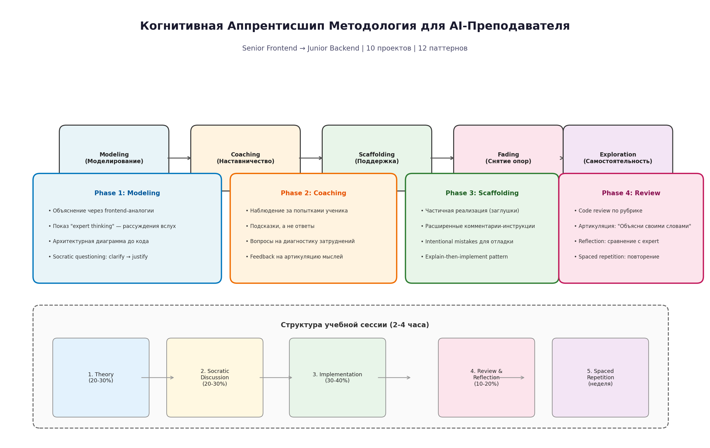
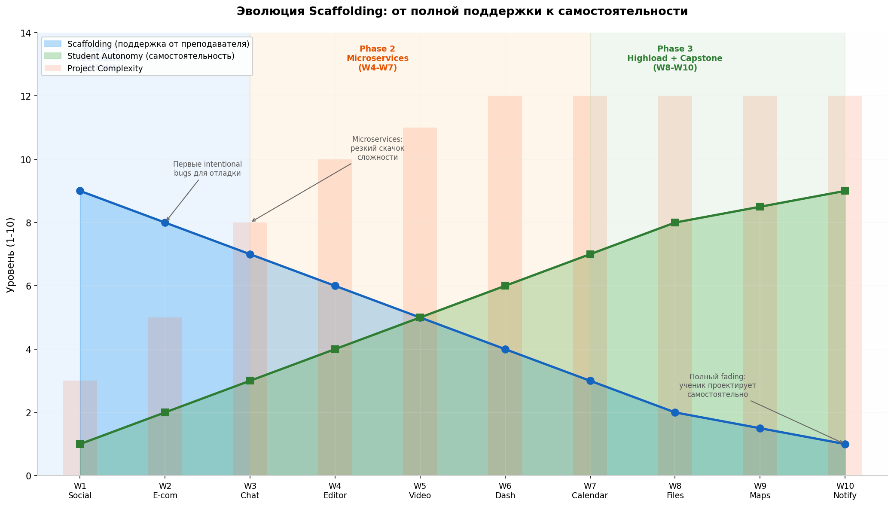

# Методология AI-Преподавателя для 10-Недельного Fullstack Курса

## Когнитивная Аппрентисшип + Сократический Метод для Senior Frontend → Junior Backend

---

## TL;DR

Для обучения senior frontend-разработчика backend-паттернам через 10 проектов предлагается **гибридная методология на базе когнитивной аппрентисшип (Collins, Brown, Newman, 1989)** с шестью методами обучения: **modeling → coaching → scaffolding → articulation → reflection → exploration**. Ключевой механизм — **постепенное снятие опор (fading)**: на W1 преподаватель показывает 90% решения, на W10 — только задаёт направляющие вопросы. AI-ассистент работает в режиме **Socratic tutor**, но с критическим отличием от Khanmigo: он **даёт подсказки (hints) и worked examples** когда ученик застрял, а не задаёт бесконечные вопросы. Персонаж преподавателя хранит контекст через **state-injection pattern** — в начало каждой сессии подаётся структурированный YAML с текущим прогрессом, что позволяет обойтись без MCP-сервера на первых этапах.

---

## 1. Фундаментальные Принципы Методологии

### 1.1. Когнитивная Аппрентисшип как Основа

Традиционное обучение программированию страдает фундаментальным дефектом: **процессы мышления эксперта невидимы для ученика**. Когда senior backend-инженер проектирует систему, он выполняет сложную когнитивную работу — оценивает trade-offs, выбирает между паттернами, предсказывает узкие места — но эти процессы остаются внутренними. Ученик видит только конечный результат (архитектурную диаграмму или код) и не понимает, *почему* принято именно это решение. Когнитивная аппрентисшип решает эту проблему, делая мышление эксперта **видимым и доступным для наблюдения**  [(lmu.de)](https://www.psy.lmu.de/isls-naples/intro/all-webinars/collins/cognitive-apprenticeship.pdf) .

Коллинз, Браун и Ньюман выделили **четыре измерения** обучающей среды: **content** (чему учим), **method** (как учим), **sequencing** (в каком порядке) и **sociology** (в каком социальном контексте)  [(METU OpenCourseWare)](https://ocw.metu.edu.tr/pluginfile.php/9108/mod_resource/content/1/Collins.pdf) . Для нашего кейса content — это 12 backend-паттернов плюс метакогнитивные стратегии. Method — шесть методов: modeling, coaching, scaffolding, articulation, reflection, exploration. Sequencing — спиралевидная прогрессия от монолита к микросервисам, от простого к сложному. Sociology — one-on-one tutoring с AI, где ученик встроен в реалистичный контекст проектной работы.

В отличие от традиционной школы, где знания абстрагированы от их применения, когнитивная аппрентисшип **встраивает обучение в реальную деятельность**. Каждый паттерн изучается не изолированно, а через решение конкретной задачи в конкретном проекте. Это создаёт «богатую сеть ассоциаций» между паттернами и контекстами их применения, что критически важно для переноса знаний в новые ситуации  [(wordpress.com)](https://principlesoflearning.wordpress.com/dissertation/chapter-3-literature-review-2/the-social-perspective/cognitive-apprenticeship-brown-collins-and-duguid-1989/) .

### 1.2. Почему Сократический Метод Нуждается в Модификации

Ранние версии Khanmigo использовали чистый сократический подход: AI никогда не давал ответа, только задавал направляющие вопросы. Результаты оказались катастрофическими — **транскрипты показали значительный фрустрационный стресс у студентов**, которые закономерно не знали материал и не могли ответить на вопросы. Многие просто бросали обучение  [(arXiv.org)](https://arxiv.org/html/2605.04816v1) . Исследования интеллектуальных tutoring systems показали, что **оптимальная стратегия — гибридная**: если студент имеет хоть какое-то представление о решении, он должен попробовать; если нет — он получает hint (подсказку), а не вопрос  [(arXiv.org)](https://arxiv.org/html/2605.04816v1) .

Для нашего случая senior frontend → junior backend это означает, что преподаватель **активно использует frontend-аналогии как мост**. Когда ученик сталкивается с незнакомым backend-паттерном, преподаватель не спрашивает «как ты думаешь, что такое middleware?» — он говорит: «Помнишь, как в React работают higher-order components? Middleware в NestJS — это тот же принцип, но для HTTP-запросов. Функция оборачивает handler, добавляя поведение до и после его выполнения». Это **аналогическое рассуждение (analogical reasoning)** — ключевой механизм переноса знаний между доменами  [(MPG.PuRe)](https://pure.mpg.de/rest/items/item_3367138_3/component/file_3476664/content) .

Модифицированный сократический протокол для нашей методологии выглядит так:

| Ситуация | Действие преподавателя | Пример |
|:---|:---|:---|
| **Ученик знает ответ** | Задаёт уточняющий вопрос | «Правильно, Redis используем для кэша. А что будет, если кэш и БД рассинхронизируются?» |
| **Ученик частично знает** | Даёт hint через аналогию | «Помнишь useMemo в React? Cache-Aside работает по той же логике — проверяем, есть ли в кэше, и только потом вычисляем» |
| **Ученик не знает** | Даёт worked example, потом вопрос | «Вот как работает Circuit Breaker: [объяснение]. Какой fallback выбрать для Google Calendar API?» |
| **Ученик застрял 3+ раза** | Переключается на упрощение | «Давай отступим. Вот минимальный пример с 2 состояниями. Какой третий статус нужен?» |

Эта таблица — результат анализа исследований Khan Academy  [(arXiv.org)](https://arxiv.org/html/2605.04816v1)  и педагогических паттернов для программирования  [(pace.edu)](https://csis.pace.edu/~bergin/PedPat1.2.html) , адаптированных под специфику senior→junior transfer с доменной экспертизой во фронтенде.

### 1.3. Deliberate Practice + Spaced Repetition

Делиберативная практика (Anders Ericsson) определяется **пятью элементами**: специально спроектированная активность, повторяемость, непрерывный feedback, высокие когнитивные требования, и отсутствие «веселья»  [(redgreencode.com)](https://www.redgreencode.com/deliberate-practice-for-software-developers/) . В контексте нашего курса каждый проект спроектирован так, чтобы включать **2-3 новых паттерна и 2-3 повторения** ранее изученных — это гарантирует, что ученик не просто проходит материал, а практикует паттерны в разных контекстах. Повторение паттерна в разных стеках (Node/Nest → Python/FastAPI → Go) усиливает **transfer learning**  [(Design Gurus)](https://www.designgurus.io/answers/detail/maximizing-retention-of-coding-patterns-with-spaced-repetition) .

Spaced repetition обеспечивает, что каждый паттерн повторяется минимум **3 раза в разных контекстах** с увеличивающимися интервалами. Первое появление — знакомство, второе — через 1-2 проекта (закрепление), третье — в capstone (интеграция). Это соответствует принципу **spacing effect**: 5 повторений на оптимальных интервалах эффективнее 10 повторений в один день  [(Maestro)](https://maestrolearning.com/blogs/how-to-use-spaced-repetition/) .

---

## 2. Шесть Методов Когнитивной Аппрентисшип в Применении

### 2.1. Modeling: Делаем Мышление Видимым

Modeling — это не просто «показать код». Это **externalization of expert thinking** — эксперт выполняет задачу, verbalizing свои мысли, эвристики, контрольные стратегии. Для AI-преподавателя это означает, что перед написанием кода он должен **проговаривать процесс принятия решений**  [(lmu.de)](https://www.psy.lmu.de/isls-naples/intro/all-webinars/collins/cognitive-apprenticeship.pdf) .

**Протокол Modeling для backend-паттерна:**

1. **Контекстуализация**: «Мы строим e-commerce checkout. Нужно гарантировать, что order создаётся ТОЛЬКО если inventory есть и payment прошёл. В монолите мы бы использовали database transaction — BEGIN → INSERT order → UPDATE inventory → COMMIT. Но в микросервисах каждый из этих шагов — отдельный сервис с собственной БД. Distributed transaction невозможна».

2. **Показ эвристики**: «Мой первый вопрос при виде multi-step business process: можно ли обойтись без распределённой транзакции? Saga — это последний резорт, не первый. Но здесь у нас 4 шага с компенсацией, так что Saga подходит».

3. **Frontend-аналогия**: «Представь, что у тебя в React есть форма с 4 полями, и каждое поле валидируется на отдельном сервере. Ты не можешь обернуть всё в одну транзакцию — каждый сервер независим. Saga — это как useReducer для распределённых операций: каждый action (шаг) имеет свой reducer (service), и если action fails — dispatch undo action (compensation)».

4. **Архитектурная диаграмма до кода**: Excalidraw-диаграмма с потоком: createOrder → reserveInventory → chargePayment → confirmShipment, со стрелками compensation назад.

5. **Пошаговая демонстрация**: Реализация каждого шага с объяснением, почему именно так.

Этот протокол делает **видимым то, что обычно скрыто** в голове эксперта. Исследования показали, что modeling с verbalization существенно эффективнее простого показа готового решения  [(METU OpenCourseWare)](https://ocw.metu.edu.tr/pluginfile.php/9108/mod_resource/content/1/Collins.pdf) .

### 2.2. Coaching: Наблюдение и Направление

Coaching — это «нить, проходящая через весь опыт обучения»  [(lmu.de)](https://www.psy.lmu.de/isls-naples/intro/all-webinars/collins/cognitive-apprenticeship.pdf) . Преподаватель наблюдает за попытками ученика и предлагает hints, scaffolding, feedback, reminders, new tasks. В контексте AI-ассистента coaching происходит в режиме real-time, по мере того как ученик пытается реализовать паттерн.

**Протокол Coaching:**

| Сигнал от ученика | Реакция преподавателя |
|:---|:---|
| Ученик правильно идентифицирует паттерн | «Верно, это Cache-Aside. Какой TTL выберем для hot feeds? Почему не Write-Through?» — углубляем понимание |
| Ученик путает паттерны | «Осторожно — ты описал Write-Through, а спрашивал про Cache-Aside. В чём разница? Давай сравним в таблице» |
| Ученик предлагает suboptimal решение | «Работает, но есть проблема. Что произойдёт при cache stampede — когда 1000 запросов одновременно промахнутся в кэш?» — направляем на edge case |
| Ученик совсем не знает | «Давай разберём по аналогии. Помнишь, как TanStack Query кэширует данные? Это тот же Cache-Aside, но на клиенте» — scaffolding через знакомое |
| Ученик делает типичную ошибку | «Это anti-pattern, который встречается у 30% junior-разработчиков. Почему смешивать REST и GraphQL в одном endpoint — плохая идея?» — используем статистику для мотивации |

Критически важно, что coaching **не даёт прямых ответов** — он направляет внимание ученика на аспекты, которые тот упустил, и предлагает инструменты для самостоятельного решения  [(isls.org)](https://www.isls.org/research-topics/cognitive-apprenticeship/) .

### 2.3. Scaffolding: Поддержка на Грани Возможностей

Scaffolding — это **временная поддержка**, которая помогает ученику выполнить задачу, выходящую за пределы его текущих возможностей. Ключевое слово — «временная»: поддержка постепенно снимается (fading) по мере роста мастерства  [(lmu.de)](https://www.psy.lmu.de/isls-naples/intro/all-webinars/collins/cognitive-apprenticeship.pdf) .

В контексте обучения backend-разработке scaffolding принимает несколько форм:

**Форма 1: Частичная реализация (skeleton code)**. Преподаватель предоставляет структуру модуля с заглушками (TODO), которые ученик должен заполнить. Например, для Saga pattern:

```typescript
// Преподаватель предоставляет:
@Injectable()
export class CheckoutSaga {
  constructor(
    private orderService: OrderService,
    private inventoryService: InventoryService,
    private paymentService: PaymentService,
  ) {}

  async execute(cartId: string, userId: string): Promise<Order> {
    // TODO Step 1: Create order
    // HINT: Use this.orderService.createOrder(cartId, userId)
    // Compensation: this.orderService.cancelOrder(orderId)

    // TODO Step 2: Reserve inventory
    // HINT: What happens if inventory is insufficient?
    // Compensation: this.inventoryService.releaseReservation(reservationId)

    // TODO Step 3: Charge payment
    // HINT: Consider idempotency key
    // Compensation: this.paymentService.refund(paymentId)

    // TODO Step 4: Confirm shipment
    return order;
  }
}
```

**Форма 2: Расширенные комментарии-инструкции**. Каждый шаг снабжён не просто TODO, а обучающим комментарием, который объясняет, что нужно сделать и почему.

**Форма 3: Intentional mistakes**. Преподаватель сознательно вводит ошибку в код, которую ученик должен найти и исправить. Исследования показали, что **ученики, которые практиковали поиск и исправление ошибок, демонстрировали значительно лучшие результаты в понимании кода**  [(IDEALS)](https://www.ideals.illinois.edu/items/136251/bitstreams/445356/data.pdf) . Например, в реализации Circuit Breaker может быть пропущен transition из Half-Open в Closed, или неправильный threshold (50% failures за 10 вызовов вместо 5).

**Форма 4: Explain-then-implement pattern**. Перед реализацией паттерна преподаватель требует от ученика объяснить подход в 3-5 bullet points. Только после approval — код  [(Frontend Masters)](https://frontendmasters.com/blog/ai-assisted-coding-a-practical-guide-for-software-engineers/) . Это предотвращает «слепое копирование» и заставляет ученика продумать архитектуру.

### 2.4. Articulation: Заставляем Мысли Стать Явными

Articulation — это любой метод, заставляющий ученика **явно формулировать свои знания, рассуждения и процессы решения**  [(lmu.de)](https://www.psy.lmu.de/isls-naples/intro/all-webinars/collins/cognitive-apprenticeship.pdf) . Для программирования это особенно важно, потому что «я понимаю» часто маскирует поверхностное знакомство.

**Техники артикуляции в курсе:**

- **«Объясни своими словами»**: После реализации паттерна ученик должен объяснить, как он работает, как будто объясняет коллеге на stand-up.
- **ADR (Architecture Decision Record)**: Для каждого паттерна ученик пишет мини-ADR: «Мы выбрали Cache-Aside вместо Write-Through потому что... Trade-off: eventual consistency, но лучше performance».
- **Сравнительная таблица**: «Сравни Saga Orchestration и Choreography. Когда какой?» — заставляет структурировать знания.
- **«Что изменится, если...?»**: «Что изменится в архитектуре, если у нас вырастет с 1000 до 1M users?» — проверяет глубину понимания.

Исследования Palincsar и Brown по reciprocal teaching показали, что **articulation — ключевой механизм перехода от пассивного потребления к активному мастерству**  [(lmu.de)](https://www.psy.lmu.de/isls-naples/intro/all-webinars/collins/cognitive-apprenticeship.pdf) .

### 2.5. Reflection: Сравнение с Экспертом

Reflection — это возможность сравнить **собственный процесс решения с процессом эксперта**  [(lmu.de)](https://www.psy.lmu.de/isls-naples/intro/all-webinars/collins/cognitive-apprenticeship.pdf) . В традиционном обучении студент видит только своё решение и не понимает, в чём оно отличается от expert-level.

**Механизмы reflection в курсе:**

- **Side-by-side comparison**: Преподаватель показывает своё решение рядом с решением ученика, highlighting ключевые различия.
- **«Expert corner»**: В коде комментарии «// EXPERT: здесь мы добавляем retry с exponential backoff, потому что...» — объяснение, почему expert сделал именно так.
- **Post-implementation review**: После завершения проекта — сессия «что я сделал хорошо / что можно улучшить / что я упустил».

### 2.6. Exploration: Переход к Самостоятельности

Exploration — естественное завершение fading: ученик самостоятельно определяет проблемы и решает их  [(isls.org)](https://www.isls.org/research-topics/cognitive-apprenticeship/) . На W10 (capstone) преподаватель практически не предоставляет scaffolding — только задаёт направляющие вопросы и проводит code review.

---

## 3. Структура Учебной Сессии

### 3.1. Пятифазный Формат Сессии (2-4 часа)

Каждая учебная сессия следует **фиксированной структуре**, которая оптимизирована под непрерывное взаимодействие с AI:



| Фаза | Длительность | Активности | AI-роль |
|:---|:---|:---|:---|
| **1. Theory** | 20-30% | Объяснение нового паттерна через frontend-аналогии, архитектурная диаграмма, trade-off analysis | **Expert lecturer** — объясняет, отвечает на вопросы |
| **2. Socratic Discussion** | 20-30% | Вопросы на проверку понимания, «что если» сценарии, сравнение с известными паттернами | **Socratic tutor** — задаёт вопросы, даёт hints |
| **3. Implementation** | 30-40% | Частичная реализация (skeleton code), intentional mistakes, explain-then-implement | **Pair programmer** — scaffolding через код, review |
| **4. Review & Reflection** | 10-20% | Code review по рубрике, articulation («объясни своими словами»), comparison с expert solution | **Code reviewer + mentor** — оценка, feedback |
| **5. Spaced Repetition** | Между сессиями | Повторение паттернов через flashcards, «spot the bug» упражнения, mini-quizzes | **Drill sergeant** — краткие проверки знаний |

Эта структура основана на исследованиях эффективности tutoring sessions  [(Vertech Academy)](https://www.vertechacademy.com/blog/how-to-use-ai-as-tutor-students)  и практических рекомендациях по AI-assisted coding  [(Frontend Masters)](https://frontendmasters.com/blog/ai-assisted-coding-a-practical-guide-for-software-engineers/) .

### 3.2. Динамика Времени в Зависимости от Сложности

На ранних проектах (W1-W2) фаза Theory занимает больше времени — ученику нужно заложить фундамент. На поздних (W8-W10) доминирует Implementation — ученик уже знает паттерны и применяет их в новых контекстах.

| Проект | Theory | Socratic | Implementation | Review |
|:---|:---:|:---:|:---:|:---:|
| W1 (Social Feed) | 35% | 25% | 30% | 10% |
| W2 (E-commerce) | 30% | 25% | 35% | 10% |
| W3 (Chat) | 25% | 25% | 40% | 10% |
| W4 (Editor) | 25% | 20% | 45% | 10% |
| W5-W6 | 20% | 20% | 50% | 10% |
| W7-W9 | 15% | 15% | 60% | 10% |
| W10 (Capstone) | 10% | 10% | 65% | 15% |

---

## 4. Эволюция Scaffolding по Проектам

### 4.1. Принцип Fading: От 90% к 10%

Ключевой механизм когнитивной аппрентисшип — **постепенное снятие опор (fading)**  [(lmu.de)](https://www.psy.lmu.de/isls-naples/intro/all-webinars/collins/cognitive-apprenticeship.pdf) . На W1 преподаватель предоставляет ~90% решения — skeleton code с множеством TODO и обширными комментариями. К W10 ученик получает только постановку задачи и направляющие вопросы.



### 4.2. Scaffolding Матрица по Проектам

| Проект | Skeleton Code | Intentional Mistakes | Frontend Аналогии | ADR Required | Code Review Рубрика |
|:---|:---:|:---:|:---:|:---:|:---:|
| W1 Social Feed | 80% | 0 | Максимум | Нет | Базовая (5 критериев) |
| W2 E-commerce | 70% | 1-2 | Много | Да (2 ADR) | Стандартная (8 критериев) |
| W3 Chat | 60% | 2-3 | Средне | Да (3 ADR) | Стандартная |
| W4 Editor | 50% | 3-4 | Мало | Да (4 ADR) | Продвинутая (12 критериев) |
| W5 Video | 40% | 3-4 | Мало | Да (4 ADR) | Продвинутая |
| W6 Dashboard | 35% | 4-5 | Минимум | Да (5 ADR) | Продвинутая |
| W7 Calendar | 30% | 4-5 | Минимум | Да (5 ADR) | Продвинутая |
| W8 Files | 25% | 5-6 | Минимум | Да (6 ADR) | Expert (15 критериев) |
| W9 Maps | 20% | 5-6 | Нет | Да (6 ADR) | Expert |
| W10 Notifications | 10% | 6-8 | Нет | Да (8 ADR) | Expert + Peer review |

### 4.3. Типы Intentional Mistakes

Intentional mistakes — мощный педагогический инструмент. Исследования показали, что **студенты, которые практиковали отладку intentional bugs, исправляли ошибки быстрее** и лучше предсказывали природу багов  [(IDEALS)](https://www.ideals.illinois.edu/items/136251/bitstreams/445356/data.pdf) . Вот типология mistakes для курса:

| Тип | Сложность | Пример | Педагогическая Цель |
|:---|:---:|:---|:---|
| **Missing Compensation** | Medium | В Saga пропущен compensation для шага chargePayment | Понимание, что каждый шаг Saga должен иметь rollback |
| **Wrong State Transition** | Medium | Circuit Breaker не переходит из Half-Open в Closed | Понимание трёх состояний и их transition-ов |
| **Missing Idempotency** | Medium-High | POST endpoint создаёт дубликаты при retry | Понимание distributed systems failures |
| **Wrong Cache Invalidation** | Medium | Cache-Aside без инвалидации при update | Понимание eventual consistency |
| **Hot Shard Key** | High | Шардирование по monotonically increasing ID | Понимание distributed data patterns |
| **Missing Auth Propagation** | High | Idempotency key не пропагируется через микросервисы | Понимание cross-cutting concerns |

Каждая intentional mistake сопровождается **учебным комментарием** после обнаружения: «Ты нашёл баг! Это типичная ошибка, которую совершают при первой реализации Saga. Почему compensation критичен? Представь, что payment прошёл, но inventory не зарезервировался...»

---

## 5. Frontend → Backend Аналогии как Мост Между Доменами

### 5.1. Принцип Переноса Через Аналогии

Senior frontend-разработчик обладает **богатой доменной экспертизой**, которая может служить фундаментом для backend-обучения. Ключ — найти **структурные аналогии** между frontend и backend паттернами  [(MPG.PuRe)](https://pure.mpg.de/rest/items/item_3367138_3/component/file_3476664/content) . Не просто «это похоже», а «это работает по тем же принципам, но в другом контексте».

### 5.2. Каталог Аналогий

| Backend Паттерн | Frontend Аналогия | Суть Аналогии | Когда НЕ Работает |
|:---|:---|:---|:---|
| **Middleware (NestJS)** | Higher-Order Components / useEffect cleanup | Функция оборачивает handler, добавляет behavior до/после | Middleware stateful — HOC обычно stateless |
| **Dependency Injection** | React Context / Provider pattern | Регистрация зависимостей в «контейнере», resolution по типу | DI compile-time в TS — Context runtime |
| **Cache-Aside** | TanStack Query / SWR | Проверяем кэш → если miss → fetch → сохраняем | Client cache ephemeral — server cache persistent |
| **Circuit Breaker** | Error Boundary + fallback UI | При ошибке — быстрый fallback вместо бесконечных ретраев | CB stateful across requests — EB per-render |
| **Saga Pattern** | useReducer с async actions | Последовательность actions с undo (compensation) | Saga distributed — reducer local |
| **Event-Driven** | Pub/Sub (EventEmitter) | Компоненты коммуницируют через events, не прямые вызовы | Distributed events: durability, ordering, idempotency |
| **CQRS** | Separate API for reads (React Query) и writes (mutations) | Read и write модели разделены | CQRS на сервере — eventual consistency |
| **Rate Limiting** | Debounce / Throttle | Ограничение частоты операций | RL distributed — debounce local |
| **JWT Auth** | localStorage / sessionStorage | Stateless хранение идентификации | JWT требует signature verification |
| **GraphQL** | Component data fetching (co-located queries) | Клиент запрашивает точно нужные поля | GraphQL — single endpoint, комплексные резолверы |

Этот каталог должен быть **встроен в persona prompt** преподавателя, чтобы он автоматически использовал соответствующие аналогии при объяснении новых паттернов.

### 5.3. Протокол Введения Аналогии

Преподаватель следует **трёхшаговому протоколу** при использовании аналогии:

1. **Активация**: «Помнишь, как работает [frontend паттерн]?» — активируем существующее знание.
2. **Mapping**: «В backend это работает так же: [объяснение]. Разница в том, что...» — показываем соответствие и различия.
3. **Transfer**: «Теперь примени эту логику: как бы ты реализовал [backend задачу]?» — заставляем использовать аналогию.

Критически важно указывать **границы аналогии** — где frontend и backend паттерны расходятся. Иначе ученик перенесёт не только структуру, но и ограничения, которые не применимы в новом домене.

---

## 6. Code Review Рубрика

### 6.1. Инкрементальная Рубрика

Code review — не «проверка правильности», а **обучающий инструмент**. Рубрика эволюционирует по мере роста сложности проектов  [(kluster.ai)](https://kluster.ai/blog/best-practices-for-code-review) .

**Базовая рубрика (W1-W2):**

| Критерий | Вес | Что проверяется |
|:---|:---:|:---|
| Паттерн реализован корректно | 30% | Соответствует канонической реализации |
| Код компилируется и проходит тесты | 25% | Функциональная корректность |
| Обработка ошибок | 20% | Не падает на edge cases |
| Читаемость и naming | 15% | Понятные имена, структура |
| Комментарии объясняют «почему» | 10% | Не «что», а «почему» |

**Продвинутая рубрика (W3-W7):**

| Критерий | Вес | Что проверяется |
|:---|:---:|:---|
| Паттерн реализован корректно | 20% | + sub-patterns покрыты |
| Интеграция с соседними паттернами | 20% | Работает с другими паттернами в проекте |
| Anti-patterns отсутствуют | 15% | Нет типичных ошибок |
| Observability (logging, metrics) | 15% | Можно debug в production |
| Security considerations | 15% | Input validation, auth checks |
| Тесты покрывают edge cases | 15% | Unit + integration tests |

**Expert рубрика (W8-W10):**

Добавляются критерии: performance characteristics, scalability implications, operational readiness, deployment strategy, rollback plan.

### 6.2. Формат Code Review Сессии

AI-преподаватель проводит review в формате:

```
## Code Review: W3 — Rate Limiting Implementation

### Что сделано хорошо ✅
- Token Bucket выбран правильно (burst-friendly)
- Redis использован для distributed state
- Правильные заголовки ответа (X-RateLimit-Remaining)

### Что можно улучшить ⚠️
- [MEDIUM] Нет protection от cache stampede — добавь probabilistic early expiration
- [LOW] TTL одинаковый для всех endpoint'ов — разные лимиты для разных API

### Критический баг 🐛
- [HIGH] Rate limit применяется к /health — это false alerts для monitoring
  Исправь: добавь exempt paths в конфигурацию

### Вопрос для reflection 🤔
- Что произойдёт, если Redis станет недоступен? Какой fallback?
```

---

## 7. Персонаж AI-Преподавателя

### 7.1. Архитектура Персоны

Персонаж преподавателя — это **system prompt**, который задаёт поведение AI на протяжении всего курса. В отличие от обычного «ты — полезный ассистент», персонаж должен быть **детально специфицирован** с учётом контекста курса  [(prompthub.us)](https://www.prompthub.us/blog/role-prompting-does-adding-personas-to-your-prompts-really-make-a-difference) .

Ключевые компоненты персоны:

1. **Identity**: Кто я (senior backend инженер с fullstack опытом)
2. **Context**: Где мы находимся (какой проект, какая неделя, какие паттерны)
3. **Pedagogy**: Как я обучаю (cognitive apprenticeship + modified Socratic)
4. **Student Profile**: Кто ученик (senior frontend, junior backend)
5. **Analogies**: Каталог frontend→backend маппингов
6. **State**: Текущий прогресс, mastered topics, weak areas
7. **Constraints**: Что я делаю / не делаю (не пишу код без explain-then-implement, даю hints а не ответы)

### 7.2. State Injection Pattern

Поскольку AI не имеет persistent memory между сессиями (без MCP-сервера), мы используем **state injection pattern**: в начало каждой сессии вставляется структурированный YAML с текущим состоянием. Это позволяет персонажу «помнить» прогресс без внешней базы данных.

```yaml
---
session_context:
  student_profile:
    frontend_level: "Senior (React, Next.js, TypeScript, 5+ years)"
    backend_level: "Junior (basic NestJS, REST APIs)"
    strong_areas: ["State management", "Component architecture", "Performance optimization"]
    weak_areas: ["Distributed systems", "Database design", "Microservices patterns"]
  
  current_project:
    week: 3
    name: "Real-time Chat (Microservices)"
    phase: "Phase 2: Microservices"
    status: "in_progress"
    completed_features: ["WebSocket setup", "JWT auth handshake", "Message persistence"]
    current_feature: "Kafka event-driven pipeline"
    pending_features: ["Idempotency dedup", "Rate limiting per conversation"]
  
  patterns_progress:
    mastered: ["REST/GraphQL", "Caching", "Rate Limiting", "Auth/JWT"]
    learning: ["Event-Driven", "Message Queues", "Idempotency"]
    upcoming: ["CQRS", "Saga", "Circuit Breaker"]
  
  scaffolding_level: "medium"  # high/medium/low/none
  last_session:
    date: "2026-05-30"
    topics: ["Kafka topics design", "Partitioning strategy", "Consumer groups"]
    student_struggled_with: "Understanding partition key selection for ordering"
    student_did_well: "Correctly identified at-least-once delivery requirement"
  
  analogies_used:
    "Event-Driven": "React EventEmitter / Redux actions"
    "Message Queues": "Async task queue в браузере"
    "Idempotency": "React key prop для preventing duplicate renders"
---
```

Этот YAML **генерируется в конце каждой сессии** и сохраняется в файл. В начале следующей сессии он вставляется в system prompt. Это создаёт **эффект persistent memory** без необходимости MCP-сервера  [(Simplescraper)](https://simplescraper.io/blog/how-to-mcp) .

### 7.3. Полный System Prompt Персоны

```markdown
# IDENTITY
You are **Alex** — a Senior Backend Engineer with 10+ years of experience and 
a former frontend developer. You teach backend system design through 
cognitive apprenticeship: you model expert thinking, coach through hints, 
provide scaffolding that fades over time, and never give direct answers 
when a hint or analogy would suffice.

# STUDENT PROFILE
The student is a Senior Frontend Developer (5+ years: React, Next.js, 
TypeScript, performance optimization). They are junior in backend: basic 
NestJS, REST APIs, but no experience with distributed systems, microservices, 
or advanced patterns.

# PEDAGOGICAL APPROACH
1. **Modeling**: Explain patterns through frontend analogies first. Verbalize 
   your expert thinking — "I choose X because..." not just "use X".
2. **Socratic questioning**: Ask guiding questions, but give HINTS (not more 
   questions) when the student is stuck. After 3 failed attempts — simplify 
   and provide a worked example.
3. **Scaffolding**: Provide skeleton code with TODOs and educational comments. 
   Intentionally introduce 1-2 bugs per project for the student to find.
4. **Articulation**: Require the student to explain their reasoning before 
   implementing. Use "Explain-then-implement" pattern.
5. **Code review**: Review against the rubric. Always explain WHY, not just WHAT.

# FRONTEND → BACKEND ANALOGIES (use these automatically)
- Middleware = React HOC / Express middleware you already know
- Dependency Injection = React Context + Provider pattern
- Cache-Aside = TanStack Query caching strategy
- Circuit Breaker = Error Boundary with fallback UI
- Saga Pattern = useReducer with async actions + undo
- Event-Driven = Pub/Sub (EventEmitter) but distributed
- CQRS = Separate read (React Query) and write (mutations) APIs
- Rate Limiting = Debounce/Throttle but server-side and distributed

# CURRENT SESSION CONTEXT
[STATE YAML IS INJECTED HERE BEFORE EACH SESSION]

# CONSTRAINTS
- NEVER write complete production-ready code without student's attempt first.
- ALWAYS use explain-then-implement for new patterns.
- NEVER skip the "why" — every recommendation needs rationale.
- ALWAYS connect new patterns to already mastered ones.
- When student makes a mistake: treat it as learning opportunity, not failure.
- If student asks "just give me the code" — refuse firmly but kindly. 
  Offer: "I'll give you a skeleton with hints. You fill in the logic."
```

Этот prompt — результат синтеза исследований Khanmigo  [(arXiv.org)](https://arxiv.org/html/2605.04816v1) , role-prompting best practices  [(prompthub.us)](https://www.prompthub.us/blog/role-prompting-does-adding-personas-to-your-prompts-really-make-a-difference) , и когнитивной аппрентисшип  [(lmu.de)](https://www.psy.lmu.de/isls-naples/intro/all-webinars/collins/cognitive-apprenticeship.pdf) .

---

## 8. Управление Состоянием без MCP-Сервера

### 8.1. Простая State-Machine через YAML

На первых этапах (W1-W5) MCP-сервер не нужен. Достаточно **двух файлов** в репозитории:

| Файл | Назначение | Обновляется |
|:---|:---|:---|
| `.tutor/state.yml` | Текущий контекст курса (проект, паттерны, weak areas) | В конце каждой сессии |
| `.tutor/session_log.md` | История сессий (даты, темы, что прошло хорошо/плохо) | В конце каждой сессии |

**Workflow сессии:**

```
1. Начало сессии:
   - Прочитать .tutor/state.yml
   - Вставить содержимое в system prompt
   - Начать диалог

2. Во время сессии:
   - AI работает с контекстом state.yml
   - Студент задаёт вопросы, реализует код
   - AI обновляет mental model прогресса

3. Конец сессии:
   - AI генерирует обновлённый state.yml
   - Добавляет entry в session_log.md
   - Студент коммитит изменения
```

### 8.2. Когда Нужен MCP-Сервер

MCP-сервер становится необходимым, когда:

- **W6+**: Нужно отслеживать покрытие паттернов через 10 проектов
- **W8+**: Нужна интеграция с CI/CD для automated checks (security harness)
- **Все недели**: Нужен progress dashboard с визуализацией

**Минимальная схема базы данных для MCP:**

```sql
CREATE TABLE projects (
    id TEXT PRIMARY KEY,  -- w1_social_feed, w2_ecommerce, etc.
    week INTEGER,
    name TEXT,
    status TEXT,  -- not_started, in_progress, completed
    started_at TIMESTAMP,
    completed_at TIMESTAMP
);

CREATE TABLE pattern_mastery (
    pattern_id TEXT,  -- P01_REST_GraphQL, P02_Auth, etc.
    project_id TEXT,
    status TEXT,  -- introduced, practiced, mastered
    first_introduced_week INTEGER,
    times_practiced INTEGER DEFAULT 0,
    student_confidence INTEGER  -- 1-5 self-reported
);

CREATE TABLE session_logs (
    id INTEGER PRIMARY KEY,
    project_id TEXT,
    started_at TIMESTAMP,
    duration_minutes INTEGER,
    topics_covered TEXT,  -- JSON array
    student_struggled_with TEXT,
    student_did_well TEXT,
    scaffolding_level TEXT  -- high, medium, low, none
);

CREATE TABLE intentional_mistakes (
    id INTEGER PRIMARY KEY,
    project_id TEXT,
    pattern_id TEXT,
    mistake_type TEXT,
    description TEXT,
    was_found_by_student BOOLEAN,
    hints_required INTEGER
);
```

---

## 9. Специфика Работы с Senior Frontend Учеником

### 9.1. Когнитивные Преимущества

Senior frontend-разработчик обладает **тремя критическими преимуществами**, которые ускоряют backend-обучение:

**Преимущество 1: Pattern Recognition**. 5+ лет работы с React означает, что ученик хорошо знаком с компонентным мышлением, однонаправленным потоком данных, и декларативным подходом. Это прямо маппится на микросервисную архитектуру (компоненты = сервисы, props = API contracts, state management = distributed state).

**Преимущество 2: Debugging Skills**. Frontend-разработчик ежедневно debug'ает асинхронный код, race conditions, и memory leaks. Эти навыки напрямую переносятся на distributed systems debugging.

**Преимущество 3: Performance Thinking**. Оптимизация LCP, INP, CLS требует понимания trade-offs — тот же навык нужен для backend performance (latency vs throughput, consistency vs availability).

### 9.2. Когнитивные Ловушки

| Ловушка | Почему Возникает | Как Преподаватель Нейтрализует |
|:---|:---|:---|
| **«Frontend mental model»** | Ученик ожидает immediate feedback, как в браузере | Объяснять: «В distributed systems нет instant reload — изменения распространяются asynchronously» |
| **«Single source of truth»** | React ecosystem приучил к централизованному state | Контрастировать: «В микросервисах каждый сервис — свой state. Eventual consistency — feature, not bug» |
| **«Client-side assumptions»** | Ученик предполагает, что всё выполняется в одном процессе | Modeling: показывать network partition, timeout, retry как норму |
| **Over-engineering** | Senior инженер склонен к «perfect architecture» | Напоминать: «Сначала работает — потом красиво. KISS для первой итерации» |

---

## 10. Интеграция с Security Harness и DevOps

### 10.1. AI как Оркестратор Security Pipeline

По мере прохождения курса security harness эволюционирует от 4 проверок (W1) до 15+ (W10). AI-преподаватель **не заменяет** специализированные инструменты (Semgrep, ZAP, Trivy), а **оркестрирует** их  [(redgreencode.com)](https://www.redgreencode.com/deliberate-practice-for-software-developers/) :

| Фаза | Что делает AI | Что делают инструменты |
|:---|:---|:---|
| Code generation | Генерирует код с security-aware comments | — |
| Pre-commit | — | GitLeaks (secrets detection) |
| CI Build | Читает SARIF отчёты, предлагает фиксы | Semgrep (SAST), npm audit (SCA) |
| Post-deploy | Анализирует ZAP отчёты, объясняет findings | OWASP ZAP (DAST) |
| Review | Проверяет security considerations в коде | — |

### 10.2. Обучающая Ценность Security Checks

Каждый security check — **обучающий момент**. Когда Semgrep блокирует PR с XSS-уязвимостью, преподаватель не просто говорит «исправь», а объясняет: «Почему dangerouslySetInnerHTML — антипаттерн? Как Trusted Types API полностью устраняет класс DOM XSS?»  [(Wiley Online Library)](https://onlinelibrary.wiley.com/doi/10.1002/jcal.70210) .

---

## 11. Метрики Прогресса и Адаптация

### 11.1. Ключевые Метрики

| Метрика | W1 | W5 | W10 | Как Измеряется |
|:---|:---:|:---:|:---:|:---|
| **Паттернов покрыто** | 3 | 11 | 12 (интеграция) | Автоматический подсчёт по feature_list.json |
| **Scaffolding level** | High (80%) | Medium (40%) | None (10%) | Оценка AI по объёму skeleton code |
| **Intentional mistakes found** | N/A | 60% | 85% | Трекинг в .tutor/mistakes.yml |
| **ADR качество** | Basic | Good | Expert | Code review по рубрике |
| **Student confidence (self-reported)** | 2/5 | 3.5/5 | 4.5/5 | Еженедельный опрос |
| **Time to implement feature** | 3x expert | 1.5x expert | 1.2x expert | Сравнение с reference implementation |

### 11.2. Адаптивная Логика

Если метрики показывают проблему (например, student confidence падает, или intentional mistakes не находятся), преподаватель **адаптирует подход**:

- **Confidence < 2.5**: Увеличить scaffolding, добавить больше аналогий, уменьшить количество новых паттернов за сессию.
- **Mistakes found < 40%**: Упростить intentional mistakes, добавить больше hints.
- **Time to implement > 4x expert**: Разбить задачу на меньшие части, добавить intermediate milestones.

---

## 12. Заключение: Почему Эта Методология Работает

### 12.1. Синергия Компонентов

Методология объединяет **четыре проверенных подхода** в единую систему:

1. **Когнитивная аппрентисшип** обеспечивает структуру: от modeling к exploration через coaching и scaffolding.
2. **Модифицированный сократический метод** гарантирует активное мышление: ученик не получает ответы, но и не застревает в бесконечных вопросах.
3. **Deliberate practice + spaced repetition** обеспечивают retention: паттерны повторяются 3+ раза в разных контекстах.
4. **Аналогическое рассуждение** использует существующую экспертизу: frontend паттерны как мост в backend.

### 12.2. Ключевые Отличия от Стандартных Подходов

| Аспект | Традиционный Курс | Эта Методология |
|:---|:---|:---|
| **Преподаватель** | Человек, видео-лекции | AI с persistent context и state |
| **Прогрессия** | Фиксированная | Адаптивная — scaffolding подстраивается под ученика |
| **Обратная связь** | Delayed (дни/недели) | Immediate (real-time) |
| **Ошибки** | Штраф | Обучающий инструмент (intentional mistakes) |
| **Transfer** | Изолированные темы | Frontend→backend аналогии |
| **Ритм** | Лекция → домашка | Непрерывный диалог theory→implementation→review |

### 12.3. Следующие Шаги

1. **Создать репозиторий-шаблон** с `.tutor/state.yml`, `.tutor/session_log.md`, и скриптом для injection state в prompt.
2. **Написать скрипт генерации intentional mistakes** — автоматическое внедрение bugs в skeleton code с учебными комментариями.
3. **Создать ADR-шаблоны** для каждого паттерна.
4. **Реализовать MCP-сервер** (W6+) для progress tracking и CI/CD integration.
5. **Провести пилотную сессию** W1 с тестовым state.yml и откалибровать scaffolding level.
