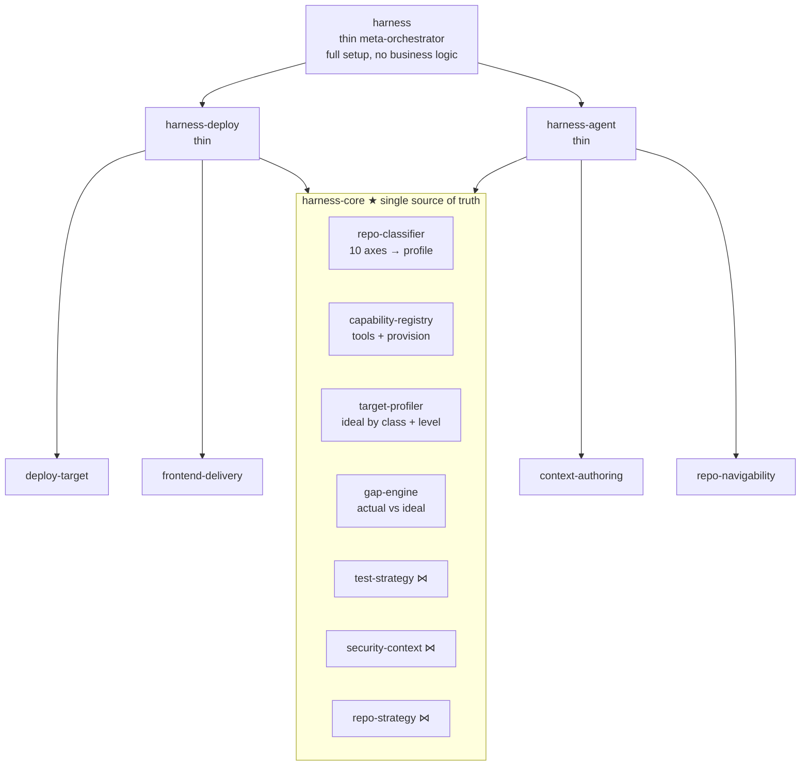
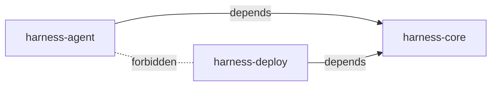
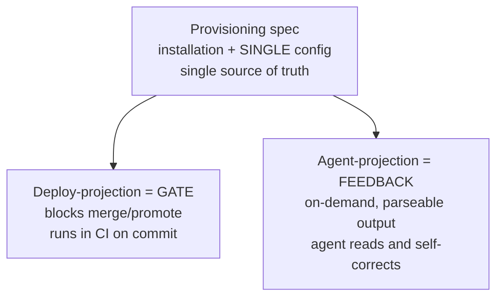
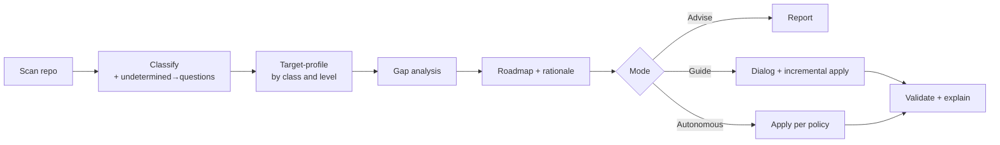

# RFC v4: Repo Harness Skill — Agent & Deployment Readiness

> [!abstract] TL;DR
> A 3-package skill set (`harness-core`, `harness-deploy`, `harness-agent`) that prepares any repository for both CI/CD delivery and AI-agent work. Built around a shared core (classifier, capability registry, target profiler, gap engine) with two thin consumer packages and an optional orchestrator. The skill scans a repo, classifies its architecture across 10 axes, diagnoses gaps against a maturity ladder (L0→L4), and guides the user through advise/guide/autonomous modes.
>
> 📋 **Build plan:** [[Repo Harness Skill — Step-by-Step Implementation Plan (RFC v4)]]

---

## 1. Summary

A set of skills that brings any repository — from an empty greenfield project to a mature service — to a state of "good harness" along **two orthogonal axes**:

- **Deployment Readiness** — delivery harness (CI, tests, security, progressive deploy, verification).
- **Agent Readiness** — context, navigation, boundary, and feedback-loop harness for safe and effective AI-agent work.

Implemented as **3 independently versioned packages** (`harness-core`, `harness-deploy`, `harness-agent`) with separate entry points over a shared core. The skill scans, diagnoses gaps, advises, and guides toward the target state through dialogue or autonomously on request. Both axes feed from a single architectural profile and a single capability registry — without duplication or drift.

---

## 2. Motivation

A repository serves two consumers: the **delivery machine** (build → verify → deploy) and the **AI agent** (understand → find → don't break → self-check). Today both harnesses are built manually, in isolation, and they rot.

Three problems this skill solves:

1. **Contextual blindness** — one step (canary or `AGENTS.md`) is configured fundamentally differently depending on architecture. There is no universal template.
2. **Duplication and drift** — lint/tests/policies are rewritten per project and diverge between "CI gate" and "agent feedback loop."
3. **No guidance** — tools either dump "everything at once" on greenfield or diagnose nothing.

---

## 3. Goals / Non-Goals

### Goals
- Work on **any repo state**: from empty React/Next.js to mature monorepo.
- Classify project across 10 architectural axes.
- Diagnose gaps against a contextual ideal and **guide** through maturity levels (advise / guide / autonomous).
- Generate both harnesses, reusing a shared core.
- Allow **independent use** of axes (agent-readiness without deployment, and vice versa).
- Guarantee **single source of truth** for shared capabilities (no drift gate↔loop).
- Every recommendation must be explainable ("why").

### Non-Goals
- Do not execute pipelines or provision cloud infrastructure.
- Do not write application code/tests from scratch — only harness and configuration.
- Do not replace human review: autonomous mode works under explicit policy with gates.
- Do not impose maximum maturity level — recommends the next reasonable one.

---

## 4. Topology Overview

Three layers: shared core, two axis-consumers, optional orchestrator. What is truly shared is the **core**, not sub-skills. Axes are not owners of tools — they are **consumers of capabilities**; the seam runs between *provisioning* (shared) and *consumption* (per-axis projection).



`⋈` — bridge sub-skills (analyzer/projector), live in core because dual by nature.

### 4.1 Packaging & Versioning Boundaries

The boundary is drawn **between core and axes**, not between "two tasks." This gives real separation without losing DRY.

| Package | Contains | Depends on | Versioned |
|---|---|---|---|
| **`harness-core`** | classifier, capability-registry, target-profiler, gap-engine, **bridge** sub-skills (`test-strategy`, `security-context`, `repo-strategy`) | — | independently |
| **`harness-deploy`** | `deploy-target`, `frontend-delivery`, deploy-projections | `harness-core` | independently |
| **`harness-agent`** | `context-authoring`, `repo-navigability`, agent-projections | `harness-core` | independently |
| **`harness`** (opt.) | orchestration "everything at once" | `deploy` + `agent` | independently |

**Boundary invariants:**

1. Dependencies flow **inward only, toward core**. `deploy` ↮ `agent` — axes **do not know** about each other.
2. **No axis holds its own copy** of core, classifier logic, or capability configs (drift protection).
3. Bridge sub-skills **are not given** to either axis — they are dual, they live in core.
4. **Separate entry points:** a user installs/calls `harness-agent` independently and **does not see deploy** (not in questions, not in output, not in dependencies).

**What this gives:**
- Separate release cadences (agent evolves with LLMs, deploy with CI tools).
- Bounded blast radius: updating `harness-agent` on 100 repos does not risk deploy logic.
- Clean greenfield UX: "make repo agent-ready" does not pull deployment ceremony.



---

## 5. Classification Model (10 Axes)

Single foundation for both axes (in `harness-core`). On greenfield, undetectable axes return `undetermined` and **become interview questions** (detection gap = interview agenda).

| Axis | Priority | Drives |
|---|---|---|
| Infrastructure (Docker/K8s/GitOps/serverless) | 🔴 Critical | `deploy-target` |
| Backend architecture (monolith/microservices/BFF/mesh) | 🔴 Critical | `deploy-target` |
| Code organization (mono/polyrepo) | 🔴 Critical | `repo-strategy` ⋈ |
| Client/server split (SPA/SSR/MPA/PWA) | 🔴 Critical | `frontend-delivery` |
| Delivery/rendering (SSG/CSR/ISR/Edge/RSC) | 🟡 Important | `frontend-delivery` |
| Frontend scaling (micro-FE/Module Federation) | 🟡 Important | `repo-navigability` |
| Auth/connectivity (JWT/BFF/OIDC) | 🟡 Important | `security-context` ⋈ |
| Interaction protocols (REST/GraphQL/gRPC/WS) | 🟢 Optional | `test-strategy` ⋈ |
| Data model/sync (CRDT/optimistic/SWR) | 🟢 Optional | param in `frontend-delivery` |
| Build/runtime (Vite/Webpack/ESM) | 🟢 Optional | param in `repo-strategy` |

`context-authoring` consumes **all 10 axes** — a good `AGENTS.md` must describe the architecture.

---

## 6. Module Catalog

### 6.1 Deployment Axis (1–8)

| # | Module | Deploy | Agent | Status |
|---|---|---|---|---|
| 1 | CI/CD Pipeline | 🔴 | 🔴 | **bridge → C** |
| 2 | Environments (IaC, disposable) | 🔴 | 🟡 | partial bridge (sandboxes) |
| 3 | Testing & Quality | 🔴 | 🔴 | **bridge → C** |
| 4 | DevSecOps | 🔴 | 🔴 | **bridge → E** |
| 5 | Progressive Delivery | 🔴 | ⚪ | deploy-only |
| 6 | Continuous Verification | 🟡 | ⚪ | deploy-only |
| 7 | Chaos / Incidents | 🟡 | ⚪ | deploy-only |
| 8 | DORA Metrics | 🟡 | 🟢 | deploy-only |

### 6.2 Agent Axis (A–E)

| Module | What it does | Driven by |
|---|---|---|
| **A. Context Layer** | Hierarchy of `AGENTS.md` (root → nested) + `README`; lazy loading down the tree | `context-authoring` |
| **B. Navigability** | Folder structure, naming, repo map, indexes | `repo-navigability` |
| **C. Guardrails-as-Feedback** | Lint/tests/types as agent self-check commands | bridge to 1,3,4 |
| **D. Agent Tooling** | Commands, slash-commands, MCP, hooks, script registry | `repo-navigability` |
| **E. Boundaries** | Protected paths, forbidden zones, what not to touch | bridge to 4 |

### 6.3 Capability Registry ("provision once, project per consumer")

Resolves the tension: "linter/Storybook is needed by both deploy and agent." A tool does not belong to an axis — it is provisioned once, **projected** twice. Lives in `harness-core`.



**Capability contract:**

```yaml
capability:
  id: string                 # lint | test | typecheck | storybook | ...
  provision:                 # SHARED, single source of truth
    install: [...]
    config_path: string
  deploy_projection:
    role: gate
    invocation: ci-on-commit
    blocks_promotion: bool
  agent_projection:
    role: feedback
    invocation: on-demand
    output_format: parseable
    fix_command: string|null
```

**Example — Storybook:** provision = installed + `build-storybook`; deploy-projection = build → publish → visual regression as gate; agent-projection = fast local run/snapshot, agent sees render errors. One config.

**Invariant:** both projections read **only** the provision config; neither holds a copy.

---

## 7. Advisory & Maturity Engine

Flow (in `harness-core`): `classify → target → gap → roadmap → execute`. The skill **guides**, not dumps "everything at once."

### 7.1 Maturity Model — target is a ladder, not a final state

| Level | Contents | For whom |
|---|---|---|
| **L0** | Nothing | greenfield starting point |
| **L1 — Feedback loop** | lint + typecheck + test runner + `AGENTS.md` | empty React/Next.js → here immediately |
| **L2 — Delivery** | CI on commit, single artifact, deploy target | production target exists |
| **L3 — Confidence** | Test Intelligence, security gates, progressive delivery | live production |
| **L4 — Operability** | Continuous Verification, chaos, DORA | mature service |

The skill recommends the **next** reasonable level, not the final one (protects greenfield from over-engineering).

### 7.2 Gap Analysis
`gap-engine` compares actual profile against target at current level. Each module/capability → `present | partial | missing` + importance weight → prioritized roadmap with "why."

### 7.3 Autonomy Modes — one roadmap, different gating

| Mode | Who approves | Who executes |
|---|---|---|
| **Advise** | — | nobody (report gaps + priorities) |
| **Guide** | human per step | skill, incrementally |
| **Autonomous** | skill per policy | skill, full roadmap |

---

## 8. Sub-skills (Contracts)

| Sub-skill | Package | Inputs | Outputs |
|---|---|---|---|
| `deploy-target` | deploy | Infra, Backend architecture | target, rollout/rollback strategy (2,5,6,7) |
| `frontend-delivery` | deploy | Client/server, Rendering, Data model | build steps, invalidation, style lint |
| `context-authoring` ⭐ | agent | ALL 10 axes | root/nested `AGENTS.md`, `README` (A) |
| `repo-navigability` ⭐ | agent | Code organization, Frontend scaling | repo map, conventions, command registry (B, D) |
| `repo-strategy` ⋈ | core | Code organization, Build | triggers/cache (1,8) + context hierarchy shape (A) |
| `test-strategy` ⋈ | core | Protocols, Architecture | pyramid + Test Intelligence (3) **+** self-check commands (C) |
| `security-context` ⋈ | core | Auth, Boundaries | secrets/SAST/DAST/Policy (4) **+** agent boundaries (E) |

**Bridges (⋈)** implement **analyzer/projector**: shared analyzer (reads axes → understands strategy) + separate projectors (deploy artifact vs agent artifact). The analyzer is shared, not the monolith.

---

## 9. Execution Flow



1. **Scan** — read repo (package.json, Dockerfile, terraform, existing `AGENTS.md`/CI).
2. **Classify** — fill 10 axes; `undetermined` → interview questions.
3. **Target** — derive ideal for project class at next maturity level.
4. **Gap** — delta; statuses present/partial/missing.
5. **Roadmap** — prioritized plan with "why."
6. **Execute** — by mode (advise/guide/autonomous).
7. **Validate** — check critical non-emptiness; warn about gaps and drift risks.

---

## 10. Key Invariants

1. **Single source of truth for capability** — both projections read one config (drift protection gate↔loop).
2. **Dependencies only toward core** — `deploy` and `agent` do not know each other; nobody duplicates core.
3. **Target derives from classification** — no universal templates.
4. **Recommend next level, not final** — greenfield protection.
5. **Detection gap = interview question** — single mechanism.
6. **Bridges share analyzer, not monolith** — analyzer/projector, else god-module.
7. **Every recommendation explainable** — else autonomous mode is scary to enable.
8. **Separate entry points** — each axis can be installed/called independently.

---

## 11. Open Questions

1. **Defensible target-model** — biggest risk: "good harness" is opinionated; need grounded, reusable, tiered ideal.
2. **Context drift** — `AGENTS.md` rots faster than code; need resync mechanism on structural change? (critical).
3. **Detection source** — balance auto-detect/interview + fallback to `undetermined`.
4. **Axis conflicts** — deploy wants canary, frontend is pure SSG; need compatibility matrix.
5. **Autonomous policy** — what without asking, what must confirm (secrets, deletion, migrations always gate).
6. **Nested `AGENTS.md` granularity** — one per monorepo package or one per domain?
7. **DORA / agent productivity metrics** — separate or unified? What is "agent productivity"?
8. **Local-first rollback guardrail** — auto-rollback dangerous when client data has diverged.
9. **Semver contract** — what in `harness-core` is breaking for axes? How guarantee backward compat?

---

## 12. Alternatives Considered

- **One monolithic skill** (v1/v2/v3 §4) — rejected: different consumers/cadences; cannot ship agent-readiness without risking deploy.
- **Two independent skills with duplicated core** — rejected: brings back drift (violates invariant #1). Replaced with 3-package model with shared core.
- **Two skills with literally shared sub-skills** — rejected: god-module serving two masters. Replaced with analyzer/projector + core.
- **Tools bound to axis** — rejected: source of confusion. Replaced with capability-registry with two projections.
- **Generate final maturity level immediately** — rejected: drowns greenfield. Replaced with L0→L4.
- **Agent axis only** — rejected: scope = both axes.

---

## Related Documents

- [[Repo Harness Skill — Step-by-Step Implementation Plan (RFC v4)]] — detailed build plan with phases, research topics, and exit criteria.

---

*Last updated: 2026-06-08*
