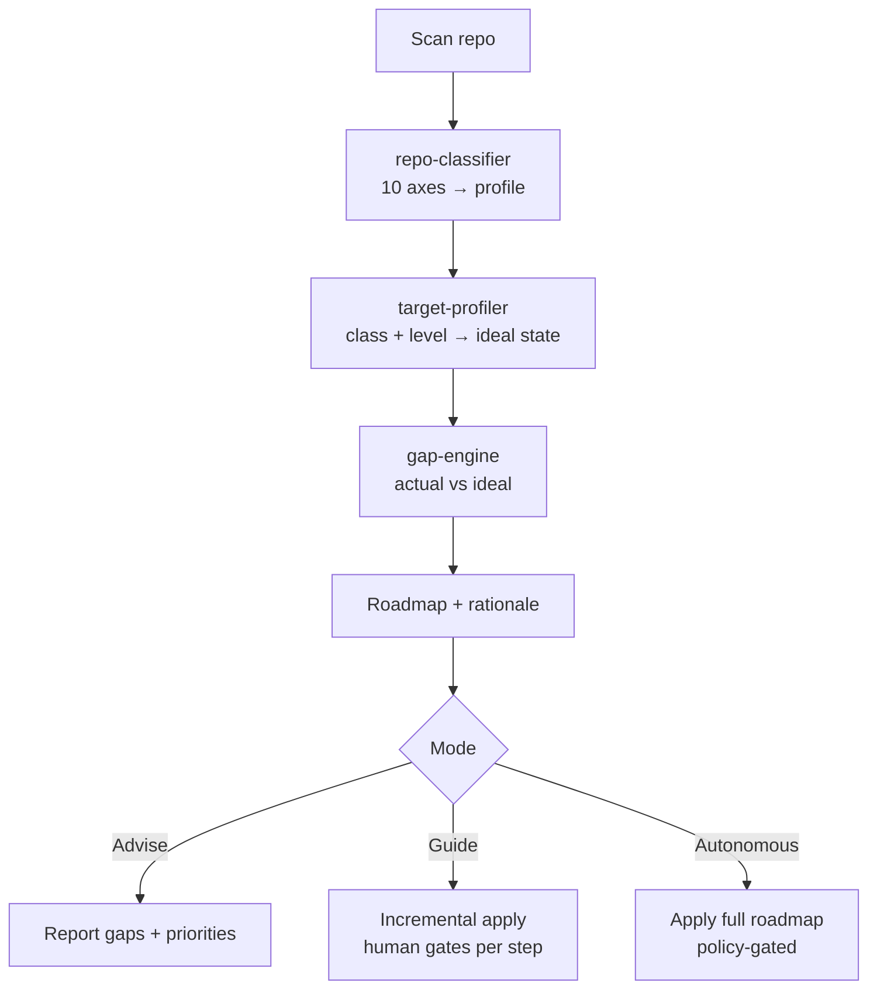
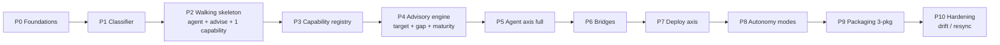

# Repo Harness Skill — Step-by-Step Implementation Plan (RFC v4)

> [!abstract] TL;DR
> A 3-package skill set (`harness-core`, `harness-deploy`, `harness-agent`) that prepares any repository for both CI/CD delivery and AI-agent work. Built around a shared core (classifier, capability registry, target profiler, gap engine) with two thin consumer packages and an optional orchestrator. The skill scans a repo, classifies its architecture across 10 axes, diagnoses gaps against a maturity ladder (L0→L4), and guides the user through advise/guide/autonomous modes.
>
> 📄 **Architecture spec:** [[Repo Harness Skill — RFC v4 Architecture]]

---

## 🔬 Phase 1: EXTRACTION — What We Distilled

### Key Concepts

- **Dual-axis harness:** Every repository serves two consumers — the delivery machine (CI/CD) and AI agents (context, navigation, guardrails). These are orthogonal axes, not sequential layers.
- **3-package topology:** `harness-core` (shared) + `harness-deploy` + `harness-agent`. Dependencies flow inward only; axes never know about each other. This enables independent release cadences and clean greenfield UX (agent-only without deployment baggage).
- **Capability registry with "provision once, project per consumer":** A tool (e.g., ESLint, Storybook) is provisioned once with a single config. Each axis projects it differently — deploy sees a CI gate, agent sees an on-demand feedback loop. Both read the same config; neither holds a copy.
- **Maturity ladder (L0→L4):** Not a final target, but a staircase. L0 = nothing; L1 = feedback loop (lint, typecheck, tests, `AGENTS.md`); L2 = delivery; L3 = confidence (security gates, progressive deploy); L4 = operability (verification, chaos, DORA). The skill recommends the *next* reasonable level, protecting greenfield from over-engineering.
- **Analyzer/Projector pattern for bridge sub-skills:** `test-strategy`, `security-context`, `repo-strategy` live in core because they are dual by nature. They share an analyzer (reads axes → understands strategy) and split into two projectors (deploy artifact vs agent artifact). This avoids god-modules.
- **Gap-as-interview:** Undetectable axes during classification automatically become interview questions. No separate "what to ask" logic — the detection gaps *are* the agenda.

### Novelty

The insight that changed everything: **deployment modules and agent modules are not separate work products — they are different consumers of the same capabilities.** The deployment module "owns" the gate; the agent module "owns" the feedback loop. But the tool, its config, and its invocation semantics are the same. This collapses a lot of duplication into a single registry with dual projections.

Also novel: the maturity engine is not a scoring rubric but a **roadmap generator**. It doesn't say "you are at 73%" — it says "you are at L1, and L2 requires X, Y, Z; here's why each matters for *your* project type."

### Architecture / Mechanics



**10 Classification Axes (all feed into `harness-core`):**

| Axis | Priority | Drives |
|---|---|---|
| Infrastructure (Docker/K8s/GitOps/serverless) | 🔴 Critical | `deploy-target` |
| Backend architecture (monolith/microservices/BFF/mesh) | 🔴 Critical | `deploy-target` |
| Code organization (mono/polyrepo) | 🔴 Critical | `repo-strategy` (bridge) |
| Client/server split (SPA/SSR/MPA/PWA) | 🔴 Critical | `frontend-delivery` |
| Delivery/rendering (SSG/CSR/ISR/Edge/RSC) | 🟡 Important | `frontend-delivery` |
| Frontend scaling (micro-FE/Module Federation) | 🟡 Important | `repo-navigability` |
| Auth/connectivity (JWT/BFF/OIDC) | 🟡 Important | `security-context` (bridge) |
| Interaction protocols (REST/GraphQL/gRPC/WS) | 🟢 Optional | `test-strategy` (bridge) |
| Data model/sync (CRDT/optimistic/SWR) | 🟢 Optional | param in `frontend-delivery` |
| Build/runtime (Vite/Webpack/ESM) | 🟢 Optional | param in `repo-strategy` |

**Capability contract:**

```yaml
capability:
  id: string
  provision:
    install: [...]
    config_path: string
  deploy_projection:
    role: gate
    invocation: ci-on-commit
    blocks_promotion: bool
  agent_projection:
    role: feedback
    invocation: on-demand
    output_format: parseable
    fix_command: string | null
```

### Key Quotes

> "Instrument does not belong to an axis — it is provisioned once and projected twice."

> "The split is not 'two tasks' — it is 'common core with separate entry points'."

> "Detection gaps are the interview agenda."

---

## 🧠 Phase 2: ANALYSIS — What This Means

### Strengths

- **Greenfield-first:** Can start with an empty Next.js project and get meaningful L1 guidance without noise from L3/L4 concerns.
- **Defensible against drift:** The single-source invariant for capabilities means gate and feedback loop never diverge.
- **Composable:** Teams can adopt `harness-agent` without touching deployment, or vice versa.
- **Explainable:** Every recommendation carries rationale, which is prerequisite for autonomous mode trust.

### Weaknesses / Limitations

- **Target-model is opinionated:** What constitutes "L2 ready" for a Next.js app is a judgment call. If the judgment is arbitrary, the whole tool loses credibility.
- **Context drift (`AGENTS.md` aging):** The most dangerous failure mode. An outdated `AGENTS.md` is worse than none — it actively misleads the agent.
- **Bridge complexity:** `test-strategy` and `security-context` must maintain two projectors. If the analyzer grows heavy, it becomes a bottleneck.
- **Classification accuracy:** Auto-detection from manifests is coarse. AST-level analysis is expensive. The fallback to interview must be smooth.

### Comparison

| Criterion | Repo Harness (this design) | Generic scaffolder (Yeoman/Projen) | Backstage Scaffolder | Ad-hoc `AGENTS.md` |
|---|---|---|---|---|
| Architecture-aware | ✅ Classifies 10 axes | ❌ Template-driven | ⚠️ Partial (entity model) | ❌ Manual |
| Maturity guidance | ✅ L0→L4 ladder | ❌ One-shot | ❌ One-shot | ❌ None |
| Agent + Deploy duality | ✅ Dual projections | ❌ N/A | ❌ N/A | ⚠️ Agent only |
| Gap diagnosis | ✅ Built-in | ❌ None | ⚠️ Extensible via plugins | ❌ None |
| Drift protection | ✅ Single-source invariant | ❌ N/A | ❌ N/A | ❌ High drift risk |
| Greenfield UX | ✅ Next level, not final | ⚠️ Often over-scaffolds | ⚠️ Often over-scaffolds | ✅ Minimal |

### Open Questions

- [ ] **#1 Defensible target-model:** What makes "L2 for a Next.js app" a fact rather than an opinion? Can we ground it in existing maturity frameworks (SLSA, OpenSSF Scorecard, DORA)?
- [ ] **#2 Context drift:** How do we detect that `AGENTS.md` no longer matches the repo structure? Regenerate on demand, via git hook, or in CI?
- [ ] **#3 Detection vs interview balance:** How much can we auto-detect before falling back to questions? Where is the cost/accuracy sweet spot?
- [ ] **#4 Compatibility matrix:** What combinations are invalid (e.g., canary deployment × pure SSG)? How do we surface and explain conflicts?
- [ ] **#5 Autonomous policy:** Which operations always require human gate (secrets, deletion, migrations)?
- [ ] **#6 Nested `AGENTS.md` granularity:** One per monorepo package or one per domain? Context richness vs noise.
- [ ] **#7 DORA vs agent productivity metrics:** Separate or unified? What does "agent productivity" even mean?
- [ ] **#8 Local-first rollback guardrail:** Auto-rollback is dangerous when client data has diverged. Special policy needed?
- [ ] **#9 Semver contract:** What in `harness-core` is breaking for axes? How do we guarantee backward compatibility?

---

## 🛠️ Phase 3: APPLICATION — How to Build It

### The Build Plan (10 Phases)

Logic: **walking skeleton first**, then thicken. Run a thin end-to-end slice early to validate the main hypotheses before investing in full layers.



#### P0 — Foundations (before writing code)

**Goal:** Choose implementation paradigm and don't reinvent wheels.

**Steps:**
1. Decide artifact form: skill (markdown instructions + scripts) vs CLI tool with LLM calls vs hybrid.
2. Fix internal contract schemas (project profile, capability, roadmap) — JSON/YAML.
3. Assemble a "shelf" of 5–6 real repos of varying maturity (empty Next.js, monorepo, microservices) — your test corpus.

**Study:**
- **Prior art scaffolders/generators:** Yeoman, Projen, Nx generators, **Backstage Software Templates / Scaffolder** (closest to our problem — catalog + templates + rules).
- **Maturity/scoring models:** **OpenSSF Scorecard**, **SLSA levels**, DORA/Accelerate, CMM. Direct analogs for our gap-engine + maturity model.
- **Policy as Code:** OPA/Rego, Conftest — for module E (boundaries) and Policy as Code.
- **Agent context conventions:** `AGENTS.md` spec, Claude Code `CLAUDE.md`, Cursor rules, aider conventions.

**Resolves:** Partial prep for #1.

**Exit criteria:**
- Decision: skill vs CLI vs hybrid (recommendation: hybrid — skill-orchestrator + deterministic scan scripts).
- Approved JSON schemas for three contracts.
- Test corpus locked.

#### P1 — `repo-classifier` (the heart)

**Goal:** Repo → structured profile across 10 axes, with honest `undetermined`.

**Steps:**
1. Deterministic scanner: reads `package.json`, `Dockerfile`, `terraform/`, lockfiles, existing `AGENTS.md`/CI configs.
2. Inference rules: signals → axes (Next.js → SSR/SSG; `turbo.json` → monorepo; etc.).
3. `undetermined` mechanism for undetectable axes + interview question generation from gaps.

**Study:**
- Framework detection heuristics (`detect-package-manager`, `envinfo`, Nx graph).
- AST/config parsing vs manifest reading — where is the sufficiency boundary?
- **Progressive disclosure theory** — how to formulate minimal interview (one decision = one question).

**Resolves:** **#3** (detection vs interview).

**Exit criteria:**
- Final signal list per axis with "detect > ask" priority.
- Depth decision: manifests sufficient, or AST needed?
- Interview question format (single-branch decision tree).

#### P2 — Walking skeleton: `agent` + `advise` + one capability

**Goal:** Run the full pipeline thinly on one example to validate architecture before heavy investment.

**Steps:**
1. Pick one capability — **lint**. Hardcode minimal target ("must have ESLint").
2. Run: classify → "no lint" → roadmap of one item → **advise** (report only, no write).
3. Run on empty Next.js from corpus.

**Study:**
- **Walking skeleton / tracer bullet** principle (Pragmatic Programmer).
- How to validate advice quality without execution (advise mode = safe sandbox for logic validation).

**Resolves:** Early signal on #1 (is target realistic at all?).

**Exit criteria:**
- Confirmation that classify→target→gap→roadmap works end-to-end.
- First feedback: is advice signal or noise?

#### P3 — `capability-registry`

**Goal:** Formalize "provision once, project per consumer."

**Steps:**
1. Implement capability contract (provision / deploy-projection / agent-projection).
2. Seed 3–4 base capabilities: lint, typecheck, test, storybook.
3. Enforce invariant: both projections read only provision config.

**Study:**
- Machine-readable output formats (ESLint `--format json`, tsc, vitest reporters) — this *is* agent-projection.
- Invocation profile differences: CI-on-commit (gate) vs on-demand fast (feedback).
- Visual regression as gate (Chromatic, Playwright snapshots) — for Storybook example.

**Resolves:** Foundation for #2 (drift) — single-source invariant established here.

**Exit criteria:**
- Stable capability schema holding 4 different tools.
- Confirmation that projections genuinely diverge (otherwise abstraction is unnecessary).

#### P4 — Advisory & Maturity Engine (the brain)

**Goal:** `target-profiler` + `gap-engine` + L0→L4 ladder.

**Steps:**
1. `target-profiler`: project class → ideal state per maturity level.
2. `gap-engine`: delta, statuses present/partial/missing + weights.
3. Logic: recommend next level, not final.
4. Roadmap generation with "why" per item.

**Study:**
- Deep dive: **OpenSSF Scorecard and SLSA** — how they define levels and justify them. Direct template for defensible target-model.
- DORA capabilities catalog — what counts as "mature" in delivery.
- How to avoid arbitrary standards: criteria for "why this at this level."

**Resolves:** **#1** (defensible target-model) — the project's biggest risk. Partially #6 (where nested `AGENTS.md` belongs in the ladder).

**Exit criteria:**
- **Defensible, reusable target-model**, tiered L0–L4, every item explainable.
- Level transition rule (when has a repo "graduated" to next level?).
- Decision: fixed importance weights, or class-dependent?

#### P5 — `agent` axis full

**Goal:** Full Agent Readiness (`context-authoring` + `repo-navigability`).

**Steps:**
1. `context-authoring`: generate root + nested `AGENTS.md` + `README` from profile (reads all 10 axes).
2. `repo-navigability`: repo map, conventions, command registry (modules B, D).
3. Context hierarchy with lazy loading.

**Study:**
- **Context engineering** for agents: what actually helps LLM (structure, boundaries, examples) vs noise.
- Hierarchical `AGENTS.md`: how agents resolve nesting (nearest wins).
- Your own vault as living example (root `AGENTS.md` + per-folder rules).

**Resolves:** **#6** (nested `AGENTS.md` granularity).

**Exit criteria:**
- Rule: one per monorepo package or one per domain? (balance context vs noise).
- Template for good `AGENTS.md` per project class.

#### P6 — Bridge sub-skills (analyzer/projector)

**Goal:** `test-strategy`, `security-context`, `repo-strategy` — shared analyzer + dual projectors.

**Steps:**
1. Per bridge: extract shared analyzer (reads axes → strategy understanding).
2. Implement two projectors: deploy artifact vs agent artifact.
3. Place in `harness-core`, verify no axis duplicates.

**Study:**
- Contract testing (Pact) — for `test-strategy` with microservices/GraphQL.
- SAST/DAST/secret-scanning tools (Semgrep, Trivy, gitleaks) — for `security-context`.
- Architectural linting (dependency-cruiser, ArchUnit, Nx boundaries) — for `repo-strategy` and boundaries.

**Resolves:** Preparation for #4 (axis conflicts surface here).

**Exit criteria:**
- Confirmation that analyzer/projector holds (analyzer truly is one for two projections).
- Tool catalog per bridge.

#### P7 — `deploy` axis

**Goal:** Deployment Readiness (`deploy-target`, `frontend-delivery`).

**Steps:**
1. `deploy-target`: rollout/rollback strategies by infra type (modules 2,5,6,7).
2. `frontend-delivery`: build steps, cache invalidation by rendering type.
3. Compatibility matrix across axes.

**Study:**
- Deployment strategies: canary/blue-green/rolling — where each applies.
- Serverless vs K8s vs static — how rollout and rollback differ.
- DORA instrumentation.

**Resolves:** **#4** (compatibility matrix), **#7** (DORA metrics), **#8** (local-first rollback).

**Exit criteria:**
- Matrix: valid deploy×frontend combinations (canary ↮ pure SSG).
- Decision on local-first guardrail for auto-rollback.
- Decision: separate agent-productivity metrics from DORA?

#### P8 — Autonomy modes (guide, autonomous)

**Goal:** Add execution on top of advise (which exists since P2).

**Steps:**
1. `guide`: incremental apply with human confirmation per step.
2. `autonomous`: full roadmap apply per policy.
3. Policy gates: what cannot happen without asking.

**Study:**
- **Human-in-the-loop patterns** for agents: where mandatory confirmation.
- Idempotency and rollback (agent must be able to undo damage).
- Safe file/git operations in autonomous mode.

**Resolves:** **#5** (autonomous policy).

**Exit criteria:**
- Clear list of "always gate" operations (secrets, deletion, migrations, git history).
- Rollback strategy if autonomous run causes harm.

#### P9 — Packaging (3-pkg model)

**Goal:** Split into `harness-core` / `harness-deploy` / `harness-agent` (+ opt. `harness`).

**Steps:**
1. Extract core as independent package.
2. Axes thin, depend only on core, know nothing of each other.
3. Separate entry points; semver policy.

**Study:**
- **Semver and compatibility contracts** between independently releasing packages.
- Monorepo tooling for the project itself (ironic: apply `repo-strategy` to self).
- How to enforce axis cannot leak into another (dependency boundary enforcement — Nx boundaries/ESLint).

**Resolves:** **#9** (semver core↔axes).

**Exit criteria:**
- Semver contract: what in core is breaking for axes.
- Confirmation: `harness-agent` installs and runs **without** deploy.

#### P10 — Hardening: context drift and resync

**Goal:** Don't let `AGENTS.md` lie to the agent.

**Steps:**
1. Drift detector: repo structure changed → context stale.
2. Resync mechanism (regenerate affected `AGENTS.md`).
3. Validation: single-source invariant check for capabilities.

**Study:**
- "Documentation as code" strategies and drift detection.
- Git hooks / CI checks for context desync.
- How agents degrade on stale context (why this is critical).

**Resolves:** **#2** (context drift) — second biggest risk.

**Exit criteria:**
- Drift detection and remediation mechanism.
- Decision: on-demand, git-hook, or CI-based resync?

### Integration

- **CLI entry:** `harness deploy`, `harness agent`, `harness advise`.
- **CI integration:** `harness check` in CI validates current level and fails if regressed.
- **Agent integration:** `harness agent --mode advise` generates context without touching deploy.

### Anti-patterns (when NOT to apply)

- **Don't use on throwaway/learning repos** — the maturity ladder assumes a project with a lifecycle.
- **Don't force autonomous mode without policy review** — the gate list must be project-specific.
- **Don't skip P2 walking skeleton** — building full layers before validating the pipeline is a trap.

---

## ✅ Phase 4: ACTION — What's Next

### Next Steps

- [ ] **P0 Step 1:** Decide artifact form (skill vs CLI vs hybrid). → PoC: can a skill call deterministic scripts?
- [ ] **P0 Step 2:** Draft JSON schemas for profile, capability, roadmap.
- [ ] **P0 Step 3:** Assemble test corpus: 5 repos (empty Next.js, Nx monorepo, Express API, microservices, legacy monolith).
- [ ] **P1:** Build classifier with auto-detect + `undetermined` fallback. Validate against corpus.
- [ ] **P2:** Walking skeleton — lint only, advise only, one repo. Does the pipeline produce meaningful signal?
- [ ] **Study block (parallel):** Deep dive OpenSSF Scorecard + SLSA levels — this is the homework for #1.

### Critical Path

```
P0 → P1 → P2 (walking skeleton)
        ↑
        └── This is the first verifiable milestone.
            If advice is noise after P2, the problem is target-model (#1).
            Go back to research before building axes.
```

### Risk Register

| Risk | Phase where it surfaces | Mitigation |
|---|---|---|
| Target-model is arbitrary opinion | P2 (first signal), P4 (full validation) | Ground in OpenSSF/SLSA/DORA; peer-review template |
| Context drift makes agent worse | P10 | Automated resync + CI gate |
| Bridge analyzers become god-modules | P6 | Strict analyzer/projector separation; code review |
| Classification too coarse | P1 | AST fallback for ambiguous cases; interview as safety net |
| Semver breaks axes | P9 | Strict API surface in core; integration tests per axis |

### Related Notes

- [[Multi-Agent Workflow Harness — Research Ideas]]
- [[AI-Era Fullstack Interview Landscape]]
- Future concept note: Capability Registry Pattern
- Future concept note: Analyzer/Projector Architecture

### Status History

- `2026-06-08`: researching — RFC v4 finalized, implementation plan distilled, research questions mapped to phases.

---

## 🗣️ Self-Conversation

*The tension throughout this design was "one skill or two?" The breakthrough was realizing the question is wrong. It's not 1 vs 2 — it's "where do we draw the versioning boundary?" The answer: three packages, with the shared core as the real asset. The axes are thin consumers. This preserves DRY while allowing independent adoption and release cadences.*

*The two risks that keep me up at night: #1 (defensible target-model) and #2 (context drift). Everything else is engineering. These two are judgment. If the target-model is arbitrary, the tool is a opinionated generator, not a harness. If `AGENTS.md` drifts, the agent is working on lies. Both need rigorous grounding in existing frameworks, not invention from scratch.*

*The walking skeleton approach (P2) is non-negotiable. Without it, we could build beautiful layers that collapse because the core hypothesis — "classify → target → gap → roadmap produces useful advice" — is false. One capability, one repo, advise-only. If that doesn't sing, nothing else matters.*
