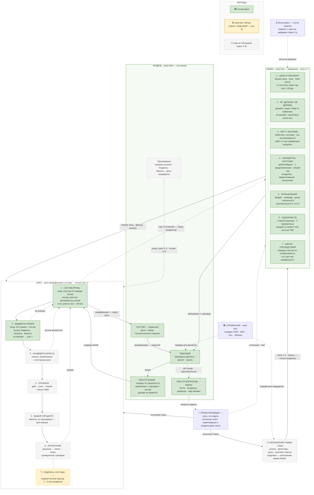

# Универсальный алгоритм выбора решений

> **Живой документ совместного мышления.** Возник из беседы вне рамок упражнений (глава 1.6, 2026-08-27): цель — алгоритм выбора решений для элементов системы под нефункциональные требования, покрывающий дизайн любой системы и помогающий на собеседовании. Метод работы — grilling-сессии по пунктам; статус каждого пункта отмечен в тексте.
>
> ⚠️ **Двойное существование.** Папка `algorithm/` живёт в двух местах: канон — `algorithm/README.md` в репозитории курса (редактирует агент), эта — зеркало для чтения. Состав папки одинаков: **README-карта + 4 заметки модулей + заметки шагов цикла в `цикл-шаги/` + словарь терминов + карта-диаграмма drawio**. При правке модуля обновляется его заметка в обеих копиях; при правке шага — его заметка; при правке карты — README и drawio; при правке языка — словарь.

**Формат.** Этот файл — карта: замысел, диаграмма, указатель модулей, открытые вопросы, журнал. Каждый модуль описан в своей заметке по единому шаблону — **Назначение / Контракт / Входы–выходы (API) / Поля (Состояние) / Инварианты / Рендеры**; у Цикла вместо «Поля» — «Шаги». Контракты форматов (вход/выход шагов) описываются в **YAML**. История решений — в журнале (§5), не в спецификациях. Единый язык документации — [[словарь]]: модули пользуются только его терминами, новый термин вводится в словаре, а не по ходу текста. Статусы частей и модулей — по словарю: **прогриловано** (содержимое обсуждено) · **структура зафиксирована** (каркас собран, части-заглушки ждут своих шагов цикла).

## 1. Замысел (принято)

**Отправная точка.** Цепочка главы 1.6 «решение → число → требование → отказ» — оператор **анализа**: она прикладывается к уже выбранному решению и вскрывает его числа и отказы. Дерево «НФТ+цифра → кандидаты → особенности → выбор» — оператор **синтеза**: генерация кандидатов от требований. Алгоритм — их объединение: цикл **generate → test → select**.

**Три слоя входов** (не два):

| Слой | Что даёт | Природа |
|---|---|---|
| ФТ + паттерны доступа | состав: какие роли обязаны существовать, какие классы решений применимы | функциональная |
| НФТ с цифрами + параметры нагрузки | материал: какое именно исполнение | качество + количество |
| ограничения (бюджет, команда, сроки) | рамка возможностей | проектная |

Поправки к первоначальным тезисам (зафиксированы, чтобы не возвращаться):

- «ФТ — имплементация компонентов» — нет: ФТ — тоже системный уровень (поведение системы целиком; тест из 1.3 «можно ли продемонстрировать?»). Но выбор конкретных инструментов управляется НФТ + нагрузкой + ограничениями — в этом смысле «выбор под цифры» и есть сердце работы.
- НФТ достраивают даже состав: балансировщик и Redis появились в эволюции 1.5 из цифр, не из ФТ.
- НФТ без числа не существует: «латентность» — не требование; «p95 ≤ 200 мс при пике» — требование.

**Чего не хватает в наивном дереве** (найдено при разборе): у элемента два сорта входных цифр (SLO + нагрузка); шаг декомпозиции НФТ от системы к элементам; пакетный выбор (ветви не независимы); замкнутый контур вместо дерева. Всё вошло в карту ниже (§2).

## 2. Карта алгоритма

| Сущность | Права | Содержимое |
|---|---|---|
| **Рамка** | read-only (окружение) | продукт (бриф + ответы на уточняющие вопросы), ФТ двух знаков («делаем»/«не делаем») + НФТ с цифрами (включая ось поставляемости), параметры нагрузки, ограничения, 6 сценариев, порядок классов последствий |
| **Справочник** | read-only (окружение) | универсальные порядки величин: латентности, объёмы, скорости; проекту не принадлежит |
| **Модель** | read-write (состояние) | состав (первичное), реестр болей (производное), реестр вопросов (вопросы наружу, к владельцам чисел), нагрузка на роли, декомпозиция бюджетов, ёмкость, цены кандидатов |
| **Цикл** | исполнение | шаги 1–6, модификация состава — только шаг 1 |

**Проектировщик** — роль, не модуль: у него нет состояния, только поведение. Процессор алгоритма: исполняет шаги цикла (на бумаге, в голове, в инструменте — носитель безразличен), носит вопросы к владельцам чисел и сам временно выступает владельцем предположений. Точка входа/выхода: реестр вопросов → наружу, уточнение/торг → обратно в рамку. Подробно — в заметке модуля ЦИКЛ.

**Как читать диаграмму.** Mermaid-карта в этом документе — точная копия `карта-алгоритма.drawio` (референс): те же узлы, подписи, рёбра и статусы. Три больших блока — сущности алгоритма: РАМКА — данное проекта извне (только читаем), МОДЕЛЬ — рабочее состояние (считаем и пересчитываем мы), ЦИКЛ — шесть шагов; отдельно — мониторинг, справочник (read-only окружение) и проектировщик (исполнитель шагов и переговорщик с владельцами чисел). Цвет — статус: 🟩 согласовано и записано, 🟨 гриллинг сейчас (пауза — следующий шаг 3), ⬜ ещё не обсуждали (шаги 3–6); сплошная стрелка — основной поток, пунктир — исключения (возвраты к шагу 1, торг, вопросы наружу). Править карту удобнее в drawio (в Obsidian открывается плагином draw.io, либо на [app.diagrams.net](https://app.diagrams.net)) и переносить сюда.

## 3. Указатель модулей

| Модуль | Права | Суть | Статус | Заметка |
|---|---|---|---|---|
| **РАМКА** | read-only · окружение | Данное проекта: цели, ФТ двух знаков, НФТ с числами, параметры нагрузки, ограничения, 6 сценариев, шкала последствий. Контракт: read-only, стерильность, две операции изменения (уточнение / торг). Правило двух источников и тест «рамка или модель?» на границе с моделью. | ✅ прогрилована | [[модуль-рамка]] |
| **РАМКА · заполнение** | под-заметка · процедура | Этап заполнения рамки — исполняемый алгоритм из 7 шагов: режим по источнику (интервью/RFC) → анкета → детекторы → щупы (щуп × цель) → кандидаты и судьбы → раздача → проверка. Артефакт — протокол опроса (инвариант: каждая строка получает судьбу); раскладка ответов по полям 2–4; первичный опрос + до-заполнение. Диаграмма `заполнение-рамки.drawio`; пример — [[Пример заполнения протокола опроса]]. | ⬜ черновик (ждёт гриллинга) | [[заполнение-рамки]] |
| **СПРАВОЧНИК** | read-only · окружение | Универсальные порядки величин (латентности, объёмы) — общая физика домена, не проектные данные. Операций нет, точность — порядок величины. | ✅ прогрилован | [[модуль-справочник]] |
| **МОДЕЛЬ** | read-write · состояние | Рабочее состояние: состав (первичное), оценщик (примерные расчёты / расчёт / прогон), реестр болей (отдаётся шагу 1 очередью по серьёзности — правило сортировки живёт здесь), реестр вопросов (вопросы наружу, к владельцам чисел), производные расчёты. Производные руками не правятся. Заглушка: производные расчёты (нагрузка на роли · бюджеты · ёмкость · цены кандидатов) — наполнится шагами 2–5. | структура ✅ · наполнение 4/5 | [[модуль-модель]] |
| **ЦИКЛ** | исполнение | Карта цикла: проектировщик (роль, не модуль), симметрия шагов (1/3/5 назначают исполнение — лестница роль → класс → продукт; 2/4/6 проверяют), петли (внутренняя, возвраты 2/3/6→1, торг вверх, во времени). Модификация состава — только шаг 1. | шаги 1–2 ✅ · шаги 3–6 ⬜ | [[модуль-цикл]] |
| **ЦИКЛ · шаги** | исполнение · по шагу | Заметка на каждый шаг в `цикл-шаги/`, формат «функция»: идея · вход с контрактом формата · тело по пунктам · правило сортировки/выбора · выход с контрактом · пример одного захода · когда закончен · типичные провалы. Метки узлов на диаграмме — сжатая форма раздела «вход → выход» заметки шага. Шаги 1–2 прогрилованы (у шага 2 — конвейер чисел и подалгоритмы П1–П5); заметки шагов 3–6 заводятся по мере гриллинга. | шаги 1–2 ✅ · шаги 3–6 ⬜ | [[шаг-1-состав]] |

## 4. Алгоритм и скилл

Три сущности, которые не смешиваются (разведены 2026-10-03, решение владельца):

| | **Алгоритм** — эта папка | **Скилл** — будущий артефакт | **Курсовой скилл** `skill/system-design-mentor` |
|---|---|---|---|
| Что это | метод в документации: замысел, модули, шаги, словарь, диаграммы | самодостаточный переносимый (portable) артефакт, собранный из этой папки | артефакт курса, растёт по приёмке глав |
| Чем правится | гриллингом (владелец метода) | в деле: прогоны по ситуациям; после выхода v1 — первым | протоколом курса |
| Переносимость (portability) | нет | да: скопирован на другой компьютер — работает | нет, живёт в репозитории курса |

Жизненный цикл алгоритм ↔ скилл:

- **До сборки v1** источник правды — эта папка: скилл собирается из неё целиком, не по частям.
- **После v1** направление меняется: скилл обкатывается в ситуациях и правится первым; изменения затем возвращаются в документацию.
- Сборка v1 не начата и не заблокирована; вопрос возвращается на приёмку главы 1.6 или по решению владельца. **2026-10-03 (вечер), решение владельца: порядок «сначала описание, потом скилл».** Собранный было скелет v0.1 откат полностью (канон `скилл/` и установленная копия `~/.zcode/skills/system-design-loop/` удалены). Скилл собирается **в конце**, когда полное описание алгоритма готово — шаги 1–6 прогрилованы, схемы на месте, — из папки целиком.

## 5. Открытые вопросы

- Шаги 3–6 — гриллинг впереди. **Следующий: шаг 3 «Кандидаты».**
- Граница «алгоритм vs опыт»: алгоритм задаёт структуру прохода, но не каталог кандидатов (тот наполняется главами: 2.3 даст LB-алгоритмы, 4.4 — выбор БД, …).
- Сворачивание по времени: один и тот же контур для интервью (45 минут) и RFC (неделя) — как оформить два режима глубины.
- Критерий остановки итераций (проходов цикла может быть много — когда хватит?).
- ~~Спорное: частота поллинга — рамка или модель?~~ Закрыто (раунд 6, тест проектной зависимости): свежесть — рамка, частота поллинга — модель.

## 6. Журнал гриллинга

- **2026-08-27, раунд 1.** Пользователь инвертировал цепочку главы в дерево выбора; сошлись на: три слоя входов, поправка про ФТ, декомпозиция SLO, пакетный выбор, три замыкания. Черновик v1 — семь шагов списком.
- **2026-08-27, раунд 2 (рамка).** Грилинг пяти пунктов → решения: (1) две воронки = два реестра чисел, запрет обратного потока; (2) минимализация записи числа, правило чувствительности; (3) цена как валюта, фильтр = порог; (4) базовый набор из 6 сценариев; (5) рамка — окружение, не шаг. Скелет пересобран в v2: рамка / модель / цикл.
- **2026-08-27, раунд 3 (шаг 1 «Состав», итог гриллинга).** Переименования: «скелет» → **состав**, «безработные/балласт» → **«роли без боли»**. Вскрыт и защёлкнут слой модели: состав (первичное), реестр болей `f(требования × сценарии × состав)` (не правится руками), оценщик с тремя исполнениями (наколенка/расчёт/прогон). Механика шага 1: baseline = наивный монолит; боль=приоритет, зависимость=порядок, минимальность=размер шага; кластер → цепочка минимальных ролей. Серьёзность: класс последствий (ось — необратимость, порядок классов из рамки, деньги убраны из шкалы) + доля затронутого (по кластеру — max класс / union доля); кратность = «доза», не часть меры. Остановка: реестр пуст; проверки: покрытие + ноль ролей без боли (kill-test); подпись = первый полный проход 1→6 без возвратов. Лестница роль/класс/продукт на нечётных шагах. Конвеевская дыра закрыта: поставляемость = ось НФТ, действует через боль. Числа рамки классифицируются тремя действиями (боль/фильтр/валюта) вместо сортов. Владелец: запись опциональна, роль — нет. Чувствительность обобщена на любую развилку.
- **2026-08-27, раунд 3.5 (визуализация).** ASCII-схема §2 заменена на mermaid-диаграмму с легендой и статусной раскраской (зелёный = прогриловано, жёлтый = следующий пункт, серый пунктир = черновик). Правило: при закрытии очередного пункта перекрашивать узел в диаграмме обеих копий.
- **2026-08-27, раунд 3.6 (ясность формулировок).** «Инвариант трассируемости» переименован в **правило двух источников** + отдельный **тест «рамка или модель?»** (произнеси число, не называя частей системы). Легенда и подпись «как читать» переписаны простыми формулировками.
- **2026-08-27, раунд 4 (модуль РАМКА: спецификация).** Зафиксированы поля рамки (7 полей). Решения: (1) доли рамка не хранит — сырьё здесь, делит оценщик; рождён **реестр запросов** — выходная лента наружу `{число · владелец · вопрос · развилка · подстановка}` и точка входа/выхода проектировщика, режимы «блокирующий / в долг»; (2) «вне рамок» упразднено как отдельная сущность — ФТ имеет два знака «делаем»/«не делаем», версионные пометки — аннотация; (3) нормы вынесены из рамки в **справочник** — вторую read-only сущность окружения. Диаграмма: +СПРАВОЧНИК, +РЕЕСТР ЗАПРОСОВ, +узел проектировщика.
- **2026-08-28, раунд 5 (модульная перестройка документа).** Документ перегруппирован из «истории гриллинга» в спецификацию: закреплён шаблон модуля (Назначение / Контракт / Входы–выходы (API) / Поля–Состояние / Инварианты / Рендеры; у Цикла вместо «Поля» — «Шаги»). Решение: проектировщик — **роль цикла, не модуль** (нет состояния, только поведение). Содержание решений не менялось — только уклад.
- **2026-08-28, раунд 5.1 (диаграммы).** Карта диаграммы сохранена отдельным файлом `карта-алгоритма.drawio` (обе копии, полная детализация). Mermaid-версия ужата в три горизонтальные полосы: межполосные стрелки — на уровне «сущность → сущность», легенда — строка над подписью.
- **2026-08-28, раунд 5.2 (разделение на заметки).** Спецификации модулей вынесены из основного документа в отдельные заметки: [[модуль-рамка]], [[модуль-справочник]], [[модуль-модель]], [[модуль-цикл]] (обе копии). Основной документ стал картой: замысел, диаграмма, указатель модулей, открытые вопросы, журнал. Кросс-ссылки переведены с номеров разделов на имена модулей. Синхронизация: правка модуля = его заметка ×2; правка карты = README ×2 + drawio ×2.
- **2026-08-28, раунд 5.3 (унификация диаграмм).** Mermaid-карта приведена к виду `карта-алгоритма.drawio` (референс): восстановлены точечные межблочные рёбра (справочник → оценщик; S1 → состав; реестр болей → S1; производные → цикл; реестр запросов → проектировщик), полные подписи узлов, зелёные поля рамки, легенда-блок. Цена — диаграмма снова вертикальная и выше компактной редакции: сознательный выбор единообразия с drawio. Правило: mermaid в README — зеркало drawio, правится сначала drawio, переносится сюда.
- **2026-08-28, раунд 5.4 (словарь статусов).** Пользователь поймал несоответствие: модель «защёлкнута», а часть М4 на схеме без окраски. Решения: (1) термины **прогриловано / структура зафиксирована / заглушка / наполнение** введены в словарь; «защёлкнута» выведена из оборота; (2) перекраска частей модели в drawio и mermaid: состав, оценщик, реестр болей, реестр запросов — зелёные; производные (воронка · бюджеты · цены) — серый пунктир: определения приходят с шагами 2–5 (бюджеты → шаг 2, цены → шаги 3–5); (3) статусы частей прописаны в заметке модели. Наполнение модели: 4/5.
- **2026-08-28, раунд 6 (прогрил модуля РАМКА по кускам + дисциплина словаря).** Заведён `словарь.md` (обе копии): термины вводятся только в нём. Кусок 1 «Назначение и контракт»: владелец числа определён; стерильность → стерильность от технологий (примеры + тест); уточнение/торг — определения, примеры, различие «узнаёт существующее / меняет принятое»; расписано, когда рамка читается; объяснено, почему число без владельца — плохо; аналогия инстанса (инсайт пользователя). Кусок 2: «граница с моделью» переписана в прямое различие (условия против проекта); правило двух источников расширено (владелец · предположение · арифметика над рамкой с автоматическим пересчётом); новый **тест «рамка или модель» (тест проектной зависимости)**; пара **требуемое/фактическое значение**; списки примеров чисел рамки и «похожих, но модели». Закрыт спор о поллинге: свежесть — рамка, частота поллинга — модель. «Шляпа» изъята из языка.
- **2026-08-28, раунд 7 (кусок 3 РАМКИ: нагрузка).** «Воронка» выведена из оборота: метафора маркетинга, у нас ничего не сужается — цепочка вычислений одного предмета. Пара: **параметры нагрузки** (рамка, поле 4; термин Клепманна гл. 1 — поведение пользователей + вычислимые следствия; в курсе 1.2 то же называлось «воронкой») / **нагрузка на роли** (модель; раскладка спроса через механики — работа шага 2). Формула: **нагрузка = спрос × механика** (спрос от решений не зависит, механика — наша). Отклонены по ходу: симметричная пара «нагрузка продукта / нагрузка системы» (одинаковые слова спрятали разницу условий и проекта) и «нагрузочные требования» как третий сорт требований (по канону нагрузка — не требование, а условие в формулировке НФТ производительности: «p95 ≤ X при нагрузке Y»; Клепманн: параметры нагрузки отдельно от показателей производительности; RFC: разделы 2 и 3). Поле 3 дополнено формулировкой «при параметрах нагрузки». Диаграмма M4 → «нагрузка на роли · бюджеты · цены». Кусок 3 докрыт 2026-09-01: failure mode → **типичный провал** (развёрнутые формулировки: «расчётное число», «без операции владельца», подмена предпосылки на интервью); языковое решение — **«поллинг» вместо «опроса»** по всему корпусу; вернувшаяся «шляпа» снова изъята.
- **2026-09-01, раунд 7.1 (термины нагрузки и роль).** «Спрос» выведен из оборота — рыночный термин, непрозрачный в нашем домене; формула канонизирована: **«нагрузка на роли = параметры нагрузки × механика взаимодействия ролей»** (заодно снята двусмысленность голого «нагрузка» рядом с «параметры нагрузки»). **Механика взаимодействия ролей** введена в словарь (наши решения о том, как роли взаимодействуют между собой и с клиентами, обслуживая работу: поллинг против push, фан-аут, обращение за сессией; уточнение пользователя того же дня: не «механика», а именно механика взаимодействия). **Роль подтверждена** пользователем: «то, что элемент состава обязан выполнять, но не конкретная технология» — определение в словарь + правило употребления: голая «роль» = роль состава, роли людей — «роль пользователя»; предложение переименовать роль → «элемент» отозвано (элемент читается как вещь, роль — функция; лестница роль → класс → продукт потеряла бы смысл).
- **2026-09-01, раунд 7.2 (чистка хвостов по итогам сайд-чата).** Последний живой остаток «воронки» убран из меры серьёзности модуля ЦИКЛ: «вычислима из параметров нагрузки и текущего состава». В РАМКУ (связка «нагрузка на роли = параметры нагрузки × механика взаимодействия ролей») добавлена явная ссылка на тест «рамка или модель»; прямое называние принадлежности оставлено рядом со ссылкой сознательно (решение пользователя: дублирование остаётся). Пример с числами (10 000 онлайн × поллинг 30 с ≈ 330 запросов/с на «слушание») и развёрнутые формулировки «типичного провала» подтверждены пользователем — уже реализованы раундом 7.
- **2026-09-01, раунд 8 (заметки шагов + язык шага 1).** Решения пользователя: (1) шаги цикла получают собственные заметки в папке `цикл-шаги/` (обе копии), формат — «функция»: идея · вход · тело по пунктам · выход · когда закончен · типичные провалы; `модуль-цикл` стал картой цикла — указатель шагов (кратко + ссылка, по решению пользователя); (2) метки узлов-шагов на диаграмме получают явные префиксы «вход: / выход:» (S1 обновлён; прочие — по мере гриллинга их шагов); (3) переименование по всему корпусу: «мутация» → **«модификация состава»** (модуль-модель, модуль-рамка, модуль-цикл, словарь, рёбра и заголовок CYCLE на диаграмме); (4) шаг 1 переоформлен простыми формулировками по гриллинг-вопросам пользователя: таблица классов последствий (референс, три класса + откатываемость), доля затронутого с примерами для ФТ/НФТ, **сортировка по умолчанию** (класс → доля → безразлично) с разобранным примером очереди из 5 болей, четыре модификации состава с примерами; вычищены шифры «нечётный шаг», «поле 7», «старший/младший ключ», id узлов диаграммы (M1/M3) из текстов; (5) словарь: +9 терминов шага 1 — заход, baseline, модификация состава, мера серьёзности, класс последствий, доля затронутого, доза, kill-test, подпись состава (вместе с введёнными ранее кластером болей, цепочкой минимальных ролей, реестром болей). Ссылка поля «шкала последствий» в рамке переведена на заметку шага 1.
- **2026-09-01, раунд 8.1 (сортировка переехала в модель).** Решение пользователя: сортировка очереди болей — не функционал шага 1. Принцип: «шаги решают, оценщик считает» — сортировка детерминирована и решений не содержит. Правило серьёзности (компаратор класс → доля → безразлично, таблица классов, доля с примерами, дефолтная очередь, «что не входит») переехало в модуль-модель подразделом к реестру болей; очередью командует оценщик при каждом пересчёте. Вход шага 1 стал одним документом — очередь (шкала ушла из входа: её читает оценщик); рамку шаг 1 теперь не читает вовсе. Кластер остался в шаге 1 (общая причина — суждение, не арифметика). Словарь: мера серьёзности, класс последствий, доля затронутого переехали в раздел МОДЕЛЬ. Диаграмма: M3 → «РЕЕСТР БОЛЕЙ · очередь по серьёзности».
- **2026-09-07, раунд 10 (шаг 2 — прогрилован).** Прогулка по заметке завершена (куски 4–5). Решения: контракт выхода — `версия_состава` · `выведено_из` (коллизия со «подписью состава» снята) · секция `неделимые` · обёртка `сигналы` снята: `реестр_вопросов` и `возвраты` — верхний уровень, группировка по адресам записи. **«Реестр запросов» → «реестр вопросов»** по всему корпусу — слово «запрос» освобождено под единицу работы; «выходная лента наружу» изъята. Ёмкость внесена в заглушку производных (М4). По заказу пользователя: раздел **«Конвейер чисел»** (таблица 10 операций «откуда → как → куда») + обзорная диаграмма `шаг-2-конвейер.drawio`, декомпозированная на **пять подалгоритмов П1–П5** (папка `шаг-2-подалгоритмы/`, пары «описание + диаграмма», формат draw.io). Пример «Как шло» переписан полными шагами с метками подалгоритмов. Словарь: +11 карточек шага 2 (бюджет роли · качество · делимое/неделимое · путь запроса · фаза · доставка · слот · запрос · переговорщик · правило «+1 девятка» · подалгоритм) + карточка «Реестр вопросов». Статусы: S2 — зелёный с метками «вход:/выход:»; заметка шага, модуль-цикл, указатель — «прогрилован».
- **2026-10-03, решение владельца (вне гриллинга):** разведены алгоритм и будущий скилл — новый раздел «Алгоритм и скилл»: скилл = самодостаточная переносимая (portable) сборка из этой папки; до v1 правды в документации, после v1 скилл правится первым и отдаёт изменения документации; курсовой скилл — отдельная сущность, не участвует. Сборка отложена до приёмки главы 1.6 или решения владельца, блокеров нет (вариант, собранный в параллельной сессии в тот же день, удалён владельцем — урок «сначала зачем»).
- **2026-10-03, решение владельца (вне гриллинга): этап заполнения рамки переработан в исполняемый алгоритм.** Заметка «заполнение рамки (интервью)» переименована в [[заполнение-рамки]] и перестроена по формату «кто-что-делает»: участники (проектировщик · владелец числа · справочник) · вход (источник / данные / сущности домена от исполнителя) · 7 шагов с единственной развилкой (шаг 1 — режим по источнику: интервью → анкета; RFC → сразу детекторы) · новый артефакт **протокол опроса** (строка {вопрос · кандидат · статус · куда_ляжет}; инвариант: каждая строка получает судьбу — рамка / реестр вопросов / вычеркнута) · **раскладка** ответов по полям (обещание → П3 · условие → П4 · поведение → П2 «делаем» · граница → П2 «не делаем») · до-заполнение как повторный запуск (шаги 5–7 для одной строки). Добавлено: диаграмма `заполнение-рамки.drawio` ×2 (нижний ряд связывает с существующим алгоритмом: оценщик → реестр болей → шаг 1 → шаг 2); узел «ЗАПОЛНЕНИЕ РАМКИ ⬜» на карте-алгоритма (drawio → mermaid ×2 → cp; рёбра: проектировщик исполняет опрос · поля 1–5 в рамку · справочник даёт порядки); референс-пример в волте ([[Пример заполнения протокола опроса]] — прокат самокатов, 14 строк, все судьбы; INDEX пополнен). Справочник подключён как источник технических кандидатов (внесение этапа в список его потребителей — гриллингом). Этап ⬜ ждёт гриллинга целиком; термины-кандидаты: опрос · анкета · детектор · щуп · цель · протокол опроса · раскладка.
- **Следующий на гриллинг:** шаг 3 «Кандидаты».

## Связано

- [[1.3 Требования FR-NFR]] — NFR без числа не существует; тест «можно продемонстрировать»
- [[1.2 Математика нагрузки]] — воронка нагрузки (в алгоритме — «параметры нагрузки»), параметр-убийца, таблица латентностей
- [[1.4 Ёмкость latency очередь]] — декомпозиция W по фазам, Закон Литла как арифметика испытания
- [[1.5 Масштабирование stateless]] — эволюция как ручной обход шага 1, SAM-линзы, KISS-урок
- [[Functional vs Non-Functional Requirements]], [[Back-of-the-Envelope Size Calculations]], [[Little's Law and Capacity Planning]], [[Stateless vs Stateful - the SAM Lens]], [[Headroom - Practical Capacity Ceilings]]
