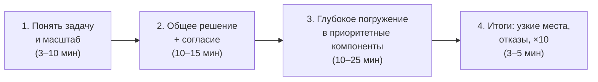

# 1.1 — Интервью-фреймворк: зачем проектирование + скелет любого дизайна

> Якорь: Сюй, гл. 3 «Общие принципы прохождения интервью по проектированию ИТ-систем», стр. 46–57. Разделы «за пределами интервью» — синтез курса 🟡.

## Зачем уметь проектировать

«Спроектируйте Google за час» звучит как издевательство — над поиском работают тысячи инженеров. Но от тебя этого **никто и не ждёт**. Интервью — симуляция рабочей ситуации: двое коллег разбирают нечётко поставленную задачу и приходят к работающему решению. Идеального ответа не существует; важен **процесс**: как ты рассуждаешь, обосновываешь выбор, реагируешь на возражения.

Навык шире интервью: тот же цикл — в RFC, на дизайн-ревью, при любых архитектурных решениях.

## Что оценивается

| Положительные сигналы | Отрицательные сигналы |
|---|---|
| Совместная работа (диалог, не монолог) | **Переусложнение** — восхищение чистотой решения без учёта цены |
| Работа под давлением неясной задачи | Узкий кругозор — решение «в вакууме», без бизнеса и масштаба |
| Конструктивность к расплывчатым задачам | Упрямство — неспособность пересмотреть решение |
| **Умение задавать подходящие вопросы** | |

## Фреймворк из 4 шагов

### Шаг 1 — понять задачу (правило «не будь Джимми»)

Джимми всегда первым тянет руку и отвечает быстро. **Не будь как Джимми.** Быстрый ответ не даёт баллов: это не викторина, правильного ответа нет. Решение без понимания требований — «очень плохой знак»: интервьюер не видит ни хода мыслей, ни умения собирать требования.

Стартовые вопросы:
- Какие именно **возможности** реализуем?
- **Сколько пользователей**? Масштаб через 3 месяца / полгода / год?
- **Технологический стек** компании, существующие сервисы?

Предположения, которые интервьюер отдаёт тебе, — **записывай** (дисциплина из 1.2: записал → посчитал).

### Шаг 2 — общее решение и согласие

Интервьюер — член команды, а не экзаменатор:
- начальный план архитектуры → спроси мнение;
- блок-схема ключевых компонентов: клиенты, API, веб-серверы, хранилища, кэши, CDN, очереди;
- приблизительные расчёты — соответствует ли решение масштабу;
- прогони 2–3 сценария использования — вскроются крайние случаи.

### Шаг 3 — глубокое погружение

Фокус на приоритетных компонентах (у URL-shortener — хеширование; у мессенджера — латентность доставки и онлайн-статусы). **Рациональное использование времени**: разбор алгоритма EdgeRank съест время и не покажет умения проектировать масштабируемые системы.

### Шаг 4 — итоги

- узкие места и улучшения — «решение никогда не идеально»;
- краткий обзор архитектуры;
- внештатные ситуации: поломка серверов, разрыв сети;
- эксплуатация: метрики, логи, выкатка;
- следующий этап масштабирования: держит 1 млн — что менять под 10 млн?

## Чек-лист

| ✅ Делай | ❌ Не делай |
|---|---|
| Всегда уточняй; не надейся на предположения | Начинай решение до уточнения требований |
| Помни: правильного ответа нет | Застревай в одном компоненте до общей схемы |
| Делись мыслями вслух | Рассуждай молча |
| Предлагай разные подходы | Стесняйся просить подсказку |
| После общего решения — детали по важности | Считай, что интервью кончился с изложением решения |

## Фреймворк за пределами интервью 🟡

| Интервью | Работа |
|---|---|
| Шаг 1: вопросы и масштаб | Сбор требований, контекст в RFC |
| Шаг 2: общее решение и согласие | Секция Proposal в RFC, дизайн-ревью |
| Шаг 3: глубокое погружение | Детальный дизайн ключевых компонентов |
| Шаг 4: итоги, узкие места, ×10 | Риски, альтернативы, план масштабирования |

В проектные главы курса (1.6, 2.6, 3.7, 4.8, 5.6, 6.5) заложен этот ритм: RFC пишется **до** знакомства с книжным референсом, потом сравнение.

## Симулятор после главы

Канвас «клиент → сервер», анимация запрос-ответ, метрики RPS / средняя латентность / доля ошибок, карта модулей. Фундамент, куда в 1.4 придут перцентили и очередь, в 1.5 — балансировщик и пул.

## Глоссарий

интервью-фреймворк · масштаб решения (design scope) · предположения (assumptions) · красные флаги (negative signals) · переусложнение (over-engineering)

---
Связано: [[1.2 Математика нагрузки]] · [[1.3 Требования FR-NFR]] (шаг 1 детально) · [[1.6 Проект Мессенджер v1]] (фреймворк = скелет RFC)
