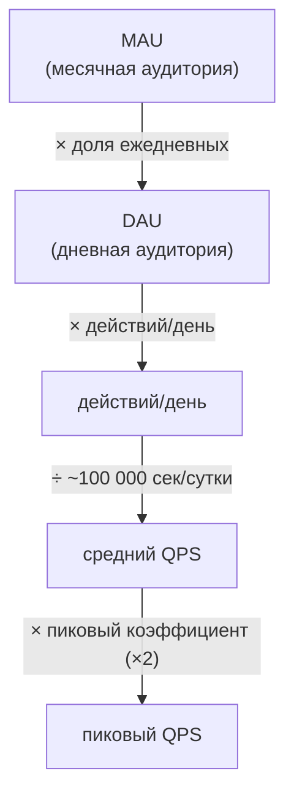

# 1.2 — Математика нагрузки: MAU/DAU → RPS

> Якорь: Сюй гл. 2 «Приблизительные оценки» (арифметика: *как* считать) + Клепманн 1.3 «Описание нагрузки» (модель: *что* считать). Схема без чисел — это картинка.

## Наколеночные вычисления (back-of-the-envelope)

Считают «на обороте конверта» не потому, что нет калькулятора, а потому что **конверт маленький**: только главные числа и одна цепочка рассуждений. Цель — **отсеять заведомо нежизнеспособные архитектуры до того, как ты их нарисовал** (Джефф Дин: оценки «дают хорошее представление о том, какие архитектуры соответствуют вашим требованиям»).

## Воронка нагрузки

Пример Сюя (Twitter, числа учебные): MAU 300 млн × 50% = **150 млн DAU**; × 2 твита = 300 млн/день; ÷ 86 400 ≈ **3 500 QPS**; пик ×2 ≈ **7 000 QPS**; медиа 10% × 1 Мб → ~30 Тб/день → **~55 Пб за 5 лет**.

Методологические приёмы (важнее чисел):
1. **Предположения — до расчёта, письменно.** Позже на них можно сослаться и сверить с расчётом.
2. **86 400 ≈ 100 000** — сутки «около ста тысяч секунд», деление на 10⁵ устное.
3. **Пик считается множителем** (×2), а не «как-нибудь потом»: системы проектируются под пик.
4. Хранилище — через **действий/день × байты**, не через QPS.

## Таблица 1. Степени двойки

| Степень | Значение | Название |
|---|---|---|
| 2¹⁰ | ~1 тысяча | Кб |
| 2²⁰ | ~1 миллион | Мб |
| 2³⁰ | ~1 миллиард | Гб |
| 2⁴⁰ | ~1 триллион | Тб |
| 2⁵⁰ | ~1 квадрильон | Пб |

## Таблица 2. Латентности (Джефф Дин, порядки — не устарели)

| Операция | Время |
|---|---|
| Кэш L1 / L2 | 0,5 нс / 7 нс |
| Мьютекс / основная память | 100 нс |
| Сжатие 1 Кб (Zippy) | 10 мкс |
| 2 Кб по сети 1 Гбит/с | 20 мкс |
| Чтение 1 Мб из памяти | 250 мкс |
| **Пакет туда-обратно внутри ЦОД** | **500 мкс** |
| **Seek по диску** | **10 мс** |
| Чтение 1 Мб из сети / с диска | 10 мс / 30 мс |
| **Пакет Калифорния ↔ Нидерланды** | **150 мс** |

Пять правил интуиции (Сюй):
1. **Память быстрая, диск медленный** — разница в порядках (100 нс vs 10 мс = ×100 000 до seek'а).
2. **Избегай seek'а** по диску — доминирует внутри ЦОД.
3. **Простое сжатие дешёвое** (10 мкс/Кб).
4. **Сжимай перед отправкой по сети** — сжатие на три порядка дешевле передачи.
5. **Межрегион — долго**: 150 мс против 500 мкс внутри ЦОД (×300) — вернётся в теме CDN.

## Таблица 3. Девятки доступности

| Доступность | Простой/сутки | Простой/год |
| ----------- | ------------- | ----------- |
| 99 %        | 14,4 мин      | 3,65 дня    |
| 99,9 %      | 1,44 мин      | 8,77 ч      |
| 99,99 %     | 8,64 с        | 52,6 мин    |
| 99,999 %    | 864 мс        | 5,26 мин    |
| 99,9999 %   | 86,4 мс       | 31,56 с     |

Каждая девятка — **вдесятеро меньше простоя** и, как правило, на порядок дороже архитектура. «Хочу пять девяток» без расчёта цены — красный флаг.

## Клепманн: опиши нагрузку

- **«Масштабируемая система» — бессмысленная фраза.** Масштабируемость — вопрос: «какие варианты, **если** нагрузка вырастет *так-то*?» Первый шаг — описать нагрузку **параметрами нагрузки** (load parameters).
- **Параметры у каждой системы свои**: запросы/с, отношение чтение:запись, активные пользователи чата, доля попаданий в кэш. Для одних систем критично среднее, для других — предельные случаи.

### Кейс Twitter: параметр-убийца — fan-out

Числа (2012): публикация 4 600 з/с (пик >12 000), чтение ленты **300 000 з/с**. Узкое место — не записи, а **fan-out** (сколько «последствий» у одного действия): один твит = веер доставок всем подписчикам.

| | Pull (подход 1) | Push (подход 2) |
|---|---|---|
| Публикация | простая вставка | вставка **во все** кэши лент подписчиков |
| Чтение ленты | тяжёлый JOIN на каждый запрос | почти бесплатно |
| Судьба | первая версия, «еле справлялась» | текущая основа |

Push выиграл, потому что чтений на два порядка больше записей (300k : 4,6k). Цена: 4 600 × 75 подписчиков = **345 000 записей/с в кэши**; у знаменитостей (>30 млн подписчиков) один твит = >30 млн записей с дедлайном ~5 с. Финал — **гибрид**: обычные по push, знаменитости подмешиваются при чтении.

**Вывод:** ключевой параметр Twitter — *распределение числа подписчиков* (хвост, не среднее). В твоей системе параметр-убийца будет другим, но он всегда есть.

## Ловушки

1. Считать без записанных предположений — процесс не проверяем, число не засчитывается.
2. Тонуть в точной арифметике — округляй: 100 000/10.
3. Терять единицы («5» — чего?).
4. Забывать пиковый коэффициент — системы падают в пике.
5. Считать по среднему и игнорировать хвост (75 vs 30 млн подписчиков).
6. «Пять девяток» вслепую — не назвав цену.
7. Оптимизировать не ту сторону: если 93% времени — сеть, «ускорять код» бессмысленно (таблица латентностей — твой аргумент).

## Глоссарий

MAU · DAU · QPS/RPS · параметры нагрузки · back-of-the-envelope · fan-out · read:write ratio · пиковый коэффициент · девятки · SLA

---
Связано: [[1.1 Интервью-фреймворк]] (расчёты — шаг 2) · [[1.4 Ёмкость latency очередь]] (λ для Литла = пиковый RPS отсюда) · англ. заметки: [[Back-of-the-Envelope Size Calculations]], [[Latency Budget - System Design]]
