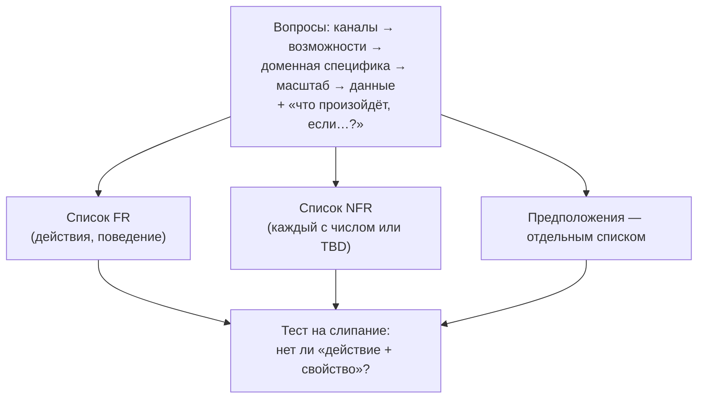

# 1.3 — Требования: функциональные и нефункциональные

> Якорь: Сюй гл.3 Шаг 1 (техника *добывания* требований) + Клепманн 1.1 (почему требования определяют архитектуру). Классификация FR/NFR — мост курса 🟡.

## Расплывчатость — не баг, а смысл

Интервьюер оценивает: совместность, поведение под давлением, **умение задавать подходящие вопросы**. Красные флаги: переусложнение, узкий кругозор, упрямство.

**Джимми** тянет руку первым («тигр проголодался!»). Быстрый ответ = решение без понимания требований: это не викторина, «угадать» не засчитывается, интервьюер не получает данных для оценки. Правило: **повремени, подумай, задай вопросы**; предположения записывай.

## Техника вопросов шага 1

Стартовый список: возможности? сколько пользователей? рост через 3/6/12 месяцев? стек и существующие сервисы? + **2–3 доменно-специфичных** вопроса.

| Вопрос (пример из диалога «лента новостей») | Что добывает |
|---|---|
| Мобильное/веб/оба? | каналы и ограничения платформ |
| Самые важные возможности? | функциональный скелет (MVP интервью) |
| Сортировка ленты — хронология или веса? | **доменно-специфичное поведение** |
| Сколько друзей? (5000) | число для fan-out |
| Объём трафика? (10 млн DAU) | вход для воронки 1.2 |
| Медиафайлы? | тип данных → хранилище и трафик |

**Формулировка через поведение, не через «как»:** «что произойдёт, если два запроса конкурируют?» — требование; «как будем делать доставку?» — скрытое предложение решения.

## FR vs NFR (мост курса 🟡)

> **FR** — «**что** пользователь/система может сделать?». Действие, возможность, поведение. Тест: **можно продемонстрировать** («смотри: публикую пост — он появляется в ленте»).
>
> **NFR** — «**насколько хорошо** и при каких условиях?». Свойство-ограничение: масштаб, скорость, доступность, консистентность. Тест: **измеряется числом или проявляется при отказе/нагрузке**.

- **Тест на слипание**: «просмотр доступности **с консистентностью данных**» = два требования. FR: *просмотр доступности*; NFR: *консистентность при конкурентном бронировании*. Слипшиеся пункты нельзя измерять и ставить им цели.
- **NFR без числа не существует.** «Быстро» — не требование; «p99 < 300 мс при пиковом 5 000 RPS» — требование. Числа берутся из воронки 1.2 и таблицы латентностей; если числа нет — честное **TBD: уточнить**.
- Ловушка: «история хранится вечно» — не FR (не действие пользователя), а NFR-хранилища; функциональная часть — «пользователь может читать старые сообщения».

## Клепманн: требования = архитектура

1. **Границы категорий инструментов размыты**: Redis — хранилище, используемое как очередь; Kafka — очередь с надёжностью уровня БД.
2. Требования жёсткие → приложение = **комбинация инструментов, склеенная кодом** (БД + кэш + поисковый индекс); синхронизация кэша и индекса с БД — обязанность твоего кода.
3. Вывод: комбинируя инструменты под свои требования, ты создаёшь новую специализированную систему — **«вы теперь не только разработчик приложения, но и архитектор информационной системы»**.

Три старших класса NFR (вся книга Клепманна и весь курс): **надёжность, масштабируемость, удобство сопровождения**. Плюс: на конструкцию влияют нетехнические факторы — команда, легаси, сроки, риск, законодательство.

## Алгоритм шага 1

**Артефакт шага 1: два списка требований + список предположений.** Без них шаг не завершён.

## Ловушки

1. **Синдром Джимми** — быстрое решение без вопросов.
2. **Переусложнение** — «добавим Kafka на всякий случай»: нет требования — нет элемента.
3. **Слипание FR/NFR** — «поиск с высокой скоростью» в одном пункте.
4. **Вопросы-решения** — «как» вместо «что произойдёт».
5. **Универсальный список** — без доменных вопросов; в каждом домене есть аналог «как сортируется лента?» — найди его первым.
6. **NFR без чисел** — «масштабируемо, быстро, надёжно» — пожелания.

## Глоссарий

FR · NFR · requirement gathering · design scope · assumptions · negative signals · over-engineering · паспорт требований

---
Связано: [[1.2 Математика нагрузки]] (числа для NFR) · [[1.6 Проект Мессенджер v1]] (раздел 2 RFC) · англ. заметка: [[Functional vs Non-Functional Requirements]]
