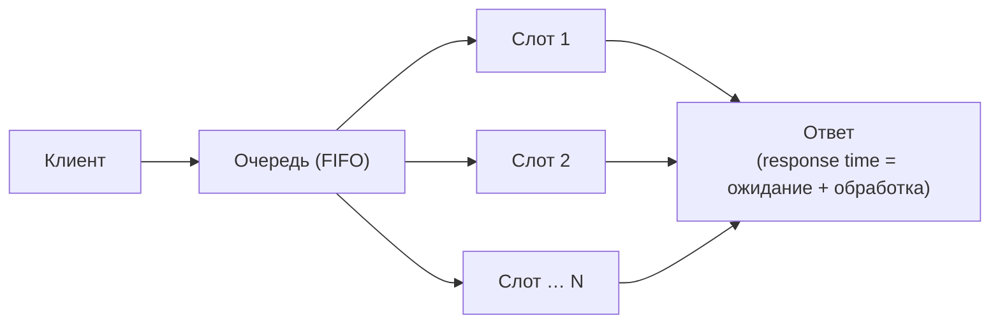

# 1.4 — Первый сервис: ёмкость, latency, очередь

> Якорь: Клепманн 1.3, стр. 36–43 целиком. 🔴 Закон Литла — синтез курса за пределами книги.

## Два вопроса масштабируемости

«Система быстрая» бессмысленно — всегда **относительно чего**:
1. Как изменится производительность, если **увеличить нагрузку** при тех же ресурсах?
2. Сколько **ресурсов добавить** при росте нагрузки, чтобы производительность не изменилась?

## Throughput vs Response time vs Latency

| Метрика | Что это | Для каких систем |
|---|---|---|
| **Пропускная способность** (throughput) | записей/запросов в секунду | пакетные (Hadoop) |
| **Время отклика** (response time) | от отправки запроса до получения ответа | онлайн (ждёт живой человек) |

> **Врезка Клепманна:** response time ≠ latency. **Время отклика** = service time + сеть + **ожидание в очереди** (всё, что видит клиент). **Latency** — только ожидание обслуживания. Всегда: **response time ≥ latency**. Диагностика: «медленно из-за очереди» ≠ «медленно из-за обработки».

## Среднее врёт: время отклика — распределение

Разброс заложен в природу запроса (переключение контекста, ретрансмиссия TCP, GC, page fault, вибрация стойки) — его не вылечить «аккуратным кодом». 99 запросов по 10 мс + 1 на 10 с → «среднее 110 мс», и ты уверен, что всё хорошо.

### Перцентили — язык хвоста

Сортируем времена по возрастанию:
- **p50 (медиана)** — половина быстрее;
- **p95** — 95% быстрее, 5% медленнее; **p99** — 1 из 100 медленнее; **p999** — 1 из 1000.

Пример (упр. 1): 95×50 мс + 4×1 с + 1×10 с → среднее 187,5 мс; **p50 = 50 мс, p95 ≈ 50 мс, p99 = 1 с, max = 10 с**. Перцентиль = **позиция в отсортированном списке с быстрого конца**, а не «представитель группы».

Почему хвост важен (Amazon): самые медленные запросы — у пользователей с **больше всего данных** (самые ценные). Рост времени отклика на 100 мс → −1% продаж; на 1 с → −16% удовлетворённости. Оптимизировать выше p99.9 обычно не стоит — дорого и зависит от случайных внешних причин.

Коварство медианы: пользователь за сессию делает много запросов — вероятность поймать хвост хотя бы раз сильно выше 50%.

### SLO / SLA

- **SLO** (objective): «стремимся к p50 < 200 мс и p99 < 1 с».
- **SLA** (agreement): юридический договор — «p99 > 1 с чаще 0,1% времени → компенсация».
- Девятки доступности из 1.2 + перцентиль = контракт: `p99 < 1 с при доступности 99,9%`.

## Блокировка головы очереди (head-of-line blocking)

Сервер обрабатывает параллельно лишь **малое число заданий** (слоты). Несколько медленных запросов заняли слоты → даже быстрые ждут → хвост взлетает.

Следствия:
1. **Измеряй на стороне клиента** — сервер не видит собственную очередь глазами клиента.
2. **Не укорачивай очередь при тестировании**: если тест-клиент ждёт ответа перед следующим запросом, ты тестируешь несуществующую систему. Запросы — независимо от отклика.

## 🔴 Закон Литла — L = λ · W

> Синтез курса (в Клепманне формулы нет). Классика теории очередей (Little, 1961).

```
L = λ · W
```

- **L** — среднее число заявок **в системе** (в обработке + в очереди), безразмерный счётчик;
- **λ** — интенсивность поступления, з/с (= пиковый QPS из воронки 1.2);
- **W** — среднее время пребывания заявки в системе, с (= время отклика).

**Что даёт:** знаешь λ и W → знаешь среднюю занятость. Пример: λ = 1000 з/с, W = 50 мс → в системе в среднем **50 заявок** → столько слотов/воркеров нужно держать. **λ · W ≤ N — порог**: ниже — сервер «дышит», у порога — очередь растёт нелинейно, p99 взлетает.

**Название главы = три буквы формулы:** ёмкость (N слотов) · latency (W) · очередь (λ, L).



Пример (упр. 2, мессенджер 10 млн DAU): 20 млн сообщений/день ÷ 86 400 ≈ 230 з/с средний, пик ×2 ≈ **460 з/с**; L = 460 × 0,2 с = **92 заявки в пике** → ≥ ~92 слотов + запас. Риск: запас ×2 при λ·W у порога не спасает от наложившихся пиков (утроения) → нужна маржа или autoscaling (мостик в 1.5).

## Словарь масштабирования (Кл, стр. 42–43)

- **Вертикальное** (scale up) — более мощная машина. **Горизонтальное** (scale out) — больше машин (shared-nothing).
- **Авто vs ручное**: автоматическое — при непредсказуемой нагрузке; ручное — проще и предсказуемее.
- **Stateless** масштабируется просто; **stateful** (БД) — сложно; разумно держать БД на одной машине, пока не заставят стоимость или доступность.
- **«Волшебного масштабирующего соуса» не существует**: 100 000 з/с × 1 Кб выглядит совсем не так, как 3 з/мин × 2 Гб. Архитектура = функция **параметров нагрузки**.

## Ловушки

1. Отчитываться средним — только тройка p50/p95/p99.
2. Путать response time и latency.
3. Оптимизировать p99.9+ без причины — назови перцентиль бизнеса и остановись.
4. Тестировать без очереди (клиент, ждущий ответа).
5. «Масштабируемая система» без параметра.
6. Распределённая БД «с первого дня».
7. Ёмкость по среднему без запаса — λ·W ≤ N порог, не цель.

## Глоссарий

throughput · response time · latency · перцентили p50/p95/p99 · tail latency · SLO · SLA · head-of-line blocking · Закон Литла · capacity · scale up/out · shared-nothing · stateless/stateful

---
Связано: [[1.2 Математика нагрузки]] (λ = пик из воронки) · [[1.5 Масштабирование stateless]] (λW ≤ N одного ящика → пул) · [[1.6 Проект Мессенджер v1]] (раздел 5 RFC) · англ. заметки: [[Percentiles and Tail Latency]], [[Little's Law and Capacity Planning]]
