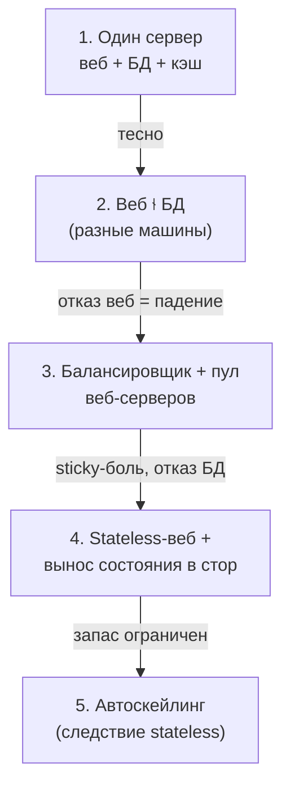

# 1.5 — Масштабирование: вертикаль vs горизонталь, stateless

> Якорь: Сюй гл.1 «Масштабирование от нуля до миллионов пользователей». SAM-анализ — расширение курса 🟡.

## Эволюция одной системы (паттерн собеседования)

| Этап | Добавляется | Решает | Остающийся отказ |
|---|---|---|---|
| 1. Single-server | — | — | любой компонент роняет всё; рычаг только вертикальный |
| 2. Веб ⫮ БД | разделение | независимое масштабирование веб и данных | отказ веб **или** БД роняет систему |
| 3. +Балансировщик +2-й веб | LB | отказ **одного** веб-сервера переживается | отказ БД роняет; узкое место сдвинулось в БД; **сам LB — новая точка отказа** (в реальности — пара LB, тема 2.3) |
| 4. +Stateless +репликация БД | вынос состояния | смерть веб-сервера не теряет сессии | согласованность реплик (3.3, 4.6) |

Правило паттерна: **начни простым, добавляй по одному компоненту, когда упрёшься** — не «сразу Kubernetes с 12 микросервисами». Каждый шаг обоснован конкретным отказом.

## Вертикальное vs горизонтальное

- **Вертикальное (scale up)** — мощнее одна машина: больше CPU/памяти/диска.
	- Ограничения: **жёсткий лимит** (рынок + бюджет) и **нет отказоустойчивости** (один сервер = SPOF).
- **Горизонтальное (scale out)** — больше серверов в пуле: отказоустойчивость + почти неограниченный рост.

Для небольшого трафика вертикальное проще и достаточно; «до миллионов» — всегда горизонтальное. Связь с 1.4: Литтл на одном сервере ограничен N одного ящика; горизонталь делает N = сумма по пулу.

## Балансировщик

Дверь в горизонталь: внешний IP у балансировщика, серверы — в частной сети (безопасность + развязка); трафик распределён; упавший сервер исключается из ротации — **первая отказоустойчивость**. Глубоко (L4/L7, алгоритмы) — глава 2.3.

## 🟡 Почему stateful больно: оси SAM

**Stateful** — сервер хранит состояние клиента (сессию) между запросами в своей памяти → клиента надо маршрутизировать на «его» сервер (sticky sessions). Наивная модель: кука хранит только `session_id` (номерок гардероба), данные — словарь `session_id → данные` в RAM сервера.

| Ось | Stateful (сессия в памяти сервера) | Stateless (сессия в общем сторе) |
|---|---|---|
| **S** — Scalability | новый сервер берёт только новых клиентов; перебалансировка = миграция сессий | новый сервер сразу принимает любой трафик |
| **A** — Availability | падение сервера = **потеря сессий** (ре-логин) | падение = LB перенаправляет, сессия живёт в сторе |
| **M** — Modifiability | деплой = rolling с миграцией либо разрыв всех сессий | деплой = новые серверы + перевод трафика, клиенты не замечают |

**Что выносится:** сессия, CSRF-токены, черновики, кэш вычислений сессии. **Что остаётся в памяти:** read-only кэш (потеря = cache miss, пересчёт), конфигурация. Тест: «можно ли потерять без потери данных?» — да → кэш; нет → состояние.

**Маркер stateless:** «убей сервер в любой момент — любой запрос можно ретранслировать на другой, пользователь не заметит».

## Автоскейлинг — следствие stateless

Не отдельная технология: в stateless добавить/убрать сервер рутинно (поднять инстанс, зарегистрировать в LB) → автоматизируемо. Линия трёх глав: статический запас ограничен (1.4, «не заложишь ×100») → нужен autoscaling → autoscaling требует stateless.

**Stateful-уровни остаются:** БД принципиально stateful (её работа = хранить состояние). «+сервер» БД не лечит: новый узел пуст и не несёт данных (вверх бесполезно), убрал узел — потерял данные (вниз опасно). Новая БД ≠ новая касса: данным надо быть целым и согласованным. Репликация/шардирование — Модуль 4 (4.6, 4.7). **БД — узкое место масштабирования**: веб раздувается легко, дальше упрёшься в данные.

## Уроки саги «ХомяЧат» (симулятор 1.5)

- **Headroom:** практический потолок ниже теоретического — эмпирически 38 RPS при ёмкости 40; планировать под **70–80% загрузки** (ρ→1 = взрыв латентности).
- **Вертикаль = замена железа:** 847 потерянных запросов при переходе (kill in-flight + ре-инит); горизонталь расширяется без потерь. Вертикаль выигрывает throughput, горизонталь — отказоустойчивость/линейность.
- **Слепота алгоритмов LB:** round-robin не видит деградацию (топит слабого очередью); least-connections выравнивает нагрузку, но не мощность и не лечит нехватку ёмкости. LC обязан видеть in-flight (осцилляции, баг саги). Хвост живёт на слабейшем сервере.
- **Kill в stateless стоит ёмкость, в stateful — ёмкость + состояние:** «падение vs деградация»: Redis down = разлогин (деградация), БД down = нет данных (падение).
- **Автоскейл в stateful заблокирован с двух сторон:** вверх бесполезен, вниз режет сессии; вертикаль неэластична во времени.

## Ловушки

1. «Масштабируемая» без параметра.
2. Вертикальное = «лучше»: проще ≠ масштабируемее.
3. Stateless = «нет данных»: нет, состояние переехало в сторы — и сторы стали новыми точками отказа.
4. Хранить сессию в памяти «как кэш».
5. Деплоить stateful как stateless (рвёшь сессии).
6. «Распределённая БД с первого дня».
7. Перепрыгивать шаги эволюции.

## Глоссарий

single-server · scale up / scale out · балансировщик · sticky sessions · stateful / stateless · веб-уровень без состояния · автомасштабирование · SAM · headroom · SPOF

---
Связано: [[1.4 Ёмкость latency очередь]] (λW ≤ N → пул) · [[1.6 Проект Мессенджер v1]] (разделы 4–6 RFC) · англ. заметки: [[Stateless vs Stateful - the SAM Lens]], [[Scaling Evolution - from Single Server to Stateless Web Tier]], [[Load Balancing Algorithms - Blind Spots and the Weakest Server]], [[Autoscaling as a Consequence of Stateless]], [[Headroom - Practical Capacity Ceilings]]
