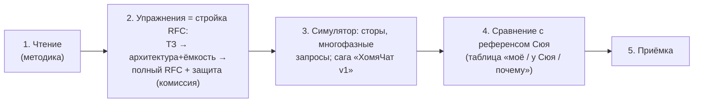

# 1.6 — Проект: Мессенджер v1 (RFC №1) · ⏳ в работе

> Проектная глава: **свой RFC до чужого референса**. Референс Сюя (гл.12, стр. 197–221, `source-syu-ch12.md`) запечатан до приёмки RFC — чтение раньше превращает проектирование в пересказ. Никаких чужих design-разборов мессенджеров; случайно известное помечать «принёс с собой, не вывел».

## Что такое RFC (design doc) 🟡

Короткий документ (5–15 страниц), отвечающий на четыре вопроса **до написания кода**: что строим и для кого · какие требования (FR, NFR, вне рамок) · как устроено (архитектура с ценой компромиссов) · что может пойти не так.

Почему индустрия платит за это временем инженеров:
1. **Ошибки на бумаге стоят копейки** — изменить раздел «Архитектура» час, обкатанную систему — месяцы (сага: 847 потерянных запросов при замене одного сервера; на бумаге — ластик).
2. **Выравнивание** — каждое возражение в документе = инцидент, не случившийся в проде (ревью — машина времени для инцидентов).
3. **Артефакт для защиты** — дизайн-ревью; интервью = устный RFC, сжатый в 45 минут.

## Скелет RFC №1 — 8 разделов

| № | Раздел | Шаг фреймворка 1.1 | Инструменты |
|---|---|---|---|
| 1 | Контекст и цель | 1 | — |
| 2 | Требования: FR (глаголами пользователя) · NFR (с числами) · **вне рамок v1** | 1 | 1.3 |
| 3 | Предположения ДО расчёта → воронка DAU→RPS→пик → хранилище | 1–2 | 1.2 |
| 4 | Архитектура: эволюция (не прыжок) · **доставка сообщений** · где состояние · выбор хранилищ | 2–3 | 1.5 |
| 5 | Ёмкость: Литтл по уровням (слоты = λ·W, W = сумма фаз), headroom 70–80% | 3 | 1.4 |
| 6 | Отказы и деградация: по каждому блоку «упадёт всё / деградирует / незаметно» + SPOF | 4 | 1.5 |
| 7 | Открытые вопросы (честные TBD + эксперимент) | 4 | — |
| 8 | Мостик в v2 | — | — |

**«Вне рамок» — половина цены документа:** защищает от расползания; каждое выкинутое — обоснованное «нет» (дыра, которую не проектируем, и защита в переговорах).

**Рабочая связка всей главы: решение → число → отказ.** Пример: sticky-сессии → число = цена доступа к сессии на каждый запрос (RAM ≈ 0, стор ≈ мс; входит в W → слоты) + худший клиент обязан влезать в один сервер → отказы: шумный клиент, kill сервера, деплой.

**Доставка сообщений — центральное дизайн-решение:** как клиент Б **узнаёт** о сообщении? Отправить несложно — сложно доставить. У каждого варианта ответа есть цена (трафик/латентность/сложность) — компромисс обязателен, бесплатного варианта не существует. (Своё решение — до референса!)

**Объём:** 2–4 страницы + 1–2 схемы (ASCII/mermaid/салфетка — лишь бы отвечала на вопросы).

## Красные флаги (антипаттерны)

1. **Решение до требований** — «Архитектура» на первой странице.
2. **NFR без чисел** — «масштабируемо относительно чего?»
3. **Числа без предположений** — гороскоп с делением в столбик; и обратно: предположение вне расчётов — мусор.
4. **Архитектура-прыжок** — сразу микросервисы без «какую проблему решает каждый».
5. **Компонент без цены** — «поставим Redis» без «что это ломает» (Redis не компонент, а талисман).
6. **Нет отказов** — схема, где ничего не падает.
7. **Нет TBD** — либо гений, либо самообман.
8. **Только средние** — p50/p95/p99, хвост живёт на самом слабом узле.

## Бриф «ХомяЧат v1» (числа и дыры)

**Входные числа:** реклама у Кристофера Свиста (4 млн подписчиков) → цель **~100 000 DAU** к концу квартала; облако, оплата помесячно; команда — ты (CTO и единственный инженер) + Стас на выгрузки.

**Дыры для уточняющих вопросов:** «быстро» (число?) · «минимум год» (максимум?) · «дольше — если бесплатно» · «как в больших мессенджерах» · «никакой ночи даунтайма» (допустимый даунтайм = число) · конверсии — предположить самому · доля трафика поилок PawFit vs живых пользователей.

**Продукт v1:** переписка 1-на-1 (групповые — v2, «не мешайте» — Аркадий); текст (медиа — v2); история ≥ год; «кто онлайн»; доставка «быстро»; логин один раз. Клиенты: приложение + виджет в «ХомяМаркет» + умная поилка PawFit (ровный машинный трафик).

## Протокол главы

## Симулятор 1.6

Сцена дорастает до хранилищ: `клиенты → балансировщик → пул → {Redis, БД}`. Запрос многофазный: веб-фаза → ходок за сессией → ходок в БД → ответ; W растёт на ходоки (видно в перцентилях — считать по Литтлу заранее). Отказы сторов разной серьёзности при одинаковом kill: одно деградирует, другое роняет — **какое именно, RFC должен предсказать** (проверка физикой саги). Бутылочное горлышко съезжает в данные: веб раздувается LB/автоскейлом, стор — нет.

## Глоссарий

RFC / design doc · приёмочная комиссия · вне рамок (out of scope) · TBD · trade-off · доставка сообщений (message delivery) · деградация vs падение

---
Связано: собирает весь модуль — [[1.1 Интервью-фреймворк]] (скелет RFC) · [[1.2 Математика нагрузки]] (раздел 3) · [[1.3 Требования FR-NFR]] (раздел 2) · [[1.4 Ёмкость latency очередь]] (раздел 5) · [[1.5 Масштабирование stateless]] (разделы 4, 6)
