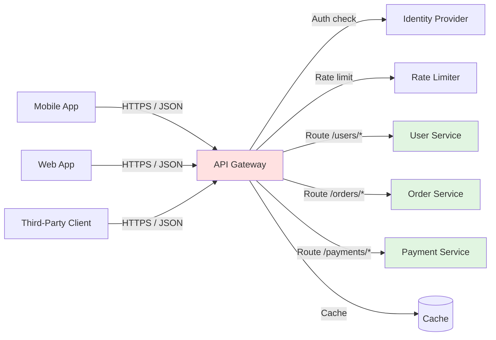

# 🧠 Topic: API Gateways

> [!abstract] Executive Summary (ELI5)
> An API gateway is like the front desk of a large office building. Visitors do not go directly to every department; they check in at the front desk, which verifies their identity, logs the visit, routes them to the right floor, and may hand out copies of commonly requested forms. In the same way, an API gateway is the single front door for many backend services.

---

## 🎯 The "Why"
- **Problem Solved:** In a system with many services, clients would otherwise need to know every service's address, protocol, and security rules. An API gateway centralizes access, hides internal complexity, and applies cross-cutting concerns in one place.
- **Alternatives:** Direct client-to-service calls, service mesh for internal traffic, or custom middleware in each service.
- **Trade-offs:** The gateway becomes a critical component that must be highly available and scalable. It can also add latency and becomes a place where complexity can accumulate if overused.

## 💡 Mental Model & Analogy
- **Analogy:** "An API gateway is like a concierge at a hotel. Guests ask the concierge for anything they need — a taxi, a restaurant reservation, directions. The concierge knows who to call, checks the guest's authorization, and may refuse requests that are unreasonable or too frequent."
- **Visual/Diagram:**

## 🛠️ Core Principles

### What Is an API Gateway?
An **API gateway** is a server that sits between clients and backend services. It acts as a reverse proxy, accepting client API requests, routing them to the appropriate backend service, and returning the aggregated or transformed response to the client.

It is a specialized reverse proxy focused on application-layer API traffic. In addition to routing, it typically handles cross-cutting concerns like authentication, rate limiting, caching, and request/response transformation.

### Problems That an API Gateway Solves

**Service discovery complexity:**
Without a gateway, clients need to know the addresses of every microservice. An API gateway provides a single entry point and internally routes requests to the right service.

**Duplicated cross-cutting concerns:**
Every service would otherwise implement its own authentication, logging, rate limiting, and SSL termination. The gateway centralizes these concerns.

**Protocol mismatch:**
Clients may use REST/JSON while internal services use gRPC or GraphQL. The gateway can translate between protocols.

**Inconsistent security:**
A central gateway ensures all external traffic passes through the same security controls.

**Client coupling:**
When services are split or merged, clients would need to change. A gateway abstracts these changes behind a stable API contract.

### How API Gateways Work
1. A client sends a request to a single endpoint exposed by the API gateway.
2. The gateway validates the request, checks authentication tokens, and enforces rate limits.
3. The gateway determines the target backend service based on path, method, headers, or other rules.
4. The gateway may transform the request, add headers, or look up a cached response.
5. The gateway forwards the request to the backend service, possibly load balancing across multiple instances.
6. The backend service processes the request and returns a response.
7. The gateway may transform the response, log metrics, and return the result to the client.

### Benefits of Using an API Gateway

**Security:**
- Centralizes authentication and authorization (e.g., JWT validation, OAuth2, API keys)
- Terminates TLS/SSL at the edge
- Hides internal service architecture and endpoints from the public internet
- Blocks malicious traffic and integrates with Web Application Firewalls

**Rate Limiting:**
- Prevents abuse by limiting how many requests a client can make in a time window
- Protects backend services from traffic spikes and runaway clients
- Supports quotas, throttling, and burst allowances

**Load Balancing:**
- Distributes requests across multiple instances of a service
- Performs health checks and removes unhealthy instances
- Supports weighted routing and canary deployments

**Caching:**
- Caches frequently accessed responses to reduce backend load and latency
- Can apply cache rules based on path, query parameters, or headers
- Works well for read-heavy API endpoints

**Request Transformation:**
- Translates between protocols (REST to gRPC, HTTP to WebSocket)
- Modifies request and response headers, bodies, and status codes
- Aggregates responses from multiple services into a single client-facing response

**Logging and Monitoring:**
- Captures request logs, latency metrics, error rates, and traffic patterns
- Provides a central place to observe all external API traffic
- Integrates with observability tools and dashboards

### Popular API Gateway Implementations

| Gateway | Best For | Notes |
|---------|----------|-------|
| **Nginx / Nginx Plus** | High-performance reverse proxy and API gateway | Mature, widely used, good for routing and load balancing |
| **Kong** | Open-source and enterprise API management | Plugin ecosystem, rate limiting, auth, analytics |
| **AWS API Gateway** | Serverless and AWS-native systems | Pay-per-use, integrates with Lambda, IAM, CloudWatch |
| **Azure API Management** | Microsoft-centric enterprises | Policy-based configuration, developer portal |
| **Google Cloud Endpoints** | GCP-native and gRPC/REST APIs | Tight integration with GCP services |
| **Traefik** | Cloud-native and Kubernetes environments | Dynamic configuration, native Ingress support |
| **Envoy** | High-performance service mesh and edge proxy | Used by Istio; can act as gateway |
| **Apache APISIX** | Cloud-native, high-performance open-source gateway | Dynamic routing, observability, multi-protocol |
| **Spring Cloud Gateway** | Java/Spring microservices | Code-based routing and filters |

### When to Use an API Gateway
Use an API gateway when:
- You have multiple backend services that clients need to access
- You want a single entry point for security, monitoring, and policy enforcement
- Clients are external or third-party and should not know internal service topology
- You need cross-cutting concerns like auth, rate limiting, caching, and transformation
- You are building a microservices architecture or exposing public APIs

Avoid or delay an API gateway when:
- The system is a single monolith with simple routing needs
- The additional hop and complexity are not justified by the scale
- You can handle cross-cutting concerns cleanly inside the application

## ⚠️ Pitfalls & Anti-patterns
- **Turning the gateway into a smart monolith:** Keep business logic in services; the gateway should handle cross-cutting concerns only.
- **Single point of failure:** Run gateways in clusters with health checks and auto-failover.
- **Over-aggregation:** Combining too many service calls in the gateway can create tight coupling and slow responses.
- **Ignoring cold-start latency:** Serverless gateways may add unpredictable latency under load.
- **Misconfigured rate limits:** Limits that are too tight block legitimate users; limits that are too loose fail to protect backends.

## 🔗 Deep Connections
- **Parent Topic:** [[Networking Fundamentals]]
- **Related Concepts:** [[Load_Balancing_Introduction]], [[Forward_And_Reverse_Proxy]], [[Microservices]], [[Caching]], [[Rate_Limiting]], [[Authentication]], [[Service_Mesh]], [[TLS_SSL]]
- **Prerequisites:** HTTP/REST, reverse proxies, load balancing basics

## ❓ Active Recall Questions
> [!faq]- What is an API gateway and why is it used?
> An API gateway is a server that sits between clients and backend services, routing requests and centralizing cross-cutting concerns like security, rate limiting, caching, and monitoring. It hides internal service complexity from clients.

> [!faq]- How does an API gateway differ from a load balancer?
> A load balancer primarily distributes traffic across backend servers for availability and scale. An API gateway does that plus authentication, rate limiting, caching, request transformation, protocol translation, and API management.

> [!faq]- What are the key benefits of using an API gateway?
> Centralized security, rate limiting, load balancing, caching, request/response transformation, logging, monitoring, and simplified client access to many services.

> [!faq]- How does an API gateway handle authentication and authorization?
> It validates tokens or API keys at the edge, often integrating with OAuth2, OpenID Connect, or LDAP, and rejects unauthorized requests before they reach backend services.

> [!faq]- Explain rate limiting and throttling in API gateways.
> Rate limiting restricts how many requests a client can make in a time window. Throttling slows or blocks clients that exceed the limit, protecting backend services from overload and abuse.

> [!faq]- What caching strategies can be implemented in an API gateway?
> Cache static or read-heavy responses, use TTL-based expiration, vary cache keys by path/query/header, and invalidate cache when underlying data changes.

> [!faq]- How does an API gateway improve security against DDoS attacks?
> It terminates TLS, applies rate limiting and connection limits, blocks malicious patterns, integrates with WAFs, and hides backend services from direct internet exposure.

> [!faq]- When should you use an API gateway in a microservices architecture?
> Use it when you have many services exposed to external clients and need a single entry point for routing, security, rate limiting, and observability.

---

*Last updated: 2026-06-30*
