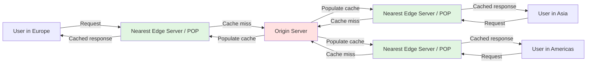

# 🧠 Topic: Content Delivery Network (CDN)

> [!abstract] Executive Summary (ELI5)
> A CDN is like a chain of local warehouses for a popular online store. Instead of shipping every order from one central factory across the world, the store keeps copies of its bestsellers in warehouses close to customers. Orders arrive faster, the central factory is less busy, and if one warehouse closes, another can still fulfill the order.

---

## 🎯 The "Why"
- **Problem Solved:** Users are physically far from origin servers, causing high latency, slow downloads, and overloaded infrastructure. CDNs place content closer to users.
- **Alternatives:** Single powerful origin server, geographic load balancing without caching, optimizing application code.
- **Trade-offs:** CDNs add cost, cache invalidation complexity, and potential stale content issues. Dynamic content is harder to cache than static content.

## 💡 Mental Model & Analogy
- **Analogy:** "A CDN is like having multiple coffee shops around a city instead of one roastery. Customers get their coffee quickly from a nearby shop, while the roastery supplies the shops in bulk and keeps production centralized."
- **Visual/Diagram:**

## 🛠️ Core Principles

### What Is a CDN?
A **Content Delivery Network (CDN)** is a geographically distributed network of servers that caches and delivers content to users from locations close to them. The goal is to reduce latency, improve availability, absorb traffic spikes, and add security at the edge.

### Problems a CDN Resolves

**Latency problem:**
The speed of light and network round trips limit how fast data can travel. A CDN reduces the physical distance between the user and the content, cutting round-trip time and improving load speed.

**Availability problem:**
If the origin server fails or a network path is down, users cannot reach the service. CDNs can serve cached content from edge servers even when the origin is temporarily unavailable.

**Load handling:**
A popular file, video, or API endpoint can overwhelm an origin server. CDNs absorb most of the traffic so the origin handles only cache misses and dynamic requests.

**Security:**
CDNs sit at the edge and can absorb DDoS traffic, enforce TLS, apply WAF rules, and hide the origin server's IP address from attackers.

### Components of a CDN

**1. Origin servers:**
The source of truth where the original content lives. When an edge server does not have a cached copy, it fetches it from the origin. The origin can be a web server, object storage bucket, or cloud service.

**2. Edge servers:**
Servers deployed in data centers around the world, grouped into Points of Presence (POPs). They cache content and serve it directly to nearby users. Edge servers are the workhorses of a CDN.

**3. Request routing system:**
The mechanism that directs each user request to the best edge server. It uses DNS, anycast routing, and real-time measurements of latency, load, and geography.

### How a CDN Works and Handles a User Request

1. A user requests an asset, for example `image.jpg` from `cdn.example.com`.
2. The user's DNS resolver queries the CDN's DNS and receives the IP address of the nearest or best-performing edge server.
3. The request goes to that edge server.
4. The edge server checks its cache:
   - **Cache hit:** The content is available and fresh; the edge server returns it immediately.
   - **Cache miss:** The edge server fetches the content from the origin server, caches it, and returns it to the user.
5. On subsequent requests, the cached copy is served directly from the edge, reducing latency and origin load.

### Use Cases of a CDN

**1. Static vs dynamic content delivery:**
- **Static content** — images, CSS, JavaScript, videos, fonts, and downloadable files. CDNs excel here because the content does not change often and can be cached for long periods.
- **Dynamic content** — personalized pages, API responses, search results. CDNs use shorter TTLs, edge-side includes, or dynamic site acceleration to optimize delivery without serving stale data.

**2. API acceleration and edge computing:**
- CDNs can cache API responses at the edge and terminate TLS closer to users, reducing API latency.
- **Edge computing** runs small pieces of logic directly on edge servers. This allows personalization, A/B testing, bot detection, and request transformation at the edge without hitting the origin.

### Caching Strategies

**Cache hit vs cache miss:**
- A **cache hit** means the requested content is found at the edge server and served directly.
- A **cache miss** means the edge server must fetch the content from the origin, cache it, and then serve it.

**Cache expiration and TTL:**
- **Time-to-Live (TTL)** defines how long content stays in cache before it is considered stale.
- Short TTLs keep content fresh but increase origin load. Long TTLs reduce origin load but risk serving outdated content.

**Cache validation:**
- **Last-Modified / If-Modified-Since:** The edge server asks the origin if content changed since a timestamp.
- **ETag / If-None-Match:** The origin returns a content fingerprint; the edge server fetches only if the fingerprint changed.
- Validation reduces bandwidth compared to unconditional fetches.

**Dynamic content caching:**
- Cache dynamic responses with very short TTLs.
- Use cache-busting parameters or edge logic to vary cache by user segment.
- Serve stale-while-revalidate to respond quickly while refreshing in the background.

### Load Balancing and Failover in CDNs

CDNs use multiple routing strategies:
- **Geo-based routing:** Send users to the closest POP by geography.
- **Latency-based routing:** Send users to the POP with the lowest measured latency.
- **Load-aware routing:** Avoid POPs that are currently overloaded.

If a POP fails, the request routing system redirects users to the next best POP. Because content is cached across many locations, a single POP failure does not take the service down.

### CDN Optimization Techniques

**Compression and minification:**
- Gzip or Brotli compression reduces transfer size for text-based assets.
- Minification removes unnecessary characters from CSS, JavaScript, and HTML.

**Image and video optimization:**
- Serve responsive images in the right size and format (WebP, AVIF) for each device.
- Adaptive bitrate streaming (HLS, DASH) delivers video quality matched to the user's bandwidth.

**API acceleration:**
- Keep-alive connections to origin, TCP optimizations, route optimization, and caching API responses at the edge reduce API latency.

### CDN Security

**DDoS protection:**
CDNs absorb large volumes of malicious traffic across their distributed network, preventing it from reaching the origin. They use rate limiting, anomaly detection, and challenge mechanisms.

**SSL/TLS offloading:**
The CDN handles TLS encryption and decryption at the edge, reducing CPU load on origin servers and centralizing certificate management.

**Origin shield:**
A designated CDN data center fetches from the origin and serves other POPs, reducing origin load and protecting it from cache miss stampedes.

### Advanced Topics

**Multi-CDN architecture:**
Organizations use multiple CDN providers to avoid vendor lock-in, increase resilience, and optimize performance across regions. A traffic manager routes requests to the best-performing CDN at any moment.

**Edge computing:**
Running code at CDN edge locations enables low-latency personalization, security filtering, and real-time processing close to users. Examples include Cloudflare Workers, AWS Lambda@Edge, and Fastly Compute.

**Real-time applications:**
CDNs help online gaming and stock trading by placing game servers, matchmaking, and market data closer to users, reducing round-trip time and jitter.

## ⚠️ Pitfalls & Anti-patterns
- **Caching dynamic or user-specific content too aggressively:** Leads to data leaks or stale responses.
- **Ignoring cache invalidation:** Without a clear invalidation strategy, content stays stale longer than intended.
- **Exposing the origin IP:** If attackers learn the origin IP, they can bypass CDN protections.
- **Misconfigured TTLs:** Too long causes stale content; too short defeats the purpose of caching.
- **Assuming a CDN replaces good origin design:** A CDN helps but does not fix slow application logic or inefficient databases.

## 🔗 Deep Connections
- **Parent Topic:** [[Networking Fundamentals]]
- **Related Concepts:** [[Caching]], [[Load_Balancing_Introduction]], [[Forward_And_Reverse_Proxy]], [[DNS]], [[Edge_Computing]], [[High_Availability]], [[DDoS]]
- **Prerequisites:** HTTP, DNS, basic caching, latency concepts

## ❓ Active Recall Questions
> [!faq]- What is a CDN and how does it work?
> A CDN is a distributed network of edge servers that caches content close to users. It routes requests to the nearest edge server, serves cached content on cache hits, and fetches from the origin on cache misses.

> [!faq]- Why do we need CDNs in system design?
> To reduce latency, improve availability, handle traffic spikes, offload origin servers, and add security at the edge.

> [!faq]- What is the difference between an origin server and an edge server?
> The origin server is the source of truth for content. Edge servers are distributed caches that serve content to nearby users.

> [!faq]- How does request routing work in a CDN?
> DNS, anycast, and real-time measurements direct each user request to the best edge server based on geography, latency, or load.

> [!faq]- What is a cache hit versus a cache miss?
> A cache hit means the content is available at the edge and served directly. A cache miss means the edge server must fetch the content from the origin.

> [!faq]- How does a CDN handle dynamic content caching?
> It uses short TTLs, edge-side logic, stale-while-revalidate, and careful cache-key design to cache dynamic responses without serving stale or personalized data incorrectly.

> [!faq]- How do CDNs protect against DDoS attacks?
> They absorb traffic across a distributed network, apply rate limiting and anomaly detection, and hide the origin server's IP address.

> [!faq]- What is edge computing and how does it relate to CDNs?
> Edge computing runs small applications or functions on CDN edge servers, enabling low-latency processing close to users. CDNs provide the global edge infrastructure for these workloads.

---

*Last updated: 2026-06-30*
