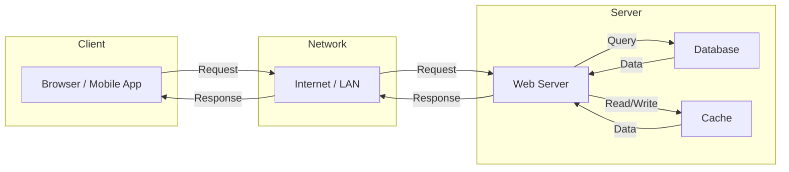

# 🧠 Topic: Client-Server Model

> [!abstract] Executive Summary (ELI5)
> The client-server model is like ordering at a restaurant. You (the client) sit at your table and ask the waiter (the server) for food. The waiter takes your order, brings it to the kitchen, and returns with your meal. You don't need to know how the kitchen works — you just make requests and receive responses.

---

## 🎯 The "Why"
- **Problem Solved:** How do we structure distributed applications so that consumers (clients) can access shared resources and services managed by providers (servers)?
- **Alternatives:** Peer-to-Peer (P2P) — every node is both client and server; no central authority. Better for file sharing, worse for consistency and security.
- **Trade-offs:** Centralization enables control, consistency, and security, but introduces a single point of failure and potential bottleneck.

## 💡 Mental Model & Analogy
- **Analogy:** "The client-server model is like a library. Patrons (clients) browse the catalog and request books. Librarians (servers) manage the collection, retrieve items, and enforce rules. Patrons never enter the storage room."
- **Visual/Diagram:**

## 🛠️ Core Principles

### What is the Client-Server Model
The client-server model is a distributed application architecture that partitions tasks or workloads between service providers (servers) and service requesters (clients). Clients initiate communication sessions by sending requests; servers wait for incoming requests, process them, and return responses.

Key characteristics:
- **Asymmetry:** Clients and servers have different roles and capabilities
- **Separation of concerns:** Presentation logic lives on the client, business logic and data on the server
- **Centralized resource management:** Servers control access to shared resources
- **Scalability potential:** Multiple clients can connect to one server; one client can use multiple servers

### Examples of This Pattern
| Domain | Client | Server | Protocol |
|--------|--------|--------|----------|
| Web browsing | Browser (Chrome, Firefox) | Web server (Nginx, Apache) | HTTP/HTTPS |
| Email | Outlook, Gmail app | SMTP/IMAP server | SMTP, IMAP, POP3 |
| File sharing | FTP client (FileZilla) | FTP server | FTP, SFTP |
| Streaming | Netflix app | CDN / streaming server | HTTP (HLS, DASH) |
| Gaming | Game client | Game server | TCP/UDP custom |
| Databases | psql, MongoDB Compass | PostgreSQL, MongoDB | TCP custom |
| Chat | Slack, WhatsApp | Messaging server | WebSocket, XMPP |

### Client / Server / Network

**Client:**
- Initiates requests
- Usually has limited resources (CPU, memory, storage)
- Runs user-facing applications (browsers, mobile apps, desktop software)
- Often transient — connects, requests, disconnects

**Server:**
- Listens for incoming requests on a well-known port
- Has abundant resources and runs 24/7
- Manages shared resources (databases, files, compute)
- Handles multiple concurrent clients

**Network:**
- The transport layer between client and server
- Can be LAN, WAN, or the internet
- Introduces latency, packet loss, and security concerns
- Protocols: TCP, UDP, HTTP, WebSocket, gRPC

### How Clients and Servers Communicate

#### Basic Steps
1. **Connection establishment:** Client opens a connection to the server's IP and port (e.g., TCP handshake for HTTP)
2. **Request:** Client sends a formatted message (e.g., HTTP GET /users)
3. **Processing:** Server parses the request, validates it, performs business logic, queries databases
4. **Response:** Server sends a formatted response (e.g., HTTP 200 OK with JSON payload)
5. **Connection teardown:** Connection may be closed or kept alive for subsequent requests

#### Types of Communication

**Request-Response Model:**
- Client sends a request, server sends a response, connection may close
- Simple, stateless by default (HTTP/1.0)
- High overhead if connections are re-established for every request
- Best for: REST APIs, web pages, occasional data fetching

**Persistent Connections:**
- Connection remains open after the first request-response
- Multiple requests can be sent over the same connection (HTTP/1.1 Keep-Alive, HTTP/2 multiplexing)
- Reduces TCP handshake overhead and latency
- Best for: APIs with frequent calls, real-time dashboards, streaming

**Other patterns:**
- **Polling:** Client repeatedly asks server if there's new data (wasteful)
- **Long Polling:** Server holds the connection open until data is available (better than polling)
- **Server-Sent Events (SSE):** Server pushes data to client over a persistent HTTP connection (one-way)
- **WebSockets:** Full-duplex persistent connection — both sides can send messages anytime (chat, gaming)
- **gRPC:** HTTP/2-based RPC with streaming support ( unary, server-streaming, client-streaming, bidirectional)

### Stateless vs Stateful Servers

| Aspect | Stateless | Stateful |
|--------|-----------|----------|
| **Session data** | Stored on client (tokens, cookies) | Stored on server (memory, session store) |
| **Scalability** | Easy — any server can handle any request | Hard — requests must route to the same server |
| **Failure recovery** | Simple — no server-side session to lose | Complex — session data must be replicated or persisted |
| **Resource usage** | Low per-request | High per-client (memory) |
| **Security** | Tokens can be stolen but are short-lived | Sessions can be hijacked if session IDs leak |
| **Examples** | REST APIs, JWT auth, HTTP | WebSocket servers, game servers, shopping carts |

#### When to Use Stateless
- **Microservices and REST APIs:** Each request is self-contained, easy to scale horizontally
- **Serverless functions:** No persistent state between invocations
- **Mobile backends:** Clients send auth tokens with every request
- **CDN edge logic:** Edge nodes don't hold session state

#### When to Use Stateful
- **Real-time applications:** WebSocket chat, multiplayer games, collaborative editing (e.g., Google Docs)
- **Long-running transactions:** Uploading a large file in chunks, multi-step workflows
- **Shopping carts (legacy):** Session holds cart contents until checkout
- **Database connections:** Connection pooling requires the server to know about open connections

#### Hybrid Approach
Modern systems often use stateless servers with a stateful backing store:
- Stateless application servers handle requests
- Session data is stored in Redis, DynamoDB, or a database
- This gives the scalability of stateless with the flexibility of stateful behavior

## 🏗️ The Role in System Design

### Scalability
- Stateless servers scale horizontally with a load balancer in front
- Stateful servers require session affinity (sticky sessions) or shared session stores
- Caching layers (CDN, Redis) reduce load on origin servers

### Security
- Clients are untrusted — always validate input on the server
- Authentication tokens (JWT, OAuth) are sent with each request in stateless systems
- TLS/SSL encrypts traffic between client and server
- Firewalls, WAFs, and rate limiters protect the server from malicious clients

### Load Balancing
- Load balancers distribute client requests across multiple server instances
- Stateless: any server can handle any request — round-robin works perfectly
- Stateful: sticky sessions or shared session store needed
- Health checks ensure traffic only goes to healthy servers

### Cloud and Microservices
- In Kubernetes, client requests hit an Ingress (load balancer), then route to pods
- Service mesh (Istio, Linkerd) manages client-server communication between microservices
- Each microservice is a server to its callers and a client to its dependencies

## ⚠️ Pitfalls & Anti-patterns
- **Treating clients as trusted:** Never rely on client-side validation alone. Always validate on the server.
- **Storing secrets on the client:** API keys, passwords, and tokens should not be embedded in client-side code (especially mobile and web apps)
- **Fat clients:** Putting too much business logic in the client makes updates hard and creates security holes
- **Session affinity without need:** Using sticky sessions when stateless would work prevents proper load distribution
- **Ignoring network latency:** Assuming the network is fast and reliable. Design for retries, timeouts, and circuit breakers.

## 🔗 Deep Connections
- **Parent Topic:** [[Networking Fundamentals]]
- **Related Concepts:** [[HTTP]], [[REST]], [[WebSocket]], [[gRPC]], [[Load Balancing]], [[Caching]], [[Microservices]], [[JWT]], [[OAuth]]
- **Prerequisites:** IP addresses, TCP/UDP, basic networking

## ❓ Active Recall Questions
> [!faq]- What is the client-server model?
> A distributed architecture where clients request services and servers provide them. Clients initiate communication; servers listen and respond. It separates presentation, business logic, and data layers.

> [!faq]- How does a client communicate with a server?
> The client opens a connection (e.g., TCP), sends a formatted request (e.g., HTTP GET), the server processes it and returns a response. The connection may be closed or kept open for persistent communication.

> [!faq]- What is the difference between stateless and stateful servers?
> Stateless servers don't store client session data — each request is self-contained. Stateful servers maintain session state between requests. Stateless is easier to scale; stateful is needed for real-time and long-running interactions.

> [!faq]- How does caching improve performance in a client-server model?
> Caching stores frequently accessed data closer to the client (browser cache, CDN, reverse proxy), reducing the number of requests that reach the origin server and lowering latency for the client.

> [!faq]- How would you design a scalable client-server system for high traffic?
> Use stateless application servers behind a load balancer, cache at multiple layers (CDN, Redis), use a database cluster, employ auto-scaling, and use asynchronous processing (queues) for heavy workloads. Store session data in a shared store like Redis if needed.

---

*Last updated: 2026-06-27*
