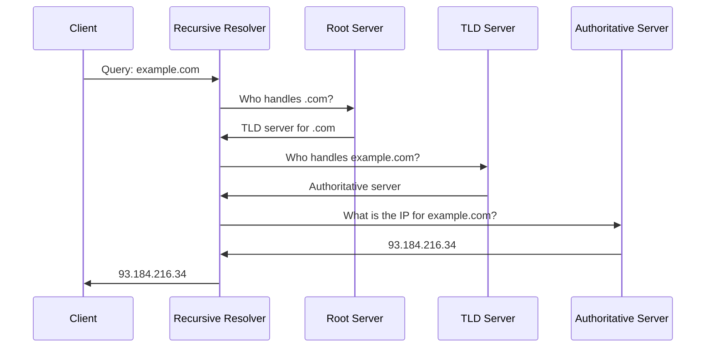
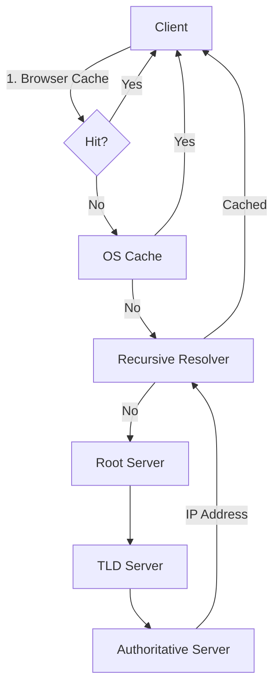

# 🧠 Topic: How DNS Works

> [!abstract] Executive Summary (ELI5)
> DNS is like the phonebook of the internet. When you type "google.com", your computer doesn't know where that is — it asks DNS to look up the "phone number" (IP address) so it can connect.

---

## 🎯 The "Why"
- **Problem Solved:** Humans remember names, computers need numbers. DNS bridges this gap by translating domain names into IP addresses.
- **Alternatives:** Static hosts files (doesn't scale), centralized directory (single point of failure)
- **Trade-offs:** DNS adds a lookup latency, but caching and hierarchical design make it negligible for most use cases

## 💡 Mental Model & Analogy
- **Analogy:** "DNS is like asking a librarian for a book. The librarian checks their desk (cache), then the local catalog (resolver), then the national library system (root → TLD → authoritative) to find the exact shelf location."
- **Visual/Diagram:**

## 🛠️ Core Principles

### Introduction to DNS
The Domain Name System (DNS) is a distributed, hierarchical naming system that translates human-readable domain names (like `example.com`) into machine-readable IP addresses (like `93.184.216.34`). It is one of the foundational protocols of the internet, operating on UDP port 53 (and TCP port 53 for zone transfers and large responses).

### Why DNS Is Important
- **User Experience:** Users type names, not numbers. Without DNS, the internet would be unusable for non-technical people.
- **Decoupling:** You can change the underlying infrastructure (IP addresses) without changing the domain name. This is critical for migrations, failover, and scaling.
- **Scalability:** DNS is distributed by design — no single server handles all queries. It scales to billions of requests per day.
- **Flexibility:** DNS supports multiple record types (A, AAAA, CNAME, MX, TXT, NS, SOA) that serve different purposes beyond simple IP mapping.

### Types of DNS Servers

| Server Type | Role | Example |
|-------------|------|---------|
| **Recursive Resolver** | Acts on behalf of the client, performs full resolution, caches results | ISP resolver, Google Public DNS (8.8.8.8), Cloudflare (1.1.1.1) |
| **Root Name Server** | Knows where to find TLD servers. The entry point of the DNS hierarchy. | a.root-servers.net through m.root-servers.net |
| **TLD Name Server** | Manages domains for a specific top-level domain (.com, .org, .net) | Verisign manages .com TLD servers |
| **Authoritative Name Server** | Holds the actual DNS records for a domain. The source of truth. | ns1.example.com (managed by the domain owner or DNS provider) |

- **Recursive vs. Iterative:** The recursive resolver does the heavy lifting — it may query multiple servers iteratively, but the client only sees one recursive request.

### DNS Caching and Performance Optimization

#### Why Caching Matters
- **Latency reduction:** 80-90% of DNS queries are served from cache, avoiding full resolution
- **Load reduction:** Caches absorb traffic that would otherwise hit root and authoritative servers
- **Resilience:** If authoritative servers are temporarily unreachable, cached records may still work

#### Where Caching Occurs (Layers)
1. **Browser Cache:** Chrome, Firefox, etc. cache DNS records for a short time
2. **OS Cache:** The operating system maintains a local DNS cache (e.g., `systemd-resolved`, Windows DNS Client)
3. **Local/Recursive Resolver Cache:** Your ISP's resolver or corporate DNS server caches results for all its users
4. **Intermediate Resolvers:** Some networks use forwarding resolvers that also cache

#### TTL (Time To Live)
- TTL is a value (in seconds) set on each DNS record that tells resolvers how long they can cache it
- **Trade-off:**
  - **Low TTL:** Faster propagation of changes, but more queries to authoritative servers
  - **High TTL:** Better performance and lower load, but slower failover when something changes
- **Best Practice:** Use high TTL for stable records (e.g., 3600s), drop TTL before planned migrations (e.g., 300s), then raise it back after

### The Domain Name Resolution Process (Step-by-Step)

1. **User types `example.com`** in the browser
2. **Browser checks its cache** — if the record is there and not expired, use it
3. **OS checks its cache** — if found, return to browser
4. **Query sent to the configured recursive resolver** (usually ISP or public DNS like 8.8.8.8)
5. **Recursive resolver checks its cache** — if found, return to client
6. **If cache miss:** Resolver queries a **Root Name Server** — "Who handles .com?"
7. **Root server responds** with the TLD server addresses for .com
8. **Resolver queries the TLD server** — "Who handles example.com?"
9. **TLD server responds** with the authoritative name server for the domain
10. **Resolver queries the authoritative server** — "What is the A record for example.com?"
11. **Authoritative server returns the IP address** (e.g., 93.184.216.34)
12. **Resolver caches the result** and returns it to the client
13. **Client connects to the IP address** via HTTP/HTTPS

### Importance of DNS in Large-Scale Systems

#### Ensuring High Availability
- **Multiple A Records:** A domain can resolve to multiple IP addresses. If one fails, clients try the next
- **DNS Load Balancing:** Distribute traffic across data centers by returning different IPs based on location, load, or round-robin
- **Anycast DNS:** The same IP address is advertised from multiple geographic locations. Users are routed to the nearest one via BGP, reducing latency and providing automatic failover

#### DNS Failover Strategies
- **Active-Standby:** Primary IP is returned; if health checks fail, DNS is updated to return the secondary IP
- **Geographic DNS (GeoDNS):** Return IPs based on the user's location. E.g., European users get European servers
- **Weighted Round-Robin:** Return IPs with different weights to control traffic distribution
- **Health Checks + Dynamic DNS:** Automated systems monitor endpoints and update DNS records when failures are detected

#### CDNs and DNS
- CDNs use DNS to route users to the nearest edge server
- When a user requests a static asset, DNS resolves to the CDN's edge node rather than the origin server
- This reduces latency and offloads traffic from the origin

#### DNS Security Risks

| Threat | Description | Mitigation |
|--------|-------------|------------|
| **DNS Spoofing / Poisoning** | Attacker injects false DNS records, redirecting traffic to malicious sites | DNSSEC (DNS Security Extensions) — cryptographically signs records |
| **Cache Poisoning** | Attacker corrupts a DNS resolver's cache with false data | DNSSEC, DNS over HTTPS/TLS, input validation on resolvers |
| **DDoS on DNS** | Overwhelming DNS infrastructure with queries to make services unreachable | Anycast for distribution, rate limiting, DNS over HTTPS, anycast routing |
| **DNS Tunneling** | Encodes data in DNS queries to exfiltrate information or bypass firewalls | DNS traffic inspection, block known DNS tunneling domains |

## ⚠️ Pitfalls & Anti-patterns
- **Ignoring TTL during deployments:** Changing DNS and expecting instant propagation causes outages
- **Single DNS provider:** No redundancy if the provider has an outage. Use multiple NS records or DNS failover services
- **Over-reliance on DNS for fine-grained load balancing:** DNS caches are sticky — clients may keep using the same IP for the TTL duration. Use application-level or proxy-level balancing for precision
- **No DNS monitoring:** If DNS fails, everything fails. Monitor resolution times and error rates

## 🔗 Deep Connections
- **Parent Topic:** [[Networking Fundamentals]]
- **Related Concepts:** [[IP_Addresses]], [[Load Balancing]], [[CDN]], [[Anycast]], [[DNSSEC]], [[BGP]]
- **Prerequisites:** IP addresses, basic networking

## ❓ Active Recall Questions
> [!faq]- What is the primary purpose of DNS?
> DNS translates human-readable domain names into machine-readable IP addresses, enabling users to access services by name rather than by number.

> [!faq]- What is the difference between a recursive and an authoritative DNS server?
> A recursive resolver queries other servers on behalf of the client and caches results. An authoritative server holds the actual DNS records for a domain and is the source of truth.

> [!faq]- Why is TTL important in DNS?
> TTL controls how long a DNS record can be cached. It balances between performance (high TTL = less querying) and agility (low TTL = faster propagation of changes).

> [!faq]- How does DNS support load balancing in large systems?
> DNS can return multiple A records (round-robin), use GeoDNS to route users to the nearest datacenter, or use Anycast to advertise the same IP from multiple locations.

> [!faq]- What are the main DNS security threats and how are they mitigated?
> DNS spoofing, cache poisoning, and DDoS attacks. Mitigation includes DNSSEC for cryptographic validation, DNS over HTTPS/TLS for encrypted queries, and Anycast for DDoS resilience.

---

*Last updated: 2026-06-27*
