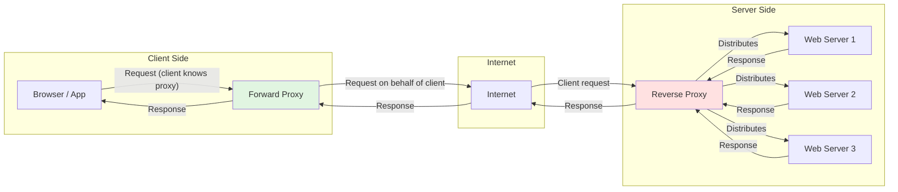

# 🧠 Topic: Forward Proxy and Reverse Proxy

> [!abstract] Executive Summary (ELI5)
> A proxy is a middleman between two parties on a network. A **forward proxy** sits in front of a client and speaks to the internet on the client's behalf, like an assistant who makes calls for you and hides your phone number. A **reverse proxy** sits in front of servers and receives requests from clients on the servers' behalf, like a receptionist who answers calls and routes them to the right employee while protecting the internal office.

---

## 🎯 The "Why"
- **Problem Solved:** How do we control, secure, optimize, or anonymize traffic between clients and servers without exposing either side directly to the internet?
- **Alternatives:** Direct client-to-server connections, VPNs for client-side privacy, application-layer routing inside services.
- **Trade-offs:** Proxies add a hop (latency), become a single point of failure or bottleneck, and require configuration and monitoring. The benefits usually outweigh the costs at scale.

## 💡 Mental Model & Analogy
- **Analogy:** "A forward proxy is like a lawyer who sends letters for you; the recipient sees the lawyer's address, not yours. A reverse proxy is like a hotel concierge: guests call one front-desk number, but the concierge routes the call to the correct room without revealing the room numbers."
- **Visual/Diagram:**

## 🛠️ Core Principles

### What Is a Proxy Server?
A **proxy server** is an intermediary machine that receives network requests from one party and forwards them to another. It can inspect, modify, cache, block, or log the traffic. Proxies operate at various layers — HTTP/HTTPS proxies at Layer 7, SOCKS proxies lower down, and transparent proxies that intercept traffic without client configuration.

Key capabilities:
- **Anonymity:** Hide the origin client's identity or IP address
- **Security filtering:** Block malicious destinations or content
- **Caching:** Store responses to reduce backend load and latency
- **Logging and monitoring:** Record traffic patterns and enforce policies
- **Access control:** Allow or deny requests based on rules

### What Is a Forward Proxy?
A **forward proxy** sits close to the client and acts on behalf of clients to reach external servers. The client is configured to send requests to the forward proxy, which then fetches the resource from the destination.

Common use cases:
- **Client privacy and anonymity:** Hide the client's real IP address from websites and services
- **Content filtering and policy enforcement:** Corporations and schools block unwanted sites or scan outbound traffic
- **Caching frequently accessed content:** Reduce bandwidth by caching pages, updates, and media
- **Bypassing geo-restrictions:** Route traffic through a proxy in another region
- **Audit and compliance:** Log all outbound traffic for security reviews

Real-world examples:
- Corporate web proxies (Blue Coat, Zscaler, Squid)
- Residential proxy services for web scraping
- Browser VPN/proxy extensions
- SOCKS5 proxies used by developers or privacy tools

### What Is a Reverse Proxy?
A **reverse proxy** sits in front of backend servers and receives incoming client requests on their behalf. Clients do not know which backend server ultimately handles the request; they only talk to the reverse proxy.

Common use cases:
- **Load balancing:** Distribute requests across multiple backend servers
- **SSL/TLS termination:** Decrypt HTTPS traffic at the edge so backend servers handle plain HTTP
- **Caching:** Cache static assets and API responses to reduce backend load
- **Compression:** Compress responses before sending them to clients
- **Security and DDoS protection:** Hide backend topology, rate-limit requests, and block malicious traffic
- **Path-based routing:** Route `/api/*` to one service and `/*` to another

Real-world examples:
- **Nginx** serving as a reverse proxy for Node.js or Python applications
- **HAProxy** distributing MySQL or HTTP traffic
- **Cloudflare** sitting in front of websites for CDN, WAF, and DDoS protection
- **AWS ALB / Application Load Balancer** routing to EC2, ECS, or Lambda targets
- **Kubernetes Ingress controllers** (NGINX Ingress, Traefik)

### Forward Proxy vs Reverse Proxy

| Aspect | Forward Proxy | Reverse Proxy |
|--------|--------------|---------------|
| **Position** | In front of clients | In front of servers |
| **Who knows about it** | Client is configured to use it | Client usually does not know it exists |
| **Protects/anonymizes** | The client | The backend server |
| **Typical use cases** | Privacy, filtering, caching, bypassing restrictions | Load balancing, SSL termination, caching, security |
| **Examples** | Squid, Zscaler, corporate proxies, SOCKS5 | Nginx, HAProxy, Cloudflare, AWS ALB |
| **Traffic direction** | Client → Proxy → Internet → Origin server | Client → Internet → Proxy → Backend server |
| **Main benefit** | Controls and hides outbound traffic | Controls and optimizes inbound traffic |

### Reverse Proxy and System Design

**Load Balancing:**
A reverse proxy can spread requests across a pool of backend servers using algorithms like round-robin, least connections, or IP hash. This prevents any single server from being overwhelmed.

**Caching:**
Reverse proxies cache static files (images, CSS, JS) and even dynamic responses when safe. This means the proxy can serve repeat requests without ever contacting the backend, improving response time and reducing server load.

**SSL/TLS Termination:**
The reverse proxy handles the computationally expensive TLS handshake and encryption/decryption with clients. It forwards unencrypted HTTP to internal servers inside a trusted network, simplifying certificate management.

**DDoS Protection:**
By sitting at the edge, a reverse proxy absorbs and distributes large volumes of traffic. It can rate-limit requests, challenge suspicious clients (CAPTCHA, JavaScript challenges), and block attack patterns before they reach backend servers.

## ⚠️ Pitfalls & Anti-patterns
- **Making the proxy a single point of failure:** Run reverse proxies in pairs or clusters with health checks and failover.
- **Over-caching dynamic content:** Cache only responses that are safe to cache; stale data can cause confusing bugs.
- **SSL termination without re-encryption internally:** If the internal network is untrusted, re-encrypt traffic between the reverse proxy and backend servers (SSL passthrough or end-to-end TLS).
- **Misconfigured forward proxies leaking data:** A misconfigured proxy can expose internal client behavior or become an open relay for attackers.
- **Ignoring proxy latency:** Every proxy is a network hop; place proxies geographically close to users and monitor latency.

## 🔗 Deep Connections
- **Parent Topic:** [[Networking Fundamentals]]
- **Related Concepts:** [[Load_Balancing]], [[Caching]], [[HTTP]], [[TLS_SSL]], [[CDN]], [[Firewall]], [[Microservices]], [[Kubernetes]]
- **Prerequisites:** Client-server model, IP addresses, DNS, basic HTTP

## ❓ Active Recall Questions
> [!faq]- What is a proxy server, and why is it used?
> A proxy server is an intermediary that forwards requests between a client and another server. It is used for anonymity, security filtering, caching, access control, logging, and traffic optimization.

> [!faq]- What is the key difference between a forward proxy and a reverse proxy?
> A forward proxy sits in front of clients and acts on their behalf to reach external servers. A reverse proxy sits in front of backend servers and receives client requests on their behalf.

> [!faq]- How does a forward proxy improve security and privacy?
> It hides the client's real IP address, filters outbound destinations, inspects traffic for threats, and logs activity for compliance.

> [!faq]- How does a reverse proxy help in load balancing and caching?
> It distributes incoming requests across multiple backend servers and caches responses so repeat requests do not reach the origin server.

> [!faq]- How does a reverse proxy protect backend servers from DDoS attacks?
> It absorbs traffic at the edge, applies rate limiting, challenges suspicious clients, and blocks malicious patterns before traffic reaches backend servers.

> [!faq]- How does SSL termination work in a reverse proxy?
> The reverse proxy handles the TLS handshake and decrypts HTTPS traffic from clients, then forwards plain HTTP (or re-encrypted traffic) to backend servers inside the trusted network.

> [!faq]- How does a transparent proxy differ from a forward or reverse proxy?
> A transparent proxy intercepts traffic without requiring client configuration. Unlike a forward proxy, the client is not aware of it, and unlike a reverse proxy, it can be placed on either client-side or server-side networks for filtering or caching.

---

*Last updated: 2026-06-30*
