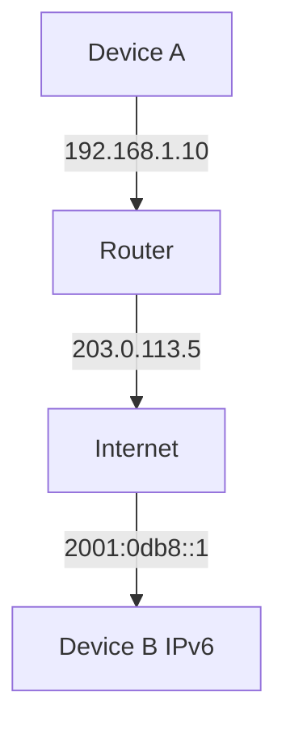

# 🧠 Topic: IP Addresses

> [!abstract] Executive Summary (ELI5)
> IP addresses are like street addresses for computers on the internet. Just as a house needs an address to receive mail, every device needs an IP address to send and receive data on a network.

---

## 🎯 The "Why"
- **Problem Solved:** How do devices uniquely identify and locate each other across interconnected networks?
- **Alternatives:** MAC addresses (link-layer only, not routable), Named pipes (local only)
- **Trade-offs:** IPv4 is widely supported but limited; IPv6 solves the limitation but adoption is slower

## 💡 Mental Model & Analogy
- **Analogy:** "An IP address is like a postal address — the country code is the network portion, the city is the subnet, and the street number is the host."
- **Visual/Diagram:** 

## 🛠️ Core Principles & Code Snippets

### Overview
An IP (Internet Protocol) address is a numerical label assigned to each device connected to a computer network that uses the Internet Protocol for communication. It serves two main functions: host or network interface identification and location addressing.

### IPv4 vs IPv6

| Feature | IPv4 | IPv6 |
|---------|------|------|
| **Address length** | 32 bits | 128 bits |
| **Address format** | Dotted decimal (e.g., 192.168.1.1) | Hexadecimal (e.g., 2001:0db8::1) |
| **Total addresses** | ~4.3 billion | ~3.4 × 10³⁸ |
| **Header size** | 20 bytes (variable) | 40 bytes (fixed) |
| **Checksum** | Yes | No (handled by upper layers) |
| **NAT** | Commonly used | Not needed |
| **Security** | Optional (IPsec) | Built-in (IPsec mandatory) |

### Public IP
- **Globally routable** address reachable from anywhere on the internet
- Assigned by ISPs or cloud providers
- Unique across the entire internet
- Required for servers that need to be accessible from the outside world

### Private IP
- **Non-routable** on the public internet
- Used within local networks (LANs, VPCs, containers)
- Defined ranges:
  - `10.0.0.0/8`
  - `172.16.0.0/12`
  - `192.168.0.0/16`
- NAT translates private IPs to public IPs for outbound communication

---

## 🏗️ The Role of IP Addresses in System Design

### Scalability
- Horizontal scaling requires distributing traffic across many nodes, each with its own IP
- CIDR blocks allow efficient allocation of IP ranges to auto-scaling groups
- IPv6's vast address space removes the limitation of IP exhaustion when scaling to millions of containers

### Security
- Private IPs create a natural boundary — only exposed services get public IPs
- Security groups and firewalls use IP addresses as the primary identifier for allow/deny rules
- IP whitelisting/blacklisting is a common access control mechanism

### Load Balancing
- Load balancers use IP addresses to route incoming requests to backend servers
- Health checks monitor backends by IP
- DNS-based load balancing resolves domain names to different IPs based on geography or load

### Cloud Networking
- VPCs (Virtual Private Clouds) assign private IP ranges to resources
- Elastic IPs provide stable public IPs that can be remapped between instances
- Subnetting divides IP ranges into public and private subnets

### Microservices and Containers
- Each container/pod gets its own IP in Kubernetes (via CNI plugins like Calico, Cilium)
- Service meshes route traffic between microservices using IP addresses
- Container networking requires efficient IP allocation and recycling

## ⚠️ Pitfalls & Anti-patterns
- **Hardcoding IPs:** Always use DNS or service discovery instead of hardcoding IP addresses
- **IPv4-only architecture:** Design for IPv6 from the start to avoid future migration pain
- **Over-reliance on NAT:** NAT introduces complexity and limits certain protocols (e.g., P2P)
- **Ignoring CIDR planning:** Poor IP allocation leads to fragmentation and makes scaling harder

## 🔗 Deep Connections
- **Parent Topic:** [[Networking Fundamentals]]
- **Related Concepts:** [[DNS]], [[NAT]], [[Load Balancing]], [[VPC]], [[CIDR]]
- **Prerequisites:** Basic networking, OSI model

## ❓ Active Recall Questions
> [!faq]- What is the primary difference between IPv4 and IPv6?
> IPv4 uses 32-bit addresses (~4.3 billion total) while IPv6 uses 128-bit addresses (~3.4 × 10³⁸), solving the address exhaustion problem.

> [!faq]- Why do we need private IP addresses?
> Private IPs conserve the limited IPv4 address space and provide a security boundary by keeping internal devices non-routable from the public internet.

> [!faq]- How does NAT solve the IPv4 shortage?
> NAT allows many devices with private IPs to share a single public IP address by translating the source address on outbound traffic.

> [!faq]- How does a load balancer use IP addresses?
> The load balancer exposes a single virtual IP (VIP) to clients and distributes incoming connections to multiple backend servers based on their individual IPs.

> [!faq]- How does DNS resolve IPs at scale?
> DNS uses hierarchical caching (browser → OS → local resolver → root → TLD → authoritative) and techniques like anycast, geo-DNS, and load-balanced DNS servers to resolve names to IPs efficiently.

---

*Last updated: 2026-06-27*
