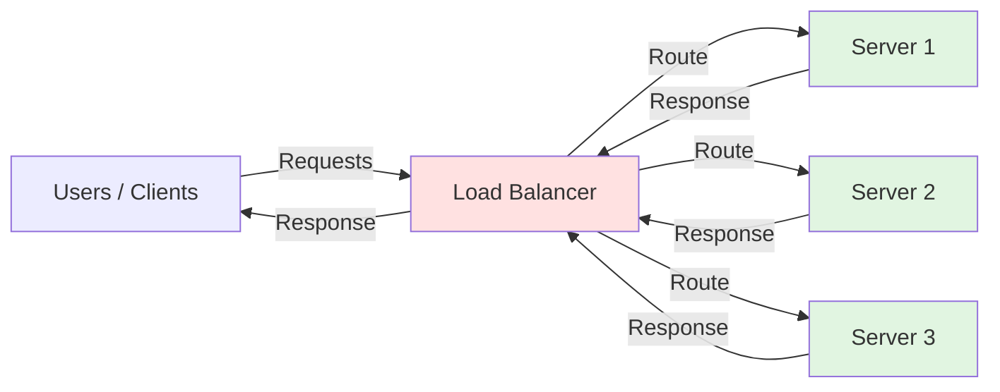

# 🧠 Topic: Introduction to Load Balancing

> [!abstract] Executive Summary (ELI5)
> Imagine a single cashier at a busy supermarket. Eventually the line becomes too long and customers wait forever. Load balancing is like opening more checkout lanes and having a manager direct each customer to the shortest line, so no single cashier is overwhelmed and the store keeps running smoothly even if one lane closes.

---

## 🎯 The "Why"
- **Problem Solved:** A single server cannot handle unlimited users, traffic, or data. Load balancing distributes work across multiple servers so the system can grow and survive failures.
- **Alternatives:** Bigger single server (vertical scaling), optimizing code, or caching. These help for a while but hit hard physical and economic limits.
- **Trade-offs:** Load balancing adds infrastructure complexity, potential single points of failure if the balancer itself is not redundant, and requires state awareness for some applications.

## 💡 Mental Model & Analogy
- **Analogy:** "Load balancing is like a traffic cop at a multi-lane highway entrance. Instead of every car using one lane, the cop directs vehicles to the lane with the least congestion, keeping traffic flowing and preventing any single lane from jamming."
- **Visual/Diagram:**

## 🛠️ Core Principles

### Why Do We Need Load Balancing?
A single application server has finite resources: CPU, memory, disk I/O, and network bandwidth. As traffic grows, the server eventually saturates. Response times increase, requests fail, and the application becomes unreliable.

Load balancing solves this by spreading incoming requests across a pool of servers, allowing the system to:
- Handle more concurrent users
- Serve requests faster
- Avoid overloading any individual machine
- Continue operating even when some machines fail

### The Scaling Challenge
When demand exceeds the capacity of one server, you scale. There are two primary strategies:

#### Vertical Scaling (Scale Up)
Add more power to a single machine — more CPU cores, RAM, or faster storage.

Pros:
- Simple to implement; no architecture changes
- Easier to maintain session state because there is only one server

Cons:
- Physical limits on how big one machine can get
- Expensive high-end hardware
- Single point of failure remains
- Downtime required to upgrade

#### Horizontal Scaling (Scale Out)
Add more servers to the pool and distribute work among them.

Pros:
- Near-unlimited growth potential
- Commodity hardware is cheaper
- Fault tolerance improves because other servers can take over

Cons:
- Requires a mechanism to distribute traffic (load balancer)
- Introduces data consistency and session management challenges
- More machines to monitor, deploy, and maintain

### Problems Introduced by Horizontal Scaling
Adding servers creates new questions:
- **Which server should handle each request?** Need a routing strategy.
- **What if a server fails?** Need health checks and failover.
- **What if a user has session data on one server?** Need sticky sessions or shared session storage.
- **How do servers share state?** Need databases, caches, or message queues accessible to all nodes.
- **How do you deploy without downtime?** Need rolling deployments and graceful shutdowns.

A load balancer directly addresses the first two problems and works alongside other patterns for the rest.

### Introducing Load Balancing
A **load balancer** is a component that distributes incoming network traffic across multiple backend servers, called a pool or cluster. It acts as the single entry point for clients while hiding the actual server topology.

Common distribution algorithms:
- **Round Robin:** Send each request to the next server in sequence. Simple and fair.
- **Least Connections:** Route to the server currently handling the fewest active connections.
- **Least Response Time:** Route to the server with the fastest recent responses.
- **IP Hash:** Hash the client's IP to consistently map them to the same server.
- **Weighted algorithms:** Give some servers a larger share based on capacity.

### Load Balancing, Reliability, and Availability

**Scalability:**
Load balancing makes horizontal scaling practical. You can add servers behind the balancer as traffic grows, and the balancer automatically includes them in the pool. This lets a system grow from handling hundreds to millions of requests.

**Availability:**
Load balancers run health checks on backend servers. If a server stops responding or returns errors, the balancer stops sending traffic to it. Clients continue using healthy servers, so a single server failure does not bring down the service.

**Reliability:**
By preventing overload and detecting failures quickly, load balancing improves the overall reliability of the system. It also enables zero-downtime maintenance because servers can be removed from the pool, updated, and added back without interrupting service.

### Evolution from Single Server to Load-Balanced Architecture

1. **Single server:** One machine runs the application and database. Simple, but limited and fragile.
2. **Vertical scaling:** Upgrade the machine. Helps temporarily, but cost and limits grow quickly.
3. **Separate database:** Move the database to its own server to reduce contention. The application server remains the bottleneck.
4. **Multiple application servers:** Run the application on several identical servers.
5. **Load balancer in front:** Introduce a load balancer to route traffic across the application servers.
6. **Advanced architecture:** Add caching layers, CDNs, auto-scaling, and health checks for a resilient, high-scale system.

## ⚠️ Pitfalls & Anti-patterns
- **Load balancer as a single point of failure:** Deploy load balancers in pairs or clusters with failover.
- **Ignoring stateful sessions:** Applications that store session data locally need sticky sessions or an external session store like Redis.
- **Unbalanced traffic:** The wrong algorithm can overload a server while others sit idle. Match the algorithm to the workload.
- **Missing health checks:** Without health checks, failed servers keep receiving traffic.
- **Overloading the balancer itself:** For very high traffic, use DNS-based load balancing, anycast, or multiple layers of balancers.

## 🔗 Deep Connections
- **Parent Topic:** [[Networking Fundamentals]]
- **Related Concepts:** [[Forward_And_Reverse_Proxy]], [[Caching]], [[CDN]], [[High_Availability]], [[Microservices]], [[Auto_Scaling]], [[DNS]]
- **Prerequisites:** Client-server model, IP addresses, HTTP basics

## ❓ Active Recall Questions
> [!faq]- What problem does load balancing solve?
> It solves the bottleneck of a single server by distributing incoming traffic across multiple servers, improving performance, scalability, and fault tolerance.

> [!faq]- Why does a single server eventually become a bottleneck?
> A single server has finite CPU, memory, disk I/O, and network bandwidth. Once demand exceeds these limits, response times rise and requests fail.

> [!faq]- What is the difference between vertical and horizontal scaling?
> Vertical scaling adds resources to a single server. Horizontal scaling adds more servers and distributes work among them.

> [!faq]- Why is horizontal scaling often preferred over vertical scaling?
> It is more cost-effective, offers near-unlimited growth, uses commodity hardware, and improves fault tolerance by removing the single-server dependency.

> [!faq]- What challenge arises when an application is deployed across multiple servers?
> Traffic must be routed intelligently, sessions may need to be shared, and failed servers must be detected and removed from the pool.

> [!faq]- What role does a load balancer play in a distributed system?
> It distributes client requests across backend servers, performs health checks, and provides a single entry point that hides the server topology.

> [!faq]- How does load balancing improve scalability?
> New servers can be added behind the balancer to handle more traffic without changing clients or the application architecture.

> [!faq]- How does load balancing improve availability?
> Health checks detect failed servers and stop sending traffic to them, so client requests are served by the remaining healthy servers.

> [!faq]- What happens if one server fails in a load-balanced architecture?
> The load balancer removes the failed server from the pool and routes traffic to the healthy servers, maintaining service continuity.

> [!faq]- Why is load balancing considered foundational in modern system design?
> It enables horizontal scaling, fault tolerance, high availability, and elasticity, which are essential for handling large-scale internet traffic.

---

*Last updated: 2026-06-30*
