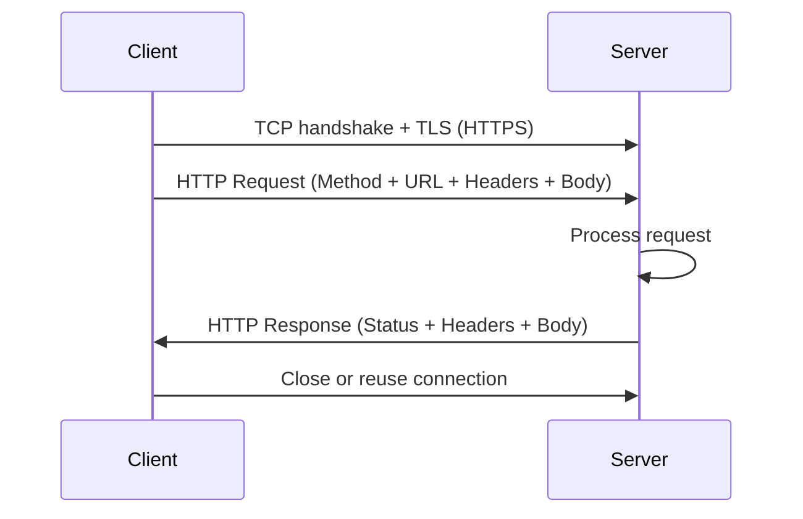

# HTTP Deep Dive

> [!abstract] Executive Summary (ELI5)
> HTTP is the language web browsers and servers use to talk. A client sends a request with a method and an address; the server sends back a response with a status code and the requested data. It is simple, text-based, and stateless — meaning each request is independent, so systems rely on cookies, sessions, or tokens to remember who you are.

---

## The "Why"

### Why HTTP?
HTTP is the backbone of the web because it is:
- **Universal**: every browser, server, and API speaks it.
- **Simple**: text-based request/response model with a small set of verbs.
- **Extensible**: headers and methods can be added without breaking the protocol.
- **Scalable**: statelessness lets servers handle requests independently.

### Why It's Simple
- A request is just a method, a URL, headers, and an optional body.
- A response is a status line, headers, and an optional body.
- Both are human-readable text (before compression or encryption).

### Challenges of Simplicity
- **Statelessness**: every request is isolated; identity must be re-sent each time.
- **No built-in security**: HTTP sends data in plaintext; HTTPS solves this with TLS.
- **Header overhead**: repeated headers can add latency, especially on mobile or low-bandwidth links.
- **Head-of-line blocking**: in HTTP/1.1, a single slow request can block others on the same connection.
- **No push semantics**: the server cannot push data to the client without an explicit request (WebSockets/SSE extend this).

---

## How HTTP Works

### Client-Server Model
- **Client**: usually a browser, mobile app, or service that initiates a request.
- **Server**: a process listening on an IP and port (typically 80 for HTTP, 443 for HTTPS) that returns responses.
- The connection is established over TCP; HTTPS adds TLS on top.

### HTTP Request-Response Cycle

Example: a browser asks `GET /index.html` and the server replies `200 OK` with the HTML file.

---

## Parts of an HTTP Request

| Part | Purpose | Example |
|------|---------|---------|
| **Method** | Action to perform | `GET`, `POST`, `PUT`, `DELETE`, `PATCH` |
| **URL** | Resource path and query | `/users/42?expand=profile` |
| **Headers** | Metadata about the request | `Host: example.com`, `Content-Type: application/json` |
| **Body** | Payload (optional) | JSON form data, file upload |

## Parts of an HTTP Response

| Part | Purpose | Example |
|------|---------|---------|
| **Status Line** | Protocol version and result | `HTTP/1.1 200 OK` |
| **Headers** | Metadata about the response | `Content-Type: application/json`, `Content-Length: 1024` |
| **Body** | Returned resource (optional) | HTML, JSON, image bytes |

---

## HTTP Methods

| Method | Meaning | Idempotent | Typical Use |
|--------|---------|------------|-------------|
| **GET** | Retrieve a resource | Yes | Read data |
| **POST** | Create a resource | No | Submit forms, create records |
| **PUT** | Replace a resource entirely | Yes | Update with full payload |
| **DELETE** | Remove a resource | Yes | Delete a record |
| **PATCH** | Partially update a resource | Not guaranteed | Apply a delta |

### Idempotency in HTTP
An operation is **idempotent** if doing it multiple times has the same effect as doing it once.
- **Idempotent**: GET, PUT, DELETE, HEAD, OPTIONS.
- **Not idempotent by default**: POST (each call may create a new resource), PATCH (depends on semantics).

Idempotency is crucial for retries: if a request times out, the client can safely retry an idempotent request.

---

## HTTP Status Codes

| Range | Category | Examples |
|-------|----------|----------|
| **1xx** | Informational | `100 Continue` |
| **2xx** | Success | `200 OK`, `201 Created`, `204 No Content` |
| **3xx** | Redirection | `301 Moved Permanently`, `302 Found`, `304 Not Modified` |
| **4xx** | Client Error | `400 Bad Request`, `401 Unauthorized`, `403 Forbidden`, `404 Not Found` |
| **5xx** | Server Error | `500 Internal Server Error`, `502 Bad Gateway`, `503 Service Unavailable` |

### Common Redirects
- **301 Moved Permanently**: the resource has a new permanent URL; browsers cache the redirect.
- **302 Found**: the resource is temporarily available at another URL; the original URL remains valid.

---

## Maintaining State in HTTP

Because HTTP is stateless, applications layer state mechanisms on top:

| Mechanism | How it works | Use case |
|-----------|--------------|----------|
| **Cookies** | Server sends a small token; client repeats it on every request | Session IDs, preferences, tracking |
| **Sessions** | Server stores user data in memory/DB; a session ID cookie links the client | Shopping carts, login state |
| **JWT** | Signed token containing claims; client sends it with each request | Stateless APIs, SSO, mobile apps |
| **OAuth 2.0** | Delegated authorization framework; access tokens issued by an identity provider | Third-party login, API access |

---

## HTTPS

HTTPS is HTTP encrypted with TLS (Transport Layer Security). It provides:
- **Encryption**: prevents eavesdropping.
- **Authentication**: certificates verify the server's identity.
- **Integrity**: detects tampering in transit.

### Differences Between HTTP and HTTPS
| Aspect | HTTP | HTTPS |
|--------|------|-------|
| Port | 80 | 443 |
| Security | Plaintext | Encrypted via TLS |
| Certificates | Not required | Requires TLS certificate |
| Performance | Slightly lower overhead | Small TLS overhead, often negligible |
| SEO/Trust | Marked insecure | Preferred by browsers and search engines |

---

## HTTP Beyond the Web

HTTP is used far beyond browser-server communication:
- **REST APIs**: standard contract for microservices.
- **gRPC-Web**: maps RPC semantics over HTTP/2.
- **Webhooks**: HTTP callbacks for event-driven architectures.
- **IoT**: devices upload telemetry via HTTP/HTTPS.
- **CDN**: edge servers fetch and cache content over HTTP.

### HTTP as a Contract in Distributed Systems
- HTTP methods define actions, URLs define resources, status codes define outcomes.
- API contracts (OpenAPI, Swagger) formalize expected requests and responses.
- Versioning strategies (URL `/v1/`, header `Accept-Version`) let systems evolve without breaking clients.

---

## Pitfalls & Anti-patterns

- **Sensitive data over HTTP**: always use HTTPS in production.
- **Non-idempotent POST without deduplication**: retries can create duplicates.
- **Giant headers/cookies**: increases latency and risk of rejection.
- **Ignoring cache headers**: wastes bandwidth and server load.
- **Storing secrets in JWT**: JWT is signed, not encrypted.

---

## Deep Connections

- **Parent Topic**: [[Networking Fundamentals]]
- **Related Concepts**: [[01_TCP_UDP|TCP and UDP]], [[DNS Deep Dive]], [[REST API Design]], [[Load Balancing]], [[Caching Strategies]]
- **Prerequisites**: Basic networking, TCP/IP, client-server model

---

## Active Recall Questions

> [!faq]- What is HTTP and how does it work?
> HTTP is a request-response protocol where a client sends a method + URL + headers to a server, and the server returns a status code + response body.

> [!faq]- Why is HTTP considered stateless?
> Each request is independent; the server does not retain client context between requests unless cookies, sessions, or tokens are used.

> [!faq]- What is the difference between HTTP and HTTPS?
> HTTPS is HTTP encrypted with TLS, providing encryption, authentication, and integrity; it runs on port 443 and requires certificates.

> [!faq]- What are the key HTTP methods and their idempotency?
> GET, PUT, DELETE are idempotent; POST and PATCH are not guaranteed to be idempotent.

> [!faq]- How do cookies, sessions, and tokens maintain state?
> Cookies store identifiers on the client; sessions store data on the server; tokens (e.g., JWT) carry claims in the request itself.
