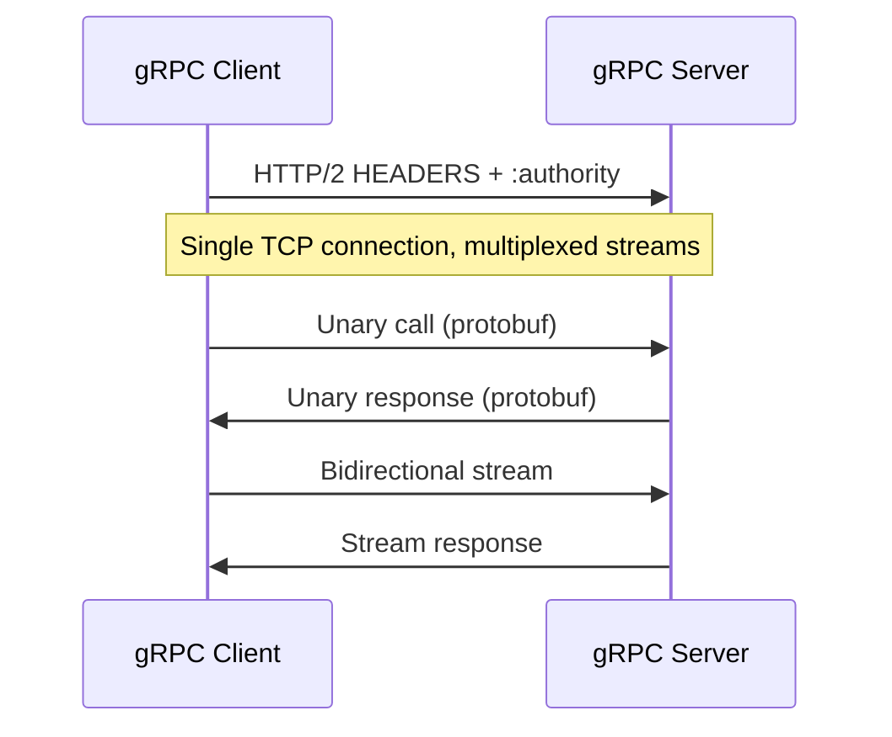

# Modern API Protocols

> [!abstract] Executive Summary (ELI5)
> REST is simple but can be inefficient: clients often receive too much or too little data, and multiple requests are needed to build a screen. gRPC and GraphQL are modern alternatives. gRPC is a fast, binary RPC framework for service-to-service calls. GraphQL lets clients ask for exactly the data they need from a single endpoint.

---

## The "Why"

### Limitations of REST
REST is the default choice for many APIs, but it struggles with modern client and service demands:

- **Over-fetching**: an endpoint returns a fixed payload; the client may only need a subset of fields but receives all of them.
- **Under-fetching**: one endpoint may not contain all needed data, forcing the client to make multiple round trips (e.g., `/users/1`, `/users/1/orders`, `/users/1/orders/5/items`).
- **Latency**: multiple sequential requests increase load time, especially on mobile networks.
- **Tight coupling**: front-end teams often depend on back-end teams to add new endpoints or fields.
- **Not optimized for real-time**: REST is request-response; streaming or push requires workarounds like WebSockets or polling.
- **Text overhead**: JSON is human-readable but verbose and slower to parse than binary formats.

These limitations led to modern protocols that optimize for different goals.

---

## Modern Solutions: gRPC and GraphQL

| Protocol | Paradigm | Best For | Main Strength |
|----------|----------|----------|---------------|
| **REST** | Resource-based, HTTP/1.1 or HTTP/2 | Public APIs, simplicity, caching | Universality, caching, tooling |
| **gRPC** | RPC over HTTP/2 with Protocol Buffers | Internal microservices, real-time streaming | Performance, type safety, streaming |
| **GraphQL** | Query language with a single endpoint | Frontend-driven apps, mobile, data aggregation | Client flexibility, precise data fetching |

---

## gRPC

gRPC is a high-performance RPC framework originally developed by Google. It uses HTTP/2 as the transport and Protocol Buffers (protobuf) as the interface definition and serialization format.

### How gRPC Works
1. **Service definition**: APIs are defined in a `.proto` file with strongly typed messages and service methods.
2. **Code generation**: protobuf compiler generates client and server stubs in many languages.
3. **Transport**: calls run over HTTP/2 with binary protobuf payloads.
4. **Streaming**: gRPC supports four communication patterns:
   - **Unary**: request-response, like a normal function call.
   - **Client streaming**: client sends multiple messages, server responds once.
   - **Server streaming**: server sends multiple messages in response to a single request.
   - **Bidirectional streaming**: both sides send a stream of messages independently.



### Key Features
- **HTTP/2 multiplexing**: many RPCs share one connection without blocking each other.
- **Binary serialization**: protobuf is compact and fast to parse.
- **Compression**: gzip can be negotiated per call.
- **Full-duplex streaming**: true bidirectional flows over one stream.
- **Strong typing**: contracts are enforced by generated code.
- **Interoperability**: polyglot support across languages.

### gRPC Use Cases
- **Microservices**: internal service-to-service communication.
- **Real-time systems**: telemetry, gaming, live dashboards.
- **IoT**: low-bandwidth, efficient binary messaging.
- **Polyglot systems**: teams using different languages share a single `.proto` contract.

---

## GraphQL

GraphQL is a query language and runtime for APIs. Instead of fixed endpoints, a GraphQL server exposes a single endpoint and a schema describing available data and operations.

### How GraphQL Works
1. **Schema definition**: types, queries, mutations, and subscriptions define the API surface.
2. **Client query**: the client sends a query specifying exactly which fields it needs.
3. **Resolver execution**: the server runs resolver functions for each requested field, often fetching data from databases or other services.
4. **Response**: the server returns a JSON object shaped exactly like the query.

```graphql
query {
  user(id: 42) {
    name
    email
    orders { total }
  }
}
```

### Advantages
- **No over/under-fetching**: clients get exactly the fields they request.
- **Fewer round trips**: one query can aggregate data from multiple backend services.
- **Strong typing**: schema acts as a contract between client and server.
- **Developer experience**: introspection, tooling, and code generation.
- **Flexibility**: front-end teams can evolve data needs without new endpoints.

### Trade-Offs
- **Caching complexity**: HTTP path-based caching does not work well; caching is usually done at the application or CDN edge level.
- **N+1 queries**: naive resolvers can hit the database for every nested field.
- **Rate limiting difficulty**: query cost varies with depth and field selection.
- **Schema governance**: large organizations need processes to evolve schemas without breaking clients.
- **Server complexity**: resolvers, DataLoader batching, and federation add operational overhead.

### GraphQL Use Cases and When to Use
- **Frontend optimizations**: reduce payload size and render-blocking requests.
- **Reducing API requests**: mobile apps especially benefit from fewer round trips.
- **Mobile and web apps**: teams need flexibility to fetch different field sets across platforms.
- **Aggregating data from multiple services**: GraphQL acts as a gateway that composes microservices.

---

## gRPC vs. GraphQL

| Aspect | gRPC | GraphQL |
|--------|------|---------|
| **Paradigm** | RPC | Query language |
| **Transport** | HTTP/2 | Usually HTTP/1.1 or HTTP/2 over POST |
| **Payload** | Binary protobuf | JSON (text) |
| **Streaming** | Native (client, server, bidirectional) | Subscriptions over WebSocket/SSE |
| **Type system** | Strong via `.proto` | Strong via schema |
| **Client control** | Server defines methods | Client defines fields |
| **Browser support** | Requires gRPC-Web proxy | Native |
| **Best for** | Internal microservices, high throughput | Frontend, mobile, aggregated backends |

---

## Authentication and Security in gRPC

- **TLS**: gRPC supports transport-level encryption. By default, it uses TLS over HTTP/2.
- **Token-based auth**: clients attach tokens (e.g., JWT) via gRPC metadata, similar to HTTP headers.
- **Mutual TLS (mTLS)**: both client and server authenticate each other with certificates.
- **Call credentials**: per-call credentials allow dynamic tokens.
- **Interceptor pattern**: middleware can validate tokens, enforce rate limits, or log calls.

---

## Scaling GraphQL APIs Efficiently

- **Query complexity analysis**: assign costs to fields and reject expensive queries.
- **Query depth limits**: prevent deeply nested queries from overwhelming the server.
- **Persisted queries**: whitelist pre-approved queries to reduce parsing and validation overhead.
- **DataLoader**: batch and deduplicate database requests to avoid N+1 problems.
- **Caching**: use response caching, CDN edge caching for simple queries, and memoization for repeated resolver calls.
- **Federation**: split the schema across multiple services, each owning its domain.
- **Rate limiting**: limit by query complexity, depth, or cost rather than just request count.
- **Subscriptions at the edge**: scale real-time subscriptions with a pub/sub bus (e.g., Redis, Kafka) rather than in-memory socket maps.

---

## Pitfalls & Anti-patterns

- **Forcing gRPC for browser clients**: browsers cannot speak native gRPC; gRPC-Web adds proxy complexity.
- **Exposing gRPC publicly**: binary protocols are harder to inspect and cache than REST/HTTP.
- **GraphQL as a free-for-all**: allow clients to query anything without cost limits or complexity checks.
- **Replacing REST everywhere**: REST is still excellent for simple, cacheable, public APIs.
- **Ignoring schema governance**: without versioning or deprecation policies, GraphQL schemas can become unstable.

---

## Deep Connections

- **Parent Topic**: [[HTTP_Deep_Dive|HTTP]]
- **Related Concepts**: [[REST_and_RESTfulness_Deep_Dive|REST]], [[Real_time_Communication_Protocols|Real-Time Communication]], [[Microservices]], [[Message Queues]], [[Caching Strategies]]
- **Prerequisites**: REST, HTTP/2, client-server model, serialization formats

---

## Active Recall Questions

> [!faq]- How do REST, gRPC, and GraphQL compare?
> REST is resource-based and universal; gRPC is a high-performance binary RPC framework for services; GraphQL is a query language that lets clients request exactly the fields they need.

> [!faq]- When would you use gRPC over REST?
> Use gRPC for low-latency, high-throughput internal microservices, real-time streaming, polyglot systems, and IoT where binary efficiency matters.

> [!faq]- What are the trade-offs of GraphQL in large-scale systems?
> GraphQL introduces caching complexity, N+1 query risks, rate-limiting challenges, schema governance overhead, and increased server complexity.

> [!faq]- How does gRPC handle authentication?
> gRPC uses TLS for transport security, token-based auth via metadata (e.g., JWT), mutual TLS for certificate-based auth, and interceptors for enforcement.

> [!faq]- How do you scale a GraphQL API?
> Scale with query complexity analysis, depth limits, persisted queries, DataLoader batching, response caching, federation, and pub/sub-backed subscriptions.
