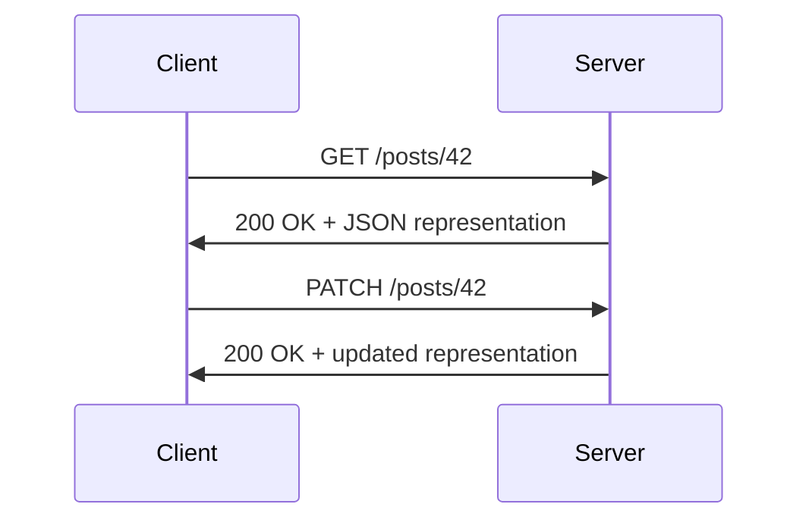

# REST and RESTfulness Deep Dive

> [!abstract] Executive Summary (ELI5)
> REST is a way to design networked systems where everything is a resource with a stable address. Clients interact with resources using a small set of well-defined HTTP methods, and each request carries everything the server needs to respond. A RESTful API follows these constraints in practice, favoring statelessness, clear URLs, and predictable HTTP behavior.

---

## The "Why"

### What is REST?
**REST** (REpresentational State Transfer) is an architectural style for designing networked applications, introduced by Roy Fielding in his 2000 doctoral dissertation. It is not a standard or protocol; it is a set of constraints that, when applied, produce systems with desirable properties like scalability, simplicity, and modifiability.

### Key Idea
- Everything is a **resource** (e.g., a user, an order, a blog post).
- Resources are identified by **URIs**.
- Clients interact with resources by exchanging **representations** of their state (typically JSON or XML).
- State transitions happen by transferring representations between client and server.

### Why REST?
- Leverages existing HTTP infrastructure (methods, status codes, caching).
- Decouples client and server, allowing them to evolve independently.
- Scales horizontally because servers do not need to remember client state.
- Easy to understand and test using standard tools.

---

## Statelessness
Each request from client to server must contain all the information needed to understand and process the request. The server does not store any client session state between requests. Session state is kept entirely on the client or represented by tokens (e.g., JWT) sent with each request.

---

## REST Architecture

RESTful systems are built around a few core architectural elements:
- **HTTP** as the application protocol.
- **Stateless requests** — no server-side session affinity.
- **Caching** — responses can be cached by clients and intermediaries.
- **Uniform interface** — consistent, resource-oriented interaction model.



---

## REST Constraints (Six Architectural Constraints)

1. **Client-Server**
   Separates user interface concerns from data storage concerns, improving portability and scalability.

2. **Stateless**
   Each request is self-contained; server does not retain client context between requests.

3. **Cacheable**
   Responses must explicitly define themselves as cacheable or not. Caching can eliminate some interactions.

4. **Uniform Interface**
   Resources are identified by URIs, manipulated through representations, and self-descriptive messages enable standard processing.
   Sub-constraints: resource identification, resource manipulation through representations, self-descriptive messages, and HATEOAS.

5. **Layered System**
   A client cannot ordinarily tell whether it is connected directly to the end server or to an intermediary (load balancer, cache, proxy).

6. **Code on Demand (Optional)**
   Servers can temporarily extend client functionality by transferring executable code (e.g., JavaScript). This is the least common constraint.

---

## RESTful API Design Principles

### Resource-Based Approach
- Model API around **nouns**, not verbs.
- Good: `/users/123`  
- Bad: `/getUser?id=123`

### Proper HTTP Methods Usage
- Use HTTP methods to express actions on resources:
  - `GET` — retrieve
  - `POST` — create
  - `PUT` — replace
  - `PATCH` — partial update
  - `DELETE` — remove

### Stateless Interactions
- Do not rely on server-side sessions.
- Pass authentication tokens (e.g., `Authorization: Bearer <token>`) in every request.

### Consistency in URL Structure
- Use plural nouns: `/orders`, `/users`.
- Nest related resources: `/users/123/orders`.
- Keep casing consistent (usually lowercase with hyphens): `/blog-posts`.
- Version at the base path or header: `/v1/products` or `Accept-Version: v1`.

---

## Resources and Endpoints

| Concept | Description | Example |
|---------|-------------|---------|
| **Resource** | A domain entity or concept | User, Order, Post |
| **Endpoint** | A URL that identifies a resource or collection | `/users/42` |
| **Collection** | A group of resources | `/users` |
| **Sub-resource** | A resource owned by another | `/users/42/orders` |

### URL Naming Tips
- Avoid actions in URLs: use `DELETE /users/42`, not `POST /users/42/delete`.
- Use query parameters for filtering, sorting, pagination: `/users?role=admin&page=2`.
- Avoid deep nesting: generally keep nesting to 1–2 levels.

---

## Modeling Resources

To design a resource model:
1. Identify the core entities in the domain.
2. Define stable, unique URIs for each entity.
3. Choose representations (JSON by default).
4. Decide which operations each resource supports.
5. Define success and error representations.

Example: a blogging platform
- `GET /posts` — list all posts
- `GET /posts/:id` — retrieve a single post
- `POST /posts` — create a post
- `PUT /posts/:id` — replace a post
- `PATCH /posts/:id` — update part of a post
- `DELETE /posts/:id` — remove a post
- `GET /posts/:id/comments` — list comments for a post
- `POST /posts/:id/comments` — add a comment

---

## JSON vs XML in REST APIs

| Aspect | JSON | XML |
|--------|------|-----|
| **Readability** | Lightweight, easy to read | Verbose, schema-driven |
| **Parsing** | Native support in most languages | Requires XML parser |
| **Data types** | Limited (strings, numbers, booleans, objects, arrays) | Strong typing via XML Schema |
| **Size** | Smaller, faster to transfer | Larger, more overhead |
| **Namespaces** | Not supported | Supported |
| **Use case** | Modern APIs, mobile, web | Enterprise systems, SOAP, legacy integrations |

**JSON is the default choice** for most REST APIs today because of its simplicity and broad language support.

---

## HTTP Methods in REST

| Method | Action | Idempotent | Safe |
|--------|--------|------------|------|
| **GET** | Retrieve a resource | Yes | Yes |
| **POST** | Create a resource | No | No |
| **PUT** | Replace a resource entirely | Yes | No |
| **PATCH** | Partially update a resource | Not guaranteed | No |
| **DELETE** | Remove a resource | Yes | No |

**Safe methods** do not modify server state (GET, HEAD, OPTIONS). **Idempotent methods** produce the same result when called multiple times.

---

## HATEOAS
**HATEOAS** (Hypermedia as the Engine of Application State) means responses include links to related actions, allowing clients to discover the API dynamically.

```json
{
  "id": 42,
  "title": "REST Basics",
  "links": [
    { "rel": "self", "href": "/posts/42" },
    { "rel": "comments", "href": "/posts/42/comments" },
    { "rel": "author", "href": "/users/7" }
  ]
}
```

HATEOAS is ideal in theory but rarely fully implemented in modern APIs due to client complexity.

---

## Authentication, Authorization, and Rate Limiting

- **Authentication**: verify identity. Common mechanisms: API keys, Basic Auth, JWT, OAuth 2.0.
- **Authorization**: verify permissions. Often handled with scopes or roles encoded in the token or checked server-side.
- **Rate limiting**: restricts the number of requests a client can make in a time window (e.g., 100 requests per minute).
- **Throttling**: slows or blocks traffic when limits are exceeded.

These protect APIs from abuse, ensure fair resource usage, and improve reliability.

---

## Versioning, Pagination, and Caching

### Versioning
- URL path: `/v1/users`
- Query param: `/users?version=1`
- Header: `Accept-Version: v1` or custom `API-Version: v1`

Backward compatibility can be maintained by adding fields without removing old ones, using optional query parameters, and deprecating endpoints gradually.

### Pagination
Common strategies:
- **Offset/limit**: `?offset=0&limit=20`
- **Cursor-based**: `?cursor=eyJpZCI6MTB9` (better for large, dynamic datasets)
- **Page-based**: `?page=2&size=20`

### Caching
- Use headers: `Cache-Control`, `ETag`, `Last-Modified`, `If-None-Match`.
- GET responses are the most cacheable.
- Avoid caching authenticated or user-specific data unless explicitly designed.

---

## Pitfalls & Anti-patterns

- **Using POST for everything** instead of proper HTTP methods.
- **Verbs in URLs** like `/createUser` or `/deleteOrder`.
- **Stateful endpoints** that require sticky sessions.
- **Returning wrong status codes** (e.g., `200 OK` with an error body).
- **Over-fetching** large resources when clients need only a subset of fields (GraphQL addresses this).
- **Breaking clients** by removing fields without versioning.

---

## Deep Connections

- **Parent Topic**: [[HTTP_Deep_Dive|HTTP]]
- **Related Concepts**: [[API Design]], [[Microservices]], [[GraphQL]], [[gRPC]], [[Caching Strategies]], [[OAuth 2.0]]
- **Prerequisites**: HTTP methods, status codes, client-server model

---

## Active Recall Questions

> [!faq]- What is REST and how does it differ from SOAP?
> REST is an architectural style based on resources and HTTP; SOAP is a protocol using XML messages and strict standards.

> [!faq]- What are the six REST constraints?
> Client-server, stateless, cacheable, uniform interface, layered system, and code on demand (optional).

> [!faq]- What is the difference between a REST API and a RESTful API?
> A REST API uses HTTP; a RESTful API follows REST constraints closely (resources, statelessness, uniform interface).

> [!faq]- What does HATEOAS mean?
> Hypermedia as the Engine of Application State: responses include links that drive the client to the next possible actions.
