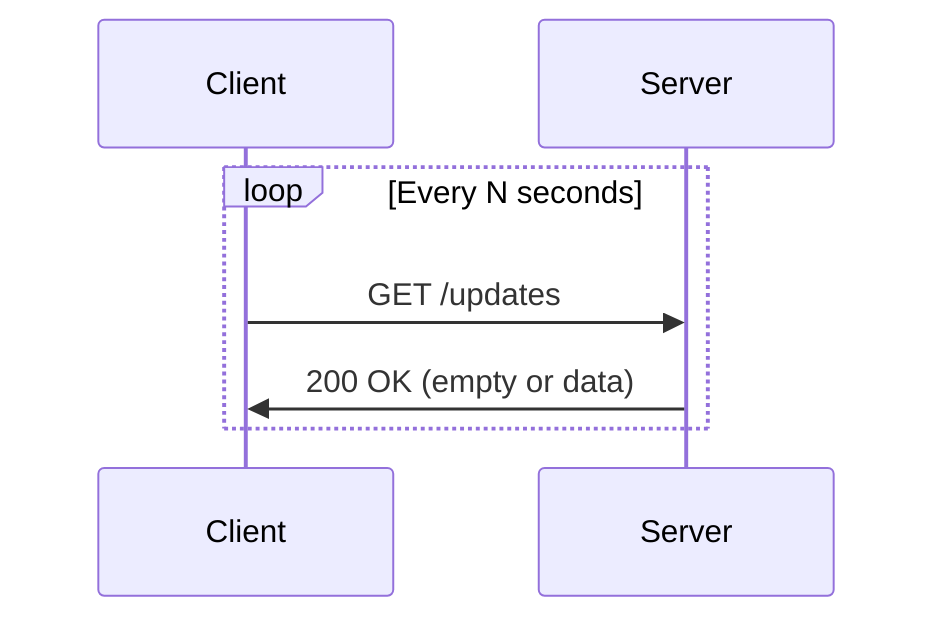
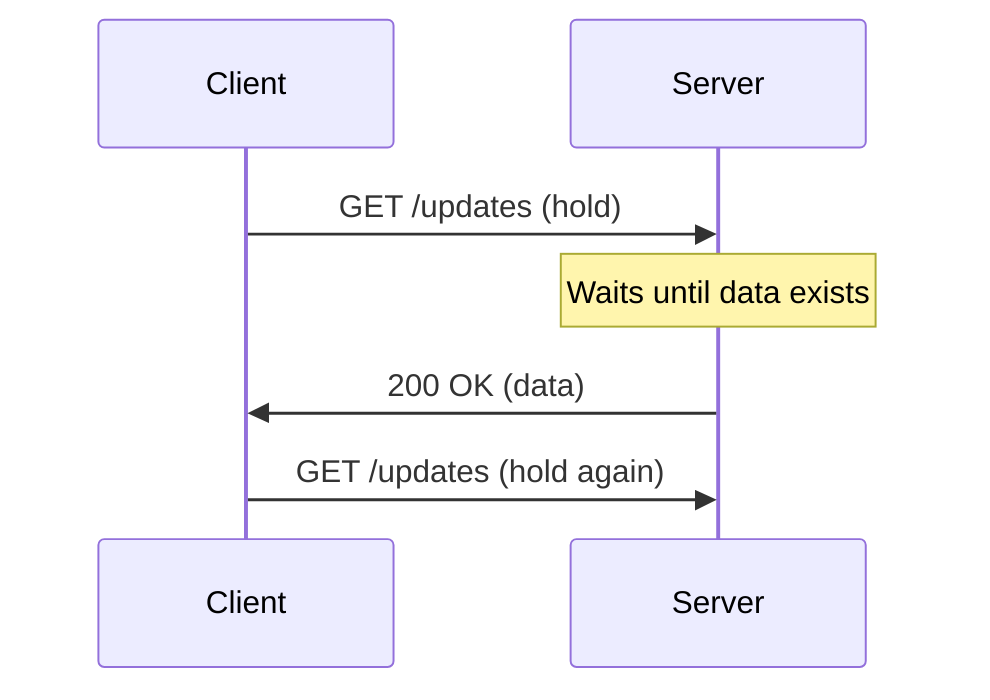
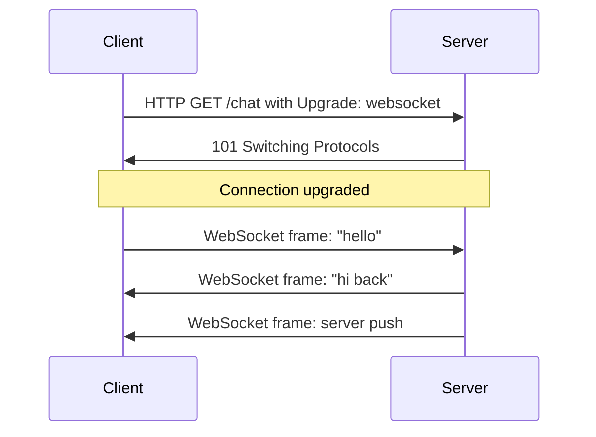

# Real-time Communication Protocols

> [!abstract] Executive Summary (ELI5)
> Real-time communication protocols let servers and clients exchange data immediately instead of waiting for a request. Traditional HTTP is like sending a letter and waiting for a reply; real-time protocols are like an open phone line where either side can speak at any time.

---

## The "Why"

### What is Real-Time Communication?
Real-time communication refers to data exchange where messages are delivered and consumed with minimal latency, often as soon as they are produced. The goal is to give users the perception of instantaneous interaction.

### When Is It Important?
- **Live chat and messaging** (WhatsApp, Slack, Discord)
- **Online gaming** (position updates, game state)
- **Financial trading** (stock tickers, order books)
- **IoT telemetry** (sensor data, device control)
- **Collaborative editing** (Google Docs)
- **Live notifications and activity feeds**

### Challenges of Traditional HTTP
Traditional HTTP is a **request-response** protocol:
- The client must ask before receiving data.
- Each request opens a new connection (or reuses one) with headers overhead.
- The server cannot push data to the client without an explicit request.
- **Head-of-line blocking**: a slow request can block others on the same HTTP/1.1 connection.
- High latency for events because the client must poll.

### Traditional HTTP vs. Real-Time
| Aspect | Traditional HTTP | Real-Time |
|--------|----------------|-----------|
| Direction | Mostly client-initiated | Bidirectional or server-initiated |
| Latency | High (pull-based) | Low (push-based) |
| Connection | Short-lived per request | Long-lived or persistent |
| Efficiency | Headers repeated per request | Lower overhead after setup |
| Use case | Static pages, REST APIs | Chat, gaming, live data |

---

## Alternatives to Improve Real-Time Data Exchange

### 1. Polling
The client repeatedly sends requests at a fixed interval to check for new data.

- **Advantages**: simple to implement, works with standard HTTP.
- **Trade-offs**: high latency, wasted bandwidth, unnecessary server load, not truly real-time.
- **Use cases**: low-frequency dashboards, simple status checks.

### 2. Long Polling
The client opens a request and the server holds it open until data is available, then responds. The client immediately opens a new request after each response.

- **Advantages**: lower latency than polling, fewer empty responses, still uses HTTP.
- **Trade-offs**: server must hold connections open, consumes resources, reconnects on every message, headers repeated.
- **Use cases**: chat fallbacks, notifications where WebSockets are blocked.

### 3. WebSockets
A persistent, full-duplex TCP connection that starts as an HTTP upgrade request and then switches to a lightweight framed protocol.

---

## WebSockets in Detail

### How WebSockets Work
1. Client sends an HTTP request with headers:
   - `Upgrade: websocket`
   - `Connection: Upgrade`
   - `Sec-WebSocket-Key`: random base64-encoded nonce
   - `Sec-WebSocket-Version: 13`
2. Server validates and responds with `101 Switching Protocols` and `Sec-WebSocket-Accept`, a hash derived from the client key.
3. The connection becomes a WebSocket; both sides exchange **frames** (text, binary, ping, pong, close).
4. Data can flow in either direction simultaneously.

### Advantages of WebSockets
- **Full-duplex**: client and server can send data independently.
- **Low latency**: no repeated handshakes or headers after upgrade.
- **Efficient**: small frames, no HTTP overhead per message.
- **Server push**: server can push events without client polling.

### WebSocket Use Cases
- Live chat and messaging
- Multiplayer gaming
- Real-time dashboards and stock tickers
- Collaborative editing
- Live sports updates
- IoT command-and-control

---

## Long Polling in Detail

### Definition
Long polling is a technique where the client sends a request and the server deliberately keeps it open until it has data to send. Once the response is returned, the client immediately issues another request.

### How It Differs from Regular Polling
| Aspect | Regular Polling | Long Polling |
|--------|---------------|--------------|
| Request timing | Fixed interval | Triggered by previous response |
| Empty responses | Frequent | Rare |
| Latency | Up to the polling interval | Near real-time |
| Server load | Many short requests | Fewer, but longer-held connections |
| Complexity | Low | Medium |

### Step-by-Step Flow
1. Client sends a request to the server.
2. Server keeps the connection open instead of responding immediately.
3. When new data is available, server sends the response and closes the connection.
4. Client receives the data and sends a new request to wait for the next event.
5. If no data arrives within a timeout, the server may close the request; the client reconnects.

### Advantages, Trade-offs, and Use Cases
- **Advantages**: works over standard HTTP, simpler than WebSockets, better than polling.
- **Trade-offs**: connection overhead per message, server must manage many open connections, reconnects cause latency spikes, headers repeated.
- **Use cases**: environments where WebSockets are blocked by proxies/firewalls, simple notification systems, fallback transport.

---

## When to Use WebSockets vs. Long Polling

| Criterion | WebSockets | Long Polling |
|-----------|-----------|--------------|
| **Latency** | Very low | Low, but spikes on reconnect |
| **Throughput** | High message frequency | Lower frequency |
| **Bidirectional** | Native | Simulated via separate requests |
| **Infrastructure** | Needs WebSocket support | Standard HTTP |
| **Firewall/Proxy** | Can be blocked | Rarely blocked |
| **Complexity** | Higher | Lower |
| **Best for** | Chat, gaming, live dashboards | Notifications, simple real-time updates, fallbacks |

Use **WebSockets** when latency and bidirectional flow are critical. Use **long polling** when you need a quick, HTTP-compatible solution or as a fallback.

---

## Scaling WebSockets in Distributed Systems

### Challenges
- **Connection affinity**: a client must usually stay connected to the same server that holds its socket.
- **Broadcasting**: sending a message to all users in a chat room requires knowing which server holds each socket.
- **State management**: socket state is tied to a process; losing a server drops connections.
- **Resource limits**: each open socket consumes memory and file descriptors.
- **Backpressure**: slow clients can cause memory buildup on the server.

### Common Solutions
- **Sticky sessions** (session affinity) route a client to the same server.
- **Shared pub/sub** (e.g., Redis Pub/Sub, NATS, Kafka) lets any server push messages to sockets on other servers.
- **Reconnection logic** with exponential backoff and replay buffers for clients.
- **Horizontal scaling** with connection limits and load balancing at the L4/L7 layer.
- **Heartbeat/ping-pong** frames to detect dead connections.

---

## Pitfalls & Anti-patterns

- **Using WebSockets for everything**: REST is still better for request-response, cacheable operations.
- **No reconnection logic**: real-time clients must reconnect after network changes.
- **Broadcasting without a message bus**: cannot scale chat rooms across multiple servers.
- **Ignoring backpressure**: can crash the server under heavy load.
- **Storing critical state only in the socket**: treat sockets as transient; persist important data.

---

## Deep Connections

- **Parent Topic**: [[HTTP_Deep_Dive|HTTP]]
- **Related Concepts**: [[01_TCP_UDP|TCP and UDP]], [[REST_and_RESTfulness_Deep_Dive|REST]], [[Message Queues]], [[Redis]], [[Load Balancing]]
- **Prerequisites**: HTTP, client-server model, TCP connections

---

## Active Recall Questions

> [!faq]- What is real-time communication and why is it important?
> It is the near-instantaneous exchange of data between systems, important for chat, gaming, finance, IoT, and collaboration.

> [!faq]- How do WebSockets differ from traditional HTTP?
> WebSockets use a persistent, full-duplex connection upgraded from HTTP, while HTTP is request-response and short-lived.

> [!faq]- What is the WebSocket handshake?
> Client sends an HTTP upgrade request with `Upgrade: websocket`; server replies with `101 Switching Protocols` and a derived `Sec-WebSocket-Accept` header.

> [!faq]- What is long polling?
> A technique where the server holds an HTTP request open until data is available, then responds; the client reconnects immediately.

> [!faq]- When should you prefer long polling over WebSockets?
> Prefer long polling when WebSockets are blocked, infrastructure is limited, or the update frequency is low and a simple HTTP solution is acceptable.
