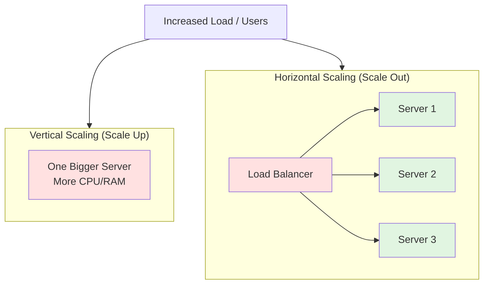

# 🧠 Topic: Introduction to Scalability

> [!abstract] Executive Summary (ELI5)
> Imagine a tiny coffee cart that serves 10 people an hour. When 1,000 people show up, you have two choices: build a bigger cart with more espresso machines (vertical scaling), or roll out 100 identical carts and let customers line up at any of them (horizontal scaling). Scalability is simply a system's ability to keep up with growing demand — more users, more data, more traffic — without slowing down or falling over.

---

## 🎯 The "Why"
- **Problem Solved:** Demand on a system is rarely constant. Traffic spikes, user bases grow, and data accumulates. A system that cannot scale becomes slow, unreliable, or completely unavailable when load increases.
- **Alternatives:** None really — every production system faces growth. The real question is *how* you scale: vertically (bigger machine) vs. horizontally (more machines), and at what cost.
- **Trade-offs:** Scaling is never free. It introduces latency, complexity, potential bottlenecks, downtime risk, and ongoing infrastructure cost. Good scalability design minimizes these trade-offs.

## 💡 Mental Model & Analogy
- **Analogy:** "Scalability is like a restaurant handling a growing dinner rush. You can either hire a super-chef with eight arms (vertical scaling) or open more kitchens and divide the orders among them (horizontal scaling). Both work — but only horizontal scaling keeps working when the rush doubles again tomorrow."
- **Visual/Diagram:**

## 🛠️ Core Principles

### What Is Scalability?

Scalability is the ability of a system to handle increased load — whether that's more users, more data, or more traffic — without compromising performance or reliability. In system design, this often means the system can grow linearly or elastically with demand, using techniques like horizontal scaling (adding more machines) or vertical scaling (upgrading hardware). A scalable system maintains responsiveness, throughput, and availability as demand increases.

> [!tip] Scalability vs. Performance
> Performance is about *how fast* a single request completes. Scalability is about *how the system behaves as load grows*. A fast system that dies at 100 users is not scalable; a slower system that smoothly handles 10 million users is.

### Why Do Systems Need to Scale?

Systems need to scale because the real world rarely stands still:

- **User growth** — A startup's user base can double month-over-month.
- **Traffic spikes** — Black Friday sales, viral content, or a global event (e.g., COVID-19) can multiply traffic overnight.
- **Data accumulation** — Every transaction, log, and user record adds to storage and processing needs.
- **Business expansion** — New markets, features, and integrations add load.
- **Availability expectations** — Modern users expect 24/7 uptime and instant responses.

Without scalability, growth translates directly into degraded performance, errors, and outages. With it, growth becomes a business opportunity rather than a technical crisis.

### Types of Scalability

#### Vertical Scaling (Scale Up)
Add more power to a single machine — more CPU cores, RAM, faster storage, or a better network card.

| Pros | Cons |
|------|------|
| Simple — no architecture changes | Physical limit on how big one machine can get |
| Easy to maintain (single node) | High-end hardware is disproportionately expensive |
| No data-consistency headaches | Single point of failure remains |
| Keeps session state trivial | Often requires downtime to upgrade |

#### Horizontal Scaling (Scale Out)
Add more servers to the pool and distribute work among them (typically behind a [[Load_Balancing_Introduction|load balancer]]).

| Pros | Cons |
|------|------|
| Near-unlimited growth potential | Requires traffic distribution (load balancer) |
| Commodity hardware is cheaper | Data consistency and session management challenges |
| Fault tolerance improves — other nodes survive a failure | More machines to monitor, deploy, and secure |
| Enables elastic / auto-scaling | Network calls and hops add latency |

> [!note] Rule of thumb
> Vertical scaling hits a wall quickly. Horizontal scaling is the foundation of virtually every large-scale internet system — but it forces you to solve distribution, consistency, and observability problems.

### Common Challenges in Scaling

As a system scales, four challenges dominate. Each is a classic system-design interview topic.

#### 1. Latency
More components and network hops introduce delays. Adding services increases inter-service calls; data sharding forces aggregation across partitions; longer dependency chains stretch request paths.

**Mitigations:**
- Cache frequently accessed data (e.g., Redis, Memcached)
- Move non-critical work to async queues / background jobs
- Reduce network hops via edge computing or [[How_DNS_Works|CDNs]]
- Optimize DB queries and cut cross-service chatter

#### 2. Bottlenecks
A single overloaded component — a saturated database, a slow downstream API, a maxed-out queue — can degrade the entire system, no matter how many front-end servers you add.

**Mitigations:**
- Use observability tools (Prometheus, Grafana, Datadog) to monitor metrics
- Watch for spikes in CPU, memory, latency, or queue depth
- Trace requests end-to-end (OpenTelemetry, Jaeger)
- Load-test with JMeter or k6 to find where degradation begins

#### 3. Downtime
More nodes and dependencies multiply the surface area for failure. Rolling deploys, cascading failures, and dependency outages all become real risks.

**Mitigations:**
- Health checks and automated failover
- Redundancy across availability zones / regions
- Graceful degradation and circuit breakers
- Zero-downtime deployment strategies (blue-green, canary)

#### 4. Cost
Scaling up infrastructure — especially in the cloud — can become expensive fast. Overprovisioning "just in case" quietly burns budget.

**Mitigations:**
- Autoscaling with sensible upper/lower bounds
- Use serverless / FaaS (AWS Lambda) for spiky, event-driven workloads
- Tiered caching to offload the primary database
- Spot or reserved instances for predictable savings
- Regularly right-size infrastructure based on real usage

## ⚠️ Pitfalls & Anti-patterns
- **Scaling the wrong layer:** Adding web servers won't help if the database is the bottleneck. Find the bottleneck first.
- **Treating scalability as an afterthought:** Retrofitting horizontal scaling onto a stateful, single-node design is painful. Design for it early.
- **Overprovisioning "just in case":** Wastes cost without improving reliability. Use autoscaling instead.
- **Ignoring observability:** You cannot scale what you cannot measure. Without monitoring and tracing, bottlenecks stay invisible.
- **Confusing scalability with availability:** A scalable system can still be unavailable; an available system can still be unscalable. They are related but distinct.

## 🔗 Deep Connections
- **Parent Topic:** [[Software Architecture]]
- **Related Concepts:** [[Load_Balancing_Introduction]], [[How_DNS_Works]] (CDN), [[Caching]], [[Auto_Scaling]], [[Microservices]], [[High_Availability]]
- **Prerequisites:** Client-server model, basic networking, single-server architecture limitations

## ❓ Active Recall Questions
> [!faq]- What does scalability mean in the context of system design?
> The ability of a system to handle increased load — more users, data, or traffic — without compromising performance or reliability, often by scaling horizontally (adding machines) or vertically (upgrading hardware).

> [!faq]- Can you explain a real-world example where scalability was critical?
> Twitter's "fail whale" — its early monolith couldn't handle growth, so it migrated to a distributed microservices architecture. Zoom scaled from 10M to 300M+ daily participants during COVID-19 using cloud-native infrastructure and autoscaling.

> [!faq]- What are the main challenges systems face as they scale?
> Latency (more network hops), bottlenecks (one overloaded component), downtime (more nodes and dependencies), and cost (cloud infrastructure adds up).

> [!faq]- How would you identify a bottleneck in a scalable architecture?
> Monitor metrics with Prometheus/Grafana/Datadog, trace requests with OpenTelemetry/Jaeger, load-test with JMeter/k6, and look for disproportionate queue growth or latency in specific services.

> [!faq]- Why does latency increase with scale, and how can you mitigate it?
> More services mean more network calls, data sharding requires aggregation, and dependency chains grow. Mitigate with caching, async processing, CDNs/edge computing, and optimized DB queries.

> [!faq]- How do you balance scalability with cost in cloud-based systems?
> Use autoscaling with bounds, serverless/FaaS for spiky workloads, tiered caching, spot/reserved instances, and regular right-sizing based on actual usage.

> [!faq]- What is the difference between vertical and horizontal scaling?
> Vertical scaling adds resources to a single machine (scale up). Horizontal scaling adds more machines and distributes the workload (scale out).

> [!faq]- Why is horizontal scaling usually preferred at large scale?
> It avoids the physical and economic limits of a single machine, uses cheaper commodity hardware, improves fault tolerance, and enables elastic auto-scaling.

---

*Last updated: 2026-07-23*
