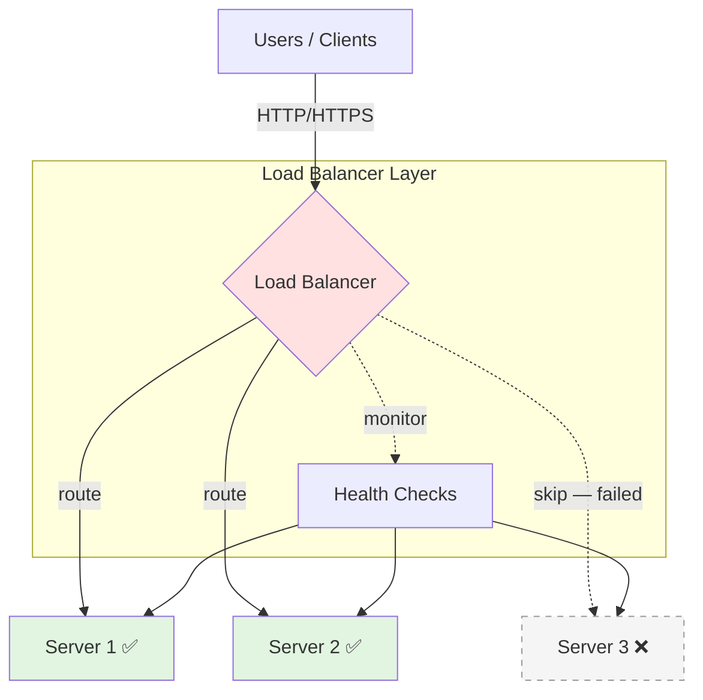

# 🧠 Topic: Load Balancers — Types, Strategies, and Selection

> [!abstract] Executive Summary (ELI5)
> A load balancer is a traffic cop that stands in front of your servers and decides which one should handle each incoming request. This note goes beyond the basics in [[Load_Balancing_Introduction]]: **what kind** of load balancer to pick (by OSI layer and by deployment), **which routing strategy** to use (static vs dynamic), and **how to choose** the right combination for a real workload.

---

## 🎯 The "Why"
- **Problem Solved:** When you scale horizontally (see [[Scaling_Strategies]]), you need a component to distribute incoming traffic across the pool of servers, hide backend topology from clients, detect failures, and route around them. Without one, horizontal scaling doesn't work.
- **Alternatives:** Client-side load balancing, DNS round-robin, or a service mesh sidecar. Each shifts where the routing decision happens.
- **Trade-offs:** A load balancer can itself become a bottleneck or single point of failure. Layer choice (L4 vs L7), strategy choice (round robin vs least connections), and deployment choice (hardware vs software) each trade off **performance**, **flexibility**, **cost**, and **complexity**.

## 💡 Mental Model & Analogy
- **Analogy:** "A load balancer is the maître d' at a busy restaurant. The maître d' knows which waiters are free, which tables they're handling, and which sections are closed for cleaning — and seats each new guest accordingly. Layer 4 is a maître d' who only counts tables; Layer 7 is one who also reads the menu the guest is asking for and routes them to the right kitchen station."
- **Visual/Diagram:**

## 🛠️ Core Principles

### Why Load Balancing Is Needed

A load balancer distributes incoming network traffic across multiple backend servers to ensure efficient utilization, prevent overload, and improve availability. Its five core jobs:

- **Ensures High Availability** — prevents downtime by redirecting traffic away from failed servers.
- **Optimizes Resource Utilization** — spreads requests evenly so no single server is overloaded while others sit idle.
- **Improves Performance** — reduces latency by routing traffic to the best-performing or nearest server.
- **Enhances Scalability** — supports horizontal scaling by letting you add servers behind it as demand grows.
- **Increases Fault Tolerance** — redirects requests if a server fails, keeping the system reliable.

> [!note] Relationship to [[Load_Balancing_Introduction]]
> The introductory note covers *what* a load balancer is and the single-server → load-balanced evolution. This note covers *which kind* and *which strategy*.

### Types of Load Balancers — By OSI Layer

#### Layer 4 Load Balancing (Transport Layer)
Operates at the network transport level (TCP/UDP).

| Aspect | Detail |
|--------|--------|
| **What it sees** | IP addresses and port numbers — no request content inspection |
| **Speed** | Faster and more efficient; minimal per-packet work |
| **Flexibility** | Low — can't route on URL, headers, or cookies |
| **Best for** | Simple, high-throughput TCP/UDP traffic; database connections |
| **Examples** | AWS Network Load Balancer (NLB), HAProxy (L4 mode) |

#### Layer 7 Load Balancing (Application Layer)
Works at the application level (HTTP/HTTPS).

| Aspect | Detail |
|--------|--------|
| **What it sees** | Full request content — headers, cookies, URL paths, query strings |
| **Speed** | Slower than L4 (per-request inspection overhead) |
| **Flexibility** | High — content-based routing, SSL termination, caching, auth |
| **Best for** | HTTP apps, microservices, path-based routing |
| **Examples** | AWS Application Load Balancer (ALB), Nginx, Traefik, Envoy |

> [!tip] Key difference
> **Layer 4 is faster but less flexible; Layer 7 is intelligent but adds overhead.** Many systems use both — L7 at the edge for HTTP, L4 internally for service-to-service TCP traffic.

### Types of Load Balancers — By Deployment

#### Software Load Balancer
Runs as an application on standard hardware/VMs/containers.

| Pros | Cons |
|------|------|
| Cost-effective and flexible | Consumes server resources |
| Easily scalable (containers/VMs) | Can add latency under very heavy traffic |
| Open-source options: Nginx, HAProxy, Envoy | You operate it yourself |

#### Hardware Load Balancer
A dedicated physical appliance optimized for traffic handling.

| Pros | Cons |
|------|------|
| High performance with hardware acceleration | Expensive and inflexible |
| Built-in security (e.g., DDoS protection) | Hard to scale dynamically |
| Vendor support and SLAs | Long procurement cycles |

> [!example] Use-case split
> **Software LBs** for cloud-native apps (autoscaling, containers, microservices). **Hardware LBs** for enterprise, on-prem, or extremely high-throughput systems where dedicated silicon pays off.

### Load Balancing Strategies — Static vs Dynamic

#### Static Strategies
Routing decisions don't change based on real-time server state.

- **Round Robin** — requests go to servers in circular order (Server 1 → 2 → 3 → repeat). Best for **uniform workloads on servers of equal capacity**. Limitation: overloads weaker servers because it assumes everyone is identical.
- **Weighted Round Robin** — like round robin, but high-capacity servers get a bigger share. Best for **heterogeneous fleets**.
- **IP Hash** — hash the client IP to consistently route to the same server (enables sticky sessions without external state).

#### Dynamic Strategies
Routing decisions adapt to real-time server state.

- **Least Connections** — route to the server with the fewest active connections. Best when **some requests take longer than others** (e.g., slow DB queries, long uploads). Limitation: requires tracking active connections → computational overhead.
- **Least Response Time** — route to the server with the fastest recent responses (a refinement of least connections).
- **Weighted Least Connections** — combines capacity weights with live connection counts.

> [!tip] Round Robin vs Least Connections — the key contrast
> **Round Robin** is simpler but assumes equal server capacity. **Least Connections** dynamically adjusts based on load. Choose round robin for uniform workloads; least connections when request cost varies.

### Strategies in Action — Concrete Examples

| Scenario | Strategy | Why |
|----------|----------|-----|
| Static asset servers (images, CSS) behind a CDN | **Round Robin** | Uniform request cost, equal-capacity servers |
| API tier where some endpoints run heavy queries | **Least Connections** | Prevents slow requests from piling up on one node |
| Fleet mixing `c5.large` and `c5.4xlarge` instances | **Weighted Round Robin** | Gives bigger instances proportionally more traffic |
| E-commerce checkout that needs session affinity | **IP Hash / Sticky Sessions** | Keeps a user's session on one backend |
| Multi-region deployment | **GeoDNS / Anycast** | Routes users to the nearest healthy region |

### Choosing the Right Load Balancer

Eight factors to weigh when selecting a strategy:

1. **Traffic pattern** — even distribution → Round Robin; varying request complexity → Least Connections.
2. **Server capacity** — heterogeneous fleet → Weighted Load Balancing.
3. **Session persistence** — must keep user sessions on one node → Sticky Sessions (IP hash).
4. **Performance vs flexibility** — L4 is faster but blunt; L7 is slower but intelligent.
5. **Scalability needs** — cloud-native → cloud LB (AWS ELB/ALB/NLB); on-prem → software or hardware.
6. **Deployment model** — containers/microservices → software LB (Envoy/Nginx); enterprise edge → hardware appliance.
7. **Security requirements** — DDoS, WAF, SSL termination → L7 with security features.
8. **Global reach** — multi-region → DNS-based / Anycast global load balancing.

### How a Load Balancer Handles High Availability & Failover

- **Health Checks** — continuously monitors servers using ping, HTTP checks, or TCP checks.
- **Automatic Failover** — if a server becomes unresponsive, traffic is redirected to healthy servers.
- **Redundancy** — deployed in **active-active** or **active-passive** pairs so the LB itself isn't a SPOF.
- **Session Persistence** — maintains user sessions across requests to prevent disruption during failover.
- **Global Load Balancing** — uses **GeoDNS** or **Anycast Routing** to distribute traffic across data centers.

### How a Load Balancer Improves Security

1. **DDoS Protection** — detects and blocks malicious traffic spikes; hardware LBs often have built-in mitigation.
2. **SSL Termination** — offloads SSL decryption from backend servers, centralizing cert management.
3. **Access Control** — restricts access via firewalls and IP whitelisting.
4. **WAF Integration** — prevents SQL injection, XSS, and other application-layer attacks.
5. **Rate Limiting** — caps requests per second to prevent abuse.

## ⚠️ Pitfalls & Anti-patterns
- **LB as a single point of failure** — always deploy redundant pairs (active-active or active-passive).
- **Wrong strategy for the workload** — Round Robin on heterogeneous servers causes hotspots; Least Connections adds overhead you may not need for uniform traffic.
- **Layer mismatch** — using L7 where L4 would do adds unnecessary overhead; using L4 when you need path-based routing simply can't do the job.
- **Missing or shallow health checks** — a TCP-open check passes even if the app is hung. Use HTTP health checks for app-tier LBs.
- **Forgetting sticky-session downsides** — sticky sessions reduce failover flexibility and can cause uneven load; prefer external session storage (Redis) when possible.
- **No global layer** — a single-region LB is a regional SPOF for a global user base.

## 🔗 Deep Connections
- **Parent Topic:** [[Introduction_to_Scalability]]
- **Companion Note:** [[Load_Balancing_Introduction]] (introductory concepts and evolution)
- **Related Concepts:** [[Scaling_Strategies]], [[How_DNS_Works]] (GeoDNS/CDN), [[Caching]], [[Auto_Scaling]], [[High_Availability]]
- **Prerequisites:** [[Load_Balancing_Introduction]], [[Scaling_Strategies]] (horizontal scaling motivation).

## ❓ Active Recall Questions
> [!faq]- What is load balancing, and why is it important?
> Distributing incoming network traffic across multiple backend servers to ensure efficient utilization, prevent overload, and improve availability. It ensures high availability (redirects on failure), optimizes resource utilization (even spread), improves performance (routes to best server), enhances scalability (supports horizontal scaling), and increases fault tolerance.

> [!faq]- Explain the difference between Layer 4 and Layer 7 load balancing.
> **Layer 4** operates at the transport level (TCP/UDP), distributing traffic based on IP and port without inspecting content — faster but less flexible (AWS NLB, HAProxy L4). **Layer 7** works at the application level (HTTP/HTTPS), routing on headers, cookies, and URL paths with SSL termination, caching, and auth — intelligent but adds overhead (AWS ALB, Nginx, Traefik). Key: L4 is faster but blunt; L7 is smart but slower.

> [!faq]- How does a load balancer handle high availability and failover?
> Health Checks (ping/HTTP/TCP) monitor servers continuously; Automatic Failover redirects traffic from unresponsive servers to healthy ones; Redundancy is achieved via active-active or active-passive pairs; Session Persistence maintains user sessions across failover; Global Load Balancing uses GeoDNS or Anycast to route across data centers.

> [!faq]- Compare Round Robin and Least Connections strategies.
> **Round Robin** sends requests in circular order — best for uniform workloads with equal-capacity servers, but can overload weaker servers. **Least Connections** sends to the server with the fewest active connections — best when requests vary in length (e.g., slow DB queries), but requires tracking connections (computational overhead). Key: Round Robin is simpler and assumes equal capacity; Least Connections adapts dynamically to load.

> [!faq]- What are the advantages of Weighted Load Balancing?
> It assigns different priorities to servers based on capacity: better resource utilization (high-performance servers get more traffic), custom traffic distribution (fine-tuned control), and support for heterogeneous environments (servers with different processing power). Examples: Weighted Round Robin, Weighted Least Connections.

> [!faq]- When would you use a software load balancer over a hardware one?
> **Software LBs** (Nginx, HAProxy, Envoy) run on standard hardware — cost-effective, flexible, easily scalable via containers/VMs, but consume server resources and can add latency under heavy load. **Hardware LBs** are dedicated appliances — high performance with hardware acceleration and built-in security (DDoS), but expensive, inflexible, and hard to scale. Use software for cloud-native apps; hardware for enterprise/high-traffic on-prem systems.

> [!faq]- How would you design a scalable load balancing solution for a large e-commerce site?
> 1. **Multiple LBs** — primary/secondary for redundancy, plus DNS-based global distribution. 2. **Right LB type** — Layer 7 for dynamic content, Layer 4 for DB connections. 3. **Strategies** — Round Robin for static content, Least Connections for dynamic requests. 4. **High availability** — auto-scaling groups for spikes, health checks to bypass failures. 5. **Performance** — CDN caching to offload backends, Gzip compression and minification to shrink responses.

> [!faq]- What factors should be considered when choosing a load balancing strategy?
> 1. Traffic pattern (even → Round Robin; varying → Least Connections). 2. Server capacity (heterogeneous → Weighted). 3. Session persistence (sticky sessions if needed). 4. Performance vs complexity (L4 faster/less flexible; L7 slower/intelligent). 5. Scalability needs (cloud-native → cloud LBs like AWS ELB; on-prem → software/hardware).

> [!faq]- How does a load balancer improve security?
> 1. **DDoS Protection** — detects and blocks malicious traffic spikes (hardware LBs often have built-in mitigation). 2. **SSL Termination** — offloads SSL decryption from backends. 3. **Access Control** — firewalls and IP whitelisting. 4. **WAF Integration** — prevents SQL injection, XSS, and other attacks. 5. **Rate Limiting** — caps requests per second to prevent abuse.

---

*Last updated: 2026-07-23*
