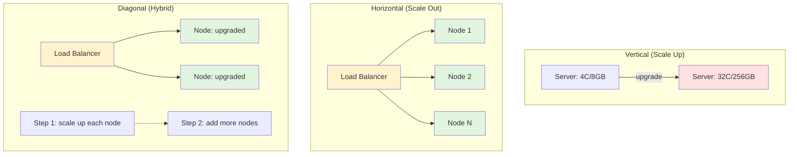

# 🧠 Topic: Scaling Strategies — Vertical, Horizontal, and Diagonal

> [!abstract] Executive Summary (ELI5)
> When your app gets too busy for one machine, you have three moves: **buy a bigger machine** (vertical), **add more machines and split the work** (horizontal), or **do both — start by upgrading, then add machines when you hit the limit** (diagonal). Vertical is easy but has a ceiling; horizontal is powerful but complex; diagonal is what most real companies actually do over time.

---

## 🎯 The "Why"
- **Problem Solved:** A single server eventually saturates under growing load. You need a deliberate strategy for *how* to add capacity rather than ad hoc reactions to outages.
- **Alternatives:** The three strategies (vertical, horizontal, diagonal) are the fundamental choices — the question is which fits your workload, budget, team, and growth stage.
- **Trade-offs:** Every strategy trades off **cost**, **complexity**, and **performance ceiling** differently. Picking the wrong one early leads to painful rewrites or wasted spend.

## 💡 Mental Model & Analogy
- **Analogy:** "Think of a restaurant kitchen. **Vertical** = giving one chef more burners and a bigger oven. **Horizontal** = hiring more chefs, each with their own station, and a head waiter directing orders. **Diagonal** = first upgrade the chef's station, and once that's maxed, open a second identical station next door."
- **Visual/Diagram:**

## 🛠️ Core Principles

### Strategy 1 — Vertical Scaling (Scale Up)

Add more power to a **single** machine: more CPU cores, RAM, faster disks, better network.

| Dimension | Assessment |
|-----------|------------|
| **Performance** | Limited by single machine capacity; gets diminishing returns at the high end. |
| **Complexity** | Easiest — no code changes, no distributed-system design. |
| **Cost** | High-capacity hardware is disproportionately expensive (a 64-core box costs far more than eight 8-core boxes). |
| **Fault tolerance** | Single point of failure remains. |
| **Deployment** | Trivial — one node, few moving parts. Often requires downtime to upgrade. |
| **Ceiling** | Hits a hard physical limit; you cannot buy an infinitely large server. |

**Real-world examples:**
- Upgrading a PostgreSQL primary from `db.r5.xlarge` to `db.r5.16xlarge` on AWS RDS when write throughput drops.
- Moving an in-memory analytics tool from 64GB to 1TB RAM to fit a larger working set.
- Bumping a Jenkins controller's RAM to handle more concurrent build jobs.

**When to choose vertical:**
- You need a quick fix without refactoring code.
- The system is monolithic or tightly coupled.
- Your team lacks distributed-systems experience.
- Early stages of a project/startup.
- Low concurrency needs that don't justify distributed complexity.

> [!tip] Vertical is a tactic, not a destination
> Vertical scaling buys you time. Eventually the single box maxes out (or the failure risk becomes unacceptable), and you must go horizontal. Plan for that day.

### Strategy 2 — Horizontal Scaling (Scale Out)

Add more servers to the pool and distribute work among them — typically behind a [[Load_Balancing_Introduction|load balancer]].

| Dimension | Assessment |
|-----------|------------|
| **Performance** | Can scale almost linearly with effort — add nodes as load grows. |
| **Complexity** | Requires distributed system design (state, consistency, discovery, orchestration). |
| **Cost** | Lower per-unit (commodity hardware) but higher operational overhead. |
| **Fault tolerance** | Resilient — other nodes survive a failure; failover is possible. |
| **Deployment** | Requires orchestration & load balancing; enables zero-downtime rollouts. |
| **Ceiling** | Near-unlimited — limited mainly by architecture and budget, not physics. |

**Real-world examples:**
- Netflix streaming on thousands of EC2 instances behind load balancers, with autoscaling groups reacting to demand.
- Web tier of any major SaaS (GitHub, Shopify, Airbnb) — stateless app servers scaled horizontally.
- Cassandra / DynamoDB clusters scaling by adding nodes for more throughput.

**When to choose horizontal:**
- Traffic is growing beyond what one machine can serve.
- You need high availability and fault tolerance.
- Workload is parallelizable (stateless services, read-heavy workloads).
- You want elastic, demand-driven scaling.

> [!warning] Horizontal scaling has prerequisites
> It only delivers when the workload is parallelizable and the architecture supports distribution (external session store, share-nothing nodes, distributable data). Otherwise adding nodes does nothing.

### Strategy 3 — Diagonal Scaling (Hybrid)

Combine both: **scale up** each node to a sensible size, **then scale out** by adding more of those upgraded nodes. This is what most teams converge on in practice.

| Dimension | Assessment |
|-----------|------------|
| **Performance** | Best of both — strong per-node capacity plus horizontal headroom. |
| **Complexity** | Moderate — you still need the horizontal infrastructure, but fewer nodes to manage than tiny commodity boxes. |
| **Cost** | Balanced — avoids both extremes. |
| **Fault tolerance** | Inherited from horizontal — multiple nodes survive failure. |
| **Deployment** | Same orchestration needs as horizontal. |
| **Ceiling** | Highest — pushes the architectural ceiling out as far as budget allows. |

**Real-world examples:**
- AWS autoscaling group where each instance is a reasonably-sized `c5.2xlarge` (not the smallest), and the group scales 2 → 50 instances on demand.
- Sharded MongoDB cluster where each shard is a beefy replica set, and new shards are added as data grows.

**When to choose diagonal:**
- You've outgrown pure vertical but want to delay operational complexity as long as possible.
- You want to minimize node count (fewer things to monitor) while keeping horizontal headroom.
- Most production systems land here eventually.

### Side-by-Side Comparison

| Factor | Horizontal | Vertical | Diagonal |
|--------|-----------|----------|----------|
| **Performance ceiling** | Near-unlimited | Single machine | Near-unlimited |
| **Complexity** | High (distributed) | Low | Medium-High |
| **Fault tolerance** | Resilient (failover) | Single point of failure | Resilient |
| **Cost profile** | Higher opex & complexity | Expensive high-end hardware | Balanced |
| **Deployment** | Orchestration + LB needed | Simple, few moving parts | Orchestration + LB |
| **Best for** | Elastic, high-growth, stateless | Quick wins, monoliths, early stage | Mature production systems |

**Summary:**
- **Horizontal** = more scalable and resilient, but complex.
- **Vertical** = quick wins, limited long-term.
- **Diagonal** = pragmatic middle path; what most teams actually do.

### When Horizontal Scaling Does NOT Help

Adding nodes is useless when the workload can't use them:

- **Not parallelizable** — A legacy monolith with shared state or global locks can't spread work across instances.
- **Non-distributable bottleneck** — A single-threaded operation, or a relational DB that doesn't shard or replicate reads.
- **Stateful service without session handling** — No sticky sessions or external session store means user requests bounce between nodes that don't share state.

**Real-world example:** Scaling a PostgreSQL database for analytics queries — simply adding more nodes does nothing unless you implement sharding or read replicas. The bottleneck is data distribution, not compute count.

### Challenges Introduced by Horizontal Scaling (and Solutions)

| # | Challenge | Solution |
|---|-----------|----------|
| 1 | **State management** — sessions live on one node | External stores: Redis, Memcached for sessions |
| 2 | **Data consistency** — multiple writers, replicas | Distributed transactions, eventual consistency, or CQRS |
| 3 | **Load distribution** — uneven traffic across nodes | Smart load balancers: least-connections, IP hashing |
| 4 | **Service discovery** — nodes come and go | Consul, Eureka, or cloud-native DNS-based discovery |
| 5 | **Deployment & orchestration** — many instances | Containers (Docker) + orchestrators (Kubernetes) |
| 6 | **Increased latency** — more network calls | Minimize inter-service calls, caching, optimize paths |

## ⚠️ Pitfalls & Anti-patterns
- **Defaulting to vertical forever:** Easy short-term, but kicks the can. The eventual horizontal migration only gets harder.
- **Scaling the wrong tier:** Adding web servers won't help if the database is the bottleneck. Profile first.
- **Adding nodes to a stateful, non-distributable workload:** Wastes money — the extra capacity goes unused.
- **Forgetting the LB / discovery layer:** Horizontal scaling *requires* a way to route traffic and find nodes; skipping this breaks in production.
- **Ignoring per-node sizing:** Tiny nodes create orchestration overhead; oversized nodes waste budget. Diagonal thinking finds the sweet spot.

## 🔗 Deep Connections
- **Parent Topic:** [[Introduction_to_Scalability]]
- **Related Concepts:** [[Load_Balancing_Introduction]], [[Caching]], [[Auto_Scaling]], [[Microservices]], [[How_DNS_Works]] (CDN), [[High_Availability]]
- **Prerequisites:** [[Introduction_to_Scalability]] — definitions of scalability, vertical vs horizontal basics.

## ❓ Active Recall Questions
> [!faq]- What are the trade-offs between horizontal and vertical scaling in terms of performance and complexity?
> Horizontal scales almost linearly (with effort) but needs distributed design, has higher opex/complexity, and requires orchestration + load balancing; it is resilient via failover. Vertical is easier to manage, has simple deploys, but is limited by single-machine capacity and leaves a single point of failure; high-capacity hardware is expensive. Horizontal = scalable/resilient/complex; Vertical = quick wins/limited long-term.

> [!faq]- Can you describe a scenario where horizontal scaling wouldn't help?
> When the workload isn't parallelizable (legacy monolith with shared state or global locks), when there's a non-distributable bottleneck (single-threaded code, a relational DB that doesn't shard/replicate reads), or a stateful service without sticky sessions/external session store. Example: adding nodes to a PostgreSQL analytics DB does nothing without sharding or read replicas.

> [!faq]- When would you choose vertical scaling over horizontal?
> When you need a quick fix without refactoring code, the system is monolithic/tightly coupled, the team lacks distributed-systems experience, you're in early startup stages, or concurrency needs are low and don't justify distributed complexity. Ideal when you don't need high elasticity or can't justify the cost/complexity of a distributed architecture.

> [!faq]- What challenges arise in horizontal scaling and how would you solve them?
> State management (use Redis/Memcached), data consistency (distributed transactions, eventual consistency, CQRS), load distribution (smart load balancers — least-connections, IP hashing), service discovery (Consul/Eureka/DNS), deployment & orchestration (Docker + Kubernetes), and increased latency (minimize inter-service calls, caching, optimize paths).

> [!faq]- What is diagonal scaling and why do most production teams land there?
> Diagonal = scale up each node to a sensible size, then scale out by adding more of those nodes. It balances per-node performance with horizontal headroom, keeps node count manageable, and pushes the architectural ceiling out. It's the pragmatic middle path most systems converge on.

---

*Last updated: 2026-07-23*
