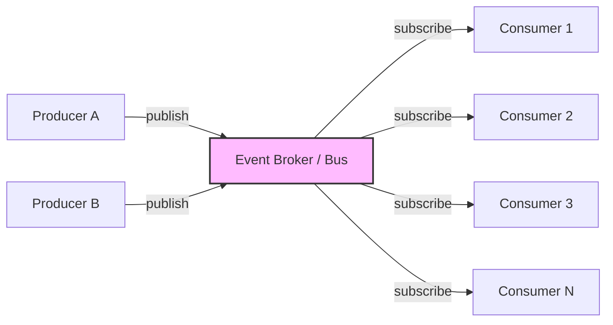
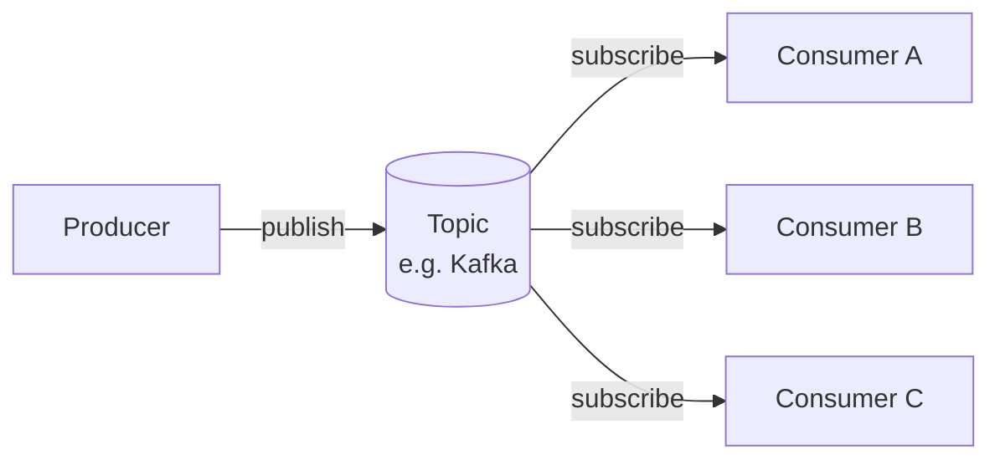
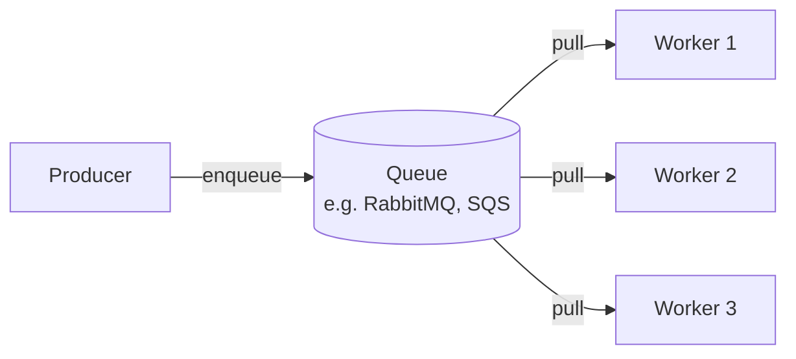
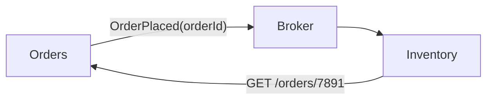
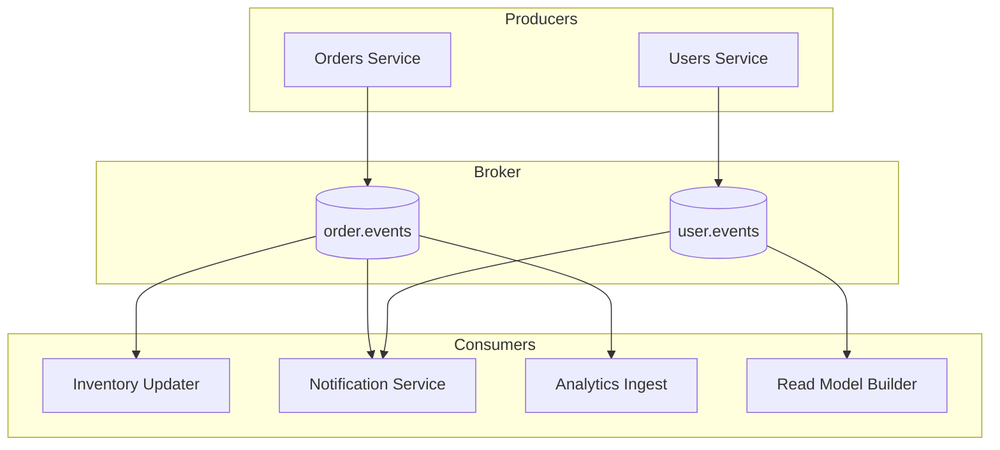

# 🧠 Topic: Event-Driven Architecture

> [!abstract] Executive Summary (ELI5)
> Event-driven architecture is like a school's morning announcements. Instead of each teacher running to every classroom to ask "should I do X?" (synchronous), the principal broadcasts "fire drill at 10 AM" over the PA (an event), and each teacher reacts however fits their class — gym takes students outside, science powers down burners, admin logs it. The principal doesn't know or care who is listening; they just announce and move on.

---

## 🎯 The "Why"
- **Problem Solved:** How do we build systems where many independent components must react to state changes **without being tightly coupled to each other or blocking on slow consumers**?
- **Alternatives:** Synchronous request-response ([[Microservices Architecture|microservices]] over HTTP/gRPC, [[Client Server Model|client-server]]), [[Monolithic Architecture|monolith]] with in-process calls.
- **Trade-offs:** Event-driven optimizes for **loose coupling, async responsiveness, and extensibility** at the cost of **eventual consistency, debuggability, and the difficulty of ordering/idempotency**. See [[Software Architecture#Trade-offs by Architectural Style]].

## 💡 Mental Model & Analogy
- **Analogy:** "Event-driven is like a newspaper subscription." You (the consumer) subscribe to a newspaper. The publisher prints and distributes copies whenever there's news — they don't call each subscriber individually to check if they're ready. You read the paper at your own pace. If you miss a day, copies may pile up at your door (queued events). The publisher and subscriber never have to coordinate directly.
- **Visual/Diagram:**


## 🛠️ Core Principles

### What is an Event-Driven Architecture
An **event-driven architecture (EDA)** is a style in which components communicate by **producing and consuming events** — notifications that something meaningful has happened — rather than calling each other directly. A **producer** emits an event and immediately moves on; one or more **consumers** react to that event asynchronously, whenever they get to it. A **broker** (Kafka, RabbitMQ, SQS, NATS, EventBridge) mediates the flow.

The defining shift: instead of *"Hey, do this and tell me when you're done"* (synchronous command), it's *"This happened — react if you care"* (asynchronous event).

Key characteristics:
- **Producer–consumer decoupling:** Producers don't know who consumes, how many consumers there are, or when they react.
- **Asynchronous by default:** Producers don't wait for consumers. Work is queued and processed when capacity allows.
- **Event as the unit of communication:** An event is an immutable record of something that happened — typically with a type, a timestamp, and a payload.
- **Reactive, not imperative:** Components respond to things that happen rather than being told what to do step by step.
- **Eventual consistency:** The system settles into a consistent state over time, not immediately after each call.

### Events vs Commands vs Messages

These three are constantly confused. The distinction matters:

| Concept | Intent | Direction of Knowledge | Example |
|---------|--------|------------------------|---------|
| **Command** | "Do this" — a request for action | Caller **knows** the recipient and what it should do | `ChargeCard(orderId, amount)` |
| **Event** | "This happened" — a statement of fact | Producer **does not know** who cares | `OrderPlaced(orderId)` |
| **Message** | The generic envelope — can carry a command or an event | A transport term | A byte buffer on a queue |

> [!tip] The naming test
> Name events in the **past tense** (`OrderPlaced`, `PaymentFailed`, `UserRegistered`) and commands in the **imperative** (`PlaceOrder`, `ChargeCard`, `RegisterUser`). If you can't tell whether something is a command or an event from its name, the boundary is muddy.

A command is routed to **one** specific recipient that must act on it. An event is broadcast to **zero or more** subscribers who may react however they like. Mixing the two — treating an event as a command by assuming exactly one consumer will handle it — is a common source of subtle bugs.

### Anatomy of an Event

A well-formed event typically carries:

```json
{
  "eventId": "evt_01HZX...",
  "type": "OrderPlaced",
  "timestamp": "2026-07-11T14:23:01Z",
  "source": "orders-service",
  "subject": "order-7891",
  "data": {
    "orderId": "ord-7891",
    "customerId": "cus-42",
    "total": 129.50,
    "items": [...]
  }
}
```

- **`eventId`:** Unique identifier — enables idempotency (consumers can detect and skip duplicates).
- **`type`:** What happened — used for routing and dispatch.
- **`timestamp`:** When it happened (event time, not processing time).
- **`source`:** Who produced it — useful for debugging and audit.
- **`data` (payload):** The relevant state at the time of the event.
- **`subject`:** The entity the event is about (useful for filtering/partitioning).

### The Broker: Topologies and Patterns

The broker sits between producers and consumers and decouples them across **three dimensions**: time (producer doesn't wait), space (they may be on different machines), and synchronization (no blocking).

#### Broker Topologies

**1. Pub/Sub (Topic-based) — the classic EDA:**

- One event → many subscribers (fan-out).
- Each subscriber gets its own copy and processes independently.
- Examples: Kafka topics, SNS, NATS subjects.
- Best for: broadcasting state changes to many independent consumers.

**2. Queue (Point-to-Point) — work distribution:**

- One event → exactly one of N competing consumers.
- Used to parallelize work — each task handled once, by whichever worker is free.
- Examples: SQS, RabbitMQ queues, Celery.
- Best for: background jobs, task distribution, horizontal scaling of processing.

> [!note] Kafka blurs the line
> Kafka uses **consumer groups**: within a group, each partition goes to exactly one consumer (queue semantics); across groups, every group gets all events (pub/sub semantics). One broker, both patterns, via partitioning + consumer groups.

#### Event Patterns (How Events Carry Data)

There are three recognized patterns for what an event contains — each with different coupling trade-offs:

**1. Event Notification (the lightest):**

- Event carries only a **notification + identifier** ("something happened, here's the ID").
- Consumer must **call back** to get details.
- Pros: Smallest payload; producer stays decoupled from what consumers need.
- Cons: Creates a synchronous callback dependency; consumer is coupled to the producer's API.

**2. Event-Carried State Transfer:**
- Event carries the **full relevant state** needed to react.
- Consumer is self-sufficient — no callback needed.
- Pros: Full decoupling; consumer can process offline; survives producer outages.
- Cons: Larger payload; data duplication; harder to evolve schema.

**3. Event Sourcing (the heaviest):**
- The **event log *is* the source of truth**. Current state is derived by replaying events.
- `OrderPlaced` → `ItemAdded` → `PaymentApplied` → `OrderShipped` → the order's current state.
- Pros: Complete audit trail; temporal queries ("what was the state on Tuesday?"); easy to rebuild read models.
- Cons: Complexity; versioning the event schema over years; eventual consistency for read models.
- Often paired with **CQRS** (Command Query Responsibility Segregation): writes append events; reads come from a separately built projection.

### At-Least-Once, At-Most-Once, Exactly-Once

Delivery semantics are a critical design decision:

| Guarantee | What It Means | Cost | Typical Use |
|-----------|---------------|------|-------------|
| **At-most-once** | Event may be delivered 0 or 1 times (may be lost) | Lowest; no retries or acks | Telemetry where loss is acceptable |
| **At-least-once** | Event delivered 1+ times (may be duplicated) | Medium; requires acks + retries | Most common default |
| **Exactly-once** | Event delivered exactly 1 time | Highest; requires idempotency and/or transactions | Financial transactions |

> [!warning] "Exactly-once" is rarely truly end-to-end
> True exactly-once delivery across independent systems is very hard. In practice, most "exactly-once" systems are actually **at-least-once delivery + idempotent consumers** — the effect is exactly-once *processing*, achieved by deduplicating on `eventId`. Always design consumers to be **idempotent** regardless of the broker's claim.

### Idempotency and Ordering

These two are where event-driven systems live or die.

#### Idempotency
A consumer is **idempotent** if processing the same event multiple times has the same effect as processing it once. This is **mandatory** in EDA because duplicates *will* happen — retries, at-least-once delivery, network blips.

Techniques:
- **Deduplication by `eventId`:** Track processed IDs in a store (Redis, DB) and skip if already seen.
- **Natural idempotency:** Operations that are inherently safe to repeat (`SET balance = 100` is idempotent; `balance += 10` is not).
- **Versioned state:** Use the event's version/sequence number and only apply if it advances the state.

#### Ordering
If `OrderPlaced` is processed after `OrderShipped`, you have a problem. Ordering guarantees depend on the broker:

- **Per-partition ordering:** Kafka guarantees order *within a partition* but not across them. You partition by the entity ID (e.g., `orderId`) to keep one entity's events in order.
- **No global ordering:** Most brokers do not guarantee global order across all events. Systems that need it pay a heavy throughput cost.
- **Out-of-order handling:** Consumers must often reconcile — track per-entity version numbers and discard stale events.

### Pros
- **Loose coupling:** Producers don't know who consumes. You can add, remove, or change consumers without touching producers.
- **Asynchronous responsiveness:** Producers return fast — no blocking on slow consumers. Request handling decouples from heavy side-effects.
- **Natural scalability:** Consumers scale independently; brokers buffer spikes. A sudden burst queues up rather than overloading downstream systems.
- **Resilience:** If a consumer is down, events queue up and are processed when it recovers. Producers are unaffected.
- **Easy extensibility:** Adding a new reaction (e.g., "when an order is placed, also send to analytics") is purely additive — subscribe a new consumer.
- **Auditability:** Events form an immutable log of what happened and when — invaluable for debugging, compliance, and replay.
- **Replayability:** With event sourcing, you can rebuild state by replaying the log. You can also replay events into a fixed consumer or a new projection.
- **Fan-out:** One event naturally triggers many independent reactions without the producer coordinating them.

### Cons
- **Eventual consistency by default:** The system settles over time, not immediately. Reasoning about *current* state is hard.
- **Implicit control flow:** "What happens when an order is placed?" has no single answer — it's spread across many consumers. Harder to trace and reason about.
- **Debugging is hard:** A single user action may fan out across many async consumers. Without **distributed tracing**, reconstructing what happened is painful.
- **Ordering, idempotency, exactly-once:** These are notoriously difficult. Get them wrong and you get duplicates, lost updates, or out-of-order effects.
- **Schema evolution:** Events are consumed by many services over years. Evolving the schema without breaking consumers requires careful versioning.
- **Poison messages:** A malformed event that always crashes its consumer will be retried forever (or block the queue) unless you have a dead-letter strategy.
- **Testing complexity:** You can't just call a function — you have to produce events, run consumers, and observe async outcomes. End-to-end tests are slow and flaky.
- **Operational overhead:** Brokers are critical infrastructure. They need clustering, replication, monitoring, retention policies, and capacity planning.
- **Latency floor:** Async processing adds queueing latency. Not suitable for sub-millisecond hard-realtime requirements.
- **"Fire and forget" temptations:** Easy to emit an event and forget about its consequences — until they bite.

### Use Cases (When to Use)

Event-driven shines when:

- **Many independent reactions to one change:** `OrderPlaced` → debit inventory, charge payment, send email, update analytics, trigger fraud check. Doing this synchronously couples and slows the order flow.
- **Real-time / near-real-time processing:** Stream processing, live dashboards, IoT telemetry, log/metrics ingestion.
- **Decoupling producers from consumers that scale differently:** A fast web tier emits events; a slow batch ML pipeline consumes them at its own pace.
- **Audit-heavy or compliance domains:** Where you must record what happened (event sourcing gives you a complete, immutable history).
- **Fan-out workflows:** One event, many subscribers — broadcast patterns.
- **Systems that must tolerate consumer outages:** Critical producers stay up even when downstream services are down; events buffer and catch up later.
- **Replay and temporal queries:** When you need to know "what was the state on date X" or rebuild projections from history.
- **Reactive user experiences:** Server-Sent Events, WebSockets, push notifications — the front-end subscribes to events.

### When NOT to Use

Event-driven is a poor fit when:
- **You need strong, immediate consistency:** Financial transfers requiring ACID across entities, inventory that must never oversell in real time.
- **The control flow is simple and linear:** A few synchronous calls do the job more clearly than events + consumers.
- **Sub-millisecond latency is required:** Async queueing adds latency floor; synchronous in-process calls are faster.
- **The system is small:** A monolith with a few direct calls is simpler to build, test, and debug.
- **Tracing and debugging maturity is low:** Without distributed tracing, EDA becomes a black box.
- **Your team isn't ready for eventual consistency:** If "the data might be stale for a few seconds" is unacceptable, EDA will cause friction.

### Real-World Examples
- **Uber:** Uses Kafka extensively — every trip event (request, match, arrival, completion) flows through a streaming backbone powering surge pricing, billing, fraud detection, and analytics.
- **Netflix:** Kepler pipeline ingests billions of events/day (plays, errors, navigation) for recommendations, analytics, and operational monitoring.
- **LinkedIn:** Built Kafka originally — activity events, metrics, log data flow through it at massive scale.
- **Amazon:** `OrderPlaced`-style events (via EventBridge / internal systems) trigger inventory, shipping, email, and billing workflows — the canonical event-driven e-commerce flow.
- **Walmart:** Real-time inventory and supply chain events stream through Kafka for fraud detection, pricing, and inventory updates.

## 🏗️ The Role in System Design

### How EDA Relates to Other Styles
EDA is usually **combined** with other styles, not used alone:

| Combination | How It Works |
|-------------|--------------|
| **EDA + Microservices** | Services emit/consume events instead of calling each other synchronously. The most common pairing. |
| **EDA + Monolith** | A monolith publishes events for async side-effects (emails, analytics) while keeping core logic synchronous. |
| **EDA + Serverless** | Functions react to events (S3 upload → Lambda → process). Event-driven is the native serverless model. |
| **EDA + CQRS** | Commands write events; queries read from projections built from the event log. |

### The Internal Event-Driven Topology
A typical EDA system has these moving parts:



### Patterns That Make EDA Work

| Pattern | Purpose |
|---------|---------|
| **Dead-Letter Queue (DLQ)** | Capture messages that fail repeatedly so they don't block the queue |
| **Idempotent Consumer** | Track `eventId` to safely handle duplicates from at-least-once delivery |
| **Outbox Pattern** | Reliably emit an event in the same DB transaction as the state change (avoids the dual-write problem) |
| **Saga** | Multi-step distributed workflow coordinated by events, with compensations |
| **CQRS** | Separate write model (commands/events) from read model (projections) |
| **Event Sourcing** | Store events as source of truth; derive state by replay |
| **Schema Registry** | Centrally manage and evolve event schemas (e.g., Avro, Protobuf) |
| **Backpressure** | Signal producers to slow down when consumers can't keep up |

> [!tip] The Outbox pattern — small name, big payoff
> When a service must update its database *and* emit an event, doing them as two separate writes is unsafe (one might fail). The **Outbox pattern**: write the event to an `outbox` table **in the same transaction** as the data change, then a separate process (a "polling publisher" or Change Data Capture like Debezium) reads the outbox and publishes to the broker. Atomicity guaranteed.

## ⚠️ Pitfalls & Anti-patterns
- **Non-idempotent consumers:** Processing an event twice produces two side-effects (double charge, duplicate email). Always deduplicate by `eventId` or design operations to be naturally idempotent.
- **Ignoring ordering:** `OrderShipped` processed before `OrderPlaced`. Partition by entity ID and track per-entity versions.
- **"Exactly-once" assumption:** Assuming the broker guarantees exactly-once delivery end-to-end. It usually doesn't — design for at-least-once + idempotency.
- **Dual-write problem:** Updating the DB in one step and publishing the event in another. If the second fails, you have inconsistent state. Use the **Outbox pattern**.
- **Fat events vs thin events without intent:** Picking the wrong event pattern. A notification-only event that forces consumers to call back creates coupling; a full-state event that changes shape frequently breaks consumers. Choose deliberately.
- **No dead-letter strategy:** A poison message crashes the consumer forever, blocking the queue. Always configure a DLQ.
- **Schema drift:** Changing event structure without versioning breaks consumers. Use a schema registry and backward-compatible evolution.
- **Event spaghetti:** Uncontrolled fan-out where one event triggers ten consumers, each emitting more events, creating an untraceable cascade. Model the flows explicitly.
- **Treating events as commands:** Naming or routing an event as if exactly one consumer must handle it. Events are facts; commands are requests — don't conflate them.
- **Ignoring backpressure:** Producers outpacing consumers until the broker runs out of disk or memory. Monitor consumer lag.
- **No distributed tracing:** In EDA, "what happened" is spread across consumers. Without tracing, debugging is a multi-hour forensic exercise.

## 🔗 Deep Connections
- **Parent Topic:** [[Software Architecture]]
- **Related Concepts:** [[Microservices Architecture]] (the most common host for EDA), [[Monolithic Architecture]], [[Client Server Model]], Message Queues, Kafka, CQRS, Event Sourcing, Sagas, [[Domain-Driven Design]]
- **Siblings:** EDA is often the **communication style** between [[Microservices Architecture|microservices]], replacing or complementing synchronous HTTP/gRPC. It can also be used inside a [[Monolithic Architecture|monolith]] for async side-effects.
- **Prerequisites:** Understanding of synchronous vs asynchronous communication, message queues, basic distributed systems.

## ❓ Active Recall Questions
> [!faq]- What is an event-driven architecture?
> A style where components communicate by producing and consuming **events** — notifications that something happened. Producers emit an event and move on; consumers react asynchronously. A broker (Kafka, RabbitMQ, SQS) mediates. The shift is from "do this and tell me when done" (synchronous command) to "this happened — react if you care" (asynchronous event).

> [!faq]- What is the difference between an event, a command, and a message?
> A **command** is "do this" — directed at a specific recipient that must act (`ChargeCard`). An **event** is "this happened" — a fact broadcast to anyone who cares (`OrderPlaced`). A **message** is the generic envelope carrying either. Events are past-tense and broadcast; commands are imperative and targeted.

> [!faq]- What is the difference between pub/sub and queue topologies?
> **Pub/sub (topic):** one event fans out to many subscribers — each gets a copy. Used for broadcasting state changes. **Queue (point-to-point):** one event is handled by exactly one of N competing workers — used for work distribution and parallel processing. Kafka supports both via partitions and consumer groups.

> [!faq]- What are the three event patterns (notification, state transfer, sourcing)?
> **Event Notification:** event carries only an ID; consumer must call back for details (small payload, but creates a sync dependency). **Event-Carried State Transfer:** event carries full state; consumer is self-sufficient (fully decoupled, but larger payload and schema coupling). **Event Sourcing:** the event log is the source of truth; current state is derived by replaying events (full audit + replay, but high complexity).

> [!faq]- What are the main advantages of event-driven architecture?
> Loose producer–consumer coupling, asynchronous responsiveness (producers don't block), independent scalability of consumers, resilience to consumer outages (events buffer), easy extensibility (add a consumer without touching producers), auditability (events form an immutable log), and natural fan-out.

> [!faq]- What are the main disadvantages of event-driven architecture?
> Eventual consistency by default, implicit control flow that's hard to reason about, difficult debugging without distributed tracing, notoriously hard ordering/idempotency/exactly-once guarantees, schema evolution across many consumers, poison messages blocking queues, and operational overhead of running brokers.

> [!faq]- What are at-least-once, at-most-once, and exactly-once delivery?
> **At-most-once:** may lose events, never duplicates. **At-least-once:** never loses, may duplicate — the most common default. **Exactly-once:** delivered exactly one time — the hardest, rarely truly end-to-end. In practice, "exactly-once" is usually at-least-once delivery plus idempotent consumers that deduplicate by `eventId`.

> [!faq]- Why must consumers be idempotent in EDA?
> Because duplicates are inevitable — retries, at-least-once delivery, and network blips all cause them. A non-idempotent consumer will double-charge, double-send, or double-count. Deduplicate by `eventId`, track per-entity versions, or design operations to be naturally idempotent (`SET x = 5` is safe; `x += 1` is not).

> [!faq]- What is the dual-write problem, and how does the Outbox pattern solve it?
> When a service must update its database *and* emit an event, doing them as two separate writes is unsafe — one may fail, leaving inconsistent state. The **Outbox pattern** writes the event to an `outbox` table in the **same transaction** as the data change, then a separate process publishes the outbox entries to the broker. Atomicity is guaranteed.

> [!faq]- What is a dead-letter queue (DLQ), and why is it essential?
> A queue where messages that fail to process repeatedly are sent, so they don't block the main queue forever. Without a DLQ, a single poison message can wedge a consumer indefinitely. The DLQ lets problematic events be inspected and handled separately while the pipeline keeps flowing.

> [!faq]- How does ordering work in event-driven systems?
> Most brokers guarantee order only **within a partition**, not globally. You partition by the entity ID (e.g., `orderId`) so all events for one entity land in the same partition and stay in order. Across entities or partitions, order is not guaranteed. Consumers must also track per-entity versions to discard stale or out-of-order events.

> [!faq]- When should you use event-driven architecture?
> When many independent reactions must fire from one change, for real-time/streaming workloads, to decouple producers from consumers that scale differently, for audit-heavy domains (event sourcing), for fan-out workflows, to tolerate consumer outages, and for reactive UIs. Avoid it when you need strong immediate consistency, simple linear flows, or sub-millisecond latency.

> [!faq]- How does EDA compose with other architectural styles?
> EDA is rarely used alone. It's most often paired with **microservices** (services communicate via events instead of sync HTTP), with **monoliths** (async side-effects like emails/analytics), with **serverless** (functions react to events — the native serverless model), and with **CQRS** (commands write events, queries read from projections).

---

*Last updated: 2026-07-11*
