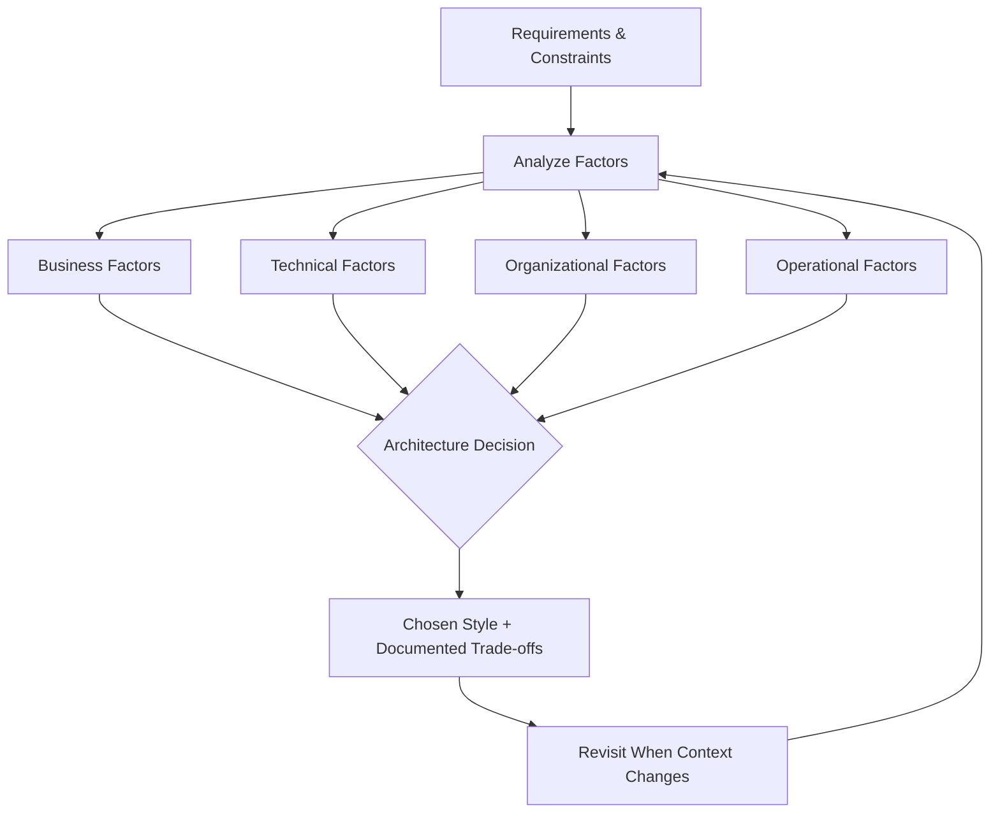
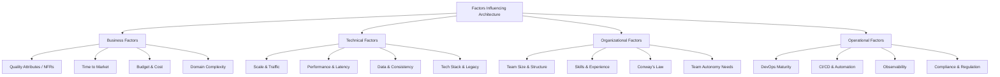
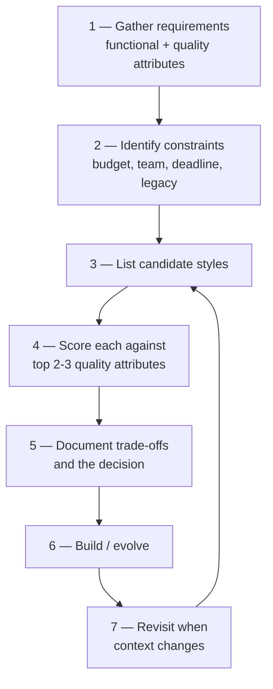

# 🧠 Topic: Factors Influencing Architecture Selection

> [!abstract] Executive Summary (ELI5)
> Choosing an architecture is like choosing a vehicle. A sports car (microservices) is fast and flashy but expensive and hard to maintain. A bicycle (monolith) is simple and cheap but won't carry a family of five. A minivan (layered) is practical and familiar. The "best" vehicle doesn't exist — the right choice depends on *where you're going, how many people, what roads, and your budget*. Architecture selection works the same way: you match the style to the context, not the other way around.

---

## 🎯 The "Why"
- **Problem Solved:** How do we decide which [[Software Architecture|architectural style]] (or combination) fits a given system, team, and business context — instead of picking based on hype or familiarity?
- **Alternatives:** Copying what Netflix/Google did (cargo-cult engineering), defaulting to whatever the team already knows, or "deciding by committee" with no framework.
- **Trade-offs:** There is no universal best architecture. Every choice is a bet. The goal is to make the decision **explicit, evidence-based, and revisitable** rather than implicit and accidental.

## 💡 Mental Model & Analogy
- **Analogy:** "Architecture selection is like a doctor's diagnosis." A good doctor doesn't prescribe the same treatment to every patient. They ask about symptoms (requirements), lifestyle (team/ops context), history (legacy/constraints), and goals (quality attributes). Only then do they match a treatment to the patient. A doctor who prescribes antibiotics for everything is dangerous — and so is an architect who reaches for microservices for every problem.
- **Visual/Diagram:**

## 🛠️ Core Principles

### What Drives Architecture Selection
Architecture selection is driven by **four families of factors**. No single factor decides — the right architecture emerges from weighing all of them together, with the most important ones weighted heaviest for *your* context.

---

### 1. Business Factors

#### Quality Attributes (Non-Functional Requirements)
The "-ilities" are usually the **strongest driver** of architecture. Functional requirements tell you *what* the system does; quality attributes tell you *how well* it does it under constraints. Architecture is primarily the answer to quality-attribute demands.

| Quality Attribute | Question It Answers | Architecture Lean |
|-------------------|---------------------|-------------------|
| **Scalability** | Can it handle growth in load/data? | [[Microservices Architecture\|Microservices]], [[Event-Driven Architecture\|EDA]] (scale per component) |
| **Availability / Reliability** | Does it stay up when things fail? | Microservices (fault isolation), EDA (async buffering) |
| **Performance / Latency** | How fast does it respond? | Monolith (in-process calls), avoid network hops |
| **Maintainability** | Can we change it without pain? | [[Layered Architecture\|Layered]], modular monolith, clean architecture |
| **Testability** | Can we verify it works? | Layered (testable layers), monolith (easy E2E) |
| **Deployability** | Can we ship safely and often? | Microservices (independent deploys) |
| **Security** | Can we protect it? | Client-server (clear trust boundary), service mesh (mTLS) |
| **Evolvability** | Can it adapt over years? | Modular monolith, microservices (per-service evolution) |

> [!tip] Prioritize, don't maximize
> You cannot maximize all quality attributes at once — they conflict (e.g., performance vs. flexibility, security vs. latency). Identify your **top 2–3** must-have attributes and optimize for those. The rest become acceptable trade-offs.

#### Time to Market
- **Speed needed early?** A [[Monolithic Architecture|monolith]] lets you ship fastest — one codebase, one deploy, no distributed-systems overhead. Ideal for MVPs and finding product-market fit.
- **Long-term evolution?** Investing in [[Layered Architecture|layered]]/clean architecture early pays off if the system will live for years, even if it slows the initial build slightly.

#### Budget and Cost
- **Small budget / lean phase?** Monoliths minimize infrastructure, tooling, and headcount. Microservices multiply costs (more services, more replicas, more monitoring, often a platform team).
- **Total cost of ownership (TCO):** Consider not just build cost but operational cost over years. A "free" microservices choice can become expensive to run.

#### Domain Complexity
- **Simple / CRUD domain:** A monolith or layered architecture is sufficient and appropriate.
- **Complex domain with clear sub-domains:** [[Domain-Driven Design]] bounded contexts suggest natural service boundaries — a candidate for microservices.
- **Unclear / evolving domain:** Start monolithic. You can't draw service boundaries you haven't discovered yet. See the "monolith first" principle in [[Microservices Architecture]].

---

### 2. Technical Factors

#### Scale and Traffic Profile
| Traffic Profile | Suitable Architecture |
|-----------------|----------------------|
| **Low / predictable** | Monolith, layered |
| **High, uniform** | Monolith behind a load balancer + caching |
| **High, uneven (hot spots)** | Microservices (scale only the hot component) |
| **Bursty / spiky** | EDA (broker buffers spikes), serverless |
| **Massive streaming data** | EDA (Kafka-style streaming) |

The key question isn't "how much traffic?" but "**do different parts need to scale differently?**" If yes, microservices/EDA earn their cost. If no, a monolith scales fine with horizontal replication.

#### Performance and Latency Requirements
- **Sub-millisecond / hard realtime:** In-process calls (monolith) or very carefully tuned services. Every network hop adds milliseconds.
- **Low-latency web (tens of ms):** Layered monolith or microservices with caching and async where possible.
- **Near-real-time (seconds):** EDA and async processing are fine — the latency floor of queuing is acceptable.

> [!warning] Network latency is a 1000x tax
> An in-process function call is ~nanoseconds. A network call between services is ~milliseconds. If your latency budget is tight, every microservice hop eats into it.

#### Data and Consistency Requirements
| Requirement | Architecture Lean |
|--------------|-------------------|
| **Strong ACID across entities** | Monolith (shared transaction), keep tightly-coupled data together |
| **Eventual consistency acceptable** | Microservices (DB per service), EDA |
| **Audit trail / temporal queries** | EDA with event sourcing |
| **Polyglot persistence (different DBs per concern)** | Microservices (each owns its store) |

Data consistency is often the **decisive factor**. If your domain needs ACID transactions across entities (e.g., financial ledgers), keeping those entities together in a monolith avoids the agony of distributed transactions (sagas).

#### Existing Tech Stack and Legacy Systems
- **Greenfield (new project)?** Free to choose based on all other factors.
- **Legacy system?** The **Strangler Fig** pattern lets you incrementally extract services from a monolith. You rarely get a blank slate — architecture selection is often *evolution*, not *creation*.
- **Team's existing expertise:** A style the team can't operate is a liability, regardless of its theoretical fit.

---

### 3. Organizational Factors

#### Team Size and Structure
| Team Size | Recommended Starting Point |
|-----------|---------------------------|
| **1–5 engineers** | Monolith (modular internally) |
| **5–10 engineers** | Modular monolith, possibly extracting 1–2 services |
| **10+ teams** | Microservices (each team owns services) |

Microservices exist to solve the **team scaling** problem, not the traffic problem. A monolith can serve enormous traffic; it cannot serve 50 engineers stepping on each other in one codebase.

#### Conway's Law
> *"Any organization that designs a system will produce a design whose structure is the organization's communication structure."* — Melvin Conway

Conway's Law is not a warning — it's an **observation you can use**:
- If your org is organized by **business domain** (orders team, payments team), microservices aligned to those domains will feel natural.
- If your org is organized by **technical layer** (frontend team, backend team, DBA team), a layered architecture will emerge regardless of your intent.
- **Reverse Conway:** Structure teams the way you want the architecture to look, then let the architecture follow.

#### Skills and Experience
- **Team experienced with distributed systems?** Microservices/EDA are viable.
- **Team new to architecture?** Start with layered/monolithic — the most forgiving and teachable styles.
- **No DevOps experience?** Microservices will overwhelm the team. Build maturity first.

#### Team Autonomy Needs
- Do teams need to **deploy independently** and move at their own pace? Microservices.
- Is **tight coordination** acceptable or even desirable (small team, shared direction)? Monolith.

---

### 4. Operational Factors

#### DevOps Maturity
This is a **gate** for microservices and EDA. If any of these are missing, stay monolithic:

- ✅ CI/CD pipelines (automated build, test, deploy)
- ✅ Containerization (Docker) and orchestration (Kubernetes)
- ✅ Observability (centralized logging, metrics, distributed tracing)
- ✅ Automated testing and contract testing
- ✅ Infrastructure as code

> [!warning] The microservices tax is real
> Microservices and EDA come with a non-negotiable operational tax (see [[Microservices Architecture#The Microservices Tax]]). If your organization cannot pay it, these styles will hurt more than they help. DevOps maturity is a prerequisite, not an afterthought.

#### Compliance and Regulation
- **Financial / healthcare:** May require strict audit trails (favor EDA + event sourcing), data residency (separate services per region), or strong consistency (favor monolith for transactional cores).
- **GDPR / data protection:** May require data isolation per user/region, influencing how you partition services and data.

---

### Decision Framework: Mapping Factors to Styles

The table below maps common factor combinations to recommended styles. Treat it as a **starting heuristic**, not a prescription — real decisions weigh multiple factors.

| If your context is... | Lean toward... | Because... |
|-----------------------|----------------|------------|
| Small team, MVP, unknown domain | [[Monolithic Architecture\|Monolith]] | Fastest to build and change; learn the domain first |
| CRUD app, modest traffic, stable domain | [[Layered Architecture\|Layered]] / Monolith | Separation of concerns without distribution cost |
| Large org, many teams, complex domain | [[Microservices Architecture\|Microservices]] | Team autonomy, independent deployment/scaling |
| Many reactions to one event, streaming data | [[Event-Driven Architecture\|EDA]] | Decoupling, async, fan-out, buffering |
| User-facing product with shared resources | [[Client Server Model\|Client-Server]] | Clear trust boundary, centralized resources |
| Strong ACID across entities | Monolith (keep data together) | Avoid distributed transactions / sagas |
| Hot component needs independent scaling | Extract that service (Strangler Fig) | Scale only what needs it |
| Low latency, hard realtime | Monolith (in-process calls) | Avoid network latency |

> [!tip] It's rarely one style
> Real systems blend styles. A common production architecture: a **client-server** front door (API gateway), **microservices** for the core, each service **layered** internally, communicating via **events** for cross-service writes. Don't force a single label — compose what fits.

### The Selection Process

A disciplined approach to architecture selection:

1. **Gather requirements** — both functional (what it does) and non-functional (quality attributes). NFRs usually drive architecture more than features.
2. **Identify constraints** — budget, team size, deadline, existing systems, regulatory requirements.
3. **List candidate styles** — don't fixate on one. Consider 2–3 alternatives.
4. **Score against your top quality attributes** — which style best satisfies the 2–3 attributes that matter most?
5. **Document the trade-offs** — use an Architecture Decision Record (ADR). What did you choose, what did you reject, and *why*?
6. **Build or evolve** — implement. If greenfield, consider "monolith first." If legacy, use the Strangler Fig.
7. **Revisit when context changes** — architecture decisions are not permanent. Team grows? Traffic spikes? Domain stabilizes? Re-evaluate.

> [!note] Architecture Decision Records (ADRs)
> An ADR is a short document capturing a single architectural decision: the context, the options considered, the decision, and the consequences. Writing ADRs forces explicit trade-off thinking and leaves a trail for future teams. "Why did we choose X?" should always have a written answer.

## 🏗️ The Role in System Design

### Architecture Is Not a One-Time Decision
The most important mindset shift: **architecture selection is continuous, not a one-time event.** A system that starts as a monolith may evolve to extract microservices. A microservices system may consolidate services that were split too eagerly. The factors change — team grows, traffic spikes, domain clarifies — and the architecture should evolve with them.

### Avoid These Anti-Mindsets
| Anti-Mindset | Why It Fails |
|--------------|--------------|
| **"Netflix uses microservices, so should we"** | You're not Netflix. Different scale, team, domain. |
| **"Microservices are more modern / better"** | Modern ≠ appropriate. A monolith may be the right choice. |
| **"We'll figure out architecture later"** | Implicit architecture is still architecture — just bad and accidental. |
| **"Pick one style and commit forever"** | Architectures evolve. So should yours. |
| **"The architect decides, the team builds"** | Architecture is a team conversation. Decisions imposed top-down erode. |

### The Golden Questions
Before committing to an architecture, answer these honestly:

1. **What are my top 2–3 quality attributes?** (Not "all of them" — prioritize.)
2. **What is my team size and DevOps maturity?** (Be honest, not aspirational.)
3. **Is the domain well-understood enough to draw boundaries?**
4. **Do different parts need to scale or deploy independently?**
5. **Can my organization pay the operational tax?**
6. **What would I choose if I ignored hype entirely?**

## ⚠️ Pitfalls & Anti-patterns
- **Cargo-cult engineering:** Copying the architecture of a company at a completely different scale/stage. "Netflix did it" is not a reason.
- **Optimizing for all quality attributes:** They conflict. Trying to maximize everything produces a compromised everything.
- **Ignoring organizational reality:** Choosing microservices when the team is small and DevOps maturity is low.
- **Treating the decision as permanent:** Refusing to evolve the architecture as factors change.
- **No documentation:** Making the decision in a meeting, never writing it down, so no one remembers *why* in two years.
- **Architecture by resume:** Choosing a style because the lead engineer wants to put it on their CV, not because it fits.
- **Ignoring data consistency needs:** Choosing microservices when the domain demands ACID across entities, then drowning in saga complexity.
- **Deciding in isolation:** The team that builds and operates the system must be part of the decision.
- **Premature commitment:** Drawing service boundaries before the domain is understood.

## 🔗 Deep Connections
- **Parent Topic:** [[Software Architecture]]
- **Related Concepts:** [[Monolithic Architecture]], [[Layered Architecture]], [[Microservices Architecture]], [[Event-Driven Architecture]], [[Client Server Model]], [[Domain-Driven Design]], [[Load Balancing]], [[Caching]], [[API Gateways]]
- **Companion Notes:** This note is the **decision layer** on top of the style-specific notes. Each style note details *what* it is; this note explains *how to choose* between them based on context.
- **Prerequisites:** Familiarity with the five architectural styles and basic quality attributes.

## ❓ Active Recall Questions
> [!faq]- What are the four families of factors that influence architecture selection?
> **Business** (quality attributes, time to market, budget, domain complexity), **Technical** (scale/traffic, performance/latency, data/consistency, tech stack/legacy), **Organizational** (team size/structure, skills, Conway's Law, autonomy needs), and **Operational** (DevOps maturity, CI/CD, observability, compliance). No single factor decides — they must be weighed together.

> [!faq]- Why are non-functional requirements (quality attributes) usually the strongest driver of architecture?
> Functional requirements tell you *what* the system does; quality attributes (scalability, availability, latency, maintainability) tell you *how well* it does it under constraints. Architecture is primarily the answer to quality-attribute demands. Two systems with identical features but different scale/latency/availability needs may warrant completely different architectures.

> [!faq]- How does team size influence architecture selection?
> Small teams (1–10 engineers) should use a monolith — microservices overhead swamps the benefits. Large organizations (10+ teams) benefit from microservices so teams can own services and work in parallel. Microservices exist to solve the **team scaling** problem, not the traffic problem — a monolith can serve enormous traffic.

> [!faq]- What is Conway's Law, and how does it affect architecture?
> "Organizations produce systems that mirror their communication structure." If teams are organized by business domain, microservices aligned to those domains feel natural. If organized by technical layer, a layered architecture emerges regardless of intent. You can use this deliberately ("reverse Conway"): structure teams the way you want the architecture to look.

> [!faq]- Why is DevOps maturity a "gate" for microservices and EDA?
> Microservices and EDA come with a non-negotiable operational tax: per-service CI/CD, centralized logging, distributed tracing, metrics, containerization, orchestration, secrets management. If the organization cannot pay this tax, these styles become an operational nightmare. Build DevOps maturity first; adopt microservices second.

> [!faq]- How do data consistency requirements influence architecture?
| Need | Lean |
|------|------|
| Strong ACID across entities | Monolith (avoid distributed transactions) |
| Eventual consistency acceptable | Microservices, EDA |
| Audit trail / temporal queries | EDA with event sourcing |

If a domain needs ACID across entities (e.g., financial ledgers), keep them in a monolith. Distributed transactions (sagas) are painful — don't invite them unless the domain tolerates eventual consistency.

> [!faq]- How does scale/traffic profile influence architecture selection?
> Low/predictable traffic suits a monolith. High, uniform traffic suits a monolith behind a load balancer with caching. High, uneven traffic (hot spots) suits microservices so you can scale only the hot component. Bursty/spiky traffic suits EDA or serverless, where brokers buffer spikes.

> [!faq]- What is the recommended process for making an architecture decision?
> Gather requirements (functional + quality attributes) → identify constraints (budget, team, legacy) → list candidate styles → score each against your top 2–3 quality attributes → document the trade-offs in an Architecture Decision Record (ADR) → build or evolve → revisit when context changes.

> [!faq]- What is an Architecture Decision Record (ADR), and why use one?
> A short document capturing a single architecture decision: the context, options considered, the decision, and its consequences. ADRs force explicit trade-off thinking and leave a trail so future teams understand *why* a choice was made. "Why did we choose X?" should always have a written answer.

> [!faq]- What is cargo-cult engineering, and how do you avoid it?
> Copying the architecture of a company (e.g., Netflix, Google) at a completely different scale, team size, or domain — "they did it, so should we." Avoid it by analyzing *your own* factors (team, scale, domain, maturity) and choosing what fits your context, not someone else's.

> [!faq]- Why is architecture selection continuous rather than one-time?
> The factors change over time — teams grow, traffic spikes, domains clarify, budgets shift. A system that starts as a monolith may extract microservices; a microservices system may consolidate services that were split too eagerly. Good architects treat the architecture as evolving, not frozen at the initial decision.

> [!faq]- Why do real production systems rarely use a single architectural style?
> Because different parts of a system have different needs. A common production architecture: client-server front door (API gateway), microservices for the core, each service layered internally, communicating via events for cross-service writes. Styles compose — you match each layer of the decision to the relevant factors.

---

*Last updated: 2026-07-11*
