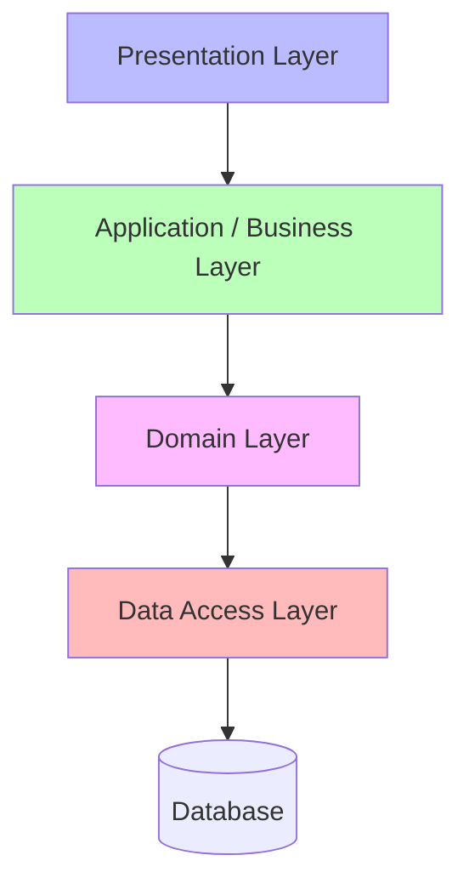
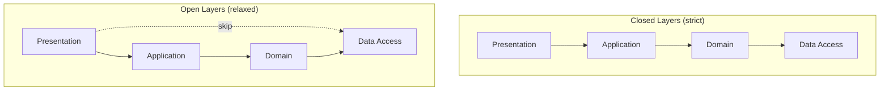
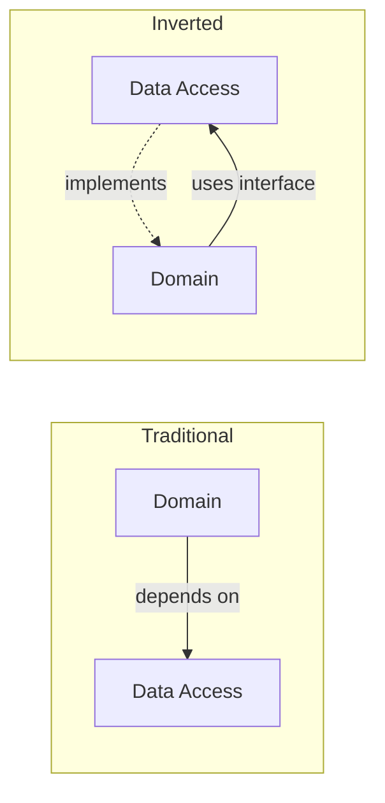

# 🧠 Topic: Layered Architecture

> [!abstract] Executive Summary (ELI5)
> A layered architecture is like a layer cake — each tier sits on top of the one below it. The top layer (presentation) is what you see and eat first; underneath sit the business logic and data layers that hold everything up. A layer only talks to the one directly below it, never skipping tiers. You can swap a layer (change the sponge for chocolate) without rebuilding the whole cake.

---

## 🎯 The "Why"
- **Problem Solved:** How do we organize an application so that concerns are cleanly separated, each part has a single responsibility, and we can change one part without breaking the others?
- **Alternatives:** [[Monolithic Architecture]] without layers (Big Ball of Mud), [[Microservices]] (separates by business capability, not by technical tier), hexagonal/onion/clean architecture (inverts dependencies toward the domain core).
- **Trade-offs:** The layered style optimizes for **clarity, separation of concerns, and swappability** at the cost of **indirection, latency, and pass-through layers** that can emerge when features cut vertically. See [[Software Architecture#Trade-offs by Architectural Style]].

## 💡 Mental Model & Analogy
- **Analogy:** "A layered architecture is like a restaurant." Customers (presentation) place orders with the waiter (application/business), the waiter hands the order to the kitchen (domain), and the kitchen fetches ingredients from the pantry (data access). Each role talks only to the one below it. A customer never walks into the pantry; the pantry never speaks to a customer.
- **Visual/Diagram:**

## 🛠️ Core Principles

### What is a Layered (n-tier) Architecture
A **layered architecture** organizes an application into **horizontal tiers**, each with a distinct responsibility. Layers collaborate top-down: a higher layer may call the layer directly below it, but a lower layer must never call back up. The result is a strict, predictable dependency direction.

The classic variant is the **four-layer model**:

| Layer | Responsibility | Examples |
|-------|----------------|----------|
| **Presentation** | User interface, HTTP/API endpoints, request handling | Controllers, views, REST handlers, CLI |
| **Application / Business** | Use-case orchestration, workflow, application rules | Services, use-case handlers, transaction scripts |
| **Domain** | Core business logic and rules, the heart of the system | Entities, value objects, domain services |
| **Data Access** | Persistence and external integration | Repositories, ORM, DAOs, external API clients |

> [!note] Application vs Domain
> Some traditions collapse these into one "business logic" layer. The cleaner separation treats the **application layer** as orchestration (what the system *does*) and the **domain layer** as the rules (what the business *means*). This distinction is central to Domain-Driven Design and clean architecture.

Key characteristics:
- **Unidirectional dependency:** Dependencies always point downward — presentation → business → data.
- **Closed layers:** A layer may only call the one directly below it (the strict form).
- **Single responsibility per tier:** Each layer owns one concern and nothing else.
- **Well-defined interfaces:** Layers communicate through contracts (interfaces, ports), not through implementation details.

### Open vs Closed Layers

Not every layered system is equally strict. Two policies exist:

- **Closed layers (strict):** A request must pass through every layer in order. Presentation cannot skip the business layer and call data access directly. This maximizes **decoupling and substitutability** — you can swap any layer without affecting the one above.
- **Open layers (relaxed):** A higher layer may skip intermediate layers. For example, presentation might call data access directly for a simple read. This reduces **pass-through overhead** but weakens the abstraction.

Most production systems use **closed layers as the default** and open them only where a skip measurably improves performance.

### The Dependency Rule
The golden rule of layered architecture: **dependencies point inward and downward, never outward or upward.**

- Presentation depends on application — never the reverse.
- Application depends on domain — never the reverse.
- Domain depends on data access — *ideally never* (see [Inverting the Dependency](#inverting-the-dependency) below).
- The database is a detail; the domain should not know which database you use.

When this rule is violated — when a lower layer reaches up to call a higher one — the architecture degrades. Circular and upward dependencies are the fastest way to turn a layered system into a Big Ball of Mud.

### Variants and Related Styles

The layered style is the ancestor of a family of related architectures:

| Style | Relationship to Layered |
|-------|------------------------|
| **3-tier / n-tier** | Classic layered across physical tiers (web server, app server, database) |
| **MVC (Model-View-Controller)** | A layered structure focused on UI separation |
| **Hexagonal (Ports & Adapters)** | Layers wrapped around a domain core; all I/O goes through "ports" |
| **Onion Architecture** | Concentric layers; dependencies point toward the center (domain) |
| **Clean Architecture** | Concentric circles; "the dependency rule" — dependencies point inward |

> [!tip] Where clean/hexagonal/onion differ
> The classic layered style lets the **domain depend on data access**. Hexagonal, onion, and clean architectures **invert** this: the domain depends on nothing, and the data-access layer depends on the domain (via interfaces defined by the domain). This protects the business rules from infrastructure churn.

#### Inverting the Dependency
In the traditional layered model, the domain layer *calls* the data-access layer — so the domain knows about SQL, ORM, or HTTP clients. The dependency points **toward infrastructure**.

Inverted dependency (the hexagonal/onion/clean approach) flips this:

The domain defines a **port** (interface) like `UserRepository`. The data-access layer **implements** that interface. Now the domain owns the contract, and you can swap Postgres for MongoDB without touching the domain. This is the single most important refinement layered architecture received in the last 20 years.

### Pros
- **Clear separation of concerns:** Each layer has one job, and the responsibilities never bleed across tiers.
- **Well-understood and teachable:** The most common architectural pattern in the industry — every developer recognizes it.
- **Layer swappability:** Because layers communicate through interfaces, you can swap one (e.g., replace MySQL with Postgres, or replace a REST API with gRPC) without touching the others.
- **Independent testability:** Each layer can be unit-tested in isolation by mocking the layer below.
- **Predictable dependency direction:** Code flows top-down. New developers can navigate the codebase by following the layers.
- **Parallel team work:** One team can own the presentation layer while another owns the domain — the contract between them is the interface.
- **Maps naturally to web apps:** MVC, REST controllers, ORM repositories — the style fits the dominant application type.

### Cons
- **Pass-through / anemic middle layers:** When a request just flows through the business layer to data access and back, the middle layer adds no value — it is a pure relay. This is extremely common in CRUD apps.
- **Cross-cutting features touch every tier:** A "vertical" feature like adding a field end-to-end requires changes in presentation, business, domain, and data access. The horizontal slicing fights vertical change.
- **Indirection and latency:** Each request cascades down the whole stack. More layers = more hops = more latency and abstraction cost.
- **Monolithic deployment:** Layered architecture says nothing about how the system is deployed — it is usually a single artifact, inheriting the [[Monolithic Architecture#Cons|monolith's deployment limitations]].
- **Artificial layering:** Some domains don't decompose neatly into horizontal tiers. Forcing them produces awkward, leaky layers.
- **Coupling creep:** Without discipline, layers start reaching across each other (presentation calling data access, domain calling controllers), eroding the boundaries.
- **Domain depending on infrastructure (traditional form):** In the naive version, the domain layer knows about the database — the most valuable code is coupled to the most volatile code.

### Use Cases (When to Use)

Layered architecture fits a wide range of applications. Use it when:

- **Standard line-of-business / CRUD apps:** Create-Read-Update-Delete screens over a database — the bread and butter of enterprise software.
- **MVC web applications:** Rails, Django, Spring MVC, ASP.NET — these frameworks are built around the layered/MVC structure.
- **Internal tools and admin panels:** Where the domain is modest and the UI is forms-and-tables.
- **Apps with a stable, well-understood domain:** When the business rules change less often than the UI or the database.
- **Teams new to architecture:** It is the easiest architectural style to learn and apply correctly.
- **Systems that need swappable persistence or presentation:** When you may need to support multiple frontends (web, mobile, CLI) or migrate the database later.

### When NOT to Use

Layered architecture is a poor fit when:
- The **domain is complex and central** to the system — hexagonal/onion/clean architecture protects the domain better by inverting dependencies.
- The system needs **independent scaling or deployment** of components — layered is deployment-agnostic but typically monolithic; consider [[Microservices]].
- **Most features cut vertically** (end-to-end slices) rather than horizontally — feature-oriented or modular decomposition fits better.
- The application is **event-heavy or real-time** — [[Event-Driven Architecture]] handles reactive flows more naturally.

### Real-World Examples
- **Spring / Spring Boot (Java):** Controller → Service → Repository → Database is the textbook four-layer structure.
- **Django / Rails:** Views/Controllers → Models/Services → ORM → Database. The MVC pattern is a layered architecture specialized for web apps.
- **ASP.NET / .NET Core:** Controller → Service → Repository → EF Core. Microsoft's official templates ship layered by default.
- **Enterprise Java EE:** Servlets → EJB (business) → JPA/Hibernate (data) → Database — a canonical n-tier stack.

## 🏗️ The Role in System Design

### The Default Internal Structure
Layered architecture is rarely the *whole* architectural decision — it is usually the **internal structure of a larger choice**. A [[Monolithic Architecture|monolith]] or a [[Microservices|microservice]] is typically layered *inside*. The style answers "how do I organize code?" more than "how do I deploy it?"

### The Stepping Stone
Layered is often the first architecture a team adopts and the foundation from which they graduate. The typical progression:
1. Start with a **naive layered** app (controller → repository).
2. Introduce a **domain layer** and separate application from domain.
3. **Invert the dependency** toward the domain (hexagonal/onion/clean).
4. Extract modules into services if and when scale demands it.

### Composition with Other Styles
Layered composes cleanly with almost everything:
- **Layered + Monolith:** The most common pairing — a structured monolith.
- **Layered + Microservices:** Each service uses layered internally.
- **Layered + Event-Driven:** An event consumer can be layered; the event handler lives in the application layer.

## ⚠️ Pitfalls & Anti-patterns
- **Anemic domain model:** The domain layer is just a bag of getters/setters; all logic lives in the application layer or worse, in controllers. The layer exists in name only.
- **Pass-through layers:** The business layer does nothing but forward calls to data access — a sign the layer is artificial. Either remove it or give it real responsibility.
- **Presentation calling data access directly:** Skipping layers "just this once" breaks the dependency rule and couples the most volatile layer to the most detailed one.
- **Domain depending on the database:** The traditional flaw — fix it with dependency inversion (define a repository interface in the domain, implement it in data access).
- **Too many layers:** Each new layer is another hop and another abstraction. Resist adding layers "for completeness" — add them only when they earn their keep.
- **Circular dependencies:** A lower layer calling a higher one creates a cycle that breaks compilation, testing, and reasoning. Enforce direction with lint tools (e.g., ArchUnit, dependency-cop).
- **Leaky abstractions:** The data layer returns ORM entities to the business layer, leaking SQL/ORM concerns upward. Use DTOs or domain objects at the boundary.
- **One service class per entity:** A 1:1 mapping between tables and services is a CRUD smell, not architecture. Model behavior, not storage.

## 🔗 Deep Connections
- **Parent Topic:** [[Software Architecture]]
- **Related Concepts:** [[Monolithic Architecture]], [[Microservices]], [[Client Server Model]], [[Domain-Driven Design]], [[MVC]], Hexagonal / Ports & Adapters, Onion Architecture, Clean Architecture
- **Siblings:** Layered is the internal structure most often used *inside* a [[Monolithic Architecture|monolith]] or a [[Microservices|microservice]]. Hexagonal, onion, and clean architecture are its dependency-inverted descendants.
- **Prerequisites:** Basic understanding of MVC, request/response flow, and object-oriented design.

## ❓ Active Recall Questions
> [!faq]- What is a layered (n-tier) architecture?
> An architectural style that organizes an application into **horizontal tiers**, each with a single responsibility. The classic model has four layers — presentation, application/business, domain, and data access. Dependencies flow strictly top-down: a higher layer may call the layer directly below it, never the reverse.

> [!faq]- What is the dependency rule in layered architecture?
> Dependencies always point **downward and inward** — presentation depends on application, application on domain, domain on data access. Lower layers must never call back up to higher layers. Violating this rule creates circular dependencies and degrades the system into a Big Ball of Mud.

> [!faq]- What is the difference between closed and open layers?
> **Closed (strict):** a layer may only call the one directly below it, maximizing decoupling and swappability. **Open (relaxed):** a layer may skip intermediate layers (e.g., presentation calling data access directly for a fast read), reducing pass-through overhead at the cost of weaker abstraction.

> [!faq]- What are the main advantages of layered architecture?
> Clear separation of concerns, layer swappability (swap the database or UI without touching others), independent testability of each layer, a predictable dependency direction, parallel team work across layers, and familiarity — it is the most widely understood architectural style.

> [!faq]- What are the main disadvantages of layered architecture?
> Pass-through/anemic middle layers in CRUD apps, features that cut vertically touching every tier, latency and indirection from cascading down the stack, monolithic deployment by default, and in the traditional form the domain depending on the database (fixed by dependency inversion).

> [!faq]- What is an "anemic domain model," and why is it a problem?
> A domain layer that contains only data (getters/setters) with no behavior — all logic lives elsewhere. The layer exists in name only and provides none of the benefit of a true domain model. It is a common anti-pattern in naive layered apps.

> [!faq]- What is a "pass-through layer," and what does it signal?
> A middle layer (often the business/application layer) that merely forwards calls to the layer below without adding logic. It signals that the layer is artificial — either remove it or give it a real responsibility (orchestration, validation, transaction management).

> [!faq]- How do hexagonal, onion, and clean architecture refine layered architecture?
> They **invert the dependency** between the domain and data access. Instead of the domain depending on the database, the domain defines an interface (a port), and the data-access layer implements it. This keeps the business rules independent of infrastructure and makes the database swappable.

> [!faq]- When should you use layered architecture?
> For standard CRUD / line-of-business apps, MVC web applications, internal tools, systems with a stable domain, teams new to architecture, and applications that need swappable persistence or multiple frontends. It is the default internal structure for most web apps.

> [!faq]- When is layered architecture a poor fit?
> When the domain is complex and central (prefer hexagonal/clean), when components need independent scaling or deployment (prefer microservices), when features are mostly vertical end-to-end slices, or when the system is event-heavy and real-time.

> [!faq]- How does layered architecture compose with other styles?
> It is usually an **internal** structure, not a deployment decision. A monolith or a microservice is typically layered inside. The layered style answers "how do I organize code?" while the outer style (monolith, microservices, event-driven) answers "how do I deploy and scale?"

---

*Last updated: 2026-07-11*
