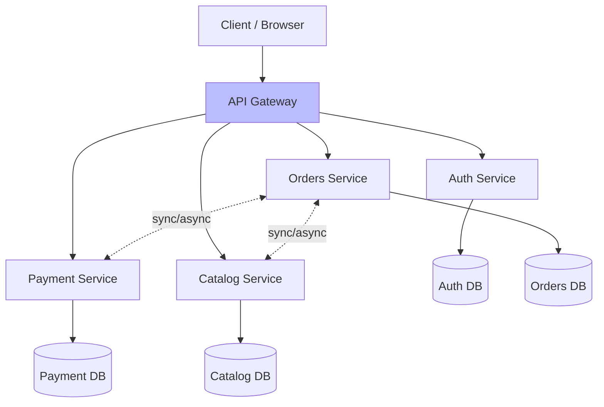
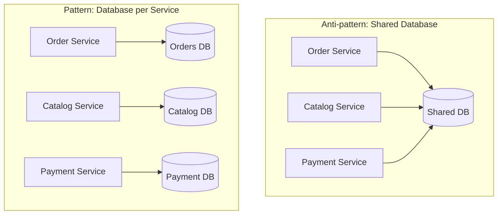
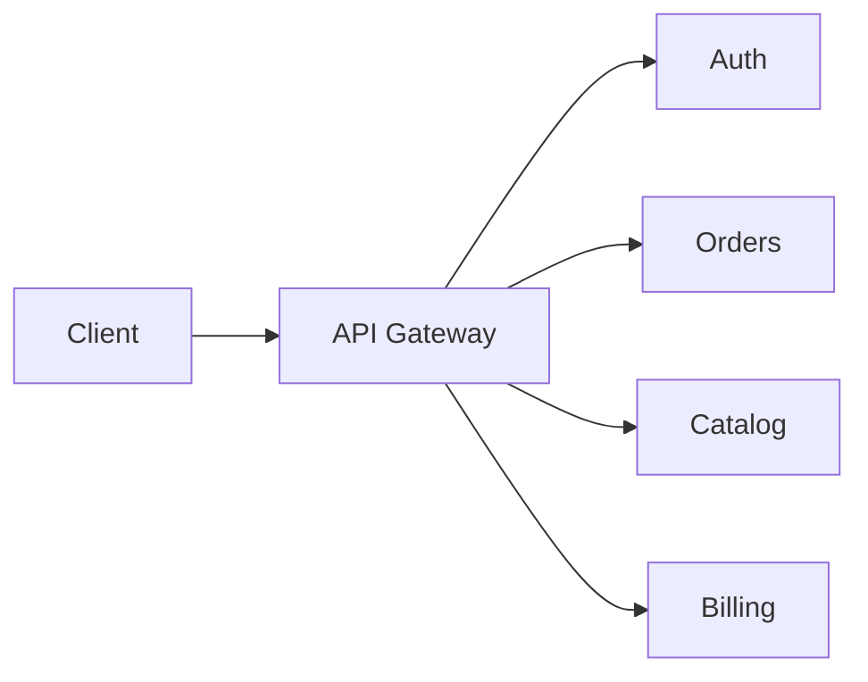

# 🧠 Topic: Microservices Architecture

> [!abstract] Executive Summary (ELI5)
> Microservices are like a food court. Instead of one big restaurant with one kitchen that makes everything (a monolith), you have many small specialized stalls — one for sushi, one for pizza, one for ice cream. Each stall has its own chefs, ingredients, and opening hours, and customers hop between them. If the pizza stall closes for renovation, the sushi stall keeps serving. Each stall can be replaced, scaled, or redecorated without touching the others.

---

## 🎯 The "Why"
- **Problem Solved:** How do we build and evolve large systems where many teams must work in parallel, different parts must scale independently, and no single failure should bring down everything?
- **Alternatives:** [[Monolithic Architecture]] (simple, but no independent scaling/deployment), [[Layered Architecture]] (organizes code internally, says nothing about deployment), service-oriented architecture (SOA — an earlier, coarser-grained variant).
- **Trade-offs:** Microservices optimize for **independent scaling, deployment, and team autonomy** at the cost of **distributed-systems complexity, operational overhead, and eventual consistency**. See [[Software Architecture#Trade-offs by Architectural Style]].

## 💡 Mental Model & Analogy
- **Analogy:** "Microservices are like a city's specialized shops instead of a single department store." A department store (monolith) has everything under one roof — one owner, one cash register, one power supply. If the power goes out, the whole store closes. A city block of specialized shops (microservices) has many owners, each running their own business. The bakery can expand to two locations without the bookstore having to do the same. Coordination is harder (different owners, different hours), but each shop is independent and resilient.
- **Visual/Diagram:**

## 🛠️ Core Principles

### What is a Microservices Architecture
A **microservices architecture** structures an application as a **collection of small, autonomous services**, each:
- **Built around a business capability** (a bounded context, in DDD terms) — not a technical layer.
- **Independently deployable** — each service has its own release cycle.
- **Owning its own data** — each service has a private database; no shared schema.
- **Communicating over the network** — via APIs (synchronous: HTTP/gRPC) or events (asynchronous: Kafka, RabbitMQ).
- **Owned by a small team** — typically the "two-pizza team" (6–8 people).

The unit of decomposition is the **service boundary**, drawn along business capability lines. Where a [[Monolithic Architecture|monolith]] splits code into layers, microservices split it into vertical slices — each slice owning its UI, business logic, and data.

Key characteristics:
- **Service independence:** Each service can be developed, deployed, scaled, and replaced without touching the others.
- **Decentralized data:** No shared database. Each service owns its data store and exposes it only through its API.
- **Polyglot technology:** Each service may use the language, database, and framework best suited to its job.
- **Smart endpoints, dumb pipes:** Services contain their own business logic; the communication channel (message bus, HTTP) stays simple.
- **Failure-aware design:** Every call can fail; services must handle timeouts, retries, and circuit breakers.

### Core Characteristics in Depth

#### 1. Service Boundaries (Bounded Contexts)
The hardest and most important decision in microservices is **where to draw the lines**. Each service should map to a **bounded context** — a coherent slice of the business domain with its own ubiquitous language. The [[Domain-Driven Design]] methodology is the standard tool for finding these boundaries.

| Good boundary | Bad boundary |
|---------------|--------------|
| Maps to a business capability ("Orders", "Shipping") | Maps to a technical layer ("Data Access") |
| Changes together stay in one service | Every feature requires changes in 5 services |
| Service owns its data end-to-end | Services share tables in one database |
| Service can be deployed without coordinating with others | Deploy requires coordinated rollout across services |

#### 2. Decentralized Data (Database per Service)
This is the single most defining — and most painful — rule of microservices: **each service owns its private database.** No service reads or writes another's tables directly.

Why this matters:
- **Loose coupling:** Services can change their schema without breaking others.
- **Independent deployment:** No coordinated DB migrations.
- **Polyglot persistence:** The catalog can use Elasticsearch, orders can use Postgres, sessions can use Redis.

What it costs:
- **No cross-service joins or ACID transactions.** If orders need catalog data, they fetch it via API — and that data may be stale.
- **Data duplication:** The orders service may need to *store* a snapshot of product data it received, accepting eventual consistency.
- **Distributed transactions become sagas** — multi-step, compensating workflows instead of a single `BEGIN/COMMIT`.

#### 3. Independent Deployment
Each service has its **own CI/CD pipeline** and can be deployed independently — at its own cadence, by its own team, without orchestrating a release across the whole system. This is the primary operational payoff of microservices.

This requires:
- **Backward-compatible API evolution** — you can't force all consumers to upgrade at once.
- **Versioning strategy** — API versions, feature flags, or parallel endpoints.
- **Contract testing** — consumer-driven contracts (e.g., with Pact) to verify services still talk to each other.

#### 4. Communication Patterns
Microservices communicate in two fundamental ways:

**Synchronous (Request-Response):**
- Client calls a service and **waits** for the response.
- Protocols: HTTP/REST, gRPC.
- Pros: Simple request-response model; easy to reason about for a single call.
- Cons: The caller is blocked; a downstream failure cascades up; tight **temporal coupling** (both services must be up at the same time).
- Best for: Reads that need fresh data, simple query/response flows.

**Asynchronous (Event-Based):**
- Service **emits an event** and moves on; other services react when ready.
- Protocols: Kafka, RabbitMQ, SQS, NATS.
- Pros: Decoupling — the producer doesn't know or wait for consumers; resilient to downstream outages; easy to add new consumers.
- Cons: Eventual consistency; harder to debug; ordering and idempotency challenges.
- Best for: Writes with side effects (order placed → debit inventory, send email, update analytics), high-throughput fan-out.

> [!tip] Prefer async for cross-service writes
> Synchronous chains create temporal coupling — if service C is slow, services A and B block too. For cross-service *writes* with side effects, prefer events. Reserve synchronous calls for reads or when an immediate response is essential.

### Service Discovery and Routing
With many services coming and going (instances scaling up and down, containers restarting), callers need a way to find them:

- **Service registry** (Consul, Eureka, etcd): Services register their location; callers look them up.
- **Client-side discovery:** The caller queries the registry and picks an instance.
- **Server-side discovery:** A load balancer or sidecar (Envoy in Istio/Linkerd) handles lookup.
- **DNS / Kubernetes Services:** In K8s, a `Service` gives a stable DNS name backed by a dynamic set of pods.

### The API Gateway
A microservices system almost always sits behind an **API gateway** — a single entry point that:

- Routes requests to the right service.
- Handles **cross-cutting concerns**: authentication, rate limiting, TLS termination, request logging.
- Can aggregate responses from multiple services (the **API composition / BFF** pattern).
- Shields clients from the internal service topology.

### Pros
- **Independent scalability:** Scale only the service under load — e.g., add more search replicas without touching auth.
- **Independent deployment:** Each service ships on its own schedule. Small, frequent, low-risk releases.
- **Team autonomy:** Teams own their services end-to-end (design, build, deploy, operate). Conway's Law made to work *for* you.
- **Fault isolation:** A crash or memory leak in one service does not take down the others (when architected correctly).
- **Tech-stack heterogeneity:** Each service can use the right tool — Go for a high-throughput proxy, Python for ML inference, Postgres for transactions.
- **Independent evolution:** A service can be rewritten, refactored, or replaced without a system-wide effort.
- **Clear ownership and accountability:** "The Orders team owns the Orders service" — on-call, SLOs, and improvements all have a clear owner.
- **Easier to reason about (locally):** Each service is small and focused; understanding one service is easier than understanding a monolith.

### Cons
- **Distributed-systems complexity:** Network failures, latency, partitions, timeouts, retries, circuit breakers — every call can fail, and you must handle it.
- **Operational overhead:** Per-service CI/CD, monitoring, logging, tracing, alerting, on-call. Often requires a dedicated platform/SRE team.
- **Eventual consistency:** No cross-service ACID transactions. Data is replicated asynchronously; you must design for drift and reconciliation.
- **Distributed transactions are hard:** Multi-service workflows become **sagas** — long, compensating sequences that are far harder than a `BEGIN/COMMIT`.
- **Testing is harder:** End-to-end tests require all services up. Contract tests and consumer-driven contracts become essential.
- **Debugging and observability:** A single user request may cross 5 services. You need **distributed tracing** (Jaeger, Zipkin) and centralized logging to make sense of it.
- **Data duplication and drift:** Each service stores its own copies of data it received. Reconciliation and freshness are ongoing concerns.
- **Deployment coordination for API changes:** Backward-incompatible API changes must be versioned and rolled out carefully across consumers.
- **Network latency:** In-process calls (nanoseconds) become network calls (milliseconds) — a 1000x cost per hop.
- **Higher infrastructure cost:** More services, more replicas, more containers, more monitoring — all cost money.
- **Service boundary mistakes are expensive:** Drawing the wrong boundary produces a **distributed monolith** — tight coupling, coordinated deploys, and the worst of both worlds.

### Use Cases (When to Use)

Microservices are justified when **multiple** of these hold:

- **Large engineering organization (10+ teams):** Where teams would otherwise block each other in a shared monolith.
- **Complex domain with stable bounded contexts:** Where the business capabilities are well understood (you can draw the right lines).
- **Need for independent scaling:** Where one component (e.g., search, video transcoding) has a very different load profile from the rest.
- **Different tech-stack needs:** Where parts of the system genuinely benefit from different languages or databases.
- **Mature DevOps practices:** CI/CD, containerization, orchestration (Kubernetes), observability, and automated deployment are already in place.
- **High availability requirements:** Where fault isolation between subsystems matters.

### When NOT to Use

Microservices are the wrong choice when:
- **The team is small (1–10 engineers):** The operational overhead swamps the benefits. Stay with a [[Monolithic Architecture|monolith]] (preferably a modular one).
- **The domain is not yet understood:** You can't draw service boundaries you haven't discovered. Build a monolith first; extract services later.
- **DevOps maturity is low:** Without CI/CD, observability, and automation, microservices become an operational nightmare.
- **The system is simple:** A CRUD app with modest traffic has nothing to gain from distribution.
- **You need strong ACID consistency across entities:** Distributed transactions are painful; if your domain is transaction-heavy and tightly coupled, keep it together.
- **You're optimizing for development speed alone:** Microservices slow down early development; their payoff comes at scale.

### Real-World Examples
- **Netflix:** Pioneered large-scale microservices — hundreds of services for browsing, recommendation, playback, billing. Each owned by an independent team.
- **Amazon:** Famously reorganized around "two-pizza teams," each owning a service. The phrase "you build it, you run it" originated here.
- **Uber:** Migrated from a monolith to a microservices architecture as the company scaled, then partially consolidated when the number of services (thousands) itself became a problem.
- **Spotify:** Uses a microservices model with autonomous "squads" owning services end-to-end.

> [!note] The common thread
> These companies adopted microservices because of **organizational scale** — hundreds of engineers needing autonomy — not because of raw traffic. As noted in [[Monolithic Architecture]], a monolith can serve enormous traffic. Microservices solve the *team scaling* problem.

## 🏗️ The Role in System Design

### "Monolith First" — How You Usually Get Here
The recommended path (per Martin Fowler and the experience of the companies above) is to **start as a monolith** and extract microservices only when a specific module demands independence. You learn the right boundaries by living with the domain first.

Extract a service when a module:
- Needs **independent scaling**,
- Is owned by a **different team**,
- Needs a **different release cadence** or tech stack,
- Has **stabilized boundaries** worth the cost of distribution.

### Patterns That Make Microservices Work
A microservices system is only as good as the patterns around it:

| Pattern | Purpose |
|---------|---------|
| **API Gateway** | Single entry point; routing, auth, rate limiting |
| **Service Discovery** | Find service instances dynamically |
| **Circuit Breaker** | Stop cascading failures when a downstream service is down |
| **Saga** | Distributed transaction across services (with compensating actions) |
| **CQRS** | Separate read and write models (often paired with event-driven services) |
| **Event Sourcing** | Store events as the source of truth; derive state from them |
| **Strangler Fig** | Incrementally extract services from a monolith |
| **BFF (Backend for Frontend)** | A gateway tailored to a specific client (web, mobile) |
| **Sidecar / Service Mesh** | Offload cross-cutting concerns (retries, mTLS, tracing) to a co-located proxy |

### The Microservices Tax
Microservices come with a non-negotiable **"tax"** — capabilities you must build or buy before the architecture pays off:

- **CI/CD per service**
- **Centralized logging** (ELK, Loki) — logs are useless if scattered across machines
- **Distributed tracing** (Jaeger, Zipkin) — to follow a request across services
- **Metrics and alerting** (Prometheus, Grafana) — per-service health
- **Containerization + orchestration** (Docker, Kubernetes)
- **Service discovery and routing**
- **Secrets management**
- **Contract testing**

If your organization cannot pay this tax, microservices will hurt more than they help.

## ⚠️ Pitfalls & Anti-patterns
- **Distributed monolith:** Services share a database, must deploy together, or sit in synchronous chains — all the costs of microservices, none of the benefits. The #1 anti-pattern.
- **Premature decomposition:** Splitting before boundaries are understood. You'll draw the wrong lines, and those are very expensive to fix.
- **Shared database:** The fastest way back to coupling. Each service must own its data.
- **Synchronous call chains (A → B → C → D):** Every hop adds latency and a failure point. Long sync chains recreate the brittleness of a monolith over a network.
- **Chatty services:** Services that call each other dozens of times per request. Network latency multiplies.
- **Too many tiny services:** "Nanoservices" — services so small that their operational overhead dwarfs their logic. Coarse-grained beats fine-grained.
- **Ignoring failure:** Assuming the network is reliable. Every call needs timeouts, retries, and circuit breakers.
- **No distributed tracing:** Without it, debugging a cross-service issue is a multi-hour forensic exercise.
- **Tight API coupling:** Services that must change in lockstep. Evolve APIs backward-compatibly.
- **Ignoring data ownership:** Two services writing to the same entity — eventual consistency bugs and lost updates follow.
- **Treating microservices as a technical decision only:** It's an organizational decision. Microservices without autonomous teams is just a hard-to-run monolith.

## 🔗 Deep Connections
- **Parent Topic:** [[Software Architecture]]
- **Related Concepts:** [[Monolithic Architecture]] (the usual starting point), [[Layered Architecture]] (often the internal structure of each service), [[Event-Driven Architecture]], [[Client Server Model]], [[Domain-Driven Design]], [[Load Balancing]], [[Caching]], [[API Gateways]], Service Mesh, Sagas, CQRS, Event Sourcing
- **Siblings:** Microservices are usually *extracted* from a [[Monolithic Architecture|monolith]] using the Strangler Fig pattern. Each service is typically [[Layered Architecture|layered]] internally and may communicate via [[Event-Driven Architecture|events]].
- **Prerequisites:** Distributed systems basics, networking, databases, CI/CD, containerization.

## ❓ Active Recall Questions
> [!faq]- What is a microservices architecture?
> A style that structures an application as a collection of small, autonomous services, each built around a business capability, independently deployable, owning its own private database, and communicating over the network via APIs or events. Decomposition is by business capability (vertical slice), not by technical layer.

> [!faq]- What is the "database per service" rule, and why does it matter?
> Each service owns its private database; no service reads or writes another's tables directly. This enables loose coupling, independent deployment, and polyglot persistence. The cost: no cross-service joins or ACID transactions, data duplication, and eventual consistency between services.

> [!faq]- How do microservices communicate?
> Two ways: **synchronous** (HTTP/gRPC — caller waits for the response, tight temporal coupling) and **asynchronous** (events via Kafka/RabbitMQ — producer emits and moves on, resilient and decoupled). Prefer async for cross-service writes with side effects; use sync for reads needing fresh data.

> [!faq]- What are the main advantages of microservices?
> Independent scalability (scale only the hot service), independent deployment (per-service release cycles), team autonomy, fault isolation, tech-stack heterogeneity, independent evolution per service, and clear ownership/accountability for each capability.

> [!faq]- What are the main disadvantages of microservices?
> Distributed-systems complexity (network failures, latency, partitions), operational overhead (per-service CI/CD, monitoring, on-call), eventual consistency, hard distributed transactions (sagas), harder testing and debugging, data duplication, network latency replacing in-process calls, and the "microservices tax" of required platform capabilities.

> [!faq]- What is a "distributed monolith," and how do you avoid it?
> A system that looks like microservices but behaves like a monolith: services share a database, must deploy together, or sit in long synchronous chains. It incurs all the costs of microservices with none of the benefits. Avoid it by giving each service its own data, decoupling deployment cycles, and replacing synchronous chains with async events.

> [!faq]- When should you use microservices?
> When multiple hold: large engineering organization (10+ teams), complex domain with stable bounded contexts, need for independent scaling, different tech-stack requirements, mature DevOps practices (CI/CD, K8s, observability), and high availability requirements. Most or all should be true; one alone is not enough.

> [!faq]- When should you NOT use microservices?
> When the team is small (1–10 engineers), the domain is not yet understood, DevOps maturity is low, the system is simple (CRUD with modest traffic), strong ACID consistency across entities is essential, or you're optimizing for early development speed. Start monolithic instead.

> [!faq]- What is the "microservices tax"?
> The non-negotiable platform capabilities you must build or buy before microservices pay off: per-service CI/CD, centralized logging, distributed tracing, metrics and alerting, containerization and orchestration, service discovery, secrets management, and contract testing. If your organization cannot pay this tax, microservices will hurt more than they help.

> [!faq]- What is the "monolith first" principle, and why is it recommended?
> Most systems should start as a monolith and extract microservices only when a specific module demands independent scaling, deployment, team ownership, or tech stack. You can't know the right service boundaries until the domain stabilizes; refactoring between monolith modules is cheap, but fixing wrong service boundaries is a migration.

> [!faq]- Why is an API gateway used in microservices?
> It provides a single entry point for clients, routes requests to the right service, handles cross-cutting concerns (auth, rate limiting, TLS, logging), and can aggregate responses from multiple services. It shields clients from the internal, ever-changing service topology.

> [!faq]- What is a saga, and why is it needed in microservices?
> A saga is a sequence of local transactions across services, where each step has a **compensating action** to undo it on failure. It replaces the cross-service ACID transaction (impossible with database-per-service) with an eventually-consistent, long-running workflow. Example: order placed → reserve inventory → charge card → confirm order, with compensations if any step fails.

---

*Last updated: 2026-07-11*
