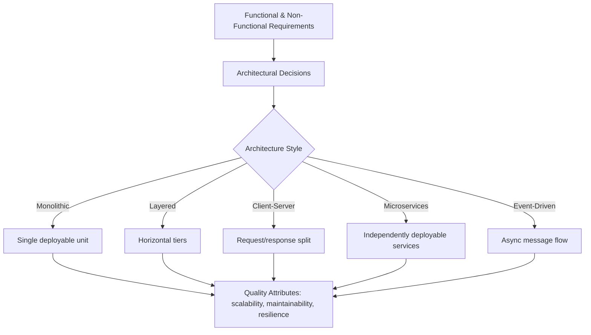
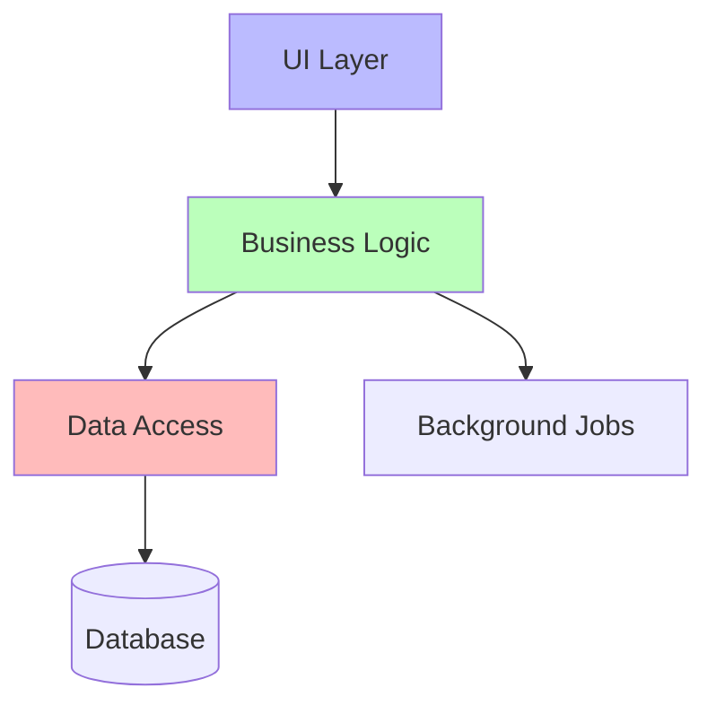
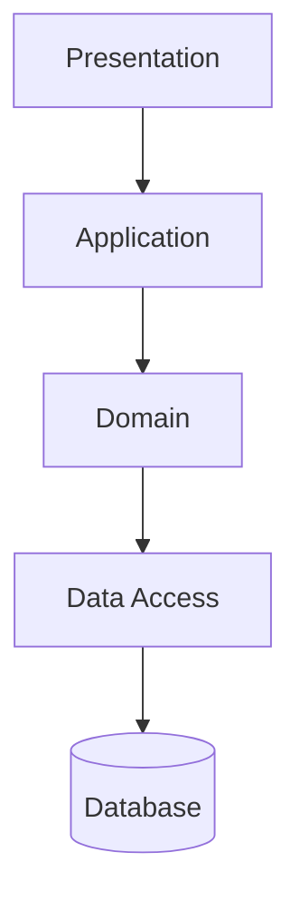
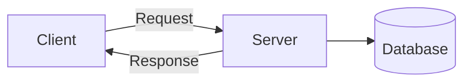
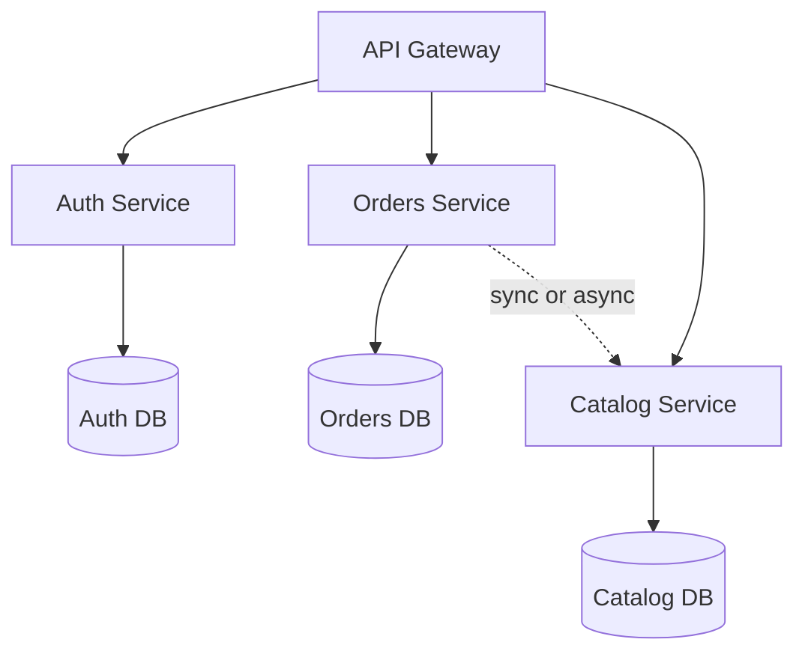
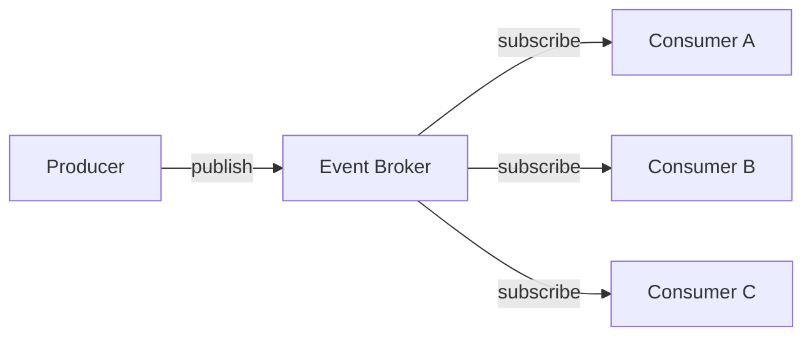

# 🧠 Topic: Software Architecture

> [!abstract] Executive Summary (ELI5)
> Software architecture is the blueprint of a system — like the floor plan of a house before you lay a single brick. It decides which rooms (components) exist, how they connect (doors/hallways), and how the whole building holds up under stress (wind, more tenants, a new floor). Choosing the floor plan wisely means the house won't collapse when you remodel or when the family grows.

---

## 🎯 The "Why"
- **Problem Solved:** How do we structure a software system so it meets functional requirements *and* stays maintainable, scalable, testable, and resilient as it grows?
- **Alternatives:** "Big Ball of Mud" (no architecture) — everyone talks to everyone. Works for a prototype, collapses under change. Ad-hoc growth leads to spaghetti code that no one can reason about.
- **Trade-offs:** Architecture is a series of compromises. A monolith is simple to deploy but hard to scale independently. Microservices scale beautifully but add operational complexity. There is no "best" architecture — only the best fit for a given context.

## 💡 Mental Model & Analogy
- **Analogy:** "Software architecture is like city planning." You decide where residential, commercial, and industrial zones go (component boundaries). You lay down roads and transit (communication paths). You plan for growth — new neighborhoods, traffic spikes, utilities. Bad city planning = traffic jams, pollution, sprawl. Bad software architecture = slow delivery, outages, team friction.
- **Visual/Diagram:**

## 🛠️ Core Principles

### What is Software Architecture
Software architecture is the **high-level structure** of a software system — the set of significant decisions about how components are organized, how they interact, what their responsibilities are, and which patterns and constraints guide the system's evolution. It is the bridge between business requirements and the running code.

Architecture is distinct from design: architecture concerns itself with the components that are *hard to change* (deployment topology, data ownership, communication style), while design concerns the internals of each component (classes, functions, algorithms). As the adage goes: *"Architecture is the decisions you wish you could get right early, because they're expensive to reverse."*

Key characteristics:
- **Component decomposition:** Breaking the system into modules with clear responsibilities
- **Relationships & interactions:** How components communicate (synchronous, asynchronous, direct, mediated)
- **Quality attributes (the "-ilities"):** Scalability, availability, maintainability, testability, security, performance
- **Constraints & trade-offs:** Every choice closes some doors and opens others
- **Evolution:** Good architectures bend rather than break when requirements change

### Why Software Architecture Matters

| Concern | What bad architecture causes | What good architecture enables |
|---------|------------------------------|--------------------------------|
| **Maintainability** | Tangled dependencies, change ripples everywhere | Isolated changes, predictable impact |
| **Scalability** | Whole system must scale, even one hot component | Scale only the pieces under load |
| **Team velocity** | Merge conflicts, blocked teams, long PRs | Teams own components, parallel work |
| **Testability** | Cannot unit test without the whole system | Components testable in isolation |
| **Resilience** | One failure cascades and takes everything down | Failures contained, graceful degradation |
| **Deployability** | Big-bang releases, risky rollouts | Independent, low-risk deployments |
| **Evolvability** | Rewrites become the only option | Incremental change over years |

Architecture decisions are "the ones that are hard to undo" — getting them wrong early means paying compounding interest later. Choosing the right style up front (and revisiting as the system grows) is one of the highest-leverage decisions a team makes.

### Common Architectural Styles

An **architectural style** is a named, reusable coordination pattern of components and connectors. Styles are not mutually exclusive — real systems often blend several (e.g., a microservices system where each service uses a layered internal structure and communicates via events).

#### 1. Monolithic
All functionality — UI, business logic, data access, background jobs — lives in a **single deployable unit** (one process, one codebase, one artifact).

- **Structure:** One application, often internally organized into modules or packages.
- **Pros:** Simple to build, test, deploy, and debug. Shared in-memory calls are fast. Low operational overhead — no distributed-systems complexity.
- **Cons:** Scales as a whole (can't scale just the billing module). A single bug can crash everything. Large codebases suffer from merge conflicts and slow builds. Tech stack lock-in.
- **When to use:** Early-stage products, small teams, when the domain is well understood and traffic is modest.
- **Example:** A Django or Rails app with templates, ORM, and background workers all in one repo, deployed as one container.

#### 2. Layered (n-tier)
Components are organized into **horizontal layers**, each with a single responsibility. A layer only talks to the one directly below it. Classic four layers: Presentation → Application/Business → Domain → Data.

- **Structure:** Strict top-down dependency — presentation calls business, business calls data, never the reverse.
- **Pros:** Clear separation of concerns. Easy to swap a layer (e.g., swap a Postgres data layer for a MySQL one) without touching business logic. Familiar and teachable.
- **Cons:** Changes that cut across layers (a "vertical" feature) touch every tier. Can degrade into "layers as pass-throughs" — thin, useless middle layers. Latency from serial calls down the stack.
- **When to use:** Classic line-of-business apps, CRUD systems, MVC web apps.
- **Example:** Spring MVC app: Controller → Service → Repository → Database. Hexagonal/onion/clean architecture are refinements of layered that invert dependencies toward the domain core.

#### 3. Client-Server
A **requester (client)** asks a **provider (server)** for a service. The server holds the resources and logic; the client presents results to the user. See [[Client Server Model]].

- **Structure:** Two distinct roles communicating over a network (usually request-response over HTTP, but also TCP/UDP/WebSocket/gRPC).
- **Pros:** Centralized control of data and logic, shared resources, clear trust boundary (clients are untrusted). The dominant model for the web.
- **Cons:** Server is a potential single point of failure and bottleneck. Network latency and failures must be handled. Server scaling is a first-class concern.
- **When to use:** Web apps, mobile backends, SaaS — essentially any product with users talking to shared state.
- **Example:** A browser (client) calling a REST API (server) backed by Postgres.

#### 4. Microservices
The system is split into **small, independently deployable services**, each owning its own data and exposing an API. Services are organized around business capability (a "bounded context") and communicate over the network.

- **Structure:** Many services + an API gateway + per-service databases + a service mesh or discovery mechanism. Each service can have its own tech stack, release cycle, and team.
- **Pros:** Independent scaling (scale only what's hot). Independent deployment and release cadence. Team autonomy — Conway's Law made to work *for* you. Fault isolation — one service crashing doesn't take down all others. Tech-stack heterogeneity.
- **Cons:** Distributed-systems complexity: network failures, latency, eventual consistency, distributed transactions (sagas). Operational overhead — observability, CI/CD, service discovery. Hard to test end-to-end. Data duplication across services.
- **When to use:** Large teams, complex domains, high traffic requiring independent scaling, mature DevOps practices. Often reached *by extracting* from a monolith, not by starting greenfield.
- **Example:** Netflix, Uber, Amazon — each a constellation of hundreds of services (billing, recommendations, playback, auth...) owned by different teams.

#### 5. Event-Driven
Components communicate by **emitting and reacting to events** (state changes or notable occurrences) rather than calling each other directly. Producers publish events; consumers subscribe. A broker (Kafka, RabbitMQ, SQS) mediates.

- **Structure:** Event producers → event bus/broker → event consumers. Often combined with microservices or serverless. Variants: event notification, event-carried state transfer, event sourcing.
- **Pros:** Loose coupling — producers don't know or care who consumes. Natural async flow — long-running work decouples from request handling. Easy to add new consumers without touching producers. Resilient to downstream outages (events queue up). Replayability when combined with event sourcing.
- **Cons:** Harder to reason about — control flow is implicit ("eventual consistency by default"). Debugging is painful without good tracing. Ordering, idempotency, and exactly-once semantics are notoriously hard. Schema evolution across many consumers is a real burden.
- **When to use:** Real-time/near-real-time workflows, reactive UIs, audit-heavy domains, when many independent reactions should fire from one change, when producers and consumers scale at very different rates.
- **Example:** E-commerce — `OrderPlaced` event triggers inventory decrement, payment capture, email confirmation, and analytics ingest, all independently.

### Trade-offs by Architectural Style

A trade-off is not a list of pros and cons — it is the *tension* you accept the moment you choose a style: what you **gain**, and what you **sacrifice** to get it. Below are the core tensions for each style.

#### Monolithic
- **Simplicity vs. independent scalability:** One deployable unit is trivial to build, test, and operate — but you cannot scale or release any single component (say, billing) without scaling and releasing the whole thing.
- **Cohesion vs. fault isolation:** Fast in-process calls and a single codebase are easy to reason about — but one memory leak, uncaught exception, or bad deploy can crash the *entire* system.
- **Shared codebase vs. team velocity:** Reuse is effortless when everything lives together — but as teams grow, the same codebase becomes a bottleneck of merge conflicts and accidental coupling.
- **Tech consistency vs. tool flexibility:** A single stack is uniform and easy to staff — but you cannot pick the right tool for each job.

#### Layered
- **Separation of concerns vs. cross-cutting features:** Clean horizontal tiers make each layer swappable and independently testable — but a single vertical feature ("add a field end-to-end") ripples through every layer.
- **Swappability vs. indirection cost:** You can swap a layer (e.g., change the database) without touching business logic — but each request cascades down the whole stack, paying latency and abstraction tax.
- **Top-down dependency vs. domain purity:** The strict presentation → business → data direction is easy to follow — but the domain core ends up coupled to data-access concerns. Hexagonal/onion/clean architectures fix this by *inverting* the dependency toward the domain.

#### Client-Server
- **Centralized control vs. single point of failure:** One server owns shared resources, consistency, and security — but it is a bottleneck and a SPOF unless you add replicas, load balancers, and failover.
- **Clean trust boundary vs. network fragility:** The split lets you treat clients as untrusted and centralize logic — but you must now design for latency, packet loss, partitions, retries, and timeouts that don't exist in a single process.
- **Stateless scalability vs. stateful features:** Stateless servers scale horizontally behind a load balancer — but real-time, collaborative, or shopping-cart-style features force sticky sessions or an external session store (e.g., Redis), reintroducing complexity.

#### Microservices
- **Independent deployment/scaling vs. operational complexity:** Each service ships and scales on its own schedule — but you pay for per-service CI/CD, observability, service discovery, orchestration, and often a dedicated platform team.
- **Loose coupling vs. distributed-systems pain:** Services are independent and replaceable — but you inherit network failures, timeouts, circuit breakers, eventual consistency, and distributed transactions (sagas) in their place.
- **Per-service data ownership vs. cross-service consistency:** Each team owns its data and moves fast — but cross-service joins and ACID transactions become impossible; you live with eventual consistency and event choreography.
- **Tech heterogeneity vs. cognitive load:** Each service can use the best tool for its job — but a polyglot system is harder to reason about, staff, and standardize (logging, tracing, security, deployment).

#### Event-Driven
- **Producer–consumer decoupling vs. observability:** Producers don't know (or care) who consumes, making the system trivially extensible — but control flow becomes implicit and end-to-end flows are hard to trace without mature distributed tracing.
- **Async responsiveness vs. eventual consistency:** Producers return fast and never block on consumers — but the system is "eventually consistent by default"; reasoning about *current* state and handling failed consumers is genuinely hard.
- **Resilience via buffering vs. ordering/idempotency:** Events queue up and survive consumer outages — but guaranteeing order, exactly-once delivery, and idempotent consumers is famously difficult.
- **Easy extensibility vs. schema evolution:** Adding a consumer requires zero change to producers — but evolving the event *schema* across many existing consumers becomes a careful, coordinated migration.

> [!tip] Reading trade-offs
> Every architecture decision is a bet. The goal is not to eliminate trade-offs — they are inescapable — but to make them **explicit**, so you accept the costs with eyes open and revisit them when the context changes.

### Quick Comparison

| Style | Coupling | Deployability | Scalability | Complexity | Best For |
|-------|----------|---------------|-------------|------------|----------|
| Monolithic | Tight | Single artifact | Whole-system only | Low | Small teams, MVPs |
| Layered | Medium (top-down) | Single artifact | Whole-system only | Low-Medium | CRUD / business apps |
| Client-Server | Network boundary | Client + server | Scale the server | Medium | Anything user-facing |
| Microservices | Loose (API) | Per-service | Per-service | High | Large teams, complex domains |
| Event-Driven | Very loose (broker) | Per-component | Per-component | High | Async, reactive, real-time |

## 🏗️ The Role in System Design

### Choosing a Style Is a Series of Trade-offs
There is no universally correct architecture. The right choice depends on:
- **Team size & structure** — Conway's Law: systems mirror communication structures.
- **Scale & traffic profile** — monoliths often suffice until they don't.
- **Domain complexity** — DDD bounded contexts naturally suggest microservices.
- **Operational maturity** — microservices demand CI/CD, observability, and automation.
- **Rate of change** — independently deployable services pay off when parts evolve at different speeds.

### Hybrid Architectures Are the Norm
Real systems rarely follow one pure style. Common blends:
- A **microservices** system where each service uses a **layered** internal structure.
- A **monolith** that publishes **events** to a queue for async side-effects.
- **Client-server** for user traffic, **event-driven** for internal data flow.

### Evolution Over Revolution
Most systems start as a **monolith** (or modular monolith) and extract microservices only when a specific module demands independent scaling, deployment, or team ownership. The "monolith first" approach is widely recommended — you only learn the right service boundaries after the domain stabilizes.

## ⚠️ Pitfalls & Anti-patterns
- **Gold-plating:** Choosing microservices for a prototype because "that's what Netflix does." Premature distribution creates complexity you don't need yet.
- **Distributed monolith:** Microservices that share a database and must deploy together — all the costs, none of the benefits.
- **Ignoring non-functional requirements:** Architecture driven only by features, ignoring scalability, availability, and security until they bite.
- **Treating architecture as one-time:** Architectures erode if decisions aren't revisited. Schedule architecture reviews.
- **Layered pass-throughs:** Thin middle layers that just forward calls — a sign the layering is artificial.
- **Event-driven without idempotency:** Duplicated events cause duplicate side-effects. Always design consumers to be idempotent.
- **Coupling microservices by database:** The fastest way back to a distributed monolith.

## 🔗 Deep Connections
- **Parent Topic:** [[System Design Fundamentals]]
- **Related Concepts:** [[Client Server Model]], [[Microservices]], [[Event-Driven Architecture]], [[Load Balancing]], [[Caching]], [[API Gateways]], [[Message Queues]], [[Domain-Driven Design]]
- **Prerequisites:** Basic understanding of how a web request flows from client to server to database.

## ❓ Active Recall Questions
> [!faq]- What is software architecture, and how is it different from design?
> Architecture is the high-level structure of a system: how components are organized, how they interact, and which decisions are hard to reverse (deployment topology, data ownership, communication style). Design deals with the internals of individual components — classes, functions, algorithms. Architecture is about the decisions you most want to get right early.

> [!faq]- Why does software architecture matter?
> It determines the system's quality attributes — scalability, maintainability, testability, resilience, deployability. Bad architecture makes every change expensive, every outage catastrophic, and every team step on each other. Good architecture isolates change, enables independent scaling, and lets teams move in parallel.

> [!faq]- What characterizes a monolithic architecture, and when should you use it?
> All functionality (UI, business logic, data access) lives in a single deployable unit. It's simple to build, test, deploy, and debug, with low operational overhead. Best for small teams, early-stage products, and modest traffic — the "monolith first" approach is widely recommended.

> [!faq]- What is the layered (n-tier) style, and what's its main weakness?
> Components are organized into horizontal layers (presentation → application → domain → data) with strict top-down dependencies. Strength: clean separation of concerns and swappable layers. Weakness: features that cut across layers touch every tier, and middle layers can degrade into useless pass-throughs.

> [!faq]- How do microservices differ from a monolith, and what is their main cost?
> A monolith is one deployable unit; microservices are many independently deployable services, each owning its own data and exposing an API, organized around business capability. Benefit: independent scaling, deployment, and team autonomy. Cost: distributed-systems complexity — network failures, eventual consistency, observability, and operational overhead.

> [!faq]- What makes event-driven architecture loosely coupled, and what's hard about it?
> Components communicate by publishing and consuming events through a broker, so producers don't know who consumes — easy to add new consumers without touching producers. What's hard: control flow is implicit (eventual consistency by default), debugging and tracing are difficult, and ordering, idempotency, and exactly-once semantics require careful design.

> [!faq]- What is a "distributed monolith," and how do you avoid it?
> A system that looks like microservices (many services, network calls) but behaves like a monolith — services share a database, must deploy together, and have tight temporal coupling. Avoid it by giving each service its own data store, decoupling deployment cycles, and replacing synchronous chains with async events where possible.

> [!faq]- What does "trade-off" mean in software architecture, and how should you approach them?
> A trade-off is the tension you accept when you choose a style — what you gain and what you sacrifice to get it. Trade-offs are inescapable; the goal is to make them **explicit** so you accept the costs knowingly and revisit them when context (team size, traffic, domain) changes.

> [!faq]- Why do most systems start as a monolith and evolve toward microservices?
> You can't know the right service boundaries until the domain stabilizes. Starting monolithic lets you move fast, learn the domain, and refactor cheaply. Microservices are typically *extracted* from a monolith once specific modules demand independent scaling, deployment, or team ownership — not built greenfield.

---

*Last updated: 2026-07-11*
