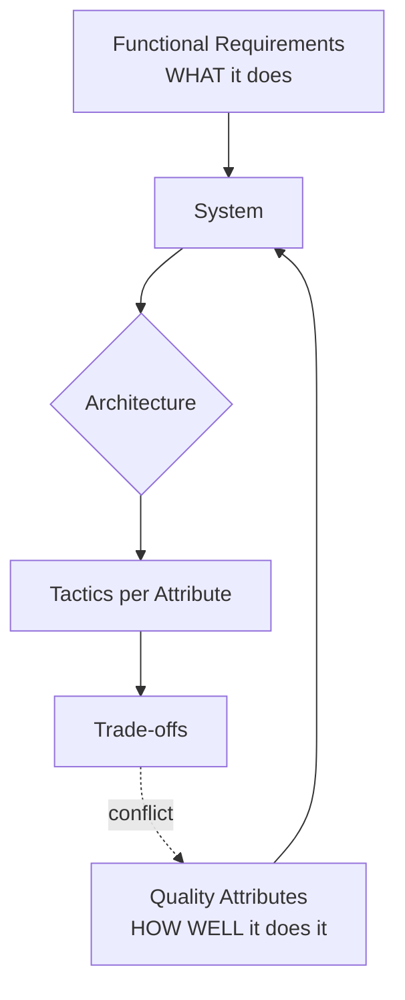

# 🧠 Topic: Software Quality Attributes (the "-ilities")

> [!abstract] Executive Summary (ELI5)
> Functional requirements say *what* a system does ("a user can place an order"). Quality attributes — the "-ilities" — say *how well* it does it: how fast, how available, how changeable, how secure. They are the non-functional requirements (NFRs), and they are usually what actually drives [[Software Architecture|architecture]]. A scooter and a freight truck both "move things" (same function); which you pick depends entirely on the -ilities — speed, capacity, fuel cost, reliability.

---

## 🎯 The "Why"
- **Problem Solved:** How do we talk precisely about the *behaviors* of a system that aren't features — so we can prioritize them, design for them, measure them, and trade them off against each other?
- **Alternatives:** Ignoring NFRs until production ("it works on my machine"). Treating "performance" or "scalability" as vague vibes instead of measurable targets. Optimizing for *all* of them at once (impossible — they conflict).
- **Trade-offs:** Quality attributes are **mutually antagonistic**. You cannot maximize availability *and* latency *and* cost-efficiency *and* consistency simultaneously. Senior engineering is the discipline of choosing which 2–3 to optimize for and which to sacrifice — explicitly.

> [!tip] Quality attributes *are* the architecture
> Two systems with identical features but different scale, latency, or availability targets may warrant completely different architectures. This is why [[Factors Influencing Architecture Selection]] treats NFRs as the **strongest driver** of architectural choice. Read this note as the deep-dive companion to that table.

---

## 💡 Mental Model & Analogy
- **Analogy:** "Quality attributes are like the spec sheet of a car." Top speed, fuel economy, safety rating, cargo volume, off-road capability, price. You can't have a vehicle that is the fastest, cheapest, safest, most spacious, and most fuel-efficient all at once — every spec is a tug-of-war with another. You pick a *profile* (sports car, minivan, truck) that optimizes the specs you care about. Architectures are the same: a profile of prioritized -ilities.
- **Visual/Diagram:**

---

## 🛠️ Core Principles

### Functional vs. Non-Functional
- **Functional requirements** — capabilities: "user can log in", "system sends an email". Verified by behavior tests.
- **Quality attributes (NFRs)** — properties of the system *as a whole*: how fast, how available, how secure. Verified by **measurable thresholds** (SLOs, percentiles, rates).

A quality attribute is only useful when it is **observable and measurable**. "The system should be fast" is not a quality attribute; "p99 read latency < 50 ms at 10k RPS" is. This is the single biggest jump from junior to senior thinking about -ilities.

### The Quality Attribute Taxonomy
There is no single canonical list (ISO/IEC 25010, Bass's *Software Architecture in Practice*, and ATAM each group them slightly differently). The practical, interview-grade set:

| Category | Attribute | One-line definition |
|----------|-----------|---------------------|
| **Runtime / observable** | **Scalability** | Ability to handle growing load by adding resources |
| | **Performance / Latency** | How fast the system responds under load |
| | **Availability** | Fraction of time the system is operational |
| | **Reliability** | Probability the system performs correctly over time |
| | **Resilience / Fault tolerance** | Ability to keep working when components fail |
| | **Elasticity** | How quickly the system scales up *and back down* with demand |
| | **Security** | Confidentiality, integrity, availability of data against threats |
| | **Durability** | Data is not lost (survives failures, corruption) |
| **Evolutionary** | **Maintainability** | Cost/ease of changing the system |
| | **Testability** | Ease of verifying correctness via tests |
| | **Deployability** | Ease/safety of releasing changes |
| | **Evolvability / Extensibility** | Ability to adapt to new requirements over years |
| | **Modifiability** | Cost of making a localized change |
| | **Observability** | Ability to understand internal state from external behavior |
| **Operational** | **Operability** | Ease of running it day-to-day (ops, rollback, on-call) |

> [!note] Don't memorize the list — internalize the conflicts
> The taxonomy matters less than the *tensions* between attributes. The sections below each name the attribute, its tactic, its metric, and — most importantly — what it fights with.

---

### 1. Scalability
**Ability to handle growth** — in users, requests, data volume — by adding resources, ideally without redesign.

- **Scale vertically (scale up):** Bigger machine (more CPU/RAM). Simple, has a hard ceiling, single point of failure.
- **Scale horizontally (scale out):** More machines. No ceiling, fault-tolerant, but introduces distribution problems (state, consistency, coordination). See [[Load Balancing Introduction]].
- **Two sub-dimensions:**
  - **Load scalability** — handles more requests?
  - **Data scalability** — handles more stored data? (sharding, partitioning)
- **Measure:** RPS sustained at target latency; max concurrent users; largest data set handled.
- **Classic tactics:** Stateless services behind a load balancer, horizontal DB sharding, read replicas, caching (see [[CDN]], caching layers), async queues (see [[Event-Driven Architecture]]).
- **Fights with:** **Consistency** (horizontal scale forces eventual consistency), **Cost** (more replicas = more money), **Latency** (coordination across nodes adds time).

> [!faq]- What's the difference between scalability and performance?
> **Performance** is how fast *one* request is served. **Scalability** is whether the system keeps that speed as load grows. A system can be fast for 10 users and collapse at 10,000 (good performance, poor scalability), or serve 10,000 users slowly but linearly (poor performance, good scalability). The scaling test: does adding resources increase throughput proportionally?

---

### 2. Availability
**Fraction of time the system is operational and serving.** Expressed in "nines".

| Nines | Availability | Allowed downtime / year |
|-------|--------------|--------------------------|
| 2 | 99% | ~3.65 days |
| 3 | 99.9% | ~8.76 hours |
| 4 | 99.99% | ~52.6 minutes |
| 5 | 99.999% | ~5.26 minutes |

- **Formula:** `Availability = MTBF / (MTBF + MTTD + MTTR)` — Mean Time Between Failures / (… + Time To Detect + Time To Repair).
- **Classic tactics:** Redundancy (no single point of failure), replication, failover, health checks, multi-AZ/multi-region deployment, graceful degradation, circuit breakers.
- **Measure:** Uptime %, SLO/SLI achievement, error budget burn rate.
- **Fights with:** **Cost** (each "nine" is roughly 10× more expensive), **Consistency** (replicas can lag), **Latency** (cross-region failover is slow).

> [!warning] The last nine costs the most
> Going from 99% to 99.9% is a load balancer and a replica. Going from 99.99% to 99.999% usually requires multi-region active-active, with all its consistency and cost pain. Most products don't need five nines — a payment *transaction* might, the marketing page does not.

---

### 3. Reliability
**Probability the system performs correctly** (delivers correct results) over a given time. Often confused with availability — but a system can be *up* and still *wrong*.

- **Availability:** "Is it reachable?" → `200 OK`
- **Reliability:** "Did it do the right thing?" → correct order total, correct balance, no data loss
- **Measure:** Error rate, successful transaction rate, data-loss incidents, MTBF.
- **Classic tactics:** Idempotency, retries with backoff, transactions, durable messaging (exactly-once or at-least-once + idempotent consumer), checksums, validation.
- **Fights with:** **Latency** (retries add time), **Availability** (refusing a dubious request improves reliability but reduces availability).

---

### 4. Maintainability
**How cheaply and safely the system can be changed** — the dominant cost over a system's lifetime (maintenance dwarfs initial build).

- **Sub-aspects:** Understandability (can a new engineer reason about it?), modifiability (does a change ripple?), modularity.
- **Measure:** Lead time for change, change failure rate, MTTR, cyclomatic complexity, code-review throughput.
- **Classic tactics:** Clear module boundaries, separation of concerns (see [[Layered Architecture]], Clean/Hexagonal Architecture), bounded contexts ([[Domain-Driven Design]]), automated testing, low coupling / high cohesion.
- **Fights with:** **Performance** (layers of abstraction add overhead), **Time-to-market** (doing it "right" slows the first release).

---

### 5. Testability
**Ease of verifying the system works correctly** through automated tests — and the *confidence* those tests give.

- **Two facets:** Ease of *writing* tests (can you instantiate a component in isolation?), and *speed/coverage* of the suite.
- **Measure:** Coverage, flake rate, test-suite runtime, blast radius of a single failing test.
- **Classic tactics:** Dependency injection, interface boundaries, hexagonal/clean architecture (test the core without DB/HTTP), contract tests between services, test pyramid (unit → integration → E2E).
- **Fights with:** **Performance** (mocking/DI adds indirection), **Feature speed** (writing tests slows delivery).

---

### 6. Deployability
**Ease and safety of releasing changes to production.**

- **Measure:** Deployment frequency, deployment lead time, change failure rate, rollback time. (These are the DORA metrics.)
- **Classic tactics:** CI/CD pipelines, small batch sizes, feature flags, blue/green and canary deployments, independent service deployment (a microservices benefit — see [[Microservices Architecture]]).
- **Fights with:** **Testability** at the system level (microservices are easy to deploy independently but hard to test end-to-end), **Operational complexity** (more moving parts).

---

### 7. Performance & Latency
**How fast the system responds** under a given load. Decomposed into:
- **Latency** — time for *one* operation (report as percentiles: p50, p95, p99 — *never* just average).
- **Throughput** — operations per unit time (RPS, TPS).

- **Measure:** p50/p95/p99 latency, throughput at target latency, tail behavior under load.
- **Classic tactics:** Caching, indexing, connection pooling, async/non-blocking I/O, in-process calls (monolith advantage), CDNs (see [[CDN]]), fewer network hops.
- **Fights with:** **Scalability** (coordinating across nodes costs time), **Maintainability** (micro-optimizations hurt readability), **Cost**, **Consistency** (strong consistency needs coordination = latency).

> [!warning] The network is a 1000x tax
> In-process call: ~nanoseconds. Network call: ~milliseconds. Tight latency budgets make every microservice hop hurt — see [[Factors Influencing Architecture Selection#Performance-and-Latency]].

---

### 8. Security
**Confidentiality, integrity, and availability (CIA) of data and services** against threats. Note: security *includes* availability — a DoS attack is a security breach that kills availability.

- **Measure:** Vulnerability count, MTTD/MTTR for incidents, % of services with mTLS, audit completeness.
- **Classic tactics:** Authentication/authorization, encryption (at rest, in transit), mTLS via service mesh, least privilege, input validation, defense in depth, clear trust boundaries (see [[Client Server Model]]).
- **Fights with:** **Latency** (encryption, extra hops), **Usability**, **Cost**, **Deployability** (security review gates slow releases).

---

### 9. Resilience / Fault Tolerance
**Ability to keep functioning when components fail.** Resilience is the *tactic*; availability is the *outcome*.

- **Classic tactics:** Redundancy, bulkheads (isolate failures so they don't cascade), circuit breakers, timeouts, retries with exponential backoff + jitter, rate limiting, graceful degradation, queue-based load leveling.
- **Measure:** Blast radius of failures, time to recover, how the system behaves under partial failure (chaos engineering).
- **Fights with:** **Latency** (retries, failover), **Cost** (redundancy), **Complexity** (more failure paths to reason about).

---

### 10. Elasticity
**How *quickly and automatically* the system scales up and back down** with demand. A refinement of scalability — elasticity emphasizes *responsiveness* and *cost* (releasing resources when not needed).

- **Classic tactics:** Autoscaling (HPA/K8s), serverless (scale-to-zero), queue-driven scaling.
- **Measure:** Time to scale up under burst; idle-resource waste.
- **Fights with:** **Predictability** (cold starts), **Latency** (scale-up lag).

---

### 11. Durability
**Data is not lost** — survives disk failures, corruption, region loss. Distinct from availability: data can be safe (durable) while temporarily unreachable (unavailable).

- **Measure:** Expected data-loss probability over time (e.g., S3's 11 nines).
- **Classic tactics:** Replication (3+ copies), erasure coding, backups, write-ahead logs, multi-region replication, checksums with self-healing.
- **Fights with:** **Latency** (acknowledging a write across replicas), **Cost**, **Consistency** (async replication risks brief windows of loss on catastrophic failure).

---

### 12. Observability
**Ability to understand the system's internal state from its external outputs.** Not just "we have logs" — can you *answer new questions* about a running system without shipping new code?

- **Three pillars:** **Logs** (discrete events), **Metrics** (aggregated numbers over time), **Traces** (request flow across services). Often adds **structured events**.
- **Measure:** MTTD (mean time to detect), quality of dashboards/alerts, % of incidents caught before users report.
- **Classic tactics:** Structured logging, centralized log aggregation, metrics (Prometheus), distributed tracing (OpenTelemetry), SLO-based alerting on user-facing symptoms, RED/USE method.
- **Fights with:** **Performance** (instrumentation overhead), **Cost** (storing telemetry is expensive), **Maintainability** (noisy logs become useless).

---

## 🧩 The Tension Map: How -ilities Conflict

The defining skill is recognizing that optimizing one attribute usually degrades another. The most common tensions:

| If you maximize… | You tend to sacrifice… |
|------------------|------------------------|
| **Latency** | Scalability (no coordination), Maintainability (micro-opts), Consistency |
| **Availability** | Cost (each nine ~10×), Consistency (async replication), Latency (failover) |
| **Consistency** | Latency (coordination), Availability (CP systems refuse on partition) |
| **Scalability** | Consistency, Operational simplicity |
| **Maintainability** | Performance (abstraction layers) |
| **Security** | Latency, Usability, Deployability |
| **Microservices (deployability/scalability)** | Testability (E2E), Maintainability (distributed complexity) |

> [!tip] The CAP theorem is the canonical example
> Under a network partition you must choose **Consistency** or **Availability** — you cannot have both. CAP is just one instance of the broader pattern: quality attributes are a design *budget*, not a wish list.

### How to Resolve Tensions
1. **Pick your top 2–3** must-have attributes per service (not the whole system). Optimize for those; accept degradation in the rest.
2. **Make the choice explicit** in an Architecture Decision Record (ADR) — see [[Factors Influencing Architecture Selection]]. Implicit trade-offs become accidental architecture.
3. **Differentiate by subsystem.** A payments ledger optimizes *consistency + durability*; a product-search service optimizes *latency + availability*. Different services, different attribute profiles — this is a major argument for microservices.
4. **Set SLOs.** "p99 < 200 ms, 99.9% available, < 0.1% data loss." Numbers force honest prioritization and tell you when you've over/under-engineered.

---

## 🏗️ The Role in System Design

### Attributes Drive Architecture
Quality attributes are the **primary input** to architecture selection — stronger than features, stronger than team preference. See [[Factors Influencing Architecture Selection#Quality-Attributes-Non-Functional-Requirements]] for the mapping table (scalability → microservices/EDA, latency → monolith, etc.).

### Attributes Are Measured, Not Asserted
Every quality attribute worth designing for is worth measuring. The progression: **vague goal** ("be scalable") → **metric** (RPS) → **threshold** (10k RPS at p99 < 100 ms) → **SLO** (enforced, with an error budget). Without measurement, "-ilities" are theater.

### Error Budgets: The Honest Trade-off Tool
An **error budget** is the gap between your SLO (e.g., 99.9%) and 100%. If you're burning it slowly, you have room to ship risky features fast. If you're burning it fast, you freeze launches and invest in reliability. It turns the availability/cost/velocity trade-off into a quantitative, shared decision.

### Per-Service Attribute Profiles
Mature systems don't apply one attribute profile everywhere. They classify services:
- **Tier-1 (critical path):** payment, auth — high availability, high consistency, high durability. Pay for it.
- **Tier-2 (user-facing):** catalog, search — high latency-sensitivity, medium availability.
- **Tier-3 (batch/background):** analytics, reporting — elastic, can tolerate downtime.

---

## ⚠️ Pitfalls & Anti-patterns
- **"Maximize all the -ilities."** They conflict. You will produce a compromised everything. Pick 2–3.
- **Unmeasured NFRs.** "It should be highly available" with no SLO is unenforceable and unverifiable.
- **Cargo-culting a tier.** Five-nines availability for an internal admin tool burns money for no user benefit.
- **Confusing availability with reliability.** A system returning wrong answers fast is "up" but unreliable.
- **Confusing scalability with performance.** See the FAQ above.
- **Optimizing locally, degrading globally.** Adding caching helps latency (local) but can break consistency or add stale-read bugs (global).
- **Ignoring operational attributes.** Maintainability, testability, deployability, observability are NFRs too — they dominate cost over a system's life. Skipping them at design time is technical-debt borrowing at loan-shark rates.
- **No error budget.** Without one, every release is a negotiation about "is this safe?" instead of a number.

---

## 🔗 Deep Connections
- **Parent Topic:** [[Software Architecture]]
- **Companion Note:** [[Factors Influencing Architecture Selection]] — maps these attributes to architectural styles; this note is the attribute-level deep dive that table references.
- **Where each attribute shows up in tactics:**
  - Scalability/Performance → [[Load Balancing Introduction]], [[CDN]], [[Caching]], [[API Gateways]]
  - Resilience/Availability → [[Microservices Architecture]], [[Event-Driven Architecture]]
  - Maintainability → [[Layered Architecture]], [[Monolithic Architecture]], Clean/Hexagonal Architecture, [[Domain-Driven Design]]
  - Communication foundations → [[Client Server Model]], [[Forward And Reverse Proxy]]
- **Prerequisites:** Basic familiarity with architectural styles and the request lifecycle (client → DNS → LB → server → DB).

---

## ❓ Active Recall Questions

> [!faq]- What is a quality attribute, and how does it differ from a functional requirement?
> A **functional requirement** says *what* the system does ("user can place an order"). A **quality attribute** (NFR) says *how well* it does it — how fast, how available, how secure, how changeable. Functional requirements are verified by behavior; quality attributes must be verified by **measurable thresholds** (SLOs, percentiles, rates). Two systems with identical features but different NFR targets can warrant entirely different architectures.

> [!faq]- Why can't you maximize all quality attributes at once?
> They are mutually antagonistic — optimizing one usually degrades another. Maximizing latency often sacrifices scalability and consistency; maximizing availability sacrifices cost (each "nine" is ~10× more expensive) and consistency; maximizing maintainability (abstraction) costs performance. Senior engineering is the discipline of picking 2–3 attributes to optimize and explicitly accepting degradation in the rest.

> [!faq]- What's the difference between scalability and performance? Between availability and reliability?
> **Performance** = how fast *one* request is served. **Scalability** = whether that speed holds as load grows (does adding resources increase throughput proportionally?). **Availability** = is the system reachable/up? **Reliability** = does it return *correct* results? A system can be up but wrong (available, unreliable), or fast for 10 users and dead at 10,000 (performant, non-scalable).

> [!faq]- How is availability measured, and what does each "nine" cost?
> `Availability = MTBF / (MTBF + MTTD + MTTR)`, expressed in "nines": 99% (~3.65 days downtime/yr), 99.9% (~8.76 hrs), 99.99% (~52 min), 99.999% (~5 min). Each additional nine is roughly **10× more expensive** — going from 4 to 5 nines typically demands multi-region active-active with all its consistency and cost pain. Most products don't need five nines; match the tier to the actual user impact.

> [!faq]- Name three tactics to improve each of: scalability, availability, resilience.
> **Scalability:** horizontal scaling behind a load balancer, read replicas/sharding for data, caching + async queues. **Availability:** redundancy (no SPOF), replication + automated failover, multi-AZ/multi-region deployment, graceful degradation. **Resilience:** circuit breakers, bulkheads, timeouts + retries with exponential backoff and jitter, rate limiting, queue-based load leveling.

> [!faq]- What are the three pillars of observability, and what distinguishes observability from "having logs"?
> **Logs** (discrete events), **metrics** (aggregated numbers over time), and **traces** (request flow across services). Having logs is not observability — observability is the ability to answer **new questions** about a running system's internal state from its external outputs, without shipping new code. Measured by MTTD and the quality of symptom-based alerting.

> [!faq]- How do you resolve conflicts between quality attributes in practice?
> Pick your top 2–3 must-have attributes *per service* and optimize for those. Make the choice **explicit** in an Architecture Decision Record (ADR). Differentiate by subsystem — e.g., a payments ledger optimizes consistency + durability, while a search service optimizes latency + availability; different attribute profiles are a major argument for microservices. Set **SLOs with error budgets** to turn the velocity/reliability trade-off into a quantitative, shared decision.

> [!faq]- Why is the CAP theorem just one instance of a broader pattern?
> CAP says under a network partition you must choose **Consistency** or **Availability** — you can't have both. That's a specific case of the general rule: quality attributes are a *budget*, not a wish list. Whenever two attributes conflict, the architecture must take a side; pretending you can have both produces accidental, inconsistent design. CAP is famous only because C-vs-A under partition is the sharpest, most formalized version of the tension.

> [!faq]- What is an error budget, and how does it improve decision-making?
> The gap between your SLO (e.g., 99.9% available) and 100%. If you're burning it slowly, you have room to ship fast and take risks. If you're burning it fast, you freeze feature launches and invest in reliability. It converts the vague "is this safe to ship?" debate into a number everyone agrees on, and balances availability against velocity objectively.

---

*Last updated: 2026-07-16*
