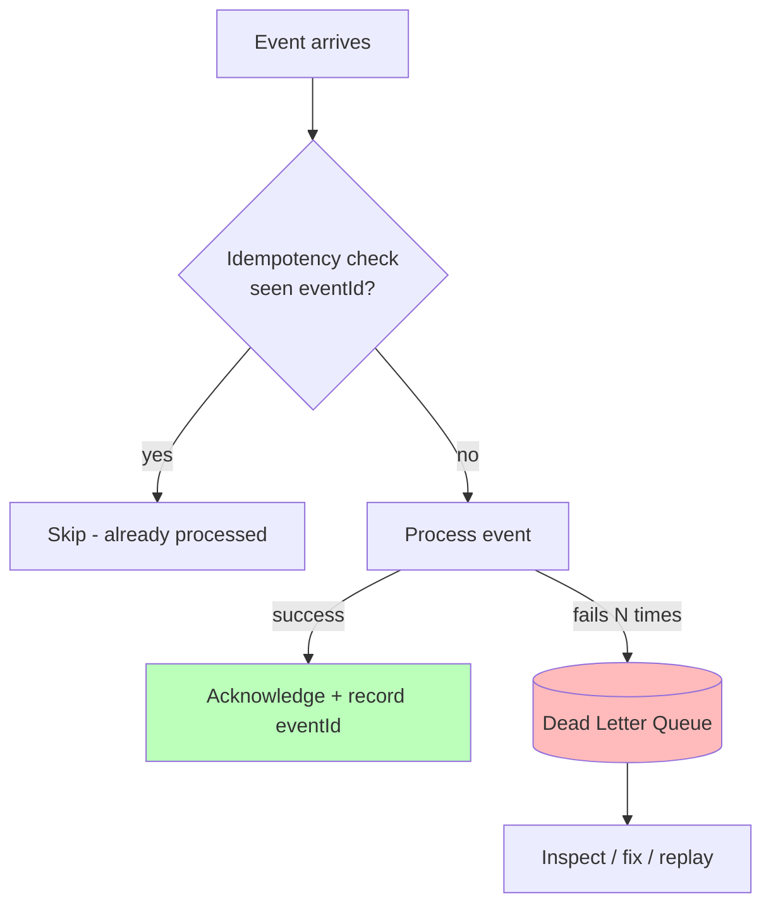
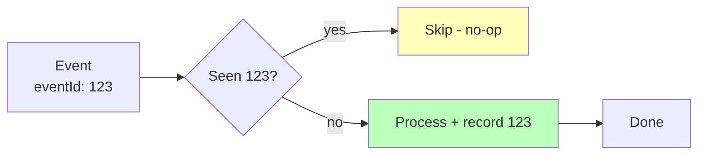
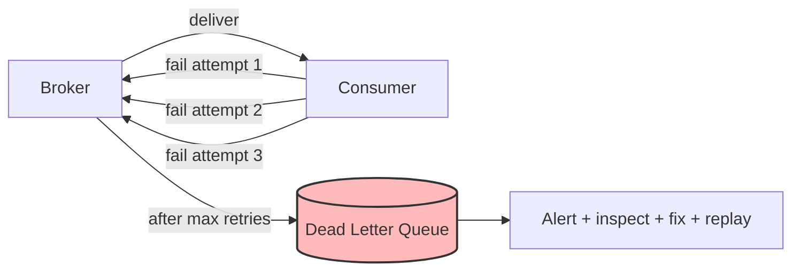
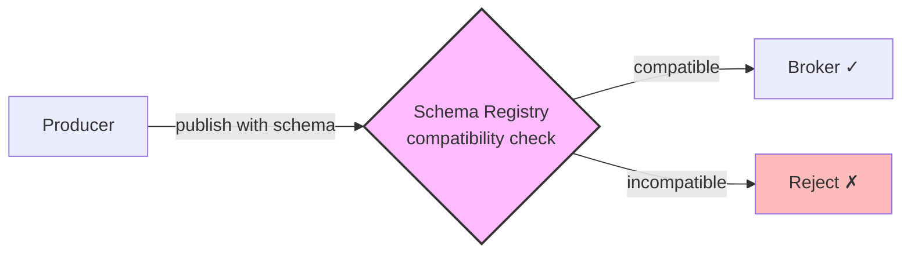

# 🧠 Topic: Event-Driven Architecture — Best Practices

> [!abstract] Executive Summary (ELI5)
> EDA best practices are like safety rules for a busy kitchen. **Idempotency** is "measure twice, cut once" — if you accidentally remake a dish, the result should be the same. **Dead-letter queues** are the "send-back bin" — inedible dishes go there for inspection, not back into the queue forever. **Choosing the right broker** is picking the right oven — a pizza oven vs. a microwave for different jobs. **Event versioning** is labeling your recipes with dates so a new cook doesn't use an outdated method.

---

## 🎯 The "Why"
- **Problem Solved:** How do you build EDA systems that are **reliable, debuggable, and evolvable** despite the challenges of eventual consistency, duplicates, ordering, and schema changes?
- **Alternatives:** Ignoring best practices and hoping for the best (silent data loss, double-charges, poison-message wedges, broken consumers on schema changes).
- **Trade-offs:** Best practices add some upfront discipline (idempotency keys, DLQ config, schema registries) but save enormous pain in production.

## 💡 Mental Model & Analogy
- **Analogy:** "EDA best practices are kitchen safety rules." Idempotency = "if you accidentally remake it, it's the same dish." DLQ = "the send-back bin for inedible orders." Right broker = "the right oven for the dish." Versioning = "date-stamped recipes so no one uses an outdated method."
- **Visual/Diagram:**

## 🛠️ Core Principles

Four best practices separate reliable EDA systems from fragile ones:

1. **Idempotent event processing**
2. **Dead-letter queues (DLQs)**
3. **Choosing the right event broker**
4. **Event versioning / schema evolution**

### 1. Idempotent Event Processing

The single most important practice in EDA. Because delivery is **at-least-once** (duplicates are inevitable — retries, crashes before ACK, network blips), consumers **must** be idempotent: processing an event multiple times has the same effect as processing it once.

**Why duplicates happen:**
- Consumer crashes after processing but before ACKing → broker redelivers.
- Network duplicates the publish.
- Retry logic resends.

**Techniques for idempotency:**

| Technique | How It Works | Best For |
|-----------|--------------|----------|
| **Deduplicate by `eventId`** | Track processed IDs in Redis/DB; skip if already seen | Most consumers — the general-purpose solution |
| **Natural idempotency** | Design operations that are inherently safe to repeat | State-setting operations |
| **Versioned state** | Use event's sequence number; only apply if it advances state | Ordered, versioned entity state |

**Examples:**
- **Idempotent:** `SET user_status = 'active'` (same result no matter how many times).
- **Not idempotent:** `balance += 10` (running it twice adds 20). Fix: `SET balance = 100` or dedup by `eventId`.
- **Idempotent charge:** use the `eventId` as the idempotency key to the payment provider, so a duplicate charge is rejected.

> [!tip] At-least-once + idempotency = effectively exactly-once
> True exactly-once delivery is rare and expensive. The practical pattern: **at-least-once delivery + idempotent consumers**. Dedup on `eventId`, and the *effect* is exactly-once processing. Always design consumers to be idempotent regardless of the broker's delivery claims.

### 2. Implement Dead-Letter Queues (DLQs)

A **dead-letter queue (DLQ)** is a separate queue where messages that **fail to process repeatedly** are sent, so they don't block the main pipeline forever.

**The problem it solves — the poison message:**
- A malformed event always crashes its consumer.
- Consumer receives → throws exception → doesn't ACK → broker redelivers → same exception → infinite loop.
- Other events pile up behind the poison message; the pipeline stalls.

**How a DLQ works:**

1. Consumer attempts to process; on failure, the event is retried (with backoff).
2. After **N failed attempts** (the max-retry threshold), the event is routed to the DLQ instead of being redelivered.
3. The main pipeline keeps flowing — other events aren't blocked.
4. The DLQ is monitored; problematic events are inspected, fixed (code fix, data correction), and optionally replayed.

**DLQ best practices:**
- **Always configure a DLQ** — never let retries loop infinitely.
- **Set a max-retry threshold** with **exponential backoff** (don't hammer a failing downstream).
- **Monitor the DLQ** and alert when it grows — events there need attention.
- **Make DLQ events inspectable** — preserve the original event, the error, and the attempt count.
- **Have a replay strategy** — after fixing the bug, replay DLQ events back into the main queue.

> [!warning] No DLQ = pipeline wedge
> Without a DLQ, a single poison message can block a consumer indefinitely — other events pile up and the whole pipeline stalls. Always configure a DLQ with a max-retry threshold and backoff.

### 3. Choose the Right Event Broker

Different brokers are optimized for different jobs. Choosing wrong leads to over-engineering (Kafka for a simple notification) or under-engineering (SNS when you need replay).

**Selection criteria:**

| Your Need | Broker Category | Examples |
|-----------|-----------------|----------|
| **Simple fan-out notification** | Pub/sub (ephemeral) | AWS SNS, Google Pub/Sub, NATS |
| **Work distribution (one consumer per message)** | Message queue | RabbitMQ, AWS SQS |
| **Durable log, replay, audit, streaming** | Event streaming | Kafka, Pulsar, Kinesis |
| **Complex routing (pattern-based)** | Topic exchanges | RabbitMQ (rich routing), AWS EventBridge |
| **Managed, cloud-native, low ops** | Cloud managed | SNS/SQS, EventBridge, Kinesis |
| **Self-hosted, full control** | Open source | Kafka, RabbitMQ, NATS |

**Decision questions:**
1. **Do consumers need replay?** Yes → Kafka/streaming. No → pub/sub or queue.
2. **Fan-out or work distribution?** Fan-out → pub/sub. Work distribution → queue.
3. **What throughput?** Very high → Kafka. Moderate → RabbitMQ/SNS.
4. **Managed or self-hosted?** Managed → SNS/SQS/EventBridge. Self-hosted → Kafka/RabbitMQ.
5. **Complex routing rules?** Yes → RabbitMQ/EventBridge. No → simpler tools.

**The "Kafka for everything" anti-pattern:**
Kafka is powerful but operationally heavy (clusters, partitions, offsets, retention, monitoring). For a simple "send a welcome email" notification, SQS or SNS is simpler and cheaper. Match the tool to the actual need — see [[Pub Sub and Event Streaming]].

> [!tip] Start simple, upgrade when needed
> Don't reach for Kafka because "it's what Netflix uses." Start with SQS/SNS or RabbitMQ for most workloads. Move to Kafka only when you genuinely need durable replay, high-throughput streaming, or event sourcing.

### 4. Event Versioning / Schema Evolution

Events are consumed by many services over years. The producer often doesn't know who consumes (that's the point of decoupling). Changing an event's structure can break consumers you've forgotten about.

**The problem:**
- You rename `customerId` to `customerRef` in `OrderPlaced`.
- Three consumers crash because they read `customerId`.
- You didn't even know those consumers existed.

**Best practices for schema evolution:**

| Practice | What It Means |
|----------|---------------|
| **Backward-compatible changes** | Add fields freely (consumers ignore unknown fields). Never remove or rename without a deprecation cycle. |
| **Schema registry** | Centrally manage schemas (Avro, Protobuf, JSON Schema); reject incompatible changes at publish time. |
| **Versioning in the event** | Include a `schemaVersion` field; consumers handle multiple versions. |
| **Optional fields with defaults** | New fields should be optional with sensible defaults so old consumers keep working. |
| **Deprecation, not removal** | Mark old fields deprecated, keep them populated, remove only after all consumers have migrated. |

**Compatibility types:**
- **Backward compatible:** new schema can read old data (add optional field). Safe.
- **Forward compatible:** old schema can read new data (consumer ignores unknown field). Safe.
- **Full compatibility:** both. The goal for long-lived events.
- **Breaking change:** neither (rename, remove, change type). Requires versioning + migration.

> [!tip] Use a schema registry from day one
> Retrofitting schema management into a mature EDA is painful. Adopt a schema registry (Confluent, AWS Glue, Apicurio) early — it rejects incompatible changes before they reach consumers, and it documents what events exist.

## 🏗️ The Role in System Design

### Best Practices Are Non-Negotiable in Production
These aren't "nice to haves." In production EDA:
- **Without idempotency:** silent double-charges and duplicate emails.
- **Without DLQs:** a single poison message wedges the pipeline.
- **With the wrong broker:** over-engineering or missing critical features (replay).
- **Without versioning:** a schema change silently breaks unknown consumers.

### Best Practices Map to Challenges
Each best practice directly mitigates a challenge from [[Event Driven Challenges]]:

| Challenge | Best Practice |
|-----------|---------------|
| Idempotency & duplicates | Dedup by `eventId`, naturally idempotent operations |
| Error handling (poison messages) | Dead-letter queue with max-retries + backoff |
| Choosing the infrastructure | Match broker to need (pub/sub vs queue vs streaming) |
| Schema evolution | Schema registry, backward compatibility, versioning |

### The Maturity Ladder
Teams typically adopt these practices in order of pain:
1. **DLQ** (after the first poison-message wedge).
2. **Idempotency** (after the first double-charge incident).
3. **Broker selection** (after outgrowing the first tool).
4. **Schema registry** (after the first broken-consumer incident).

Adopt all four proactively — don't wait for the incident.

## ⚠️ Pitfalls & Anti-patterns
- **Non-idempotent consumers:** the #1 cause of silent data bugs. Always dedup or design idempotency.
- **No DLQ:** poison messages wedge the pipeline. Always configure one.
- **Infinite retries without backoff:** hammering a failing downstream. Use exponential backoff + max-retries + DLQ.
- **Kafka for everything:** over-engineering simple use cases. Match the broker to the need.
- **Breaking schema changes without versioning:** breaks unknown consumers. Use a schema registry and backward-compatible evolution.
- **Removing fields abruptly:** breaks consumers still reading them. Deprecate first, remove after migration.
- **No DLQ monitoring:** events pile up in the DLQ unnoticed. Alert on DLQ depth.
- **Trusting "exactly-once" broker claims blindly:** design for at-least-once + idempotency regardless.

## 🔗 Deep Connections
- **Parent Topic:** [[Event Driven Overview]]
- **Previous:** [[Event Driven Challenges]] — each best practice mitigates a challenge.
- **Next:** [[Event Driven Use Cases]] — when to apply EDA (and these practices) at all.
- **Related Concepts:** [[Pub Sub and Event Streaming]] (broker selection), [[Microservices Challenges]] (Outbox, sagas), schema registry, OpenTelemetry
- **Prerequisites:** [[Event Driven Overview]], [[Event Driven Key Components]], [[Event Driven Challenges]].

## ❓ Active Recall Questions
> [!faq]- What is idempotent event processing, and why is it the #1 EDA practice?
> A consumer is idempotent if **processing an event multiple times has the same effect as once**. It's #1 because at-least-once delivery means duplicates are inevitable (retries, crashes before ACK, network blips). A non-idempotent consumer will double-charge, double-send, or double-count. Dedup by `eventId`, design naturally idempotent operations, or track per-entity versions. At-least-once + idempotency = effectively exactly-once.
<!-- #flashcards/system-design -->

> [!faq]- Name three techniques for achieving idempotency in consumers.
> 1. **Deduplicate by `eventId`** — track processed IDs in Redis/DB; skip if already seen (general-purpose). 2. **Natural idempotency** — design inherently safe operations (`SET x = 5` is idempotent; `x += 1` is not). 3. **Versioned state** — use the event's sequence number; only apply if it advances the entity's state. Choose based on the operation.
<!-- #flashcards/system-design -->

> [!faq]- What is a dead-letter queue (DLQ), and why is it essential?
> A separate queue where messages that **fail to process repeatedly** are sent after max retries, so they don't block the main pipeline forever (the poison-message problem). Essential because without it, a single malformed event wedges the consumer indefinitely — other events pile up and the pipeline stalls. Always configure a DLQ with max-retries, backoff, and monitoring.
<!-- #flashcards/system-design -->

> [!faq]- How do you choose the right event broker?
> Match the broker to your need: **simple fan-out notification** → pub/sub (SNS, Google Pub/Sub); **work distribution (one consumer per message)** → queue (RabbitMQ, SQS); **durable log, replay, audit, streaming** → Kafka/Pulsar; **complex routing** → RabbitMQ/EventBridge; **managed/low-ops** → cloud-native (SNS/SQS, EventBridge). Don't reach for Kafka for a simple notification — match the tool to the actual need.
<!-- #flashcards/system-design -->

> [!faq]- What is the "Kafka for everything" anti-pattern?
> Using Kafka (operationally heavy: clusters, partitions, offsets, retention) for workloads that don't need durable replay or high-throughput streaming — like a simple "send welcome email" notification. SQS/SNS or RabbitMQ would be simpler and cheaper. Start simple; move to Kafka only when you genuinely need replay, streaming, or event sourcing.
<!-- #flashcards/system-design -->

> [!faq]- Why is event versioning/schema evolution important, and how do you handle it?
> Events are consumed by many services over years, and producers don't know who consumes. Changing a field name or type breaks unknown consumers. Handle it with: **backward-compatible changes** (add fields freely, never remove/rename without deprecation), a **schema registry** (reject incompatible changes at publish time), **versioning in the event** (`schemaVersion`), and **deprecation over removal**. Adopt a schema registry from day one.
<!-- #flashcards/system-design -->

> [!faq]- What's the difference between backward and forward schema compatibility?
> **Backward compatible:** new schema can read old data (e.g., added an optional field) — old consumers reading new events. **Forward compatible:** old schema can read new data (consumer ignores unknown fields) — new consumers reading old events. **Full compatibility** (both) is the goal for long-lived events. Breaking changes (rename, remove, change type) require explicit versioning + migration.
<!-- #flashcards/system-design -->

> [!faq]- What are the four key EDA best practices, and what challenge does each address?
> 1. **Idempotent processing** → duplicates (at-least-once delivery). 2. **Dead-letter queues** → poison messages blocking pipelines. 3. **Right broker selection** → matching infrastructure to need (avoid over/under-engineering). 4. **Event versioning/schema evolution** → changing events without breaking unknown consumers. Adopt all four proactively — don't wait for incidents.
<!-- #flashcards/system-design -->

---

*Last updated: 2026-07-11*
