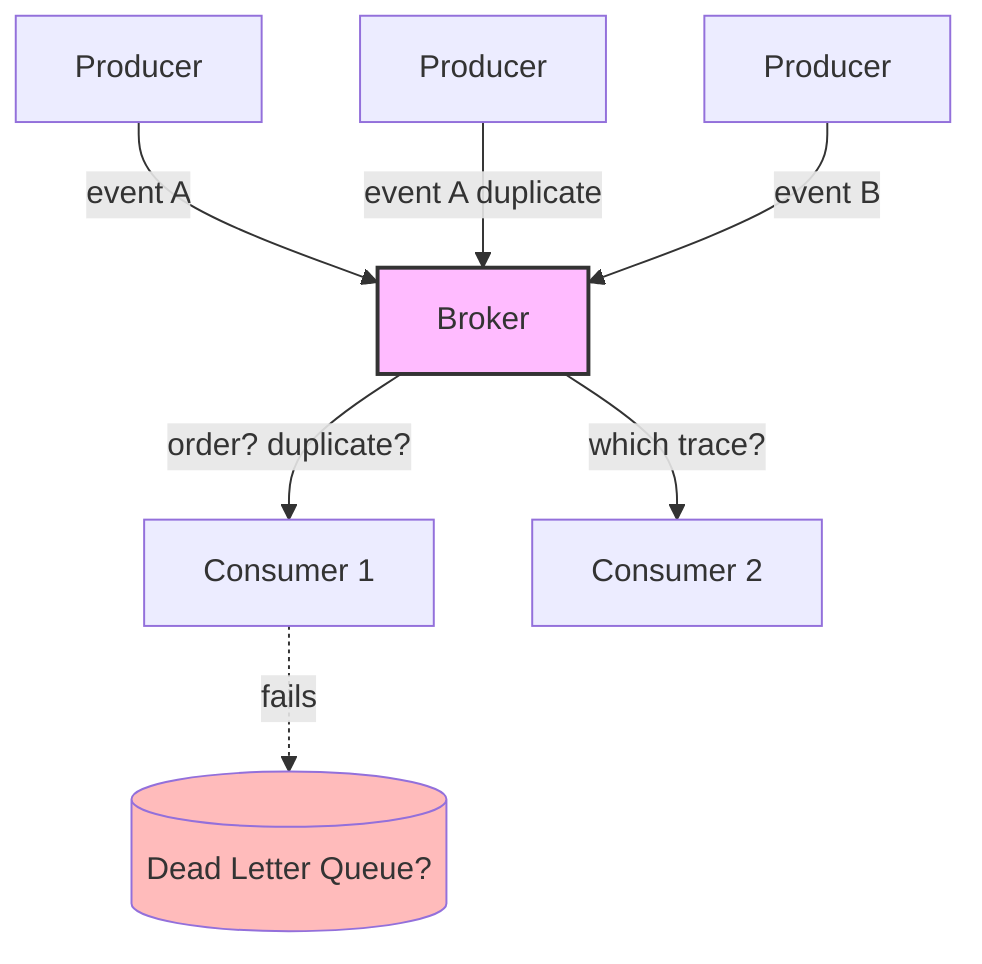
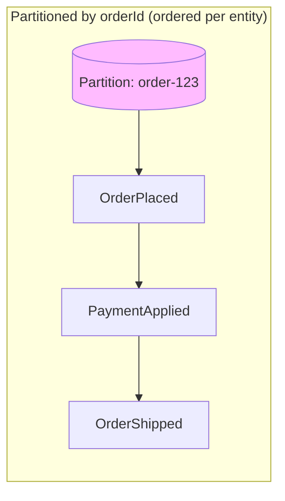
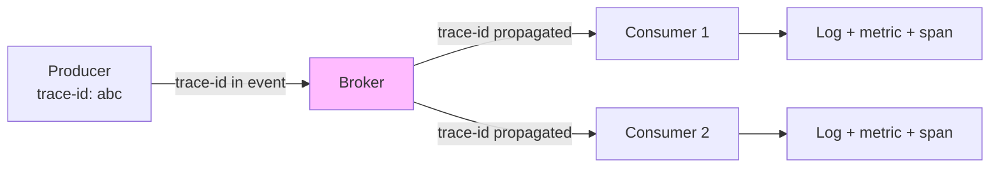

# 🧠 Topic: Challenges of Event-Driven Architecture

> [!abstract] Executive Summary (ELI5)
> EDA challenges are like running a news agency with many freelance reporters and editors who never meet. Stories (events) flow in constantly, but: you can't always tell which story came first (ordering), the same story sometimes arrives twice (duplicates), you can't easily trace a story from reporter to published article (debugging), and if an editor rejects a story it just disappears unless you have a "rejected stories" pile (dead-letter queue). The flexibility of freelancing comes with coordination headaches.

---

## 🎯 The "Why"
- **Problem Solved:** What are the costs you **must** pay when you adopt EDA, and how do you mitigate them?
- **Alternatives:** Synchronous systems avoid eventual consistency and implicit flow (but create temporal coupling and cascading failures). A monolith avoids all of it (but can't scale or decouple).
- **Trade-offs:** These challenges are the "tax" of async decoupling. You accept them because the benefits (loose coupling, resilience, scalability) outweigh the costs *for the right use cases*.

## 💡 Mental Model & Analogy
- **Analogy:** "EDA challenges are the friction of a newsroom with freelancers." Reporters file stories asynchronously; editors pick them up whenever. But who filed first? Did this story come in twice? Which reporter's story became the front-page article? And where did the rejected story go? Flexibility creates coordination overhead.
- **Visual/Diagram:**

## 🛠️ Core Principles

Six core challenges define the EDA "tax":

1. **Eventual consistency** — the system settles over time, not immediately
2. **Ordering** — events may arrive out of order
3. **Idempotency & duplicates** — at-least-once delivery means duplicates
4. **Debugging & observability** — control flow is implicit and scattered
5. **Schema evolution** — events are consumed by many services over years
6. **Error handling** — poison messages, failures, retries

### 1. Eventual Consistency

The defining trade-off. In EDA, when a producer emits an event, the system is **not immediately consistent** — consumers haven't reacted yet. The system settles into consistency over time.

**The problem:**
- A user places an order; the Orders service emits `OrderPlaced` and returns "success" to the user.
- But inventory hasn't been decremented yet, the payment hasn't been captured, and the confirmation email hasn't been sent — those are async consumers that haven't run.
- If the user immediately queries "is my order confirmed?", they might see stale state.

**Why it happens:** decoupling means producers and consumers operate independently. You trade immediate consistency for resilience and decoupling.

**Mitigations:**
- **Manage user expectations:** tell the user "we're processing your order" rather than "it's done." Send a follow-up notification when processing completes.
- **Read models / projections:** maintain a queryable view that's updated as events are processed, so reads reflect the latest processed state (CQRS).
- **Saga pattern** for multi-step workflows that must reach a consistent state, with compensations on failure. See [[Microservices Challenges]].
- **Accept it** when eventual consistency is acceptable for the domain (most side-effects — emails, analytics, search indexing — don't need to be synchronous).

> [!tip] Don't fight eventual consistency — design for it
> The mindset shift: stop trying to make EDA immediately consistent. Instead, design each consumer to be eventually consistent, use sagas for multi-step workflows that must settle, and manage user expectations about when "done" really means done.

### 2. Ordering

If `OrderShipped` is processed before `OrderPlaced`, you have a problem. Ordering is notoriously hard in distributed event systems.

**The problem:**
- Events from different producers, partitions, or network paths may arrive out of order.
- Even within one broker, global ordering across all events is expensive (single-partition throughput limit) and usually not guaranteed.
- Consumers processing events in parallel can finish later events before earlier ones.

**Mitigations:**
- **Partition by entity ID:** route all events for one entity (e.g., `orderId`) to the same partition, guaranteeing per-entity order. This is Kafka's model — order within a partition, not across.
- **Sequence numbers / versions:** include a monotonic version in each event; consumers track the last-seen version per entity and discard stale events.
- **Accept out-of-order when safe:** some events are commutative (`ItemAdded`, `ItemRemoved` — order doesn't matter for the final cart state). Don't over-engineer ordering when it's not needed.
- **Single-partition for strict global order:** only if you truly need it, and accept the throughput limit.

> [!warning] Ordering is per-partition, not global
> Most brokers guarantee order only **within a partition**. Partition by entity ID to keep one entity's events in order. Across entities, order is not guaranteed — and consumers must track per-entity versions to discard stale events.

### 3. Idempotency & Duplicates

At-least-once delivery (the most common semantic) means **events will be duplicated** — retries, network blips, consumer crashes before ACKing. A non-idempotent consumer will double-charge, double-send, or double-count.

**The problem:**
- The broker redelivers an event because the consumer crashed before ACKing.
- The network duplicates the publish.
- A retry logic resends.

**Mitigations:** (covered in depth in [[Event Driven Best Practices]])
- **Deduplicate by `eventId`:** track processed IDs in a store (Redis, DB); skip if already seen.
- **Natural idempotency:** design operations that are inherently safe to repeat (`SET balance = 100` is idempotent; `balance += 10` is not).
- **Versioned state:** use the event's version/sequence and only apply if it advances state.

> [!tip] At-least-once + idempotency = effectively exactly-once
> True exactly-once delivery is rare and expensive. The practical pattern: **at-least-once delivery + idempotent consumers**. Dedup on `eventId`, and the *effect* is exactly-once processing.

### 4. Debugging & Observability

In a sync system, a stack trace shows you the call chain. In EDA, "what happens when `OrderPlaced` fires?" has no single answer — it's spread across many consumers, each reacting asynchronously. Without observability, debugging is a multi-hour forensic exercise.

**The problem:**
- A user reports "my order didn't trigger an email." Where do you look?
- The event was published. Did the email consumer receive it? Process it? Fail silently?
- Control flow is **implicit** — there's no single code path to trace.

**Mitigations:**
- **Distributed tracing:** propagate a **correlation/trace ID** from the producer through the broker to every consumer. Tools: OpenTelemetry, Jaeger, Zipkin.
- **Structured logging:** every log includes the trace ID, event ID, and consumer name.
- **Metrics:** track event lag (how far behind consumers are), error rates, processing times.
- **Eventual-consistency-aware debugging:** "the system is still processing" is a valid state — query the consumer's processed-offset, not just the producer's "I published it."

> [!warning] No tracing = blind
> In EDA, without distributed tracing and correlation IDs, debugging is guesswork. You can't tell which consumer processed (or failed) an event. Tracing is mandatory, not optional — design for it from day one.

### 5. Schema Evolution

Events are consumed by many services over years. Changing an event's structure (adding, removing, renaming fields) can break consumers you don't even know exist.

**The problem:**
- You rename `customerId` to `customerRef` in `OrderPlaced`.
- Three consumers you forgot about crash because they read `customerId`.
- The producer has no idea who consumes its events (that's the whole point of decoupling).

**Mitigations:** (covered in [[Event Driven Best Practices]])
- **Backward-compatible evolution:** add fields freely; never remove or rename without a deprecation cycle.
- **Schema registry:** centrally manage schemas (Avro, Protobuf); reject incompatible changes at publish time.
- **Versioning:** include a schema version in the event; consumers handle multiple versions.

### 6. Error Handling (Poison Messages)

A **poison message** is an event that always crashes its consumer (malformed data, null reference, impossible state). Without protection, it will be retried forever, blocking the queue.

**The problem:**
- Consumer receives event → throws exception → doesn't ACK → broker redelivers → same exception → infinite loop.
- Other events pile up behind the poison message.

**Mitigation:** the **dead-letter queue (DLQ)** — after N failed attempts, send the event to a separate DLQ for inspection, so the main pipeline keeps flowing. Covered in [[Event Driven Best Practices]].

## 🏗️ The Role in System Design

### These Challenges Are the "EDA Tax"
Every challenge here is a cost of async decoupling. You pay it because the benefits (loose coupling, resilience, scalability, extensibility) outweigh it *for the right use cases* (see [[Event Driven Use Cases]]). If your domain needs strong immediate consistency or simple linear flows, EDA adds friction without payoff.

### Challenges Inform Best Practices
Each challenge maps to a best practice in [[Event Driven Best Practices]]:

| Challenge | Best Practice |
|-----------|---------------|
| Eventual consistency | Sagas, CQRS read models, manage user expectations |
| Ordering | Partition by entity ID, sequence numbers |
| Idempotency & duplicates | Dedup by `eventId`, naturally idempotent operations |
| Debugging | Distributed tracing, correlation IDs, structured logging |
| Schema evolution | Schema registry, backward-compatible evolution, versioning |
| Error handling | Dead-letter queues, retry policies |

### The Discipline
The unifying discipline: **assume events will be duplicated, out of order, and processed by consumers you can't see.** Engineer for these realities from day one.

## ⚠️ Pitfalls & Anti-patterns
- **Assuming immediate consistency:** telling a user "done" when side-effects haven't happened. Manage expectations.
- **Ignoring ordering:** `OrderShipped` processed before `OrderPlaced`. Partition by entity ID; track versions.
- **Non-idempotent consumers:** duplicates cause double-charges/emails. Dedup or design idempotency.
- **No distributed tracing:** blind debugging. Mandatory.
- **Breaking schema changes without versioning:** breaks consumers you don't know about. Use a schema registry.
- **No DLQ:** a poison message wedges the consumer forever. Always configure a DLQ.
- **"Fire and forget":** assuming events are delivered and processed. They're not — until you've confirmed via tracing, ACKs, and monitoring.

## 🔗 Deep Connections
- **Parent Topic:** [[Event Driven Overview]]
- **Previous:** [[Event Driven Key Components]] — the components introduce these challenges.
- **Next:** [[Event Driven Best Practices]] — how to mitigate each challenge.
- **Related Concepts:** [[Microservices Challenges]] (data consistency, tracing, network overhead overlap), sagas, CQRS, OpenTelemetry, schema registry
- **Prerequisites:** [[Event Driven Overview]], [[Sync vs Async Systems]], basic distributed-systems knowledge.

## ❓ Active Recall Questions
> [!faq]- What is eventual consistency in EDA, and how do you manage it?
> When a producer emits an event, the system is **not immediately consistent** — consumers haven't reacted yet. The system settles over time. Manage it by: setting user expectations ("we're processing"), using **read models/projections** (CQRS) for queryable state, applying the **Saga pattern** for multi-step workflows that must settle, and accepting it for side-effects (emails, analytics) that don't need to be sync.
<!-- #flashcards/system-design -->

> [!faq]- Why is ordering hard in EDA, and how do you preserve it?
> Events from different producers, partitions, or network paths can arrive out of order, and global ordering is expensive (single-partition limit). Preserve order by **partitioning by entity ID** (e.g., `orderId`) so all events for one entity land in one partition in order; include **sequence numbers/versions** so consumers discard stale events; and accept out-of-order when events are commutative. Ordering is per-partition, not global.
<!-- #flashcards/system-design -->

> [!faq]- Why must consumers be idempotent in EDA?
> At-least-once delivery means **duplicates are inevitable** — retries, network blips, consumer crashes before ACKing. A non-idempotent consumer will double-charge, double-send, or double-count. Deduplicate by `eventId`, design naturally idempotent operations (`SET x = 5` is safe; `x += 1` is not), or track per-entity versions. At-least-once + idempotency = effectively exactly-once processing.
<!-- #flashcards/system-design -->

> [!faq]- Why is debugging harder in EDA than in synchronous systems?
> In a sync system, a stack trace shows the call chain. In EDA, "what happens when X fires?" is spread across many consumers reacting asynchronously — control flow is **implicit**. Without distributed tracing and correlation IDs propagated from producer through broker to every consumer, you can't tell which consumer processed or failed an event. Tracing is mandatory.
<!-- #flashcards/system-design -->

> [!faq]- What is a poison message, and why is it dangerous?
> An event that **always crashes its consumer** (malformed data, null reference). Without protection, the broker redelivers it forever (consumer never ACKs), blocking the queue while other events pile up. Mitigate with a **dead-letter queue (DLQ)**: after N failed attempts, route the event to the DLQ for inspection so the main pipeline keeps flowing.
<!-- #flashcards/system-design -->

> [!faq]- Why is schema evolution a challenge in EDA?
> Events are consumed by many services over years, and the producer doesn't know who consumes (that's the point of decoupling). Changing an event's structure (renaming `customerId` → `customerRef`) breaks consumers you've forgotten about. Mitigate with **backward-compatible evolution** (add fields freely, never remove/rename without deprecation), a **schema registry** (reject incompatible changes at publish time), and **schema versioning** in the event.
<!-- #flashcards/system-design -->

> [!faq]- What are the six core challenges of EDA, and what's the unifying mindset?
> **Eventual consistency**, **ordering**, **idempotency & duplicates**, **debugging & observability**, **schema evolution**, and **error handling (poison messages)**. The unifying mindset: **assume events will be duplicated, out of order, and processed by consumers you can't see** — and engineer for these realities from day one with idempotency, DLQs, tracing, partitioning, and schema registries.
<!-- #flashcards/system-design -->

---

*Last updated: 2026-07-11*
