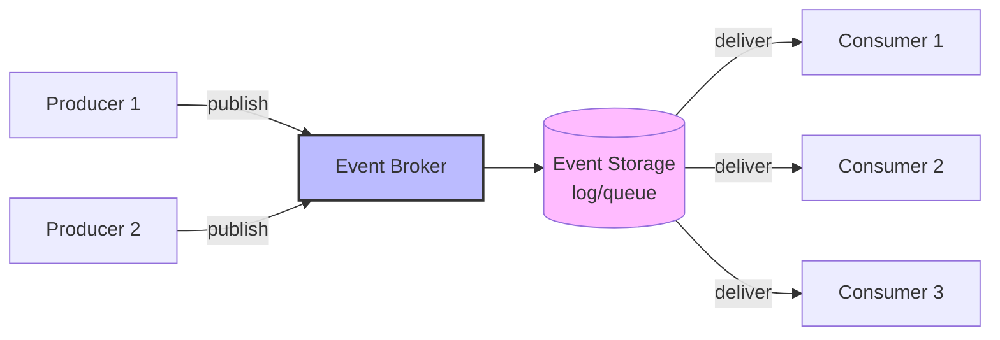
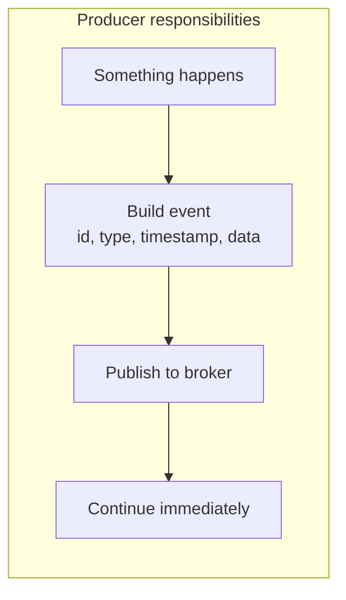
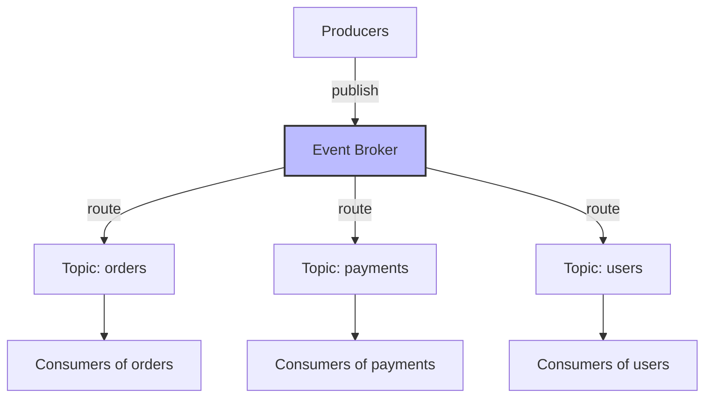
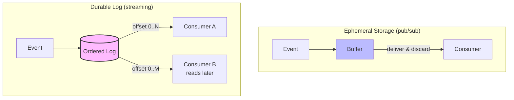
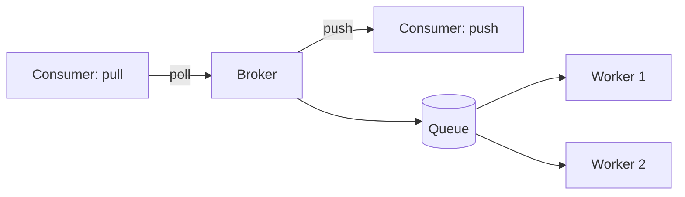
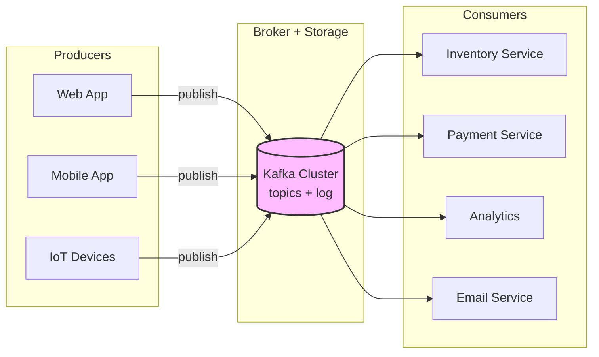

# 🧠 Topic: Key Components of Event-Driven Architecture

> [!abstract] Executive Summary (ELI5)
> An event-driven system is like a postal system. **Producers** are people dropping letters in mailboxes. The **event broker** is the sorting office — it receives, routes, and holds mail. **Event storage** is the post office's warehouse where letters wait until delivered (in streaming, this can be a long-term archive). **Consumers** are the mail carriers who pick up letters and act on them. Each part has a clear job, and they're decoupled — the sender doesn't know who delivers or receives.

---

## 🎯 The "Why"
- **Problem Solved:** What are the building blocks of an EDA, and what role does each play in producing, routing, storing, and consuming events?
- **Alternatives:** A monolith's in-process function calls need none of these — but also can't decouple, buffer, or scale independently.
- **Trade-offs:** More components = more moving parts to operate, but each is independently scalable and replaceable.

## 💡 Mental Model & Analogy
- **Analogy:** "EDA is a postal system." Producers = people sending letters. Broker = sorting office that routes and forwards. Storage = the warehouse where undelivered letters wait. Consumers = mail carriers who deliver and act. The sender drops a letter and moves on; the carrier delivers whenever they reach the address.
- **Visual/Diagram:**

## 🛠️ Core Principles

An event-driven architecture has **four key components**:

| Component | Role | Analogy |
|-----------|------|---------|
| **Event Producer** | Generates and publishes events | The letter sender |
| **Event Broker** | Routes, filters, and distributes events | The sorting office |
| **Event Storage** | Persists events (durably, ordered) | The warehouse |
| **Event Consumer** | Subscribes to and processes events | The mail carrier |

### 1. Event Producers

A **producer** is any component that **generates and publishes events** to the broker when something meaningful happens. It does not know — and does not care — who will consume the event.

**Responsibilities:**
- Detect that something happened (a state change, a user action, a sensor reading).
- Construct the event (with `eventId`, `type`, `timestamp`, `source`, `data`).
- Publish it to the broker's topic/queue.
- **Move on immediately** — do not wait for consumers.

**Examples of producers:**
- A web app emitting `UserRegistered` when someone signs up.
- A payment service emitting `PaymentCaptured` after a successful charge.
- An IoT device emitting `TemperatureReading` every minute.
- A database emitting row-change events via Change Data Capture (CDC).
- The API gateway emitting `RequestReceived`.

**Key principle:** producers are **decoupled** from consumers. A producer's success does not depend on any consumer being up or fast.

> [!tip] Producers should be "dumb" about consumers
> The producer's only job is to faithfully record what happened and publish it. It should not encode knowledge of who will consume or how they'll react. That knowledge lives in the consumers and the broker's routing rules.

### 2. Event Brokers

The **broker** is the **central middleware** that receives events from producers and routes them to the right consumers. It is the heart of the EDA — the component that decouples producers from consumers.

**Responsibilities:**
- **Accept** events from producers.
- **Route** events to the right consumers (by topic, type, filter, or subscription).
- **Buffer** events when consumers are slow or down (resilience).
- **Optionally store** events durably (see Event Storage below).
- Enforce **delivery semantics** (at-least-once, at-most-once, exactly-once-ish).

**Categories of brokers:**
| Category | Description | Examples |
|----------|-------------|----------|
| **Message brokers (queue-oriented)** | Route messages to consumers; often point-to-point or topic-based; ephemeral or short-lived | RabbitMQ, ActiveMQ, SQS |
| **Pub/sub brokers** | Broadcast events to all subscribers of a topic | AWS SNS, Google Pub/Sub, NATS |
| **Event stream platforms** | Durable, ordered logs; consumers read at their own offset | Kafka, Pulsar, Kinesis |
| **Cloud event routers** | Managed services that route events between cloud services | AWS EventBridge, Google Eventarc |

**The broker is critical infrastructure.** It's a single point of failure if not clustered/replicated. It must be:
- **Highly available** (clustered, replicated).
- **Durable** (survives node failures).
- **Scalable** (handles producer and consumer throughput).
- **Observable** (lag, throughput, error rates monitored).

> [!warning] The broker is your SPOF if you're not careful
> If the broker goes down, events stop flowing. Every broker in production must be clustered and replicated. Monitor consumer lag — if consumers fall behind, the broker's storage fills and latency grows.

### 3. Event Storage

**Event storage** is the persistence layer where events live until they're consumed (and often longer). In some brokers (pub/sub), storage is short-lived or in-memory; in event streaming (Kafka), it's a durable, replicated log.

**Two models:**
| Model | Behavior | Examples |
|-------|----------|----------|
| **Ephemeral / short-term** | Events held only until delivered to active consumers; then discarded | RabbitMQ (transient queues), SNS, Redis Pub/Sub |
| **Durable log** | Events appended to a persistent, ordered log; retained for a configured period regardless of consumption | Kafka, Pulsar, Kinesis, Event Hubs |

**Why storage matters:**
- **Durability:** events survive broker restarts and consumer outages.
- **Replay:** consumers can re-read history (rebuild read models, fix bugs, backfill new consumers).
- **Audit:** the log is a record of everything that happened.
- **Decoupling of producer/consumer speed:** a slow consumer doesn't lose events — they wait in the log.

**Retention policies** bound storage:
- **Time-based:** keep events for N days, then delete.
- **Size-based:** keep the last N gigabytes per partition.
- **Compaction:** keep only the latest event per key (a "snapshot" of current state).

> [!tip] Choose storage by your replay need
> If consumers ever need to re-process history, use durable log storage (Kafka). If events are fire-and-forget notifications, ephemeral storage (SNS) is simpler and cheaper. See [[Pub Sub and Event Streaming]].

### 4. Event Consumers

A **consumer** is any component that **subscribes to events and reacts to them**. Consumers do their work asynchronously, on their own schedule, at their own pace.

**Responsibilities:**
- **Subscribe** to topics/events of interest (by type, filter, or pattern).
- **Receive** events from the broker.
- **Process** the event (update state, trigger a workflow, call another service).
- **Acknowledge** successful processing (so the broker knows to advance/remove the event).
- Be **idempotent** — handle duplicate deliveries safely.

**Consumer patterns:**
| Pattern | How It Works | Use Case |
|---------|--------------|----------|
| **Push (broker pushes)** | Broker sends events to the consumer as they arrive | Real-time reactions (SNS, webhooks) |
| **Pull (consumer polls)** | Consumer asks the broker for new events at its own pace | Streaming (Kafka consumer reads from offset) |
| **Competing consumers** | N consumers share a queue; each event handled by one | Work distribution (SQS, RabbitMQ) |
| **Subscriber groups** | Each group gets its own copy of each event | Fan-out (Kafka consumer groups) |

**Critical consumer properties:**
- **Idempotency:** delivery is at-least-once (duplicates happen). Consumers must deduplicate by `eventId` or be naturally idempotent. See [[Event Driven Best Practices]].
- **Acknowledgment:** a consumer ACKs after successful processing; if it crashes before ACKing, the broker redelivers.
- **Error handling:** failed events go to a **dead-letter queue (DLQ)** so they don't block the pipeline. See [[Event Driven Best Practices]].
- **Scaling:** scale consumers horizontally (more instances) to keep up with event rate.

> [!warning] Non-idempotent consumers cause silent bugs
> At-least-once delivery means duplicates *will* happen. A consumer that isn't idempotent will double-charge, double-send, or double-count. Always deduplicate by `eventId` or design operations to be naturally idempotent. This is the #1 consumer pitfall.

## 🏗️ The Role in System Design

### The Four Components Enable the EDA Benefits
Each component delivers part of the EDA value:
- **Producers** staying decoupled → extensibility (add consumers freely).
- **Broker** routing and buffering → decoupling and resilience.
- **Storage** persisting → durability, replay, audit.
- **Consumers** reacting independently → scalability and fault isolation.

### Component Independence
Each component scales, fails, and evolves independently:
- Add more producers without touching consumers.
- Scale the broker cluster as throughput grows.
- Retune storage retention as needs change.
- Add/remove/scale consumers without touching producers.

### Typical Topology

## ⚠️ Pitfalls & Anti-patterns
- **Producer that waits for consumers:** defeats the purpose of EDA. Producers publish and move on.
- **Non-replicated broker:** single point of failure. Always cluster and replicate.
- **No retention strategy on durable storage:** logs grow forever. Set time/size retention or compaction.
- **Non-idempotent consumers:** duplicates cause silent double-processing. Deduplicate or design idempotency.
- **No DLQ:** a poison message wedges the consumer forever. Always configure a dead-letter queue.
- **Consumers that don't ACK correctly:** ACK before processing is done → lost events on crash; ACK too late → redelivery storms. ACK after successful processing.
- **Broker as an afterthought:** the broker is critical infrastructure. Under-provisioning or not monitoring it (especially consumer lag) causes systemic failures.

## 🔗 Deep Connections
- **Parent Topic:** [[Event Driven Overview]]
- **Previous:** [[Pub Sub and Event Streaming]] — brokers and storage implement those patterns.
- **Next:** [[Event Driven Challenges]] — the components introduce challenges (ordering, consistency, tracing).
- **Related Concepts:** [[Event Driven Best Practices]] (idempotency, DLQ, broker selection), Kafka, RabbitMQ, SNS/SQS, Change Data Capture
- **Prerequisites:** [[Event Driven Overview]], [[Sync vs Async Systems]], [[Pub Sub and Event Streaming]].

## ❓ Active Recall Questions
> [!faq]- What are the four key components of an event-driven architecture?
> **Event Producers** (generate and publish events), **Event Brokers** (route and distribute), **Event Storage** (persist events durably), and **Event Consumers** (subscribe and react). Each plays a distinct role: producers detect and emit, brokers route and buffer, storage persists, consumers process.
<!-- #flashcards/system-design -->

> [!faq]- What is the role of an event producer?
> To **detect that something happened**, construct an event (with `eventId`, `type`, `timestamp`, `source`, `data`), publish it to the broker, and **move on immediately** — not wait for consumers. Producers are decoupled from consumers: a producer's success doesn't depend on any consumer being up or fast. The producer's only job is to faithfully record what happened.
<!-- #flashcards/system-design -->

> [!faq]- What is an event broker, and why is it critical infrastructure?
> The central middleware that **receives, routes, buffers, and optionally stores** events between producers and consumers. It's the heart of the EDA — the component that decouples them. It's critical (and a SPOF if not clustered) because if it goes down, events stop flowing. Always cluster and replicate it; monitor consumer lag, throughput, and error rates.
<!-- #flashcards/system-design -->

> [!faq]- What's the difference between ephemeral and durable event storage?
> **Ephemeral** (pub/sub): events held only until delivered to active consumers, then discarded — late subscribers miss them (SNS, Redis Pub/Sub). **Durable log** (streaming): events appended to a persistent, ordered log, retained for a configured period regardless of consumption — consumers can catch up and replay (Kafka, Pulsar). Choose durable when consumers need replay or audit; ephemeral for fire-and-forget notifications.
<!-- #flashcards/system-design -->

> [!faq]- What are the responsibilities of an event consumer?
> **Subscribe** to events of interest, **receive** them, **process** (update state, trigger workflows), **acknowledge** successful processing (so the broker advances), and be **idempotent** (handle duplicates safely). Failed events should go to a **dead-letter queue**. Consumers scale horizontally to keep up with the event rate.
<!-- #flashcards/system-design -->

> [!faq]- Why must consumers acknowledge (ACK) carefully?
> ACKing tells the broker the event is processed and can be advanced/removed. **ACK before processing is done** → lost events if the consumer crashes. **ACK too late or never** → redelivery storms and the broker's storage fills. The correct pattern: process successfully, **then ACK**. If the consumer crashes before ACKing, the broker redelivers — which is why consumers must also be idempotent.
<!-- #flashcards/system-design -->

> [!faq]- What are the consumer delivery patterns (push, pull, competing, subscriber groups)?
> **Push:** broker pushes events as they arrive (SNS, webhooks) — real-time reactions. **Pull:** consumer polls/reads at its own pace (Kafka offset) — streaming. **Competing consumers:** N consumers share a queue; each event handled by one (SQS) — work distribution. **Subscriber groups:** each group gets its own copy (Kafka consumer groups) — fan-out.
<!-- #flashcards/system-design -->

> [!faq]- Why is the broker a potential single point of failure, and how do you prevent it?
> If the broker goes down, all event flow stops — producers can't publish, consumers can't receive. Prevent it by **clustering** (multiple broker nodes) and **replication** (events copied across nodes so no single node's loss loses data). Monitor consumer lag and broker health. An under-provisioned or unmonitored broker causes systemic failures.
<!-- #flashcards/system-design -->

---

*Last updated: 2026-07-11*
