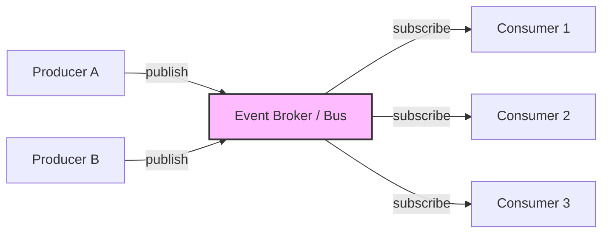

# 🧠 Topic: Event-Driven Architecture — Overview

> [!abstract] Executive Summary (ELI5)
> Event-driven architecture is like a school's morning announcements over the PA system. The principal announces "fire drill at 10 AM" and moves on — they don't go to every classroom and wait for each teacher to confirm. Each teacher reacts however fits their class: gym goes outside, science powers down burners, admin logs it. The announcer doesn't know or care who's listening. This is the core of EDA: something happens, you announce it, interested parties react on their own time.

---

## 🎯 The "Why"
- **Problem Solved:** How do we build systems where many independent components must react to state changes **without being tightly coupled to each other or blocking on slow consumers**?
- **Alternatives:** Synchronous request-response ([[Microservices Communication]] over HTTP/gRPC), [[Monolithic Architecture]] with in-process calls.
- **Trade-offs:** EDA optimizes for **loose coupling, async responsiveness, and extensibility** at the cost of **eventual consistency, debuggability, and the difficulty of ordering/idempotency**.

## 💡 Mental Model & Analogy
- **Analogy:** "EDA is like a newspaper subscription." The publisher prints and distributes copies whenever there's news — they don't call each subscriber individually to check if they're ready. You read the paper at your own pace. If you miss a day, copies pile up at your door (queued events). Publisher and subscriber never coordinate directly.
- **Visual/Diagram:**


## 🛠️ Core Principles

### What is an Event-Driven Architecture
An **event-driven architecture (EDA)** is a style in which components communicate by **producing and consuming events** — notifications that something meaningful has happened — rather than calling each other directly. A **producer** emits an event and immediately moves on; one or more **consumers** react to that event asynchronously, whenever they get to it. A **broker** (Kafka, RabbitMQ, SQS, NATS, EventBridge) mediates the flow.

The defining shift: instead of *"Hey, do this and tell me when you're done"* (synchronous command), it's *"This happened — react if you care"* (asynchronous event).

### What is an Event?
An **event** is an **immutable record of something that happened** in the past. It's a statement of fact, not a request.

A well-formed event typically carries:
```json
{
  "eventId": "evt_01HZX...",
  "type": "OrderPlaced",
  "timestamp": "2026-07-11T14:23:01Z",
  "source": "orders-service",
  "subject": "order-7891",
  "data": { "orderId": "ord-7891", "customerId": "cus-42", "total": 129.50 }
}
```

| Field | Purpose |
|-------|---------|
| **`eventId`** | Unique identifier — enables idempotency (consumers detect/skip duplicates) |
| **`type`** | What happened — used for routing and dispatch |
| **`timestamp`** | When it happened (event time, not processing time) |
| **`source`** | Who produced it — useful for debugging and audit |
| **`data` (payload)** | The relevant state at the time of the event |
| **`subject`** | The entity the event is about (filtering/partitioning) |

> [!tip] Name events in the past tense
> Events are facts about things that happened: `OrderPlaced`, `PaymentFailed`, `UserRegistered`. Commands are requests: `PlaceOrder`, `ChargeCard`. If you can't tell from the name whether it's a command or an event, the boundary is muddy. See [[Sync vs Async Systems]].

### Core Characteristics

| Characteristic | What It Means | Why It Matters |
|----------------|---------------|----------------|
| **Producer–consumer decoupling** | Producers don't know who consumes, how many there are, or when they react | Add/remove consumers without touching producers |
| **Asynchronous by default** | Producers don't wait for consumers; work queues and processes when capacity allows | Producers stay responsive under load |
| **Event as the unit of communication** | An immutable record of "something happened" | Natural audit log; replayable; enables event sourcing |
| **Reactive, not imperative** | Components respond to things that happen, not being told step-by-step | System naturally models real-world flows |
| **Eventual consistency** | The system settles into consistency over time, not immediately | Trades immediate consistency for decoupling and resilience |
| **Fan-out** | One event naturally triggers many independent reactions | Adding reactions is purely additive |
| **Resilience via buffering** | Events queue up when consumers are down or slow | Producers survive consumer outages |

### Why EDA — The Benefits

| Benefit | Explanation |
|---------|-------------|
| **Loose coupling** | Producers don't know who consumes. You can add, remove, or change consumers without touching producers. |
| **Asynchronous responsiveness** | Producers return fast — no blocking on slow consumers. Request handling decouples from heavy side-effects. |
| **Scalability** | Consumers scale independently; brokers buffer spikes. A burst queues up rather than overloading downstream. |
| **Resilience** | If a consumer is down, events queue and process on recovery. Producers are unaffected. |
| **Extensibility** | Adding a new reaction ("when order placed, also send to analytics") is purely additive — subscribe a new consumer. |
| **Auditability** | Events form an immutable log of what happened and when — invaluable for debugging, compliance, replay. |
| **Replayability** | Rebuild state by replaying the log; re-process events into a fixed consumer or new projection. |

### The Cost (Preview — see [[Event Driven Challenges]])

EDA's power comes at a cost — these are covered in depth in [[Event Driven Challenges]] and [[Event Driven Best Practices]]:

- **Eventual consistency by default** — the system settles over time; reasoning about *current* state is hard.
- **Implicit control flow** — "what happens when X?" is spread across many consumers; harder to trace.
- **Debugging is hard** — without distributed tracing, reconstructing what happened is painful.
- **Ordering, idempotency, exactly-once** — notoriously difficult. See [[Event Driven Best Practices]].
- **Schema evolution** — events are consumed by many services over years; evolving schemas carefully is a real burden.

> [!tip] EDA is a trade-off, not a free lunch
> Every EDA benefit (decoupling, async, extensibility) is paid for with a cost (eventual consistency, debuggability, ordering complexity). Choose EDA when the benefits outweigh the costs *for your use case* — see [[Event Driven Use Cases]].

## 🏗️ The Role in System Design

### This Folder's Deep Dives
This folder breaks EDA into focused concept notes:

| Note | Topic |
|------|-------|
| **Event-Driven Overview** *(this note)* | Definition, characteristics, why |
| [[Sync vs Async Systems]] | Synchronous vs asynchronous systems compared |
| [[Pub Sub and Event Streaming]] | Pub/sub, event streaming, and their differences |
| [[Event Driven Key Components]] | Producers, brokers, consumers, storage |
| [[Event Driven Challenges]] | The costs of EDA and how to mitigate them |
| [[Event Driven Best Practices]] | Idempotency, DLQs, broker selection, versioning |
| [[Event Driven Use Cases]] | When to use EDA and when not to |

### How EDA Relates to Other Styles
EDA is usually **combined** with other styles, not used alone:

| Combination | How It Works |
|-------------|--------------|
| **EDA + Microservices** | Services emit/consume events instead of calling each other synchronously. The most common pairing. |
| **EDA + Monolith** | A monolith publishes events for async side-effects (emails, analytics) while keeping core logic synchronous. |
| **EDA + Serverless** | Functions react to events (S3 upload → Lambda → process). Event-driven is the native serverless model. |
| **EDA + CQRS** | Commands write events; queries read from projections built from the event log. |

## ⚠️ Pitfalls & Anti-patterns
- **Treating events as commands:** Assuming exactly one consumer handles an event. Events are facts; commands are requests — don't conflate them.
- **Ignoring eventual consistency:** Assuming the system is immediately consistent after producing an event.
- **No tracing:** In EDA, "what happened" is spread across consumers. Without tracing, debugging is a multi-hour forensic exercise.
- **Starting with EDA when sync would do:** EDA adds complexity. If your flow is simple and linear, synchronous is clearer.

## 🔗 Deep Connections
- **Parent Topic:** [[Software Architecture]], [[Event-Driven Architecture]]
- **This Folder:** [[Sync vs Async Systems]] → [[Pub Sub and Event Streaming]] → [[Event Driven Key Components]] → [[Event Driven Challenges]] → [[Event Driven Best Practices]] → [[Event Driven Use Cases]]
- **Related Concepts:** [[Microservices Communication]] (async is EDA), [[Microservices Challenges]], [[Client Server Model]]
- **Prerequisites:** Basic understanding of synchronous vs asynchronous communication and message queues.

## ❓ Active Recall Questions
> [!faq]- What is an event-driven architecture (EDA)?
> A style where components communicate by producing and consuming **events** — notifications that something happened. Producers emit an event and move on; consumers react asynchronously whenever ready. A broker (Kafka, RabbitMQ, SQS) mediates. The shift: from "do this and tell me when done" (synchronous command) to "this happened — react if you care" (asynchronous event).
<!-- #flashcards/system-design -->

> [!faq]- What is an event, and how does it differ from a command?
> An **event** is an immutable record of something that **happened** (past tense: `OrderPlaced`, `PaymentFailed`) — a fact broadcast to anyone who cares. A **command** is a request to **do something** (imperative: `PlaceOrder`, `ChargeCard`) — directed at one specific recipient that must act. Events are broadcast; commands are targeted. Mixing them is a common bug source.
<!-- #flashcards/system-design -->

> [!faq]- What are the core characteristics of EDA?
> Producer–consumer decoupling (producers don't know who consumes), asynchronous by default (producers don't wait), event as the unit of communication (immutable fact), reactive not imperative (respond to what happens), eventual consistency, fan-out (one event → many reactions), and resilience via buffering (events queue when consumers are down).
<!-- #flashcards/system-design -->

> [!faq]- Why use EDA — what are the main benefits?
> Loose coupling (add/remove consumers without touching producers), async responsiveness (producers don't block), scalability (consumers scale independently; brokers buffer spikes), resilience (events queue through consumer outages), extensibility (new reactions are purely additive), auditability (events form an immutable log), and replayability (rebuild state by replaying the log).
<!-- #flashcards/system-design -->

> [!faq]- What is an event's structure, and why does each field matter?
> An event carries: `eventId` (uniqueness → enables idempotency/dedup), `type` (what happened → routing), `timestamp` (when it happened, event time not processing time), `source` (who produced it → debugging), `data`/payload (relevant state), and `subject` (the entity → filtering/partitioning). A well-formed event is self-contained and uniquely identifiable.
<!-- #flashcards/system-design -->

> [!faq]- What are the main costs of EDA?
> Eventual consistency by default (hard to reason about *current* state), implicit control flow (hard to trace what happens), difficult debugging without distributed tracing, notoriously hard ordering/idempotency/exactly-once guarantees, and schema evolution across many consumers. EDA is a trade-off — its benefits (decoupling, async) are paid for with these costs.
<!-- #flashcards/system-design -->

---

*Last updated: 2026-07-11*
