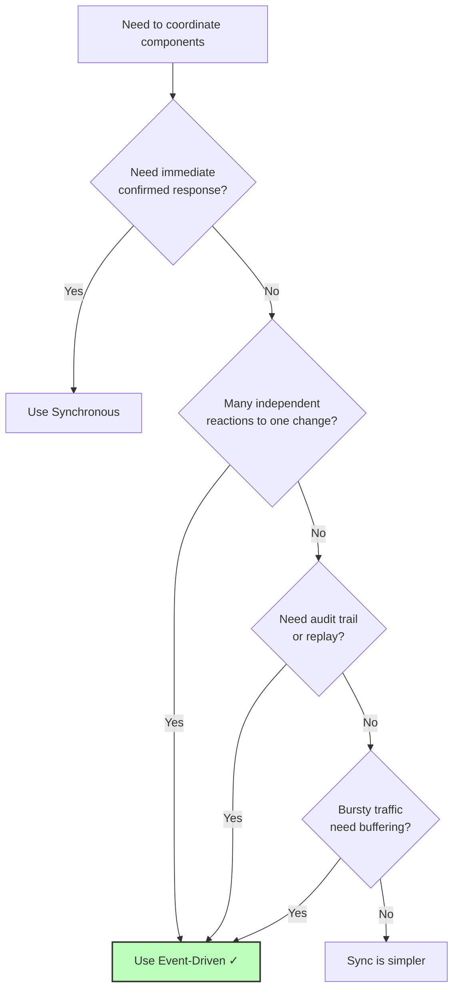

# 🧠 Topic: Event-Driven Architecture — Use Cases

> [!abstract] Executive Summary (ELI5)
> Knowing when to use EDA is like knowing when to use a delivery service vs. picking something up yourself. If you need it *right now* and can confirm it's there, go yourself (synchronous). If you're fine with it arriving later, want to notify many people, or need a record of every shipment, use a delivery service (EDA). EDA shines when many independent reactions must fire, when you need to buffer spiky traffic, or when you need an audit trail of everything that happened.

---

## 🎯 The "Why"
- **Problem Solved:** When does EDA's value (decoupling, resilience, extensibility) outweigh its costs (eventual consistency, complexity)? When should you reach for it — and when should you avoid it?
- **Alternatives:** Synchronous request-response ([[Sync vs Async Systems]]), [[Monolithic Architecture]] with in-process calls.
- **Trade-offs:** EDA pays off when the use case values decoupling, fan-out, buffering, or audit over immediate consistency. It's the wrong tool when you need strong immediate consistency or simple linear flows.

## 💡 Mental Model & Analogy
- **Analogy:** "Use EDA when you'd use a delivery service." If you need the package *right now* and want to confirm it arrived, go yourself (sync). If you're fine with later delivery, want to notify many recipients, or need a tracking record of every shipment, use the delivery service (EDA). Don't use a delivery service to grab a coffee from the next room.
- **Visual/Diagram:**


## 🛠️ Core Principles

EDA shines when one or more of these conditions hold. The more that are true, the stronger the case for EDA.

### When to Use EDA

#### 1. Many Independent Reactions to One Change (Fan-Out)
The canonical EDA use case. A single state change must trigger **many independent side effects**, and the producer shouldn't coordinate them or wait for them.

**Example — `OrderPlaced` in e-commerce:**
```mermaid
graph TD
    O[Orders Service<br/>emits OrderPlaced] --> B[Broker]
    B --> I[Inventory Service<br/>reserve stock]
    B --> P[Payment Service<br/>charge card]
    B --> E[Email Service<br/>send confirmation]
    B --> A[Analytics<br/>ingest event]
    B --> F[Fraud Detection<br/>score order]
    B --> R[Recommendation<br/>update "frequently bought"]
    style B fill:#fbf,stroke:#333,stroke-width:2px
```
Doing this synchronously couples the order flow to five downstream services — if any is slow, order placement suffers. With EDA, the order service emits and returns; each consumer reacts independently. Adding a new reaction (say, a loyalty-points service) is purely additive — subscribe a new consumer, no change to the producer.

**Other examples:** user registration → welcome email, analytics, profile initialization, fraud check; IoT sensor reading → alerting, storage, analytics, control system.

#### 2. Real-Time / Near-Real-Time Processing
Systems that must react to data **as it arrives** — stream processing, live dashboards, monitoring, alerting.

**Examples:**
- **Live analytics dashboards** updating as events stream in.
- **Fraud detection** scoring transactions in real time.
- **IoT telemetry** — sensor readings flowing into monitoring, alerting, and storage.
- **Log/metrics ingestion** — application logs and metrics flowing into a processing pipeline.

#### 3. Decoupling Producers from Consumers at Different Scales
When producers and consumers operate at very **different speeds or scales**, EDA's buffering decouples them. A fast web tier can emit events; a slow batch ML pipeline consumes them at its own pace.

**Example:** A high-traffic website emits user-behavior events continuously; a nightly ML training job consumes the backlog to retrain models. The producer never waits for the consumer.

#### 4. Audit-Heavy or Compliance Domains
Domains that must **record what happened** for compliance, debugging, or legal reasons. Events form an immutable, time-ordered log — the ultimate audit trail.

**Examples:**
- **Financial services** — every transaction event logged for regulators.
- **Healthcare** — patient record access events for HIPAA compliance.
- **Change tracking** — who changed what, when, and why.

With **event sourcing** (the log *is* the source of truth), you get a complete history and can replay to any point in time.

#### 5. Systems That Must Tolerate Consumer Outages
Critical producers must stay up even when downstream consumers are down. EDA's buffering means events queue and catch up later — the producer is unaffected.

**Example:** An e-commerce site must keep accepting orders even if the fulfillment service is down. Orders emit events; fulfillment consumes them when it recovers. No lost orders.

#### 6. Reactive User Experiences
Front-ends that subscribe to events — push notifications, live updates, collaborative editing.

**Examples:**
- **Server-Sent Events (SSE)** / **WebSockets** pushing updates to browsers.
- **Mobile push notifications** triggered by backend events.
- **Collaborative editing** (Google Docs-style) syncing changes via events.

#### 7. Event Sourcing and CQRS
Domains where you want **replay** (rebuild state from history) or **temporal queries** ("what was the state on Tuesday?"). Event sourcing stores every state change as an event; CQRS separates the write model (events) from read models (projections).

**Example:** Rebuild a read-optimized search index by replaying all `ProductUpdated` events. Or audit an account balance at any historical point by replaying its transaction events.

### When NOT to Use EDA

| Situation | Why EDA Is Wrong | Use Instead |
|-----------|------------------|-------------|
| **Strong immediate consistency needed** | EDA is eventually consistent — side effects haven't happened when the producer returns | Synchronous, or keep tightly-coupled data together |
| **Simple, linear flow** | A few sync calls do the job more clearly than events + consumers | Synchronous |
| **Sub-millisecond latency** | Async queueing adds a latency floor | In-process calls (monolith) |
| **Small system / CRUD app** | EDA adds complexity without payoff | Monolith or simple three-tier |
| **Low observability maturity** | EDA without tracing is a black box | Build observability first |
| **Team not ready for eventual consistency** | "Data might be stale for seconds" causes friction | Synchronous |

### Real-World Examples

| Company | EDA Use |
|---------|---------|
| **Uber** | Kafka backbone for trip events (request, match, arrival, completion) powering surge pricing, billing, fraud, analytics |
| **Netflix** | Kepler pipeline ingests billions of events/day (plays, errors, navigation) for recommendations and monitoring |
| **LinkedIn** | Built Kafka originally — activity events, metrics, log data at massive scale |
| **Amazon** | `OrderPlaced`-style events (EventBridge) triggering inventory, shipping, email, billing — the canonical e-commerce flow |
| **Walmart** | Real-time inventory and supply-chain events for fraud detection, pricing, stock updates |

> [!note] The common thread
> These companies use EDA because they have **many independent reactions** to high-volume events, need **real-time processing**, and value **decoupling and buffering**. They also have the engineering maturity to pay the EDA tax (tracing, idempotency, DLQs, schema registries).

## 🏗️ The Role in System Design

### EDA Composes with Other Styles
EDA is rarely the *whole* architecture — it's usually combined:

| Combination | How |
|-------------|-----|
| **EDA + Microservices** | Services communicate via events instead of sync HTTP. Most common pairing. |
| **EDA + Monolith** | A monolith publishes events for async side-effects (emails, analytics). |
| **EDA + Serverless** | Functions react to events (S3 upload → Lambda). Native serverless model. |
| **EDA + CQRS** | Commands write events; queries read from projections. |

### The Decision Framework
When designing a system, ask:
1. **Does the operation need an immediate confirmed response?** Yes → sync.
2. **Are there many independent reactions to one change?** Yes → EDA.
3. **Do I need an audit trail or replay?** Yes → EDA (with event sourcing).
4. **Is traffic bursty, needing buffering?** Yes → EDA.
5. **Must the producer survive consumer outages?** Yes → EDA.
6. **Can the domain tolerate eventual consistency?** No → sync. Yes → EDA viable.

If 2+ answers point to EDA and the domain tolerates eventual consistency, EDA is likely the right choice. Apply the [[Event Driven Best Practices|best practices]] from the start.

### Hybrid Is Normal
Most real systems are **hybrid**: sync for reads and user-facing confirmation, async (EDA) for writes with side effects. Don't force a single style — match each interaction to its need.

## ⚠️ Pitfalls & Anti-patterns
- **Using EDA when sync would do:** adds complexity without payoff. If the flow is simple and linear, sync is clearer.
- **Ignoring eventual consistency:** telling users "done" when side-effects haven't happened. Manage expectations.
- **EDA without best practices:** no idempotency, no DLQ, no tracing — silent data loss and untraceable failures.
- **EDA without observability:** "fire and forget" leads to events that disappear. Trace everything.
- **Forcing EDA into a consistency-heavy domain:** financial transfers needing ACID across entities suffer under EDA's eventual consistency. Keep those synchronous or use sagas carefully.

## 🔗 Deep Connections
- **Parent Topic:** [[Event Driven Overview]]
- **Previous:** [[Event Driven Best Practices]] — apply these when you choose EDA.
- **Related Concepts:** [[Sync vs Async Systems]] (when sync vs async), [[Pub Sub and Event Streaming]] (which EDA pattern), [[Microservices Architecture]] (common host for EDA), [[Factors Influencing Architecture Selection]]
- **Prerequisites:** [[Event Driven Overview]], [[Sync vs Async Systems]], [[Event Driven Challenges]].

## ❓ Active Recall Questions
> [!faq]- When does EDA shine — what are the main use cases?
> 1. **Many independent reactions to one change** (OrderPlaced → inventory, payment, email, analytics). 2. **Real-time/near-real-time processing** (streaming, live dashboards, fraud). 3. **Decoupling producers from consumers at different scales** (fast web tier, slow batch ML). 4. **Audit-heavy/compliance domains** (immutable event log). 5. **Tolerating consumer outages** (events buffer). 6. **Reactive UIs** (SSE, WebSockets, push notifications). 7. **Event sourcing/CQRS** (replay, temporal queries).
<!-- #flashcards/system-design -->

> [!faq]- When should you NOT use EDA?
> When you need **strong immediate consistency** (financial transfers needing ACID), the flow is **simple and linear** (a few sync calls are clearer), **sub-millisecond latency** is required (async adds a floor), the system is **small/CRUD** (EDA adds complexity without payoff), observability maturity is low (EDA without tracing is a black box), or the team isn't ready for eventual consistency.
<!-- #flashcards/system-design -->

> [!faq]- Why is fan-out the canonical EDA use case?
> A single `OrderPlaced` event must trigger inventory reservation, payment capture, email confirmation, analytics ingest, and fraud check — many independent reactions. Doing this synchronously couples the order flow to five downstream services (any slow one hurts order placement). With EDA, the order service emits and returns; each consumer reacts independently. Adding a new reaction is purely additive — no producer change.
<!-- #flashcards/system-design -->

> [!faq]- How does EDA help when producers and consumers run at different speeds?
> EDA's broker **buffers** events between them. A fast web tier can emit events continuously; a slow batch ML pipeline consumes the backlog at its own pace. The producer never waits for or is slowed by the consumer. Without EDA, the producer would block on the slow consumer (temporal coupling) or have to implement its own buffering.
<!-- #flashcards/system-design -->

> [!faq]- Why is EDA valuable for audit-heavy or compliance domains?
> Events form an **immutable, time-ordered log** — the ultimate audit trail of what happened and when. With event sourcing (the log is the source of truth), you have a complete history and can replay to any point in time, query historical state ("what was the balance on Tuesday?"), and satisfy regulators who demand a record of every transaction.
<!-- #flashcards/system-design -->

> [!faq]- How does EDA compose with other architectural styles?
> Rarely used alone. Most often paired with **microservices** (services communicate via events instead of sync HTTP), **monoliths** (async side-effects like emails/analytics), **serverless** (functions react to events — the native serverless model), and **CQRS** (commands write events, queries read from projections). Most real systems are hybrid: sync for reads, EDA for writes with side effects.
<!-- #flashcards/system-design -->

> [!faq]- What's the decision framework for choosing EDA?
> Ask: 1. Need an immediate confirmed response? (yes → sync). 2. Many independent reactions to one change? (yes → EDA). 3. Need audit/replay? (yes → EDA). 4. Bursty traffic needing buffering? (yes → EDA). 5. Producer must survive consumer outages? (yes → EDA). 6. Domain tolerates eventual consistency? (no → sync). If 2+ point to EDA and the domain tolerates eventual consistency, EDA is likely right — apply best practices from the start.
<!-- #flashcards/system-design -->

---

*Last updated: 2026-07-11*
