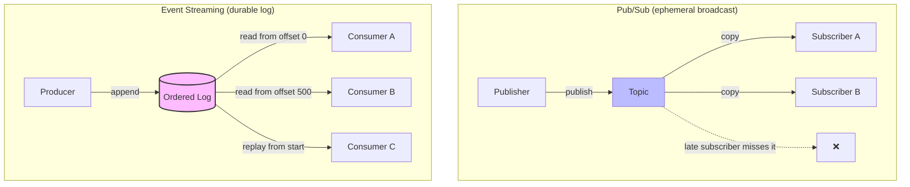
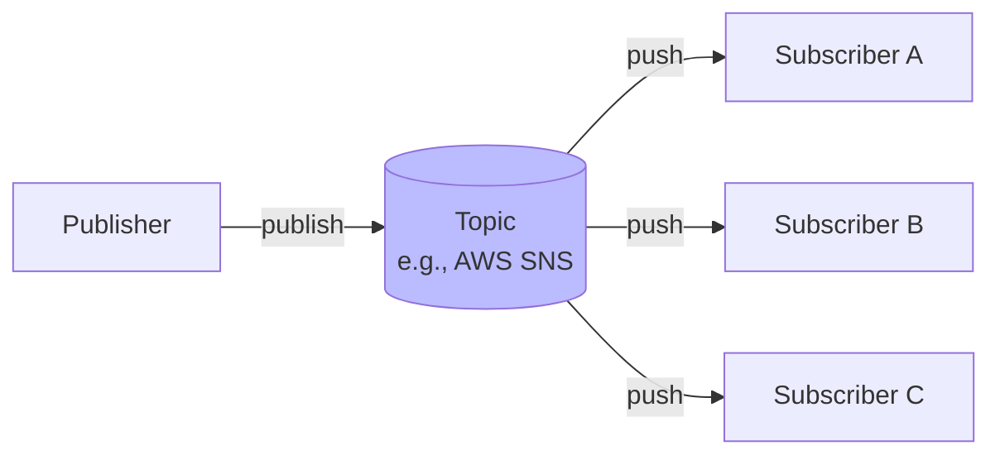
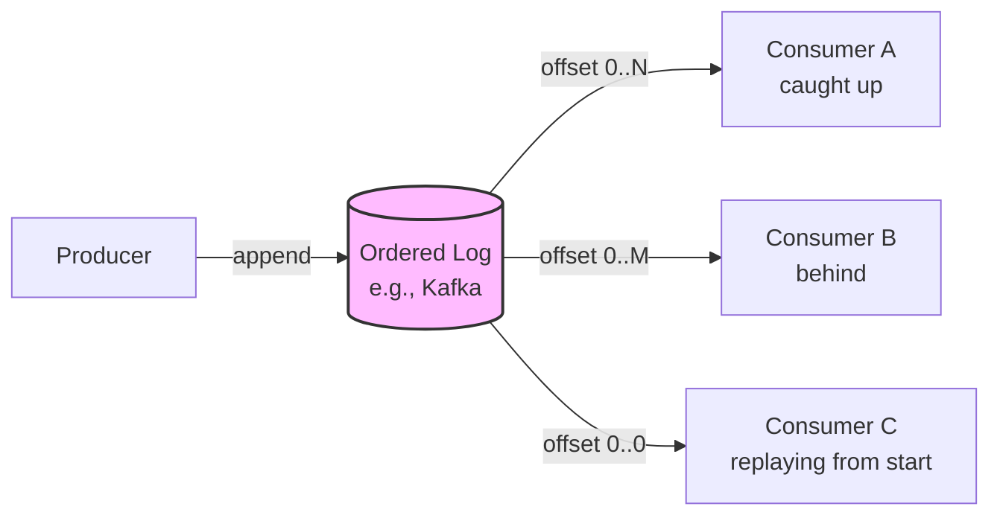
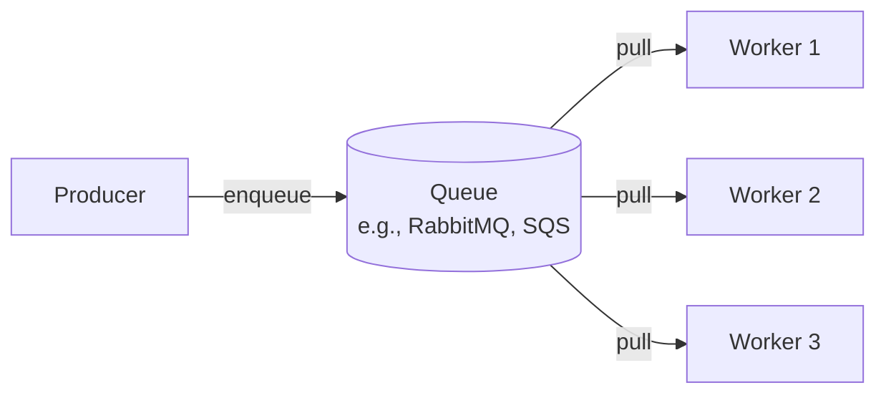

# 🧠 Topic: Pub/Sub vs Event Streaming

> [!abstract] Executive Summary (ELI5)
> **Pub/sub** is like a magazine subscription — the publisher prints an issue, every subscriber gets a copy, and if you weren't subscribed when it printed, you miss it (the message is gone). **Event streaming** is like a DVR or Netflix — every episode is stored in order on a server; you can watch it now, watch it later, or rewatch from the beginning. The log is the source of truth, and you consume at your own pace.

---

## 🎯 The "Why"
- **Problem Solved:** When components communicate asynchronously, how do we route and deliver events — broadcast them to whoever is listening *now*, or store them durably for anyone to consume *whenever*?
- **Alternatives:** Synchronous request-response ([[Sync vs Async Systems]]), point-to-point message queues (work distribution).
- **Trade-offs:** Pub/sub is simple and real-time but ephemeral (miss it, lose it); event streaming is durable and replayable but heavier and more complex.

## 💡 Mental Model & Analogy
- **Analogy:** "Pub/sub is a magazine; event streaming is a DVR." Magazine: the publisher prints, current subscribers get a copy, and if you weren't subscribed you missed it — once delivered, the publisher forgets it. DVR: every episode is recorded in order; you can watch now, later, or rewatch from season 1. The recording persists.
- **Visual/Diagram:**

## 🛠️ Core Principles

### 1. Pub/Sub (Publish-Subscribe)

A **pub/sub** model: publishers emit events to a **topic**; all current **subscribers** receive a copy. The broker routes events to active subscribers. Delivery is typically **ephemeral** — once delivered (or once the topic moves on), the event is gone.

**Key characteristics:**
- **Fan-out:** one event → many subscribers, each getting its own copy.
- **Push-based (often):** the broker pushes events to subscribers as they arrive.
- **Ephemeral:** typically no long-term storage. If a subscriber is down when the event is published, it may miss it (unless the broker offers buffering/durability).
- **Decoupled:** publishers don't know how many subscribers exist.

**Typical tools:** AWS SNS, Google Pub/Sub, NATS, Redis Pub/Sub, RabbitMQ topic exchanges.

**Best for:** Broadcasting state changes to many independent consumers where each reacts in real time — "notify everyone who cares, right now." Think: live notifications, real-time UI updates, fan-out workflows.

### 2. Event Streaming

An **event streaming** model: producers **append** events to a durable, ordered **log**; consumers **read** from the log at their own pace, keeping track of their position (an offset). The log is the source of truth and persists for a configured retention period.

**Key characteristics:**
- **Durable log:** events are stored persistently (disk, replicated) for a retention period (days, weeks, forever).
- **Ordered:** events within a partition are strictly ordered by append time.
- **Pull-based (often):** consumers poll/read from their last offset at their own pace.
- **Replayable:** a consumer can reset its offset to 0 and re-process the entire history.
- **Position tracking:** each consumer group tracks its own offset — independent progress.
- **Partitioning for scale:** the log is split into partitions; each partition is an ordered sequence. This enables parallel consumption (one consumer per partition).

**Typical tools:** **Kafka** (the canonical example), Apache Pulsar, AWS Kinesis, Azure Event Hubs.

**Best for:** Event sourcing (the log *is* the source of truth), stream processing, audit/compliance (durable record), replay (rebuild read models), decoupling producers from consumers at very different speeds, high-throughput pipelines.

### 3. Pub/Sub vs Event Streaming — Head-to-Head

| Aspect | Pub/Sub | Event Streaming |
|--------|---------|-----------------|
| **Storage** | Ephemeral (delivered, then gone) | Durable log (retained for days/weeks/forever) |
| **Delivery model** | Push to active subscribers | Pull/read from a position (offset) |
| **Ordering** | Often no global ordering guarantee | Strict order within a partition |
| **Late/restarting consumers** | Miss events published while away | Resume from their last offset; can replay from start |
| **Replay** | Not supported (event is gone) | Fully supported (reset offset) |
| **Throughput** | High, but optimized for fan-out | Extremely high (optimized for append-only log throughput) |
| **Consumer independence** | All subscribers get each event once | Each consumer group reads at its own pace/offset |
| **Best for** | Real-time broadcast, notifications | Event sourcing, audit, stream processing, replay |
| **Typical tools** | SNS, Google Pub/Sub, NATS | Kafka, Pulsar, Kinesis, Event Hubs |
| **Complexity** | Lower | Higher (partitions, offsets, retention, consumer groups) |

### The Decisive Question

> **Do consumers need to see events that happened while they were away?**

- **No** → Pub/sub is simpler and sufficient. The broker delivers to whoever's listening now.
- **Yes** → Event streaming is required. The durable log lets consumers catch up, replay, and never miss an event.

### Message Queues — The Third Pattern (Briefly)

A **message queue** (point-to-point) is distinct from both: one message is processed by **exactly one** of N competing consumers — used for work distribution (RabbitMQ queues, AWS SQS). Pub/sub fans out to *all* subscribers; a queue distributes to *one* worker.

> [!note] Kafka blurs the lines
> Kafka uses **consumer groups**: within a group, each partition goes to exactly one consumer (queue semantics — work distribution); across groups, every group gets all events (pub/sub semantics — fan-out). Plus it's a durable log (streaming). One tool, three patterns, via partitions + consumer groups.

## 🏗️ The Role in System Design

### Choosing Between Them

| If you need... | Choose... |
|----------------|-----------|
| Real-time broadcast to many consumers | **Pub/sub** |
| Notifications, live updates | **Pub/sub** |
| Durable record of what happened (audit) | **Event streaming** |
| Replay (rebuild state, re-process history) | **Event streaming** |
| Consumers at very different speeds | **Event streaming** |
| Stream processing / analytics pipeline | **Event streaming** |
| Work distribution across N workers | **Message queue** |
| Exactly-once processing of a task | **Message queue** |

### Common Architectures
- **Pub/sub for fan-out:** `OrderPlaced` → inventory, payment, email, analytics all subscribe and react in real time.
- **Event streaming for the backbone:** all domain events flow through Kafka; services consume what they need, replay when rebuilding read models (CQRS), and the log serves as an audit trail.
- **Queue for background work:** "process this video" → one of N workers picks it up.

## ⚠️ Pitfalls & Anti-patterns
- **Using pub/sub when you need replay:** if consumers ever need to re-process history (e.g., after a bug fix or to build a new read model), pub/sub's ephemerality loses events. Use event streaming.
- **Using event streaming for simple notifications:** Kafka for a simple "send a welcome email" notification is overkill — a lightweight pub/sub or queue is simpler.
- **Ignoring ordering in streaming:** events within a partition are ordered, but across partitions they're not. Partition by entity ID to keep one entity's events in order.
- **No retention strategy:** event streaming logs grow forever without a retention policy. Set retention (time or size) to bound storage.
- **Treating Kafka as a queue without understanding consumer groups:** if all consumers share one group, only one gets each event (queue). If each has its own group, all get each event (pub/sub). Know which you want.
- **Over-engineering:** streaming adds partitions, offsets, consumer groups, retention, and monitoring complexity. Don't reach for it when pub/sub or a queue would do.

## 🔗 Deep Connections
- **Parent Topic:** [[Event Driven Overview]]
- **Previous:** [[Sync vs Async Systems]] — pub/sub and streaming are the two main async patterns.
- **Next:** [[Event Driven Key Components]] — brokers are the central component of both pub/sub and streaming.
- **Related Concepts:** [[Event Driven Challenges]] (ordering, retention), [[Event Driven Best Practices]] (broker selection), Kafka, RabbitMQ, SNS/SQS, event sourcing, CQRS
- **Prerequisites:** [[Event Driven Overview]], [[Sync vs Async Systems]].

## ❓ Active Recall Questions
> [!faq]- What is pub/sub, and when do you use it?
> A model where publishers emit events to a **topic**, and all current **subscribers** receive a copy — fan-out. Delivery is typically **ephemeral**: once delivered, the event is gone; late subscribers miss it. Use it for real-time broadcast and notifications (e.g., "notify everyone who cares, right now"). Tools: SNS, Google Pub/Sub, NATS.
<!-- #flashcards/system-design -->

> [!faq]- What is event streaming, and when do you use it?
> A model where producers **append** events to a durable, ordered **log**, and consumers **read** at their own pace, tracking their position (offset). The log persists for a retention period and is **replayable**. Use it for event sourcing (the log is the source of truth), audit, stream processing, and when consumers need to catch up or replay history. Tools: Kafka, Pulsar, Kinesis.
<!-- #flashcards/system-design -->

> [!faq]- What's the key difference between pub/sub and event streaming?
> **Durability and replay.** Pub/sub is ephemeral — once delivered, the event is gone; late/restarting consumers miss it. Event streaming stores events in a durable, ordered log — consumers resume from their last offset and can replay the entire history. The decisive question: "Do consumers need to see events that happened while they were away?" No → pub/sub. Yes → streaming.
<!-- #flashcards/system-design -->

> [!faq]- How does Kafka blur the line between pub/sub, queues, and streaming?
> Kafka uses **consumer groups**: within a group, each partition goes to exactly one consumer (**queue** semantics — work distribution); across groups, every group gets all events (**pub/sub** semantics — fan-out). Plus it's a durable log (**streaming** — replayable). One tool, three patterns, via partitions + consumer groups. Know which semantics you want before configuring.
<!-- #flashcards/system-design -->

> [!faq]- Why is ordering different in pub/sub vs event streaming?
> Pub/sub often has **no global ordering guarantee** — events are pushed to subscribers as they arrive. Event streaming guarantees strict order **within a partition** (append order) but not across partitions. To keep one entity's events in order, partition by the entity ID (e.g., `orderId`) so all its events land in the same partition.
<!-- #flashcards/system-design -->

> [!faq]- When would you choose a message queue over pub/sub or streaming?
> When you need **work distribution**: one message processed by exactly **one** of N competing consumers (e.g., "process this video," "send this email"). Pub/sub fans out to *all* subscribers; a queue distributes to *one* worker. Tools: RabbitMQ queues, AWS SQS. Use pub/sub for broadcast, streaming for durable replay, and queues for parallel work processing.
<!-- #flashcards/system-design -->

> [!faq]- What's a common mistake when choosing between pub/sub and event streaming?
> Using **pub/sub when you need replay** — if consumers ever need to re-process history (after a bug fix, to build a new read model), pub/sub's ephemerality loses those events. Use event streaming. Conversely, using **Kafka for a simple notification** is overkill — a lightweight pub/sub or queue is simpler. Match the tool to the durability/replay need.
<!-- #flashcards/system-design -->

---

*Last updated: 2026-07-11*
