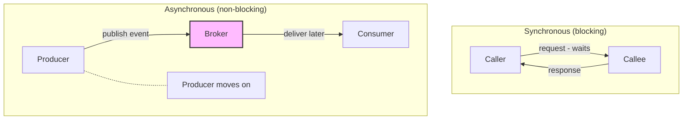
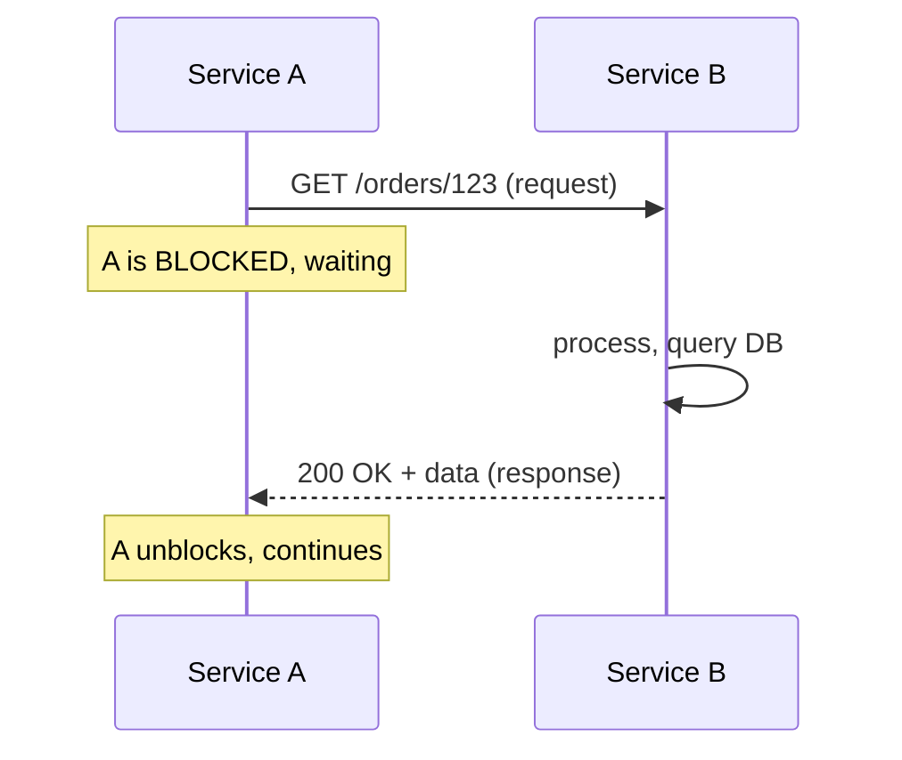
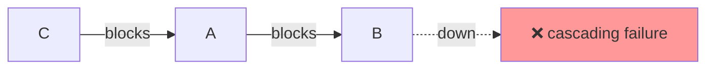
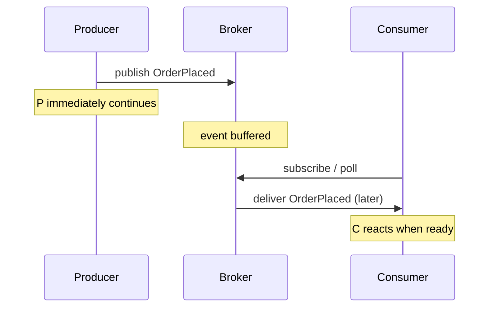
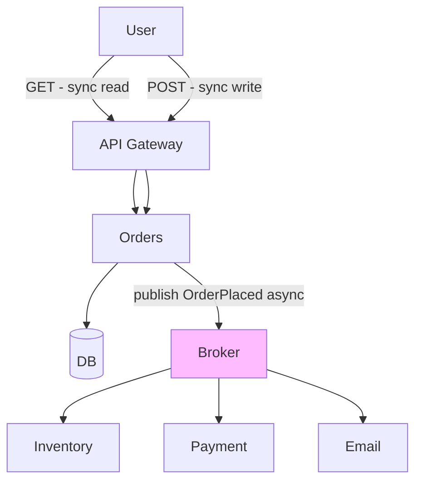

# 🧠 Topic: Synchronous vs Asynchronous Systems

> [!abstract] Executive Summary (ELI5)
> **Synchronous** is a phone call — you dial, wait on the line, and get an answer before hanging up. You and the other person must both be free *at the same time*. **Asynchronous** is an email — you send it and move on; the other person reads and responds whenever they're ready. Phone calls give immediate answers but block both of you; emails let everyone keep working but create a delay.

---

## 🎯 The "Why"
- **Problem Solved:** When services need to coordinate, should the caller **wait** for a response (sync) or **move on** and let the callee react later (async)?
- **Alternatives:** A pure monolith uses in-process calls (neither, really — no network). Distributed systems must choose between sync and async (or combine both).
- **Trade-offs:** Sync is simple and immediate but creates **temporal coupling** (both must be up); async is decoupled and resilient but introduces **eventual consistency** and complexity.

## 💡 Mental Model & Analogy
- **Analogy:** "Sync is a phone call; async is an email." A phone call blocks both parties until resolved — immediate but fragile (if they don't pick up, you're stuck). An email lets you send and move on — resilient and scalable, but you can't be sure when (or if) it's read.
- **Visual/Diagram:**

## 🛠️ Core Principles

### Synchronous Systems

The caller sends a request and **blocks** (waits) for a response before continuing. Both parties must be available at the same time.

**Examples:** REST APIs (HTTP), gRPC, GraphQL, database queries, traditional RPC.

**How it works:**

**When to use sync:**
- You need an **immediate response** to proceed ("is this item in stock *right now*?").
- A **read** that needs fresh data.
- A simple query/response where the caller can't proceed without the answer.
- Exposing a **public API** to external clients.

**The danger — temporal coupling:**
Synchronous calls create **temporal coupling** — both services must be up and responsive at the same time. If Service B is slow or down, Service A blocks, then times out — and if C called A, C blocks too. Failures cascade up the chain.

### Asynchronous Systems

The sender emits a message/event and **moves on immediately**; the receiver processes it whenever ready. A broker mediates.

**Examples:** Kafka, RabbitMQ, AWS SNS/SQS, Google Pub/Sub, NATS, email, message queues.

**How it works:**

**When to use async:**
- A **write with side effects** (`OrderPlaced` → debit inventory, charge payment, send email).
- The producer doesn't need an immediate response.
- You want to **decouple** producer from consumer (different scales, availability).
- **Bursty traffic** — the broker buffers spikes.
- Many independent reactions to one event (fan-out).

### Head-to-Head Comparison

| Aspect | Synchronous | Asynchronous |
|--------|-------------|--------------|
| **Caller behavior** | Blocks until response | Moves on immediately |
| **Coupling** | Temporal (both must be up) | Loose (producer doesn't wait) |
| **Consistency** | Immediate (response confirms) | Eventual (consumer catches up) |
| **Failure mode** | Cascades up (caller fails too) | Buffered (events queue) |
| **Latency for caller** | Higher (waits for full chain) | Lower (returns immediately) |
| **Throughput** | Limited by slowest callee | Higher (decoupled, buffered) |
| **Complexity** | Simpler to reason about (linear) | Harder (eventual consistency, tracing) |
| **Use case** | Reads needing fresh data | Writes with side effects |
| **Protocols** | REST, gRPC, GraphQL | Kafka, RabbitMQ, SNS/SQS |
| **Debugging** | Easier (linear stack trace) | Harder (need distributed tracing) |

### The Core Trade-off

> **Synchronous trades resilience for immediacy. Asynchronous trades immediacy for resilience.**

| You optimize for... | Choose... | You accept... |
|---------------------|-----------|---------------|
| Immediate, confirmed response | **Synchronous** | Temporal coupling, cascading failures |
| Decoupling, resilience, throughput | **Asynchronous** | Eventual consistency, harder debugging |

### The Mitigations

**For synchronous (reduce temporal coupling):**
- **Timeouts** — never block forever; fail fast.
- **Retries with backoff** — handle transient failures.
- **Circuit breakers** — stop calling a failing service; return a fallback.
- **Keep chains short** — avoid A→B→C→D sync chains.

**For asynchronous (manage eventual consistency):**
- **Idempotent consumers** — duplicates are inevitable (at-least-once delivery).
- **Dead-letter queues** — capture poison messages so they don't block the pipeline.
- **Distributed tracing** — follow a request across async hops.
- **Schema versioning** — evolve events without breaking consumers.

### Most Real Systems Use Both

A typical system uses **sync for reads** (a user needs an answer now) and **async for writes** with side effects (reactions happen in the background):

> [!tip] Prefer async for cross-service writes
> Synchronous write chains create cascading failures. For cross-service **writes** with side effects, prefer events: the producer emits `OrderPlaced` and returns success immediately; inventory, payment, and email react independently. If one is down, events buffer and catch up — no cascade. Reserve synchronous calls for reads needing fresh data.

## 🏗️ The Role in System Design

### Sync and Async Define System Character
The choice between sync and async defines how a system *feels*:
- **Sync-heavy systems** are easier to reason about (linear) but brittle under failure (cascades) and limited in throughput.
- **Async-heavy systems** are resilient and scalable but harder to debug and eventually consistent.

### Choose by Operation Type
| Operation | Recommended | Why |
|-----------|-------------|-----|
| Read needing fresh data | **Sync** | Caller needs the answer now |
| Write with side effects | **Async** | Decouple, avoid cascades |
| Long-running task | **Async** | Don't block the caller for minutes |
| Simple query/response | **Sync** | Simpler; async is overkill |
| Fan-out (many reactions) | **Async** | Producer shouldn't coordinate N consumers |

## ⚠️ Pitfalls & Anti-patterns
- **Long synchronous chains (A→B→C→D):** every hop is a failure point; latency compounds. Keep chains short; async where possible.
- **No timeouts/retries/circuit breakers on sync calls:** a slow downstream cascades. Every sync call needs all three.
- **Using sync for everything:** cross-service writes with side effects should be async to avoid cascading failures.
- **Assuming async means "fire and forget":** events still need idempotent consumers, DLQs, and tracing — "fire and forget" leads to silent data loss.
- **Ignoring eventual consistency in async:** telling a user "done" when the side effects haven't happened yet. Manage expectations (e.g., "We'll email you when processing completes").

## 🔗 Deep Connections
- **Parent Topic:** [[Event Driven Overview]]
- **Next:** [[Pub Sub and Event Streaming]] — the two main async communication patterns.
- **Related Concepts:** [[Microservices Communication]] (sync vs async between services), [[Microservices Challenges]] (temporal coupling, circuit breakers), circuit breakers, retries, timeouts
- **Prerequisites:** [[Event Driven Overview]].

## ❓ Active Recall Questions
> [!faq]- What is the fundamental difference between synchronous and asynchronous communication?
> In **synchronous**, the caller **blocks** (waits) for a response before continuing — both parties must be available at the same time (temporal coupling). In **asynchronous**, the sender emits and **moves on immediately**; the receiver processes whenever ready via a broker. Sync is immediate but fragile; async is decoupled and resilient but eventually consistent.
<!-- #flashcards/system-design -->

> [!faq]- What is temporal coupling, and why is it the main risk of synchronous systems?
> Temporal coupling means both services must be **up and responsive at the same time**. If Service B is slow or down, Service A blocks, then times out — and if C called A, C blocks too. Failures cascade up the chain. Mitigate with timeouts, retries, circuit breakers, and by keeping sync chains short or moving cross-service writes to async.
<!-- #flashcards/system-design -->

> [!faq]- When would you choose synchronous over asynchronous?
> When you need an **immediate response** to proceed (e.g., "is this in stock *right now*?"), for a **read** needing fresh data, for a simple query/response where the caller can't proceed without the answer, or when exposing a **public API** to external clients. Sync is simpler to reason about but creates temporal coupling.
<!-- #flashcards/system-design -->

> [!faq]- When would you choose asynchronous over synchronous?
> For **writes with side effects** (OrderPlaced → inventory, payment, email), when the producer doesn't need an immediate response, to **decouple** producer from consumer (different scales/availability), to **buffer spiky traffic**, and for **fan-out** (many reactions to one event). Async is resilient and scalable but introduces eventual consistency.
<!-- #flashcards/system-design -->

> [!faq]- Why should cross-service writes prefer async over sync?
> Synchronous write chains create cascading failures — if payment is down, order placement fails too, even though the order is valid. With async, the producer emits `OrderPlaced` and returns success immediately; payment, inventory, and email react independently. If one is down, events buffer and catch up — no cascade.
<!-- #flashcards/system-design -->

> [!faq]- How do most real systems combine sync and async?
> **Sync for reads** (a user needs an answer now — "is this in stock?") and **async for writes** with side effects (OrderPlaced → inventory, payment, email). The API gateway fronts sync client calls; internal cross-service writes flow through a broker. This gives immediate responses where needed and decoupling/resilience where possible.
<!-- #flashcards/system-design -->

> [!faq]- What are the mitigations for synchronous communication's risks?
> **Timeouts** (never block forever — fail fast), **retries with exponential backoff** (handle transient failures), **circuit breakers** (stop calling a failing service; return a fallback), and **keeping chains short** (avoid A→B→C→D — every hop is a failure point). Every synchronous call should have all of these.
<!-- #flashcards/system-design -->

> [!faq]- What's the core trade-off between sync and async?
> **Synchronous trades resilience for immediacy** — you get a confirmed response now, but both services must be up (temporal coupling, cascading failures). **Asynchronous trades immediacy for resilience** — the producer stays responsive and survives consumer outages, but you accept eventual consistency and harder debugging. Choose by operation type: reads → sync; writes with side effects → async.
<!-- #flashcards/system-design -->

---

*Last updated: 2026-07-11*
