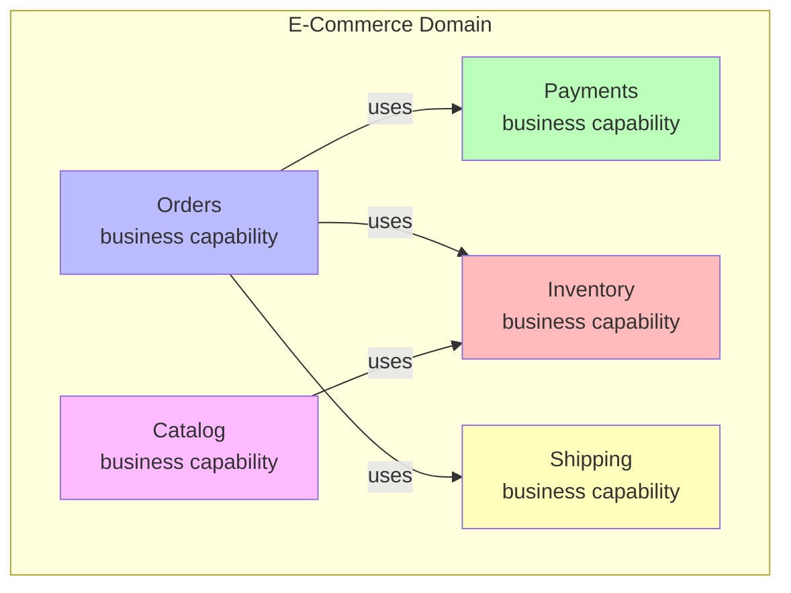
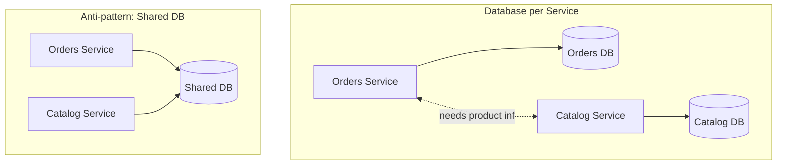

# 🧠 Topic: How to Identify Microservices

> [!abstract] Executive Summary (ELI5)
> Identifying microservices is like dividing a restaurant into stations. You don't put the stove in the middle of the dining room. You look at *what the business does* — taking orders, cooking, billing, cleaning — and give each function its own station with its own tools and staff. A good boundary means the grill cook doesn't need to interrupt the cashier to do their job. A bad boundary means everyone's constantly walking into each other.

---

## 🎯 The "Why"
- **Problem Solved:** How do we decide *what* a microservice is — where to draw the lines between services so each is cohesive, independent, and changes for one reason?
- **Alternatives:** Decomposing by technical layer (presentation/data — wrong unit), by entity/table (too fine-grained), by arbitrary "convenience."
- **Trade-offs:** Right boundaries give autonomy and independent scaling; wrong boundaries produce a **distributed monolith** — the most expensive mistake in microservices.

## 💡 Mental Model & Analogy
- **Analogy:** "Identifying services is like organizing a company into departments." You group people by what they do for the business — Sales, Engineering, Finance — not by what tools they use (everyone uses email). A good department boundary means Finance can close the books without needing Engineering to sign off.
- **Visual/Diagram:**

## 🛠️ Core Principles

### The Central Question
Service identification is the **single hardest and most important** decision in microservices. Four lenses help you find the right boundaries:

1. **Business Capabilities** — what does the business *do*?
2. **Single Responsibility Principle** — one reason to change.
3. **Data Ownership** — who owns what data?
4. **Independent Deployability** — can it ship on its own?

Apply all four together — no single lens is sufficient.

### 1. Business Capabilities

The primary decomposition criterion. A service should map to a **specific business function** — a capability the business recognizes as a thing it does. In [[Domain-Driven Design]] terms, this is a **bounded context**: a coherent slice of the domain with its own ubiquitous language.

**How to find business capabilities:**
- Listen to how the business talks about itself: "We take orders, process payments, manage inventory, ship products." Each verb-phrase is a candidate capability.
- Look at org charts — teams often already align to capabilities (the shipping team, the billing team).
- Use **Event Storming**: map the domain as a timeline of domain events (`OrderPlaced`, `PaymentCaptured`, `InventoryReserved`) and group them by which capability triggers and reacts to them.

| Good boundary (business capability) | Bad boundary |
|-------------------------------------|--------------|
| Orders, Payments, Catalog, Inventory, Shipping | "Data Access Service", "Auth Service" (technical) |
| Changes together stay in one service | Every feature touches 5 services |
| Service maps to a team's ownership | Service spans 3 teams' ownership |

> [!example] E-commerce capabilities
> `Orders` (place, track, cancel orders), `Payments` (charge, refund), `Catalog` (browse, search products), `Inventory` (stock levels, reservations), `Shipping` (fulfillment, tracking). Each is a business function with its own data and rules.

### 2. Single Responsibility Principle (SRP)

Borrowed from OO design: **a service should have one reason to change.** If a service is responsible for both billing and inventory, a change to billing logic risks breaking inventory. SRP keeps services cohesive and change-isolated.

**Applying SRP to services:**
- A service owns **one business capability** and the rules that go with it.
- If two different change drivers (e.g., "add a new payment method" and "change shipping carrier") keep hitting the same service, it's doing too much — split it.
- SRP at the service level is sometimes called the **"common closure principle"**: things that change together belong together; things that change independently belong apart.

> [!tip] SRP is about *reason to change*, not "one method"
> A service can have many methods and still satisfy SRP — as long as they all serve one business capability and change for one set of reasons. Don't over-split into "one service per function."

### 3. Data Ownership

A defining trait of microservices: **each service owns its data, and no other service touches it directly.** Data ownership both *defines* and *enforces* the service boundary.

**Rules of data ownership:**
- Each service has a **private database** — no shared schemas, no cross-service joins.
- The only way to access another service's data is through its **API** (sync) or by receiving a **copy via events** (async).
- If two services need the same data, they **duplicate** it (with eventual consistency) rather than share a table.

**Using data ownership to find boundaries:**
- If a set of entities is always **read and written together** by the same use cases, they likely belong to one service.
- If two services would need to **share tables**, that's a signal they might be one service — OR you need to duplicate data via events and accept eventual consistency.

> [!warning] Shared database = distributed monolith
> If multiple services read/write the same tables, you have coupling — schema changes break other services, deployments must coordinate, and you've lost the main benefit of microservices. This is the #1 anti-pattern.

### 4. Independently Deployable

A correctly identified service can be **deployed on its own schedule** without forcing other services to deploy with it. This is both a *design constraint* and a *test* of whether your boundary is right.

**What independent deployability requires:**
- A **well-defined, backward-compatible API** — consumers don't break when you deploy.
- **No shared database** — no coordinated migrations.
- **No compile-time coupling** — no shared libraries that version-lock services.
- **Contract testing** — consumers verify the service still meets its promises.

**The deployability test:**
> Can I deploy this service at 3 AM, alone, without coordinating with any other team? If no, the boundary is wrong — you have temporal coupling, and likely a distributed monolith.

### Putting It Together: A Decision Heuristic

| Question | If Yes... | If No... |
|----------|-----------|----------|
| Does it map to a business capability? | Good candidate | Wrong unit — don't create it |
| Does it have one reason to change (SRP)? | Cohesive | Split it further |
| Does it own its data? | Autonomous | Reconsider the boundary |
| Can it deploy independently? | True service | You have coupling — fix the boundary |

### Common Decomposition Smells

| Smell | What It Signals | Fix |
|-------|-----------------|-----|
| Every feature touches 3+ services | Services too fine-grained | Merge them |
| Services must deploy together | Temporal coupling | Decouple via events |
| Services share a database | Data coupling | Give each its own DB |
| A service is just a CRUD wrapper | No real business capability | Merge into its caller |
| Chatty inter-service calls | Wrong boundary (data split across services) | Bring the data together |
| "Nanoservice" with one endpoint | Over-decomposition | Merge |

## 🏗️ The Role in System Design

### Start Coarse, Refine Later
It's much easier to **split a too-big service** than to **merge two too-small services** (merging means reconciling databases and release cycles). Start with fewer, coarser services and split when a clear boundary emerges. "Make it run, make it right, make it fast" — but for services: "make it coarse, split when it hurts."

### Bounded Contexts from DDD
[[Domain-Driven Design]] is the standard tool for finding service boundaries. A **bounded context** is a boundary within which a model is consistent — "product" means the same thing everywhere inside the Catalog context, but means something different in the Shipping context (where it's a physical box). Service boundaries should align with bounded-context boundaries.

### Candidate Capabilities vs. Validated Bounded Contexts

> [!danger] The deepest trap in service identification
> A **feature list is not a set of bounded contexts.** "We have Projects, Tasks, Auth, Notifications, Billing" feels like five services waiting to be drawn. It isn't. It's five *hypotheses* about what the system does — and a hypothesis is not evidence.

This distinction is the answer to the recurring skeptic argument *"we know our boundaries now"* (see [[04_Easy_Defending_The_Monolith]]). The two vocabulary words that resolve it:

| | **Candidate Capability** | **Validated Bounded Context** |
|---|---|---|
| **What it is** | A thing on a feature list — "Projects," "Tasks," "Auth." | A boundary that has survived contact with reality. |
| **Epistemic status** | **Hypothesis.** "We *think* the system does this, and we *think* it's separate." | **Evidence.** "Real usage, real edge cases, and real change patterns have proven this boundary holds." |
| **Where it lives** | On a whiteboard, a roadmap, a founder's head. | In a system that has been *running* against real users. |
| **What happens if you draw a service around it** | You'll redraw it under load — and redrawing a service boundary in production is a **migration**, not a refactor. | Extraction is a project: replace the module's in-process interface with an HTTP call, migrate the data, done. |
| **When to trust it** | Never — until validated. | When changes *inside* it stop rippling across the others. |

**Fowler's MonolithFirst rule (the rationale, not a sibling rule):** you cannot predict service boundaries before you've run the system against real users. So build the thing that lets you discover them cheaply — a **modular monolith** whose modules are the *candidate seams*. Run it. Watch which seams hold under real change pressure. *Those* are your validated bounded contexts. *Then* extract.

> [!example] The indie-game-dev SaaS (from [[04_Easy_Defending_The_Monolith]])
> Day-one feature list: Projects, Tasks, Auth, Notifications, Billing → five candidate capabilities. After 12 months of real usage, you discover:
> - **Tasks** keeps changing shape — it's actually two contexts (player tasks vs. producer milestones). The candidate was wrong.
> - **Notifications** is genuinely separate and stable — it's a validated bounded context. Safe to extract first.
> - **Billing** and **Auth** turn out to share an `Account` concept tightly — they may be one context, not two.
>
> You could not have known any of this from the feature list. Running the monolith revealed it.

**The decision rule:**
> Draw services around **validated** bounded contexts, never around **candidate** capabilities. Until a boundary is validated, keep it as a *module* inside a monolith — pre-cut, cheap to extract later via [[Strangler Fig]] when an exit criterion fires.

### The "Strangler Fig" Path
You rarely identify all services up front. The typical path: start monolithic, and **extract** services one at a time as boundaries stabilize — using the Strangler Fig pattern to incrementally route traffic from the monolith to extracted services.

## ⚠️ Pitfalls & Anti-patterns
- **Decomposing by entity/table:** "A service per table" produces chatty, anemic services. Decompose by *business capability*, not by data entity.
- **Over-decomposition (nanoservices):** Services so small their operational overhead dwarfs their logic. Coarse-grained beats fine-grained.
- **Shared database:** The fastest path to a distributed monolith. Each service must own its data.
- **Ignoring data ownership:** Drawing a boundary that splits tightly-coupled data, forcing constant cross-service calls.
- **Forgetting independent deployability:** A "service" that must deploy with others is not really a service.
- **Drawing boundaries by technical layer:** "The Data Access Service" is not a business capability — it's a layer.

## 🔗 Deep Connections
- **Parent Topic:** [[Microservices Overview]]
- **Next:** [[Structuring Microservices]] — once you've identified services, how to structure them.
- **Related Concepts:** [[Domain-Driven Design]], bounded contexts, [[Microservices Challenges]] (data consistency across owned data), [[Microservices Communication]] (how services with owned data talk)
- **Prerequisites:** [[Microservices Overview]].

## ❓ Active Recall Questions
> [!faq]- What are the four lenses for identifying microservices?
> 1. **Business Capabilities** — what does the business do? 2. **Single Responsibility Principle** — one reason to change. 3. **Data Ownership** — who owns what data? 4. **Independent Deployability** — can it ship on its own? Apply all four together — no single lens is sufficient.
<!-- #flashcards/system-design -->

> [!faq]- What is a business capability, and why is it the primary decomposition criterion?
> A specific business function the organization performs — "take orders," "process payments," "manage inventory." It maps to a DDD **bounded context**. We decompose by business capability (not technical layer) because changes that belong together stay in one service, teams align with the business, and each service maps to clear ownership.
<!-- #flashcards/system-design -->

> [!faq]- How does the Single Responsibility Principle apply to microservices?
> A service should have **one reason to change** — it owns one business capability and the rules that go with it. If two different change drivers (e.g., "add a payment method" and "change shipping carrier") keep hitting the same service, it's doing too much and should be split. SRP is about reason-to-change, not "one method per service."
<!-- #flashcards/system-design -->

> [!faq]- What does "data ownership" mean for a microservice, and why is it critical?
> Each service owns its **private database** — no shared schemas, no cross-service joins. Other services access its data only via its API (sync) or via event-carried copies (async). It's critical because data ownership both *defines* the boundary and *enforces* independence. Sharing a database is the fastest path to a distributed monolith.
<!-- #flashcards/system-design -->

> [!faq]- How do you test whether a service boundary is correct?
> The independent-deployability test: **can I deploy this service alone, at 3 AM, without coordinating with another team?** If yes, the boundary is right. If no, you have temporal or data coupling and likely a distributed monolith. A correct boundary also maps to a business capability, has one reason to change (SRP), and owns its data.
<!-- #flashcards/system-design -->

> [!faq]- What is a "distributed monolith," and how does bad decomposition cause it?
> A system that looks like microservices but behaves like a monolith: services share a database, must deploy together, or sit in long synchronous chains. Bad decomposition causes it by drawing boundaries that split tightly-coupled data, ignoring data ownership, or over-decomposing into chatty nanoservices. It has all the costs of microservices and none of the benefits.
<!-- #flashcards/system-design -->

> [!faq]- Should you start with fine-grained or coarse-grained services, and why?
> **Coarse-grained.** It's much easier to split a too-big service later than to merge two too-small ones (merging means reconciling databases and release cycles). Start with fewer, coarser services and split when a clear, stable boundary emerges. "Make it coarse, split when it hurts."
<!-- #flashcards/system-design -->

> [!faq]- Why is decomposing by entity/table a bad idea?
> "A service per table" produces chatty, anemic CRUD wrappers with no real business capability. The right unit is a *business capability* that may span multiple entities. Decomposing by entity fragments cohesive logic across services, forcing constant cross-service calls and a distributed monolith.
<!-- #flashcards/system-design -->

> [!faq]- What is the difference between a candidate capability and a validated bounded context?
> A **candidate capability** is a hypothesis — a thing on a feature list ("Projects," "Tasks," "Auth"). A **validated bounded context** is a boundary that has survived contact with real users, real edge cases, and real change patterns. Drawing a service around a candidate means you'll redraw it under load — which is a migration, not a refactor. Draw services only around *validated* contexts.
<!-- #flashcards/system-design -->

> [!faq]- Your co-founder says "we have a feature list — Projects, Tasks, Auth, Notifications, Billing — those are our service boundaries." How do you respond?
> "Those are **candidate capabilities**, not **validated bounded contexts** — a feature list is a hypothesis, not evidence. We don't yet know whether Tasks is one context or two, or whether Billing and Auth share an Account concept. Fowler's **MonolithFirst** rule: you discover boundaries by *running* the monolith, not by predicting them. So we build a modular monolith whose modules are the candidate seams, run it, and extract via **Strangler Fig** only when a boundary stabilizes and an exit criterion fires."
<!-- #flashcards/system-design -->

---

*Last updated: 2026-07-16*
