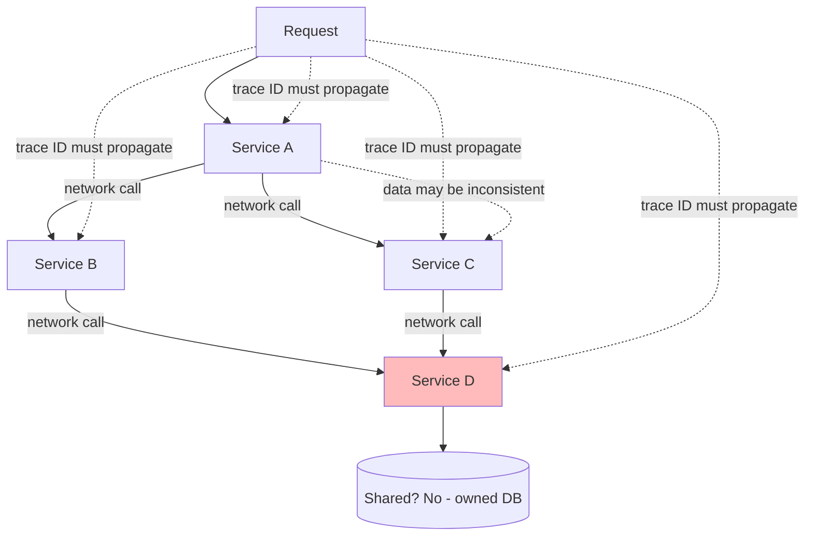
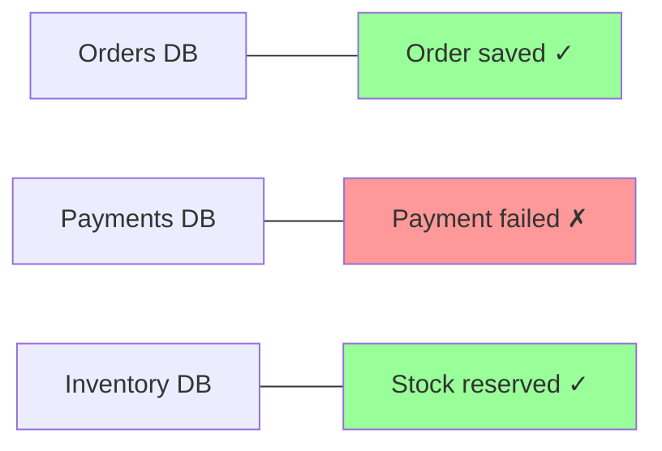
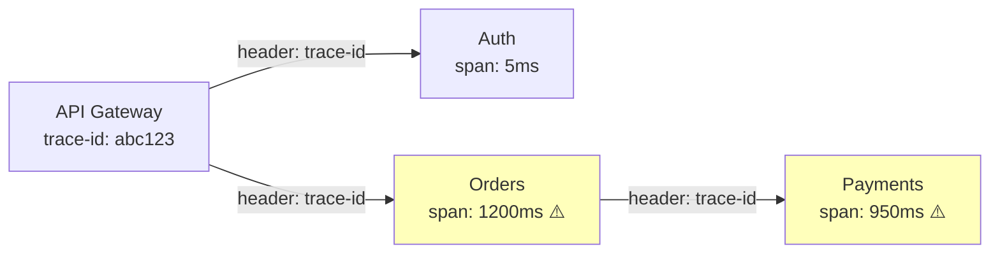
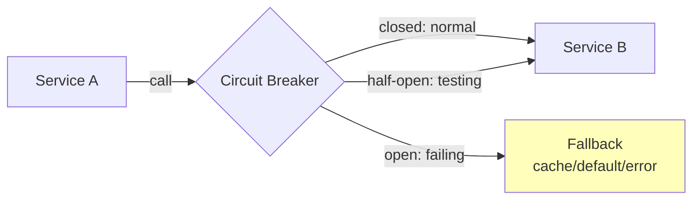
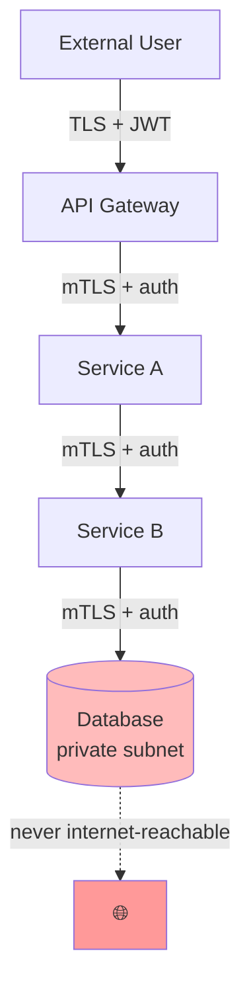

# 🧠 Topic: Challenges of Microservices

> [!abstract] Executive Summary (ELI5)
> Microservices challenges are like running a chain of food trucks instead of one restaurant. In one restaurant, the kitchen sees the whole order and can fix mistakes instantly. With food trucks, the burger truck doesn't know what the drink truck poured — you need a system to keep orders consistent (data consistency), track which truck has your full order (distributed tracing), deal with the walkie-talkie delays between trucks (network overhead), make sure only staff enter each truck (security), and run a whole new **operations crew** to deploy, monitor, and repair every truck independently (DevOps complexity).

---

## 🎯 The "Why"
- **Problem Solved:** What are the costs you **must** pay when you adopt microservices, and how do you mitigate them?
- **Alternatives:** A [[Monolithic Architecture|monolith]] avoids all four challenges (shared memory, single transaction, no network, one trust boundary) — at the cost of independent scaling and team autonomy.
- **Trade-offs:** These challenges are the "tax" of distribution. You accept them because the benefits (independent scaling, team autonomy, fault isolation) outweigh the costs *at scale*.

## 💡 Mental Model & Analogy
- **Analogy:** "Microservices challenges are the friction of a long supply chain." One factory (monolith) has no shipping delays. A global supply chain (microservices) has customs, transit times, lost shipments, and security checkpoints at every border — plus a **separate logistics team for every factory** (DevOps). You accept the friction because specialization and scale pay off — but you must engineer for it.
- **Visual/Diagram:**

## 🛠️ Core Principles

Five challenges define the microservices "tax":

1. **Data consistency** across independently-owned databases
2. **Distributed tracing** across many service hops
3. **Network overhead** from inter-service calls
4. **Security** across many trust boundaries
5. **DevOps & operational complexity** — many independently-deployable services need their own pipelines, environments, observability, and on-call rotation. *This is often the deciding factor in whether to adopt microservices at all.*

### 1. Data Consistency

The hardest challenge. With [[Identifying Microservices#3. Data Ownership|database-per-service]], there are **no cross-service ACID transactions**. A single business operation (e.g., "place an order") may need to update Orders, Payments, and Inventory — each in its own database. You can't wrap them in one `BEGIN/COMMIT`.

#### The Problem

If Payment fails after Order is saved and Inventory reserved, the system is in an **inconsistent state**. In a monolith, one transaction rolls everything back. In microservices, there's no global transaction.

#### Solutions

**1. Saga Pattern**
A **saga** is a sequence of local transactions, each with a **compensating action** to undo it on failure. There's no global ACID — instead, each step can be rolled back individually.

| Step | Action | Compensation |
|------|--------|--------------|
| 1 | Reserve inventory | Release inventory |
| 2 | Charge card | Refund card |
| 3 | Confirm order | Cancel order |

If step 2 fails, the saga runs compensations backward: release inventory. The system reaches a consistent state, just not via a rollback.

Two flavors:
- **Choreography:** each service emits events; the next reacts. Decentralized but harder to track.
- **Orchestration:** a central orchestrator service drives the flow. Easier to visualize and manage, but adds a central component.

**2. Eventual Consistency + Events**
Accept that data will be consistent *eventually*, not immediately. The Orders service emits `OrderPlaced`; Inventory and Payment catch up asynchronously. Clients may see slightly stale data for a few seconds. This is the trade-off you accept for decoupling.

**3. Outbox Pattern**
Solve the **dual-write problem**: when a service must update its DB *and* emit an event, doing them as two separate writes is unsafe (one might fail). The **Outbox pattern** writes the event to an `outbox` table **in the same transaction** as the data change, then a separate process (polling publisher or Change Data Capture like Debezium) publishes to the broker. Atomicity guaranteed.

**4. Idempotent Consumers**
Because delivery is at-least-once (duplicates happen), consumers must be **idempotent** — processing an event twice has the same effect as once. Deduplicate by `eventId`, or design naturally idempotent operations (`SET x = 5` is safe; `x += 1` is not).

> [!tip] Don't fight eventual consistency — design for it
> The mindset shift: stop trying to preserve ACID across services. Instead, design each service to be eventually consistent, use sagas for multi-step workflows, and make consumers idempotent. The Outbox pattern ensures your events are reliably emitted.

### 2. Distributed Tracing

A single user request may cross 5+ services. When it's slow or fails, **where** is the problem? Without tracing, you're guessing.

#### The Problem
Each service has its own logs. Without a way to tie them together, "the request took 4 seconds" tells you nothing about which service was slow. It's like trying to follow a package through a shipping company where each warehouse keeps separate, unlinked records.

#### Solution: Distributed Tracing
- **Trace ID:** every request gets a unique ID at the API gateway, **propagated via HTTP headers** to every downstream service.
- **Spans:** each service records a "span" — its portion of the work, with start/end time, service name, and the trace ID.
- **Trace tree:** spans are assembled into a tree showing the full path, so you can see exactly where time was spent and which service failed.

**Tools:** Jaeger, Zipkin, OpenTelemetry (the emerging standard), AWS X-Ray, Datadog APM.

**The three pillars working together:**
- **Tracing** shows the path and timing.
- **Metrics** show aggregate health (rate, error rate, latency).
- **Logging** shows the details at each hop.
All tied together by the **trace ID**.

> [!warning] No tracing = blind
> In a microservices system without distributed tracing, debugging a slow or failed request is a multi-hour forensic exercise. Tracing is mandatory, not optional — design for it from day one.

### 3. Network Overhead

In a monolith, function calls are **nanoseconds** (in-process). In microservices, every call is a **network call** — milliseconds. That's roughly a **1000x latency increase per hop**, plus serialization, plus the possibility of failure.

#### The Problem
- **Latency:** each hop adds milliseconds; a chain of 4 services adds 4× network round-trips.
- **Failure:** networks fail — timeouts, packet loss, partitions, DNS issues. Every call can fail.
- **Serialization:** data must be marshalled (JSON/Protobuf) at each boundary — CPU cost.
- **Chattiness:** many small calls per action multiply all of the above.

#### Solutions

| Problem | Solution |
|---------|----------|
| **Latency from hops** | Colocate services in the same data center/VPC; use **gRPC** (HTTP/2 multiplexing, binary) for internal calls; **batch** requests; use **async** for non-critical paths |
| **Failures** | **Timeouts** (never block forever), **retries with backoff** (handle transient failures), **circuit breakers** (stop calling a failing service) |
| **Serialization overhead** | Use **binary protocols** (Protobuf/gRPC) instead of JSON for internal calls |
| **Chattiness** | **Batch/aggregate** API calls; design coarse-grained APIs; use **API composition** (a single service fans out and merges) |
| **Cascade failures** | **Circuit breaker** (stop calling a downstream that's failing), **bulkheads** (isolate resources per dependency), **graceful degradation** (serve stale/limited data) |

**The Circuit Breaker Pattern:**

When Service B fails repeatedly, the circuit "opens" — A stops calling B and returns a fallback (cached data, default, or fast error) instead of blocking. After a cooldown, it "half-opens" to test if B has recovered.

> [!tip] Assume the network will fail
> Every inter-service call must have a timeout, retry-with-backoff, and circuit breaker. Treat the network as unreliable by default. The biggest mistake is assuming synchronous calls "just work."

### 4. Security

A monolith has **one trust boundary** (the client-to-server edge). Microservices have **many** — every service-to-service call crosses a boundary. More boundaries mean more attack surface.

#### The Problems
- **Expanded attack surface:** every service endpoint is a potential entry point.
- **Credential sprawl:** services need credentials to call each other; managing them securely is hard.
- **Lateral movement:** if one service is compromised, how do you stop the attacker from reaching others?
- **Unencrypted internal traffic:** many teams leave service-to-service traffic unencrypted, trusting the network.
- **Inconsistent auth/authz:** each service reimplementing security leads to gaps.

#### Solutions

| Problem | Solution |
|---------|----------|
| **Encrypt internal traffic** | **Mutual TLS (mTLS)** between services — both sides verify each other's certificates. Often handled by a **service mesh** (Istio, Linkerd) via sidecars. |
| **Service identity & auth** | Each service has a **cryptographic identity** (SPIFFE/SPIRE, or mesh-issued certs); calls authenticate via mTLS, not shared secrets. |
| **Authorization** | **OAuth2 / JWT** for user-context calls; scope-based or policy-based (OPA) authorization at each service. **Zero Trust**: never trust a call because it's "internal." |
| **Network segmentation** | Put services in **private subnets**; the database must never be internet-reachable. Use **firewalls/security groups** to limit east-west traffic. |
| **Centralized auth policy** | Don't let each service reimplement security; use an **API gateway** for edge auth and a **service mesh** for internal auth. |
| **Secrets management** | Store secrets in a **vault** (HashiCorp Vault, AWS Secrets Manager); never in code or env files checked into git. |

**Zero Trust Architecture:**
The core principle: **never trust, always verify.** Don't assume a call is safe because it came from inside the network. Every service-to-service call must authenticate and authorize. This is the opposite of the "castle-and-moat" model where the internal network is trusted.

### 5. DevOps & Operational Complexity

A monolith is **one artifact to build, deploy, monitor, and roll back**. Microservices multiply every step of the delivery pipeline by N. This is the challenge teams most underestimate — the four challenges above are *technical*; this one is *organizational and operational*, and it's often what actually sinks a microservices effort.

> [!quote] Martin Fowler's Prerequisite
> "You shouldn't start a new project with microservices, even if you're sure your application is big enough. … For most people, a monolith is the right starting point." Microservices require a baseline of **DevOps maturity** (CI/CD, automated deployment, observability, rapid provisioning) before they pay off.

#### The Problems

| Problem | What Happens |
|---------|--------------|
| **N × pipelines** | Each service needs its own CI/CD pipeline: build, test, containerize, deploy, verify. 40 services = 40 pipelines to maintain. |
| **N × environments** | Each service needs dev/staging/prod. Provisioning, configuration, and cost scale linearly with service count. |
| **Deployment ordering & versioning** | Services depend on each other's APIs. Deploying v2 of Service A may break Service B if it's still on the v1 contract. Need versioning + backward-compat discipline. |
| **Local dev friction** | Running 20 services locally to test one change is painful. Developers need Docker Compose, Telepresence, or mock/stub strategies. |
| **Environment drift** | Each service team owns its own config, libs, runtime versions. Without enforcement, the fleet fragments (a "snowflake" per service). |
| **Observability sprawl** | N services × logs, metrics, and traces → a **firehose**. Without centralized tooling, you can't correlate incidents. |
| **On-call burden** | With N services, who pages whom? Without clear ownership and runbooks, alerts bounce between teams (alert fatigue, slow MTTR). |
| **Infrastructure cost** | Each service needs its own compute, often with redundancy for HA. Idle services still cost money. Resource utilization drops vs. a shared monolith. |
| **Provisioning & orchestration** | You need container orchestration (Kubernetes, ECS, Nomad), service discovery, config management, secret rotation — an entire platform. |

#### Solutions

**1. CI/CD as a First-Class Citizen**
Every service must have an **automated, self-service pipeline**: commit → build → test → container image → deploy → health check. Without this, deployment becomes a bottleneck and a manual-error factory.
- **Templates/scaffolding:** a "golden path" — new services are generated from a template with CI/CD, logging, tracing, health checks pre-wired.
- **Trunk-based + feature flags:** decouple deploy from release. Deploy continuously; enable features per-environment/per-user.
- **Immutable artifacts:** build the container once, promote the **same image** through environments. No "rebuild for prod."

**2. Containerization + Orchestration (Kubernetes)**
- **Containers (Docker)** make each service a portable, self-contained artifact — same runtime in dev and prod.
- **Kubernetes** (or managed equivalents: EKS, GKE, AKS, ECS) provides: declarative deployment, autoscaling, self-healing (restart failed pods), service discovery, rolling updates, rollbacks, and ConfigMaps/Secrets.
- The orchestration platform is the foundation that makes N × services manageable. **Without it, you're doing manual ops on N services.**

**3. Infrastructure as Code (IaC)**
Manage infrastructure (clusters, networks, DBs, queues, DNS) the way you manage code: **versioned, reviewed, reproducible**.
- **Tools:** Terraform (multi-cloud), Pulumi (IaC in real languages), CloudFormation (AWS-native), Crossplane (Kubernetes-native).
- **Why it matters:** kills environment drift, enables reproducible environments, makes infra changes auditable and reviewable.

**4. Observability — the Three Pillars, Centralized**
You already need distributed tracing (challenge #2). Add:
- **Metrics** (Prometheus + Grafana, Datadog): RED (Rate, Errors, Duration) and USE (Utilization, Saturation, Errors) per service.
- **Logs** (ELK/Loki + structured logging): searchable, correlated by trace ID.
- **Traces** (OpenTelemetry → Jaeger/Tempo): see challenge #2.
- **Dashboards + SLOs/SLIs:** define error budgets. Alert on user-visible symptoms, not raw CPU.

> [!tip] Observability is not optional
> In a monolith, you can `grep` one log file. With N services, you need structured logging, centralized aggregation, and trace-ID correlation from day one. "We'll add it later" is the classic microservices failure — by the time you need it, you're debugging an incident blind.

**5. Clear Ownership (Conway's Law)**
Conway's Law: *"Any organization that designs a system will produce a design whose structure is the organization's communication structure."* Align services to **team boundaries** (see [[Identifying Microservices]] — Domain-Driven Design bounded contexts). Each service has:
- **One owning team** (2-pizza team) that deploys it, monitors it, and is paged for it.
- **An on-call runbook** — what to do when it breaks.
- **Documented SLOs** — what callers can rely on.
Without ownership, services become **orphaned** — nobody knows how they work, and they rot.

**6. Standardization Without Stifling Autonomy**
The balance: teams should be **autonomous in their service**, but the **platform** must be standardized. Provide:
- A **platform team** that builds the golden path (CI/CD template, observability, service mesh, secrets).
- Approved tech stacks (limit language/runtime fragmentation) — but allow exceptions with justification.
- Shared libraries for cross-cutting concerns (auth, logging, tracing, resilience) so teams don't reinvent them per-service.

**7. Service Mesh (when N gets large)**
A **service mesh** (Istio, Linkerd, Consul) moves cross-cutting concerns — mTLS, retries, circuit breaking, traffic shaping, observability — out of application code into **sidecar proxies**. At small N it's overkill; at large N (dozens–hundreds of services), it dramatically reduces per-service boilerplate and operational burden.

**8. GitOps / Progressive Delivery**
- **GitOps (Argo CD, Flux):** Git is the source of truth for cluster state; the controller reconciles drift automatically.
- **Progressive delivery:** **canary** (route 1% → 10% → 100% of traffic), **blue/green**, **feature flags**. Catch bad deploys early before they hit everyone.
- **Auto-rollback:** if health checks fail during rollout, automatically revert.

#### When NOT to Adopt — The Maturity Prerequisites

Microservices are a **scaling optimization**, not a starting point. Do **not** adopt them if you lack:

| Prerequisite | Why It's Required |
|--------------|-------------------|
| **Rapid provisioning** (minutes, not weeks) | Without self-service infra, N services = N tickets = gridlock |
| **Continuous deployment pipeline** | Manual deploys of N services don't scale and break constantly |
| **Strong observability culture** | You cannot operate what you cannot see (tracing, metrics, logs) |
| **DevOps culture (not just a team)** | "You build it, you run it." Each team owns its service in prod |
| **Clear domain boundaries** | Otherwise services become a "distributed monolith" — worst of both worlds |
| **Sufficient team size** | Each service needs an owner; too few people = orphaned services |

> [!warning] The Distributed Monolith
> The most common failure mode: adopt microservices **without** independent deployability, clear boundaries, or automation. You get N services that must all be deployed together, share a database, and break as one. This is a **distributed monolith** — it has all the costs of microservices and none of the benefits. Worse than the monolith you started with.

## 🏗️ The Role in System Design

### These Challenges Are the "Microservices Tax"
Every challenge here is a **cost of distribution**. A monolith avoids them all. You pay this tax because the benefits (independent scaling, team autonomy, fault isolation) outweigh it *at organizational scale*. If you can't pay the tax (no DevOps maturity, small team, no clear domain boundaries), don't adopt microservices. **The DevOps/operational tax is usually the deciding factor** — not the technical challenges, which have well-understood solutions, but the org's ability to operate N services reliably.

### Challenges Inform Patterns
Each challenge spawned an industry-standard pattern:

| Challenge | Pattern |
|-----------|---------|
| Data consistency | **Saga**, **Outbox**, idempotent consumers |
| Distributed tracing | **OpenTelemetry**, Jaeger/Zipkin, correlation IDs |
| Network overhead | **Circuit breaker**, retries, gRPC, bulkheads |
| Security | **Zero Trust**, mTLS, service mesh, network segmentation |
| DevOps & operations | **CI/CD pipelines**, **Kubernetes**, **IaC (Terraform)**, **GitOps**, **SLOs**, progressive delivery, platform team |

### The Discipline
The unifying discipline: **assume everything will fail.** The network will drop calls, services will be down, data will be temporarily inconsistent, and attackers will probe every boundary. Good microservices design engineers for these realities from day one.

## ⚠️ Pitfalls & Anti-patterns
- **Assuming the network is reliable:** the #1 distributed-systems fallacy. Every call needs timeouts, retries, and circuit breakers.
- **Fighting for ACID across services:** it's not possible with database-per-service. Use sagas and accept eventual consistency.
- **No distributed tracing:** debugging blind. Mandatory from day one.
- **Unencrypted internal traffic:** "internal" doesn't mean "trusted." Use mTLS.
- **Dual-write without Outbox:** updating DB and emitting event as separate steps — one will fail eventually. Use the Outbox pattern.
- **Non-idempotent consumers:** at-least-once delivery + non-idempotent consumer = double charges/emails.
- **One compromised service exposes everything:** no network segmentation, no zero trust — lateral movement is easy.
- **Skipping secrets management:** credentials in env files or code. Use a vault.
- **The distributed monolith:** microservices that must be deployed together, share a database, or break as one. All the cost, none of the benefit.
- **No CI/CD:** manual deploys of N services. Every release is a high-risk event.
- **Adopting microservices without DevOps maturity:** no rapid provisioning, no observability, no automation. The operational tax will drown the team.
- **Orphaned services (no clear owner):** nobody knows how the service works or is paged for it. It rots and eventually breaks silently.
- **Tech-stack fragmentation:** every team picks a different language/runtime/lib. The platform team can't support it; hiring and onboarding get harder.
- **Premature microservices (starting greenfield with microservices):** Fowler's advice — start with a monolith and extract when domain boundaries are clear. You don't yet know the seams.
- **No progressive delivery:** deploys go straight to 100% of traffic. A bad deploy hits everyone; rollback is the only safety net.

## 🔗 Deep Connections
- **Parent Topic:** [[Microservices Overview]]
- **Previous:** [[Microservices Communication]] — communication is the source of most challenges.
- **Next:** [[Microservices Scaling Strategies]] — scaling amplifies these challenges.
- **Related Concepts:** [[Event-Driven Architecture]] (sagas, events, Outbox), service mesh (Istio, Linkerd), OpenTelemetry, circuit breakers, zero trust, [[Caching]], CI/CD, Kubernetes, Infrastructure as Code (Terraform), GitOps (Argo CD), SLOs/error budgets, [[Identifying Microservices]] (bounded contexts → ownership)
- **Prerequisites:** [[Microservices Overview]], [[Microservices Communication]], basic distributed-systems knowledge.

## ❓ Active Recall Questions
> [!faq]- Why is data consistency harder in microservices than in a monolith?
> Because with database-per-service, there are **no cross-service ACID transactions**. A single business operation (place an order) may need to update Orders, Payments, and Inventory — each in its own DB. If one fails mid-flow, you can't roll them all back. In a monolith, one transaction handles it; in microservices, you need sagas and eventual consistency.
<!-- #flashcards/system-design -->

> [!faq]- What is the Saga pattern, and how does it solve cross-service consistency?
> A sequence of **local transactions** across services, where each step has a **compensating action** to undo it on failure. If step 2 (charge card) fails after step 1 (reserve inventory), the saga runs step 1's compensation (release inventory). There's no global ACID — the system reaches consistency through compensations. Two flavors: **choreography** (events) and **orchestration** (central driver).
<!-- #flashcards/system-design -->

> [!faq]- What is the dual-write problem, and how does the Outbox pattern solve it?
> When a service must update its DB *and* emit an event, doing them as two separate writes is unsafe — one might fail, leaving inconsistent state. The **Outbox pattern** writes the event to an `outbox` table in the **same transaction** as the data change, then a separate process (polling publisher or Change Data Capture like Debezium) publishes to the broker. Atomicity guaranteed.
<!-- #flashcards/system-design -->

> [!faq]- Why is distributed tracing mandatory in microservices?
> A single request may cross 5+ services. Without a **trace ID propagated across every hop**, you can't tell which service was slow or failed — debugging is a multi-hour forensic exercise. Tracing (Jaeger, Zipkin, OpenTelemetry) assembles spans into a tree showing the full path, timing, and failure point. It's mandatory, not optional.
<!-- #flashcards/system-design -->

> [!faq]- Why is network overhead a challenge, and how do you mitigate it?
> In-process calls are nanoseconds; network calls are milliseconds (~1000x), plus serialization and failure risk. Mitigate with: **gRPC** (binary, multiplexed) for internal calls, **batching/aggregation** to reduce round-trips, **timeouts + retries + circuit breakers** on every call, **colocation** in the same data center, and **async** for non-critical paths. Assume the network will fail.
<!-- #flashcards/system-design -->

> [!faq]- What is a circuit breaker, and when does it help?
> A pattern that **stops calling a failing downstream service**. When Service B fails repeatedly, the circuit "opens" — A stops calling B and returns a fallback (cached data, default, or fast error) instead of blocking and cascading. After a cooldown, it "half-opens" to test recovery. It prevents one slow/down service from taking down its callers.
<!-- #flashcards/system-design -->

> [!faq]- Why does microservices security need Zero Trust?
> A monolith has one trust boundary; microservices have many — every service-to-service call crosses a boundary. "Internal" doesn't mean "trusted." **Zero Trust** means every call authenticates and authorizes, never assumed safe because of network location. Implement with mTLS (often via a service mesh), OAuth2/JWT, network segmentation, and a vault for secrets.
<!-- #flashcards/system-design -->

> [!faq]- What are the core challenges of microservices, and what's the unifying mindset?
> **Data consistency** (no cross-service ACID → sagas), **distributed tracing** (need trace IDs across hops), **network overhead** (1000x latency + failure → circuit breakers), **security** (many trust boundaries → Zero Trust), and **DevOps/operational complexity** (N × pipelines, environments, observability → CI/CD, Kubernetes, IaC). The unifying mindset: **assume everything will fail** — the network, services, data consistency — and engineer for it from day one. The DevOps tax is usually what decides whether microservices are viable at all.
<!-- #flashcards/system-design -->

> [!faq]- Why is DevOps maturity a prerequisite for microservices, and what happens without it?
> Each service needs its own CI/CD pipeline, environments, observability, and on-call owner. N services multiply every ops step by N. Without **rapid provisioning, continuous deployment, centralized observability, and a "you build it, you run it" culture**, the operational tax drowns the team. The worst outcome is a **distributed monolith** — services that must deploy together, share a DB, and break as one: all microservice costs, none of the benefits.
<!-- #flashcards/system-design -->

> [!faq]- When should you NOT adopt microservices?
> Don't adopt them if you lack: rapid infra provisioning (minutes, not weeks), a CI/CD pipeline, an observability culture (traces/metrics/logs), a DevOps mindset (teams own services in prod), clear domain boundaries, or enough people to own each service. **Don't start greenfield with microservices** — begin with a monolith and extract once the domain seams are clear (Fowler's advice).
<!-- #flashcards/system-design -->

---

*Last updated: 2026-07-16*
