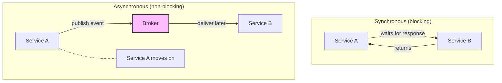
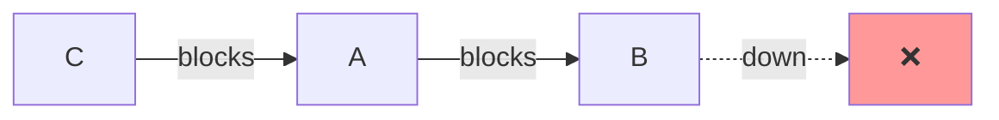
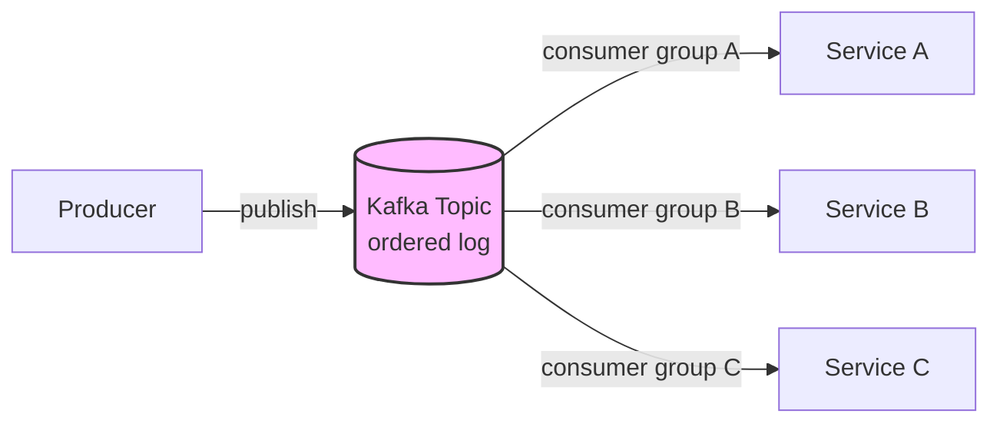

# 🧠 Topic: Communication in Microservices

> [!abstract] Executive Summary (ELI5)
> Communication in microservices is like people coordinating in an office. **Synchronous** is calling a colleague on the phone — you wait on the line until they answer (REST, gRPC). **Asynchronous** is dropping a memo in their mailbox — you move on, and they read it when ready (Kafka, RabbitMQ, SNS/SQS). Phone calls get immediate answers but block both of you; memos let everyone keep working but create a delay.

---

## 🎯 The "Why"
- **Problem Solved:** How do independently deployed services exchange information and coordinate behavior over a network that can fail?
- **Alternatives:** In-process function calls (only possible in a monolith), shared memory (impossible across services).
- **Trade-offs:** Synchronous is simple and immediate but creates temporal coupling; asynchronous is decoupled and resilient but introduces eventual consistency and complexity.

## 💡 Mental Model & Analogy
- **Analogy:** "Sync is a phone call; async is an email." A phone call blocks both parties until resolved — immediate but fragile (if they don't pick up, you're stuck). An email lets you send and move on — resilient and scalable, but you can't be sure when (or if) it's read.
- **Visual/Diagram:**

## 🛠️ Core Principles

Communication in microservices falls into two fundamental modes:

| Aspect | Synchronous | Asynchronous |
|--------|-------------|--------------|
| **Caller behavior** | Blocks until response | Moves on immediately |
| **Coupling** | Temporal (both must be up) | Loose (producer doesn't wait) |
| **Consistency** | Immediate (response confirms) | Eventual (consumer catches up) |
| **Failure mode** | Cascades up (caller fails too) | Buffered (events queue) |
| **Use case** | Reads needing fresh data | Writes with side effects |
| **Protocols** | REST, gRPC, GraphQL | Kafka, RabbitMQ, SNS/SQS |

### 1. Synchronous Communication

The caller sends a request and **waits** for the response before proceeding. Think REST APIs, gRPC calls, GraphQL queries.

#### REST (HTTP/JSON)
- **How:** Standard HTTP verbs (GET, POST, PUT, DELETE) over HTTP, usually with JSON payloads.
- **Pros:** Ubiquitous and human-readable; easy to cache (HTTP caching); great for public APIs and browser/mobile clients; huge tooling ecosystem.
- **Cons:** Verbose (text-based JSON); no native streaming; one-request-one-response model; HTTP overhead per call.
- **Best for:** Public APIs, external clients, simple request-response flows, human-readable contracts.

#### gRPC (HTTP/2 + Protobuf)
- **How:** Binary protocol over HTTP/2; strongly-typed contracts via Protocol Buffers (`.proto` files); supports unary, server-streaming, client-streaming, and bidirectional streaming.
- **Pros:** Fast (binary, multiplexed over one connection); strongly typed (schema is the contract); supports streaming; low latency — ideal for service-to-service.
- **Cons:** Not browser-friendly (needs a gateway); binary is not human-readable; steeper learning curve.
- **Best for:** Internal service-to-service communication, high-throughput / low-latency calls, polyglot environments (code generation for many languages).

#### GraphQL
- **How:** A query language where the client specifies exactly the fields it wants; a single endpoint serves many query shapes.
- **Pros:** No over/under-fetching (client gets exactly what it asks for); great for aggregating data from multiple services; strong developer experience for frontend.
- **Cons:** Complex to implement server-side; risk of tight coupling (client knows the graph deeply); caching is harder than REST; N+1 query risk.
- **Best for:** Complex client-driven queries (e.g., a rich dashboard pulling from many services), mobile clients minimizing round-trips.

#### When to Use Synchronous
- You need an **immediate response** to proceed (e.g., "is this item in stock? *right now*").
- A **read** that needs fresh data.
- A simple query/response where the caller can't proceed without the answer.
- You're exposing a **public API** to external clients.

#### The Danger: Temporal Coupling
Synchronous calls create **temporal coupling** — both services must be up and responsive at the same time. If Service B is slow or down:
- Service A blocks, then times out.
- If A is called by C, C also blocks — the failure **cascades up** the call chain.

> [!warning] Avoid long synchronous chains
> A → B → C → D means four services must all be up. One slow hop cascades. Keep sync chains short; use circuit breakers and timeouts on every call; move cross-service **writes** to async.

### 2. Asynchronous Communication

The sender emits a message/event and **moves on immediately**; the receiver processes it whenever it's ready. A broker (Kafka, RabbitMQ, SNS/SQS) mediates.

#### Message Queue (Point-to-Point)
- **How:** Producer enqueues a message; **exactly one** of N competing consumers processes it.
- **Tools:** RabbitMQ, AWS SQS, ActiveMQ.
- **Best for:** Background jobs, task distribution, work segregation (e.g., "process this video," "send this email"). Parallelizing work across many workers.

#### Pub/Sub (Topic-based)
- **How:** Producer publishes to a topic; **many subscribers** each get their own copy.
- **Tools:** Kafka, AWS SNS, Google Pub/Sub, NATS.
- **Best for:** Broadcasting state changes to many independent consumers (e.g., `OrderPlaced` → inventory, payment, email, analytics all react).

#### Event Streaming (Log-based)
- **How:** A durable, append-only log of events; consumers read at their own pace and keep their position.
- **Tools:** Kafka (the canonical example), Pulsar, Kinesis.
- **Best for:** Event sourcing, stream processing, audit logs, replaying history, decoupling producers from many consumers at different speeds.

#### When to Use Asynchronous
- A **write with side effects** (e.g., `OrderPlaced` → debit inventory, charge payment, send email).
- The producer doesn't need an immediate response.
- You want to **decouple** producer from consumer (different scales, availability).
- **Bursty traffic** — the broker buffers spikes so consumers aren't overwhelmed.
- Many independent reactions to one event (fan-out).

> [!tip] Prefer async for cross-service writes
> Synchronous chains create cascading failures. For cross-service **writes** with side effects, prefer events: the producer emits `OrderPlaced` and returns success to the user immediately; inventory, payment, and email each react asynchronously. Reserve synchronous calls for reads needing fresh data.

### Choosing Between Sync and Async

| If you need... | Choose... |
|----------------|-----------|
| Immediate response to proceed | **Synchronous** (REST/gRPC) |
| Fresh data right now (read) | **Synchronous** |
| Fire side effects and move on | **Asynchronous** (events) |
| Decouple producer from consumer | **Asynchronous** |
| Buffer spiky traffic | **Asynchronous** |
| Many reactions to one change | **Asynchronous** (pub/sub) |
| High-throughput streaming | **Asynchronous** (Kafka) |

### Service Discovery (Supporting Both Modes)

With services coming and going (instances scaling, containers restarting), callers need to find them regardless of communication mode:

- **Service registry** (Consul, Eureka, etcd): services register their address; callers look them up.
- **Client-side discovery:** caller queries the registry and picks an instance.
- **Server-side discovery:** a load balancer or sidecar (Envoy in Istio/Linkerd) handles lookup.
- **Kubernetes Services:** a stable DNS name backed by dynamic pods.

## 🏗️ The Role in System Design

### Most Real Systems Use Both
A typical microservices system uses **synchronous for reads** (a user needs an answer now) and **asynchronous for writes** (side effects can happen in the background). The API gateway fronts synchronous client calls; internal cross-service writes flow through a broker.

### Communication Patterns Recap
| Pattern | Mechanism | Use Case |
|---------|-----------|----------|
| **Request-Response** | REST/gRPC sync | Reads, immediate answers |
| **Pub/Sub** | Kafka/SNS async | Broadcasting events, fan-out |
| **Queue** | RabbitMQ/SQS async | Work distribution, background jobs |
| **Streaming** | gRPC stream, Kafka | Continuous data flows |
| **Saga (orchestrated/choreographed)** | Events + commands | Distributed transactions |

## ⚠️ Pitfalls & Anti-patterns
- **Long synchronous chains (A→B→C→D):** every hop is a failure point; latency compounds. Keep chains short; async where possible.
- **No timeouts/retries/circuit breakers on sync calls:** a slow downstream cascades and takes down callers. Every sync call needs all three.
- **Using sync for everything:** cross-service writes with side effects should be async to avoid cascading failures.
- **Treating events as commands:** assuming exactly one consumer handles an event. Events are facts; commands are requests — don't conflate them.
- **No dead-letter queue (DLQ):** a poison message wedges the consumer forever. Always configure a DLQ.
- **Ignoring idempotency:** at-least-once delivery means duplicates; non-idempotent consumers double-charge or double-send.
- **Chatty protocols:** many small sync calls per action. Batch or aggregate; consider gRPC for internal calls.
- **No schema/contract:** untyped JSON payloads drift. Use Protobuf or a schema registry.

## 🔗 Deep Connections
- **Parent Topic:** [[Microservices Overview]]
- **Previous:** [[Structuring Microservices]] — clear APIs are the synchronous contract.
- **Next:** [[Microservices Challenges]] — communication is the source of most challenges (consistency, tracing, network overhead).
- **Related Concepts:** [[Event-Driven Architecture]] (async communication is EDA), [[Client Server Model]], REST, gRPC, Kafka, RabbitMQ, [[API Gateways]], service mesh
- **Prerequisites:** [[Microservices Overview]], basic networking (HTTP, TCP).

## ❓ Active Recall Questions
> [!faq]- What are the two fundamental communication modes in microservices?
> **Synchronous** (caller blocks until response — REST, gRPC, GraphQL) and **Asynchronous** (sender emits and moves on — Kafka, RabbitMQ, SNS/SQS). Sync is immediate but creates temporal coupling; async is decoupled and resilient but introduces eventual consistency.
<!-- #flashcards/system-design -->

> [!faq]- When would you choose REST vs gRPC for service communication?
> **REST** for public APIs, browser/mobile clients, and human-readable contracts — it's ubiquitous and cacheable. **gRPC** for internal service-to-service calls needing low latency and high throughput — it's binary (Protobuf), strongly typed, multiplexed over HTTP/2, and supports streaming. A common split: gRPC between services, REST at the public API gateway.
<!-- #flashcards/system-design -->

> [!faq]- What is temporal coupling, and why is it the main risk of synchronous communication?
> Temporal coupling means both services must be **up and responsive at the same time**. If Service B is slow or down, Service A blocks, then times out — and if C called A, C blocks too. Failures cascade up the chain. Mitigate with timeouts, retries, circuit breakers, and by moving cross-service writes to async.
<!-- #flashcards/system-design -->

> [!faq]- What's the difference between a message queue and pub/sub?
> **Queue (point-to-point):** one message is processed by **exactly one** of N competing consumers — used for work distribution and background jobs (RabbitMQ, SQS). **Pub/Sub (topic):** one message fans out to **many subscribers**, each getting its own copy — used for broadcasting state changes (Kafka, SNS). Kafka supports both via partitions and consumer groups.
<!-- #flashcards/system-design -->

> [!faq]- When should you prefer asynchronous communication over synchronous?
> For **writes with side effects** (OrderPlaced → inventory, payment, email), when you want to **decouple** producer from consumer (different scales/availability), to **buffer spiky traffic**, when many independent reactions must fire from one event (fan-out), and for high-throughput streaming. Reserve sync for reads needing fresh data or immediate responses.
<!-- #flashcards/system-design -->

> [!faq]- Why should cross-service writes prefer async over sync?
> Synchronous write chains create cascading failures — if the payment service is down, the order placement fails too, even though the order itself is valid. With async, the Orders service emits `OrderPlaced` and returns success to the user immediately; payment, inventory, and email each react independently. If one is down, events buffer and catch up — no cascade.
<!-- #flashcards/system-design -->

> [!faq]- What is service discovery, and why is it needed?
> Because service instances come and go (scaling, restarts, containers), callers need a way to find them. A **service registry** (Consul, Eureka, etcd) tracks live instances; callers use **client-side discovery** (pick an instance themselves) or **server-side discovery** (a load balancer/sidecar picks for them). In Kubernetes, a `Service` gives a stable DNS name backed by dynamic pods.
<!-- #flashcards/system-design -->

> [!faq]- How do most real microservices systems combine sync and async?
> **Synchronous for reads** (a user needs an answer now — "is this in stock?") and **asynchronous for writes** with side effects (OrderPlaced → inventory, payment, email). The API gateway fronts sync client calls; internal cross-service writes flow through a broker. This gives immediate responses where needed and decoupling/resilience where possible.
<!-- #flashcards/system-design -->

---

*Last updated: 2026-07-11*
