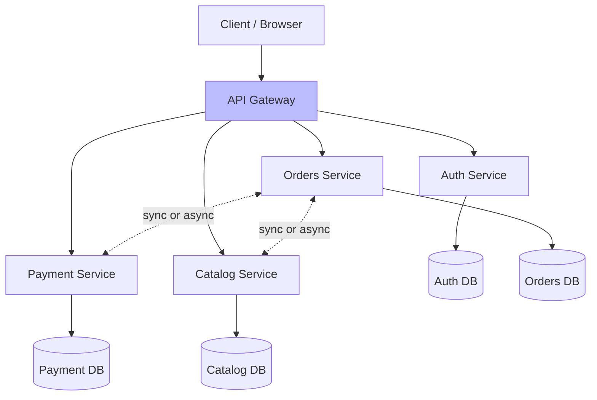

# 🧠 Topic: Microservices Architecture — Overview

> [!abstract] Executive Summary (ELI5)
> Microservices are like a food court in a mall. Instead of one giant restaurant with one kitchen making every kind of food (a monolith), you have many small specialized stalls — sushi, pizza, ice cream — each with its own chefs, ingredients, and opening hours. Customers hop between stalls. If the pizza place closes for renovation, the sushi place keeps serving. Each stall can be replaced or expanded without touching the others.

---

## 🎯 The "Why"
- **Problem Solved:** How do we build large systems where many teams work in parallel, different parts scale independently, and no single failure takes everything down?
- **Alternatives:** [[Monolithic Architecture]] (simple, but no independent scaling/deployment), [[Layered Architecture]] (organizes code internally, says nothing about deployment), SOA (an earlier, coarser-grained variant).
- **Trade-offs:** Microservices optimize for **independent scaling, deployment, and team autonomy** at the cost of **distributed-systems complexity, operational overhead, and eventual consistency**.

## 💡 Mental Model & Analogy
- **Analogy:** "A monolith is a department store; microservices are a city block of specialized shops." A department store has everything under one roof — one owner, one power supply. A city block has many independent shops, each with its own owner, inventory, and hours. Coordination is harder (different owners), but each shop is resilient and can expand independently.
- **Visual/Diagram:**

## 🛠️ Core Principles

### What is a Microservices Architecture
A **microservices architecture** structures an application as a **collection of small, autonomous services**, each:
- **Built around a business capability** (a bounded context) — not a technical layer.
- **Independently deployable** — each service has its own release cycle.
- **Owning its own data** — each service has a private database; no shared schema.
- **Communicating over the network** — via APIs (synchronous: HTTP/gRPC) or events (asynchronous: Kafka, RabbitMQ).
- **Owned by a small team** — the "two-pizza team" (6–8 people).

The unit of decomposition is the **service boundary**, drawn along business-capability lines. Where a [[Monolithic Architecture|monolith]] splits code into layers, microservices split it into vertical slices — each slice owning its UI, business logic, and data.

### Core Characteristics

| Characteristic | What It Means | Why It Matters |
|----------------|---------------|----------------|
| **Built around business capabilities** | A service maps to a bounded context (Orders, Payments, Catalog) — not a technical layer | Changes that belong together stay in one service; teams align with the business |
| **Independently deployable** | Each service has its own CI/CD pipeline and release cycle | Ship small, frequent, low-risk releases; a deploy of one service doesn't force a deploy of others |
| **Owns its own data** | Each service has a private database; no shared schema | Loose coupling; schema changes don't break other services; polyglot persistence |
| **Network-based communication** | Services talk via APIs (HTTP/gRPC) or events (Kafka/RabbitMQ) | Enables autonomy but introduces distributed-systems challenges |
| **Decentralized** | No central authority controlling all services; teams own their services end-to-end | Enables team autonomy and polyglot technology |
| **Failure-aware design** | Every call can fail; services handle timeouts, retries, circuit breakers | Resilience is a first-class concern, not an afterthought |
| **Smart endpoints, dumb pipes** | Business logic lives in services; the network is a simple transport | Avoids an intelligent (and fragile) middleware layer |

### Microservices vs. Monolith — At a Glance

| Aspect | [[Monolithic Architecture\|Monolith]] | Microservices |
|--------|----------|---------------|
| **Deployment** | One artifact | Per-service artifacts |
| **Scaling** | Whole app together | Per-service |
| **Data** | One shared database | Database per service |
| **Tech stack** | One stack | Polyglot (per service) |
| **Failure** | One bug can crash all | Fault-isolated per service |
| **Team autonomy** | Shared codebase (merge conflicts) | Team owns service end-to-end |
| **Complexity** | Code-level | Operational / distributed-systems |
| **Best for** | Small teams, MVPs, unknown domains | Large orgs, complex domains, independent scaling needs |

### The "Two-Pizza Team" and Conway's Law

Microservices are an **organizational** pattern as much as a technical one:

- **Two-pizza team:** A service should be owned by a team small enough to be fed by two pizzas (≈6–8 people). Larger teams have communication overhead that kills agility.
- **Conway's Law:** "Organizations produce systems that mirror their communication structure." If your org is organized by business domain (orders team, payments team), microservices aligned to those domains feel natural. **Reverse Conway:** structure teams the way you want the architecture to look.

> [!tip] Microservices solve the team-scaling problem
> A monolith can serve enormous traffic — what forces the move to microservices is usually **organizational scale** (many teams needing autonomy), not raw requests-per-second. See [[Monolithic Architecture#Real-World Examples]].

### Microservices Patterns (Overview)

A microservices system is only as good as the patterns around it. These are covered in depth in dedicated concept notes:

| Pattern | Purpose | Deep Dive |
|---------|---------|-----------|
| **API Gateway** | Single entry point; routing, auth, rate limiting | [[API Gateways]] |
| **Service Discovery** | Find service instances dynamically | [[Microservices Challenges]] |
| **Circuit Breaker** | Stop cascading failures when downstream is down | [[Microservices Challenges]] |
| **Saga** | Distributed transaction across services | [[Microservices Challenges]] |
| **Database per Service** | Each service owns its private data | [[Identifying Microservices]] |
| **BFF (Backend for Frontend)** | Gateway tailored to a specific client | — |

## 🏗️ The Role in System Design

### "Monolith First" — How You Usually Get Here
The recommended path is to **start as a monolith** and extract microservices only when a specific module demands independence. You learn the right boundaries by living with the domain first — see [[Microservices Architecture#The Role in System Design]].

### This Folder's Deep Dives
This folder breaks microservices into focused concept notes:

| Note | Topic |
|------|-------|
| **Microservices Overview** *(this note)* | Definition + core characteristics |
| [[Identifying Microservices]] | How to identify services: business capabilities, SRP, data ownership, independent deployability |
| [[Structuring Microservices]] | How to structure services: domain decomposition, APIs, granularity, observability |
| [[Microservices Communication]] | Sync (REST, gRPC) vs async (Kafka, RabbitMQ, SNS/SQS) |
| [[Microservices Challenges]] | Data consistency, distributed tracing, network overhead, security |
| [[Microservices Scaling Strategies]] | Horizontal scaling, auto-scaling, sharding, database scaling |

## ⚠️ Pitfalls & Anti-patterns
- **Distributed monolith:** Services share a DB, must deploy together, or sit in long sync chains — all costs, no benefits.
- **Premature decomposition:** Splitting before boundaries are understood.
- **Treating microservices as purely technical:** It's an organizational decision; without autonomous teams, it's just a hard-to-run monolith.

## 🔗 Deep Connections
- **Parent Topic:** [[Software Architecture]], [[Microservices Architecture]]
- **Related Concepts:** [[Monolithic Architecture]], [[Layered Architecture]], [[Event-Driven Architecture]], [[Client Server Model]], [[Domain-Driven Design]]
- **This Folder:** [[Identifying Microservices]] → [[Structuring Microservices]] → [[Microservices Communication]] → [[Microservices Challenges]] → [[Microservices Scaling Strategies]]
- **Prerequisites:** Distributed systems basics, networking, databases, CI/CD.

## ❓ Active Recall Questions
> [!faq]- What is a microservices architecture?
> A style that structures an application as a collection of small, autonomous services, each built around a business capability, independently deployable, owning its own private database, and communicating over the network via APIs or events. Decomposition is by business capability (a vertical slice), not by technical layer.
<!-- #flashcards/system-design -->

> [!faq]- What are the core characteristics of a microservice?
> Built around a **business capability** (bounded context); **independently deployable** (own CI/CD and release cycle); **owns its own data** (private database); communicates over the **network** (APIs or events); **decentralized** (team owns it end-to-end); designed for **failure** (timeouts, retries, circuit breakers); and follows **smart endpoints, dumb pipes** (logic in services, not middleware).
<!-- #flashcards/system-design -->

> [!faq]- Why do companies like Netflix and Amazon use microservices?
> Because of **organizational scale**, not raw traffic. Hundreds of engineers needing autonomy, independent release cycles, and clear ownership ("you build it, you run it"). A monolith can serve enormous traffic — the driver toward microservices is team scaling. Copying Netflix's architecture at a 10-person startup is cargo-cult engineering.
<!-- #flashcards/system-design -->

> [!faq]- What is the "two-pizza team" concept?
> A service should be owned by a team small enough to be fed by two pizzas (≈6–8 people). Larger teams have communication overhead that kills agility. Combined with Conway's Law, the principle is: structure small teams around business domains, and let each team own its service end-to-end.
<!-- #flashcards/system-design -->

> [!faq]- What is "smart endpoints, dumb pipes"?
> Business logic lives **in the services**, not in an intelligent middleware layer. The network (message bus, HTTP) is a simple, dumb transport. This avoids a fragile "smart bus" that becomes a bottleneck and single point of failure — the opposite of the old enterprise-service-bus (ESB) model.
<!-- #flashcards/system-design -->

---

*Last updated: 2026-07-11*
