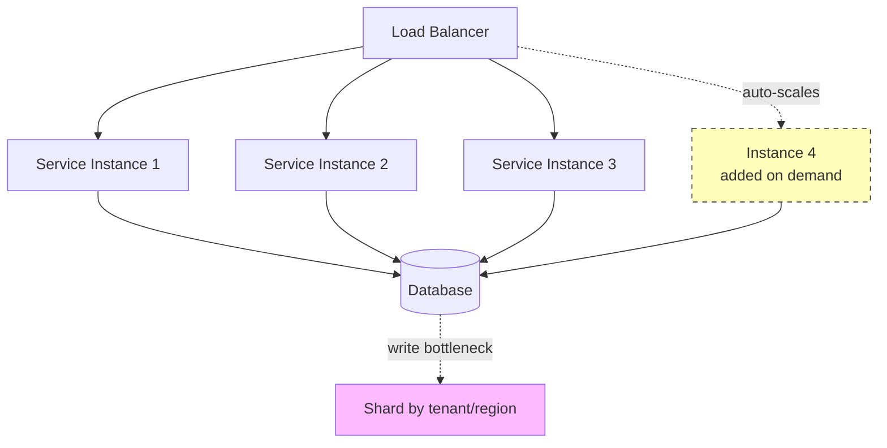
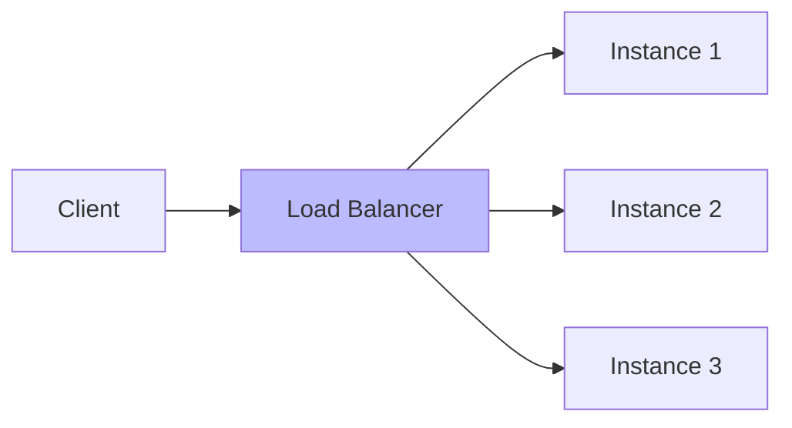
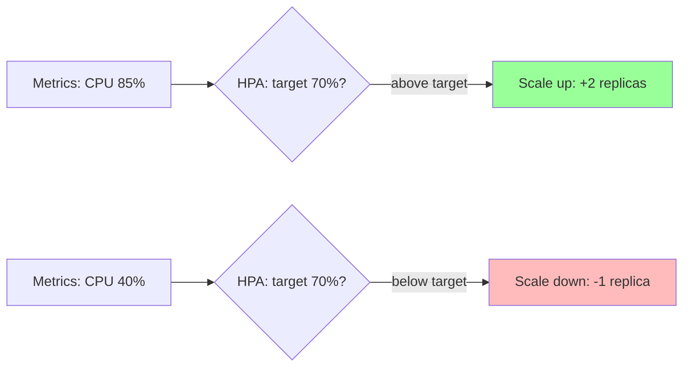
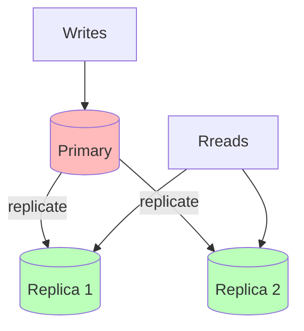
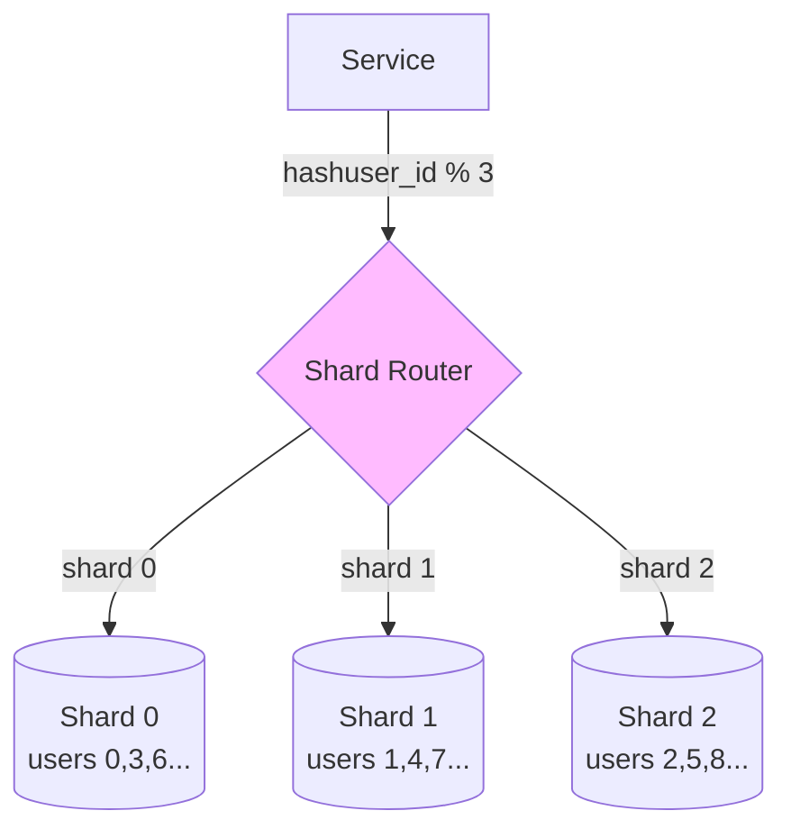
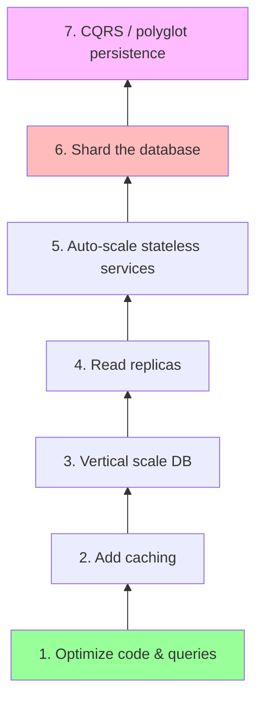

# 🧠 Topic: Scaling Strategies in Microservices

> [!abstract] Executive Summary (ELI5)
> Scaling microservices is like managing a busy airport. When a terminal gets crowded, you can either build a bigger terminal (vertical scaling) or add more gates (horizontal scaling). You can also turn gates on and off automatically based on the time of day (auto-scaling). And if all flights go through one air-traffic-control center, you split the airspace into regions so no single center is overwhelmed (sharding).

---

## 🎯 The "Why"
- **Problem Solved:** How do you grow a microservices system to handle more load — without over-provisioning (wasting money) or under-provisioning (failing under load)?
- **Alternatives:** Scaling a monolith (whole-system only, limited), buying a bigger machine (vertical only, hits a ceiling), doing nothing (the system fails under load).
- **Trade-offs:** Every scaling choice trades cost for capacity, or complexity for efficiency. The art is scaling *only what needs it*, when it needs it.

## 💡 Mental Model & Analogy
- **Analogy:** "Scaling is like staffing a restaurant." **Vertical** = train the one chef to be faster / give them a bigger stove. **Horizontal** = hire more chefs (identical, interchangeable). **Auto-scaling** = call in extra staff automatically when the dining room fills up. **Sharding** = open multiple branches in different neighborhoods so no single kitchen is overwhelmed.
- **Visual/Diagram:**

## 🛠️ Core Principles

Three scaling strategies + the database scaling problem:

1. **Horizontal Scaling** (scale out)
2. **Auto-Scaling** (scale dynamically)
3. **Sharding & Database Scaling** (scale the hard part)

### 1. Horizontal Scaling (Scale Out)

Adding **more instances** of a service behind a [[Load Balancing|load balancer]]. Each instance is identical and interchangeable; the load balancer distributes requests across them.

**Why it's the default for microservices:**
- **No hard ceiling** (unlike vertical scaling — you can always add one more instance).
- **Cheap, commodity hardware** instead of one expensive super-machine.
- **Resilience** — if one instance dies, others keep serving.
- **Enables zero-downtime deploys** — roll instances one at a time.

**The critical requirement: statelessness.**
For a load balancer to freely distribute requests, **each instance must be able to handle any request**. If an instance holds session state in memory, you need **sticky sessions** (route the same user to the same instance), which defeats even distribution. The fix: **externalize state** to Redis or use stateless tokens (JWT), so any instance can serve any user.

| Aspect | Stateless (ideal) | Stateful (problematic) |
|--------|-------------------|------------------------|
| Load balancing | Round-robin, free distribution | Sticky sessions required |
| Scaling | Add/remove freely | Must preserve session affinity |
| Failure | Any instance dies, others cover | Session loss if instance dies |
| Session storage | External (Redis, JWT) | In-memory |

> [!tip] Stateless = scalable
> The single most important property for horizontal scaling is **statelessness**. If your service holds state in memory, horizontal scaling is crippled (sticky sessions, careful drain on shutdown). Externalize all state to a shared store (Redis, DB) or to the client (JWT) so any instance can serve any request.

### 2. Auto-Scaling

Horizontal scaling driven by **metrics** — add or remove instances automatically based on load, on a schedule, or on a queue depth.

**Trigger types:**
| Trigger | Example | Best For |
|---------|---------|----------|
| **Metric-based** | CPU > 70% → add instance | General compute load |
| **Request-rate** | Requests/sec > 1000 → scale out | Traffic-driven services |
| **Queue depth** | SQS backlog > 500 → add worker | Async / background workers |
| **Schedule-based** | Add instances at 9 AM, remove at 6 PM | Predictable diurnal patterns |

**How it works (Kubernetes example):**
- A **Horizontal Pod Autoscaler (HPA)** watches a metric (e.g., CPU).
- When the metric breaches a threshold, it adjusts the **replica count**.
- The orchestrator spins up or terminates pods to match.
- **Cooldown periods** prevent thrashing (don't add/remove too fast).

**Benefits:**
- **Cost efficiency** — pay only for what you need; scale down at night.
- **Resilience** — automatically handle traffic spikes without human intervention.
- **Operational simplicity** — no 3 AM pages to "add more servers."

**Caveats:**
- **Cold-start latency** — new instances take time to boot (seconds for containers, longer for some runtimes).
- **Thrashing** — scaling up and down too fast wastes resources. Use cooldowns.
- **Dependent bottlenecks** — scaling the service doesn't help if the database is the real bottleneck (see below).
- **Metric lag** — metrics are averaged over windows; auto-scaling reacts, it doesn't predict.

> [!warning] Auto-scaling a service doesn't fix a DB bottleneck
> If your service scales to 20 instances but they all hit one database, you've just moved the bottleneck. The database becomes the ceiling. Scaling services is the easy part — scaling the **data layer** is the hard part (see Sharding below).

### 3. Sharding and Database Scaling

The database is the **hardest thing to scale** in a microservices system. It's stateful, it's shared (within a service), and ACID semantics resist distribution. Scaling strategies:

#### Read Replicas
- **How:** Copy writes to a primary; replicate to read-only copies. Direct **reads to replicas**, writes to the primary.
- **Solves:** Read-heavy load (most apps are read-heavy).
- **Limit:** Writes still hit one primary — doesn't solve write scaling. Replication lag means replicas are slightly stale.

#### Sharding (Horizontal Partitioning)
- **How:** Split rows across multiple database instances by a **shard key** (e.g., `user_id`, `tenant_id`, `region`). Each shard holds a subset of the data.
- **Solves:** Both read AND write scaling — each shard handles only its slice.
- **Shard key choice is critical:** a bad key causes hot spots (one shard gets all the traffic) or uneven distribution.

**Sharding strategies:**
| Strategy | How | Trade-off |
|----------|-----|-----------|
| **Hash-based** | `hash(key) % N` | Even distribution, but re-sharding is painful (add a shard → rehash everything) |
| **Range-based** | A-M on shard 1, N-Z on shard 2 | Range queries are easy, but risk of hot spots (everyone whose name starts with a popular letter) |
| **Directory-based** | A lookup service maps keys to shards | Flexible, but the directory itself is a component to manage |
| **Consistent hashing** | Place shards on a ring | Minimal data movement when adding/removing shards — the production standard |

**The challenges of sharding:**
- **Cross-shard queries** are hard or impossible (joins across shards don't work).
- **Cross-shard transactions** lose ACID (need two-phase commit or sagas).
- **Re-sharding** (adding/removing shards) is operationally painful without consistent hashing.
- **Hot shards:** a celebrity user's data lands on one shard and overwhelms it.

> [!tip] Database-per-service first, then shard within a service
> Microservices already shard *logically* (each service owns its data). Within a service that's still too big, shard *physically* by tenant, region, or user ID. But sharding adds real complexity — only shard when a single primary truly can't keep up.

#### Caching (The Scaling Multiplier)
Caching is the **cheapest way to scale reads**. Before sharding, add caching:
- **Application cache (Redis/Memcached):** hot data in memory; the DB never sees those reads.
- **CDN:** static assets and cacheable API responses served from edge locations.
- **Database query cache:** repeated queries return instantly.

Caching can reduce DB load by **90%+** for read-heavy workloads, often delaying or eliminating the need to shard.

#### CQRS (Command Query Responsibility Segregation)
For extreme read/write imbalance: separate the **write model** (normalized, transactional) from the **read model** (denormalized, optimized for queries, often in a different datastore like Elasticsearch). Writes go to the write model; reads come from read-optimized projections. The two are kept in sync via events.

### The Scaling Progression (What to Do, In Order)

When load grows, follow this ladder — each rung is cheaper and simpler than the one above it:

| Step | Effort | Impact |
|------|--------|--------|
| 1. **Optimize** code and queries | Low | Often 10x gains for little effort |
| 2. **Caching** (Redis, CDN) | Low-Medium | Massive read-load reduction |
| 3. **Vertical scale** the DB (bigger machine) | Low | Buys time, but hits a ceiling |
| 4. **Read replicas** | Medium | Scales reads; writes still capped |
| 5. **Auto-scale** stateless services | Medium | Scales compute to demand |
| 6. **Sharding** | High | Scales writes — but huge complexity |
| 7. **CQRS / polyglot** | High | Separates read/write scaling fully |

> [!tip] Don't start at the top of the ladder
> The most common scaling mistake is jumping to sharding (step 6) before exhausting cheaper options. Start with optimization and caching — they often solve the problem at 1/100th the effort. Only shard when a single primary DB truly can't keep up despite caching and replicas.

## 🏗️ The Role in System Design

### Scaling Is Multi-Layered
A well-scaled microservices system applies different strategies at different layers:
- **Stateless services:** horizontal + auto-scaling.
- **Stateful data layer:** caching → replicas → sharding (in that order).
- **Edge:** CDN for static content; load balancers for traffic distribution.

### The Database Is Always the Ceiling
You can scale stateless services easily (add instances). The database is stateful, shared, and ACID-constrained — it's the eventual bottleneck for almost every system. Every scaling strategy beyond step 3 exists to deal with the database.

### Cost vs. Capacity
Every scaling choice is a cost/capacity trade:
- **Horizontal** is cost-linear (pay per instance) but has no ceiling.
- **Vertical** is cheaper up to a point, then hits a hardware limit.
- **Auto-scaling** optimizes cost (scale down when idle) but needs monitoring maturity.
- **Sharding** adds operational complexity (a near-permanent cost).

## ⚠️ Pitfalls & Anti-patterns
- **Scaling services past a DB bottleneck:** adding service instances when the database is the real limit — just moves the problem.
- **Stateful services with horizontal scaling:** in-memory sessions force sticky sessions and cripple auto-scaling. Externalize state.
- **Auto-scaling thrashing:** scaling up and down too fast; use cooldown periods.
- **Bad shard key:** causes hot spots or uneven distribution. Choose carefully (consistent hashing helps).
- **Jumping to sharding prematurely:** before caching, replicas, and optimization. Sharding is near-irreversible complexity.
- **Ignoring cold-start latency:** auto-scaled instances take time to boot; don't scale to zero for latency-sensitive services.
- **Cross-shard joins:** sharding breaks joins. Design queries to be shard-local.
- **Forgetting to scale down:** leaving instances running 24/7 when traffic is diurnal — wasted money.

## 🔗 Deep Connections
- **Parent Topic:** [[Microservices Overview]]
- **Previous:** [[Microservices Challenges]] — scaling amplifies the challenges (more instances = more network calls, more consistency surface).
- **Related Concepts:** [[Load Balancing]], [[Caching]], [[N Tier Architecture]] (per-tier scaling), consistent hashing, CQRS, connection pooling, [[CDN]]
- **Prerequisites:** [[Microservices Overview]], basic understanding of databases and load balancing.

## ❓ Active Recall Questions
> [!faq]- What is horizontal scaling, and why is it the default for microservices?
> Adding **more instances** of a service behind a load balancer — each identical and interchangeable. It's the default because it has no hard ceiling (you can always add one more), uses cheap commodity hardware, provides resilience (one instance dying doesn't take down the service), and enables zero-downtime deploys. The critical requirement is **statelessness** — any instance must be able to handle any request.
<!-- #flashcards/system-design -->

> [!faq]- Why is statelessness critical for horizontal scaling?
> If an instance holds session state in memory, a load balancer must use **sticky sessions** (route the same user to the same instance) — which defeats even distribution and blocks elastic scaling. If that instance dies, the session is lost. Externalize state to Redis or use JWTs so **any instance can serve any request** — then the load balancer can distribute freely and you can add/remove instances at will.
<!-- #flashcards/system-design -->

> [!faq]- What is auto-scaling, and what are its common triggers?
> Adding/removing instances automatically based on conditions. Common triggers: **metric-based** (CPU > 70% → add), **request-rate** (RPS > 1000 → scale out), **queue depth** (SQS backlog → add workers), and **schedule-based** (add at 9 AM, remove at 6 PM). Benefits: cost efficiency (scale down when idle) and automatic spike handling. Caveats: cold-start latency, thrashing (use cooldowns), and it doesn't fix a DB bottleneck.
<!-- #flashcards/system-design -->

> [!faq]- Why doesn't auto-scaling a service fix a database bottleneck?
> If you scale a service to 20 instances but they all hit one database, you've just moved the bottleneck to the DB — it becomes the new ceiling. Scaling stateless services is the easy part; the **database is stateful, shared, and ACID-constrained**, making it the hardest component to scale. You need caching, read replicas, and eventually sharding to scale the data layer.
<!-- #flashcards/system-design -->

> [!faq]- What is sharding, and what are its trade-offs?
> Splitting a database's **rows across multiple instances** by a shard key (user_id, tenant_id, region). Each shard holds a subset, so it scales both reads AND writes. Trade-offs: cross-shard queries/joins are hard or impossible, cross-shard transactions lose ACID, re-sharding is painful (use consistent hashing to minimize data movement), and a bad shard key causes hot spots. It's high-complexity — only shard when a single primary truly can't keep up.
<!-- #flashcards/system-design -->

> [!faq]- How does consistent hashing help with sharding?
> It minimizes **data movement** when adding or removing shards. With naive `hash(key) % N`, adding one shard requires rehashing nearly all data. Consistent hashing places shards on a "ring" — adding or removing a shard only moves the keys in that shard's segment, not the entire dataset. It's the production standard for dynamically scalable sharding.
<!-- #flashcards/system-design -->

> [!faq]- What's the recommended scaling progression, and why does order matter?
> 1. Optimize code & queries → 2. Caching → 3. Vertical scale DB → 4. Read replicas → 5. Auto-scale stateless services → 6. Shard → 7. CQRS. Order matters because each rung is cheaper and simpler than the one above. **Don't jump to sharding** before exhausting caching and replicas — they often solve the problem at 1/100th the effort. Sharding is near-irreversible complexity.
<!-- #flashcards/system-design -->

> [!faq]- Why is caching the "cheapest scaling multiplier"?
> A well-placed cache (Redis/Memcached + CDN) can reduce database load by **90%+** for read-heavy workloads — most reads never reach the DB. It's far cheaper and simpler than sharding, often delaying or eliminating the need to shard. Always exhaust caching before considering physical database scaling.
<!-- #flashcards/system-design -->

> [!faq]- What is CQRS, and when would you use it?
> **Command Query Responsibility Segregation** — separate the **write model** (normalized, transactional) from the **read model** (denormalized, query-optimized, often in a different datastore like Elasticsearch). Writes go to the write model; reads come from projections kept in sync via events. Use it for extreme read/write imbalance or when read patterns differ greatly from write patterns. High complexity — a last-resort scaling strategy.
<!-- #flashcards/system-design -->

---

*Last updated: 2026-07-11*
