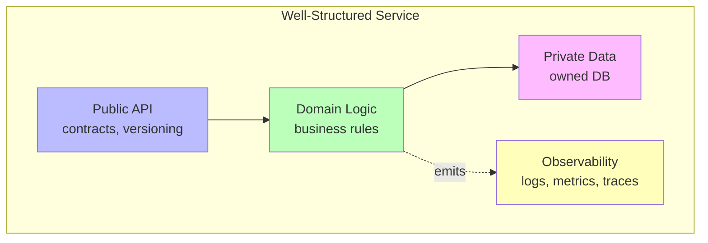
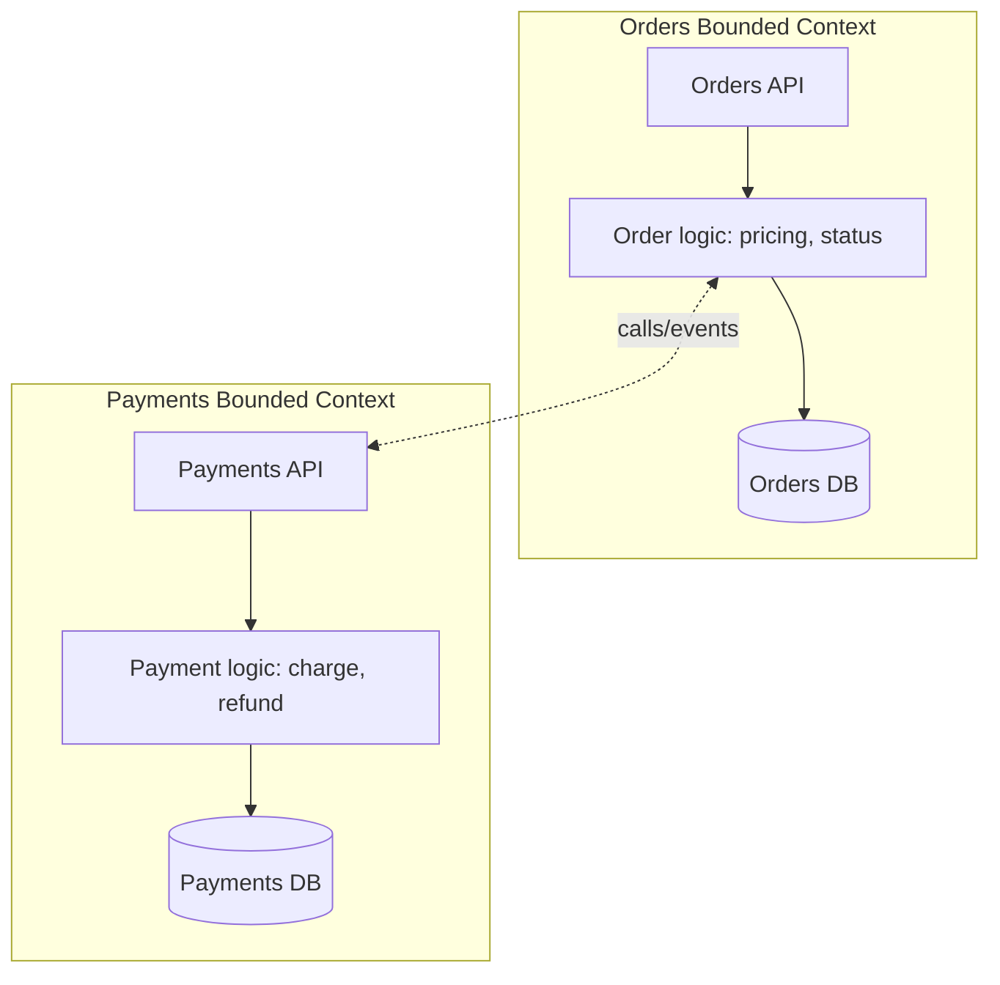
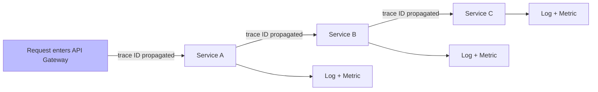

# 🧠 Topic: How to Structure Microservices

> [!abstract] Executive Summary (ELI5)
> Structuring microservices is like designing a neighborhood. First you zone it by purpose (residential, commercial, industrial) — that's decomposition by domain. Then you lay down roads with clear addresses so people can find each other — that's defining APIs. You decide how big each plot should be — that's granularity. And you install streetlights and security cameras so the city can see what's happening — that's observability.

---

## 🎯 The "Why"
- **Problem Solved:** Once you've *identified* services ([[Identifying Microservices]]), how do you *structure* them so they're cohesive, loosely coupled, right-sized, and operable?
- **Alternatives:** Ad-hoc structure (evolves into a Big Ball of Mud), over-engineering with too many tiny services.
- **Trade-offs:** Good structure enables independent teams and scaling; bad structure creates chatty, hard-to-operate, tightly-coupled services.

## 💡 Mental Model & Analogy
- **Analogy:** "Structuring services is like urban planning." You zone by purpose (domain decomposition), pave roads with addresses (APIs), size plots appropriately (granularity), and install streetlights (observability). A well-planned city flows; a poorly-planned one has traffic jams and blind spots.
- **Visual/Diagram:**

## 🛠️ Core Principles

Four pillars of structuring a microservice:

1. **Decompose by business domain**
2. **Define clear APIs**
3. **Choose the right granularity**
4. **Implement observability**

### 1. Decompose by Business Domain

The starting point (see [[Identifying Microservices]] for the full treatment). Structure each service around a **bounded context** — a coherent slice of the business domain with its own ubiquitous language.

**Structural implications of domain decomposition:**
- A service owns **one capability** end-to-end: its API, its logic, and its data.
- The service's internal code is typically [[Layered Architecture|layered]] — but the *service boundary* follows the domain, not a technical layer.
- Different bounded contexts can have different words for the same concept ("product" in Catalog vs. "shipment item" in Shipping) — and that's correct.

> [!tip] One team per service
> Domain decomposition aligns naturally with team ownership. The Orders team owns the Orders bounded context and its service, end-to-end. This is Conway's Law working *for* you.

### 2. Define Clear APIs

A service's API is its **contract with the world** — the only thing its consumers know about. A clear, stable, well-versioned API is what makes independent deployment possible.

**Principles of a good service API:**
- **Explicit contract:** The API is documented (OpenAPI for REST, Protobuf for gRPC) and treated as a contract.
- **Stable and backward-compatible:** Consumers shouldn't break when you deploy. Add fields freely; remove them slowly with deprecation.
- **Versioned:** When a breaking change is unavoidable, version the API (`/v2/orders`) and run versions in parallel during migration.
- **Cohesive:** The API serves one capability — `OrdersService` does order things, not payments or shipping.
- **Coarse-grained (often):** Prefer fewer, richer endpoints over many tiny ones — reduces chatty network calls.

**API styles:**
| Style | When | Notes |
|-------|------|-------|
| **REST (HTTP/JSON)** | Public APIs, browser/mobile clients | Ubiquitous, human-readable, easy to cache |
| **gRPC (HTTP/2 + Protobuf)** | Internal service-to-service | Binary, fast, strongly typed, streaming |
| **GraphQL** | Complex client queries (many shapes) | Client picks fields; risk of tight coupling |
| **Async events** | Cross-service writes with side effects | See [[Microservices Communication]] |

> [!warning] Don't leak your internal model
> Your API should expose a **deliberate contract** (DTOs), not your internal domain entities or database schema. Leaking internals couples consumers to your implementation — every refactor breaks them.

### 3. Choose the Right Granularity

How big should a service be? This is the eternal microservices debate. The answer: **as big as it needs to be to own a coherent capability, and no bigger.**

**Signs a service is too fine-grained (too small):**
- It's just a CRUD wrapper with no business logic.
- A single user action requires calls to 5+ services (chatty).
- The operational overhead (CI/CD, monitoring, on-call) dwarfs the logic.
- Services must constantly call each other to accomplish anything.

**Signs a service is too coarse-grained (too big):**
- Multiple teams work on it (merge conflicts, coordination).
- It has multiple reasons to change (violates SRP).
- Scaling it requires scaling parts that don't need it.
- Deployment is risky because "everything is in there."

| Too Fine-Grained (Nanoservices) | Right Granularity | Too Coarse (Mini-monolith) |
|----------------------------------|-------------------|----------------------------|
| CRUD wrapper, no logic | Owns a business capability | Multiple teams own it |
| Every action = 5 service calls | One reason to change | Multiple reasons to change |
| Ops overhead > logic | Deploys independently | Deployment is high-risk |
| Must call others to do anything | Right-sized data ownership | Scaling wastes resources |

**The granularity heuristic:**
> A service should be **small enough to be owned by one team** and **big enough to do its job without constantly calling other services**. Start coarse; split only when a clear sub-capability demands independent scaling, deployment, or team ownership.

### 4. Implement Observability

In a distributed system, you **cannot debug by attaching a debugger**. Observability — knowing what's happening inside your services from the outside — is a structural requirement, not an afterthought.

**The three pillars of observability:**
| Pillar | What | Tools |
|--------|------|-------|
| **Logging** | Discrete events with context (request ID, timestamp, service) | ELK (Elasticsearch/Logstash/Kibana), Loki, Splunk |
| **Metrics** | Numeric, aggregable time-series data (request rate, error rate, latency) | Prometheus, Grafana, Datadog |
| **Distributed Tracing** | A request's journey across services, hop by hop | Jaeger, Zipkin, OpenTelemetry |

**Structural requirements for observability:**
- **Correlation / trace IDs:** Every request gets a unique ID, **propagated across every service hop**, so you can reconstruct the full path.
- **Structured logging:** Logs are JSON with service name, trace ID, and context — searchable, not free text.
- **Health endpoints:** Each service exposes `/health` and `/ready` for orchestrators and load balancers.
- **Standardized instrumentation:** Use OpenTelemetry so all services emit traces/metrics/logs the same way.

> [!tip] Design for observability from day one
> Retrofitting observability into a mature microservices system is painful. Every service should emit structured logs, metrics, and traces **from the first commit**. Without distributed tracing, debugging a cross-service issue is a multi-hour forensic exercise.

## 🏗️ The Role in System Design

### Structure Enables the Microservices Promise
The four pillars directly enable the [[Microservices Overview|core characteristics]]:
- **Domain decomposition** → business-capability alignment + team autonomy.
- **Clear APIs** → independent deployment + polyglot technology.
- **Right granularity** → independent scaling without chatty overhead.
- **Observability** → operability at scale (the "you build it, you run it" principle).

### The "Twelve-Factor App" Baseline
Well-structured microservices usually follow the [Twelve-Factor App](https://12factor.net/) methodology: one codebase, explicit dependencies, config in the environment, backing services as attached resources, strict separate of build/release/run, stateless processes, port binding, concurrency via processes, fast startup/graceful shutdown, dev/prod parity, logs as event streams, and admin tasks as one-off processes.

## ⚠️ Pitfalls & Anti-patterns
- **Leaking internal models via the API:** Returning ORM entities directly couples consumers to your schema. Use DTOs.
- **Chatty APIs:** Many tiny endpoints → many network calls. Prefer coarse-grained, resource-oriented APIs.
- **Nanoservices:** Over-decomposed services with ops overhead dwarfing logic. Merge them.
- **No API versioning:** A breaking change takes down all consumers. Version from day one.
- **No observability:** "It works on my machine" — but you can't see prod. Retrofitting is expensive.
- **Shared libraries coupling services:** If services share a library with domain logic, they're coupled at compile time and must deploy together.
- **Mixing concerns in one service:** A service that does Orders *and* Payments violates SRP and team autonomy.
- **Ignoring the database boundary:** Structure isn't just code — if two services share a DB, they're not really separate.

## 🔗 Deep Connections
- **Parent Topic:** [[Microservices Overview]]
- **Previous:** [[Identifying Microservices]] — you can't structure well until you've identified correctly.
- **Next:** [[Microservices Communication]] — structured services need to talk; clear APIs are the contract.
- **Related Concepts:** [[Layered Architecture]] (internal structure of each service), [[Domain-Driven Design]] (bounded contexts), [[Microservices Challenges]] (observability is also a challenge), OpenTelemetry, Twelve-Factor App
- **Prerequisites:** [[Microservices Overview]], [[Identifying Microservices]].

## ❓ Active Recall Questions
> [!faq]- What are the four pillars of structuring a microservice?
> 1. **Decompose by business domain** (bounded context). 2. **Define clear APIs** (explicit, stable, versioned contract). 3. **Choose the right granularity** (not too big, not too small). 4. **Implement observability** (logs, metrics, distributed tracing). Together they enable business alignment, independent deployment, right-sized scaling, and operability.
<!-- #flashcards/system-design -->

> [!faq]- Why is decomposing by business domain the starting point for structuring services?
> Because a service should own **one business capability end-to-end** — its API, logic, and data. Domain decomposition (using DDD bounded contexts) keeps changes that belong together in one service, aligns services with team ownership, and gives each service a cohesive reason to exist. Decomposing by technical layer produces the wrong unit.
<!-- #flashcards/system-design -->

> [!faq]- What makes a good microservice API?
> An **explicit contract** (documented via OpenAPI/Protobuf), **stable and backward-compatible** (consumers don't break on deploy), **versioned** (breaking changes ship as `/v2`), **cohesive** (serves one capability — OrdersService does orders, not payments), and **coarse-grained** (fewer, richer endpoints over chatty tiny ones). It exposes DTOs, never internal entities or DB schema.
<!-- #flashcards/system-design -->

> [!faq]- How do you know if a service is the right granularity?
> It should be **small enough to be owned by one team** and **big enough to do its job without constantly calling other services**. Too fine = CRUD wrapper, chatty, ops overhead > logic (merge it). Too coarse = multiple teams own it, multiple reasons to change, risky deploys (split it). **Start coarse; split only when a clear sub-capability demands independence.**
<!-- #flashcards/system-design -->

> [!faq]- What are the three pillars of observability, and why are they mandatory in microservices?
> **Logging** (discrete events with context), **Metrics** (numeric time-series: rate, errors, latency), and **Distributed Tracing** (a request's journey across services, hop by hop). They're mandatory because in a distributed system you can't attach a debugger — without tracing and correlation IDs, debugging a cross-service issue is a multi-hour forensic exercise. Design for observability from day one.
<!-- #flashcards/system-design -->

> [!faq]- Why must trace IDs be propagated across every service hop?
> A single user request may cross 5+ services. Without a **correlation/trace ID propagated at every hop**, you can't reconstruct the request's path, see where time was spent, or find which service failed. Trace IDs tie logs, metrics, and traces together into one coherent story across the whole system.
<!-- #flashcards/system-design -->

> [!faq]- What is a "nanoservice," and how do you avoid creating them?
> A service so small that its operational overhead (CI/CD, monitoring, on-call) dwarfs its business logic — often just a CRUD wrapper. Avoid them by starting **coarse-grained** and splitting only when a clear sub-capability demands independent scaling, deployment, or team ownership. If every action requires calls to 5+ services, you've over-decomposed.
<!-- #flashcards/system-design -->

> [!faq]- Why is leaking your internal model through the API an anti-pattern?
> Returning ORM entities or DB schema details directly couples consumers to your implementation. Every internal refactor or schema change breaks them. Instead, expose a **deliberate contract** (DTOs) that you control and version independently from your internal model.
<!-- #flashcards/system-design -->

---

*Last updated: 2026-07-11*
