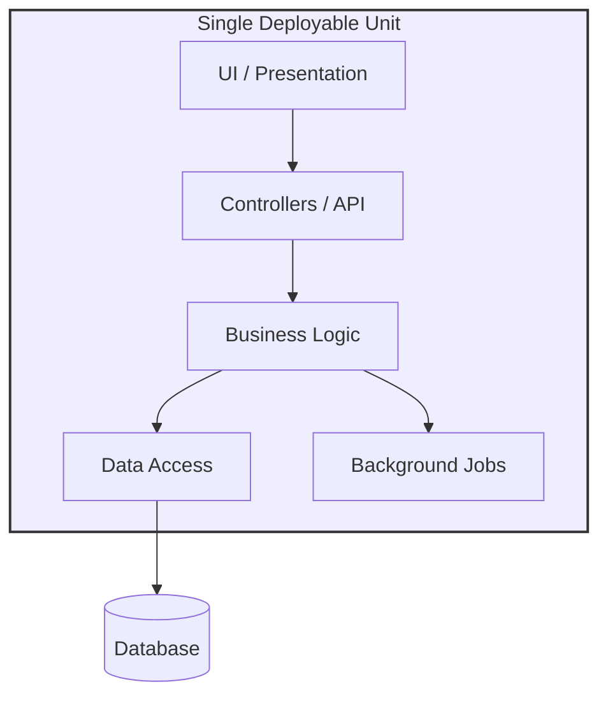
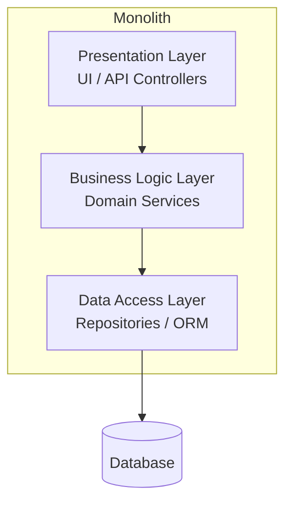

# 🧠 Topic: Monolithic Architecture

> [!abstract] Executive Summary (ELI5)
> A monolith is like a Swiss Army knife — every tool (blade, screwdriver, corkscrew) lives in one gadget you carry as a single piece. All the parts of the application — user interface, business logic, data access, background jobs — are built, packaged, and shipped together as one unit. Simple and sturdy, but if one blade breaks you may need to repair the whole knife.

---

## 🎯 The "Why"
- **Problem Solved:** How do we build and ship a complete application quickly without the operational overhead of distributed systems?
- **Alternatives:** [[Microservices]], [[Event-Driven Architecture]], service-oriented architecture (SOA). Each trades simplicity for independent scaling and deployment.
- **Trade-offs:** The monolith optimizes for **development and operational simplicity** at the cost of **independent scalability, fault isolation, and tech-stack flexibility**. See [[Software Architecture#Trade-offs by Architectural Style]].

## 💡 Mental Model & Analogy
- **Analogy:** "A monolith is like a single-family house." The kitchen, bedrooms, and bathroom are all under one roof, sharing one foundation, one electrical system, one address. Renovating the kitchen may inconvenience the whole household, but the building is simple to design, build, heat, and maintain. Contrast with a housing complex (microservices), where each unit is independent but you need shared infrastructure (roads, plumbing coordination, property management).
- **Visual/Diagram:**

## 🛠️ Core Principles

### What is a Monolithic Architecture
A **monolithic architecture** is a software design style in which the entire application is built as a **single, self-contained unit**. All functional concerns — user interface, business/domain logic, data access, integration, and often background processing — are packaged into one program, deployed as one artifact, and run in a single process.

Components inside a monolith typically communicate via **in-process function calls** rather than network calls. They share a single executable, a single runtime, and (usually) a single database.

Key characteristics:
- **Single deployable artifact:** One binary, JAR/WAR, Docker image, or executable.
- **Single process / runtime:** All modules execute together in one address space.
- **In-process communication:** Functions call each other directly — fast, no serialization, no network.
- **Shared infrastructure:** Typically one database, one configuration, one tech stack.
- **Atomic deployment:** Any change ships the whole application.

### Internal Structure of a Monolith
A monolith is *not* required to be internally tangled. A well-structured monolith organizes code into clear modules or layers (often following the [[Software Architecture#Layered (n-tier)|layered style]] internally):

The crucial distinction: these are **logical** layers, not separate processes. They live in the same memory space and call each other via plain function calls.

### Variants of the Monolith

Not all monoliths are created equal. The term spans a spectrum:

| Variant | Internal Organization | Typical Fate |
|---------|----------------------|--------------|
| **Single-Process Monolith** | One process, all features in one codebase | The classic "monolith" |
| **Modular Monolith** | One process, but strict module boundaries (DDD bounded contexts), enforced in code | Often the best long-term starting point — services can be extracted cleanly later |
| **Distributed Monolith** | Multiple services that are tightly coupled (shared DB, must deploy together) | An anti-pattern — costs of microservices, none of the benefits |
| **Monolith with Background Workers** | Main web process + worker processes sharing one codebase | Common in early-stage products |

> [!tip] The Modular Monolith is your friend
> If you start monolithic, build it as a **modular monolith**: enforce clear module boundaries, separate data ownership per module, and limit cross-module calls to well-defined interfaces. This makes a future move to microservices a clean extraction rather than a rewrite.

### Communication Inside a Monolith
Because everything runs in one process:
- **Function calls are synchronous and instant** — no serialization, no network latency.
- **Transactions are trivial** — a single ACID transaction can span multiple modules and tables.
- **Shared state is easy** — in-memory caching, singletons, and shared objects are natural.
- **Testing is straightforward** — no service stubs needed; integration tests just boot the app.

This simplicity is the monolith's superpower *and* the source of its weaknesses.

### Pros
- **Simple to develop:** One codebase, one IDE, one build. New developers can clone and run.
- **Simple to test:** End-to-end tests boot a single application. No service stubs or contract tests.
- **Simple to deploy:** One artifact, one deployment pipeline. Rollbacks are atomic.
- **Simple to operate:** One process to monitor, scale, and debug. No distributed-systems concerns.
- **Fast in-process calls:** No network, no serialization — module-to-module calls are essentially free.
- **Easy transactions:** ACID transactions span the whole domain. Distributed transactions (sagas) are not needed.
- **Low operational overhead:** No service discovery, mesh, or per-service observability. A small team can run it.
- **Lower cost:** Less infrastructure, fewer moving parts, fewer engineers needed to keep it alive.

### Cons
- **No independent scalability:** You scale the whole application, even if only one module is hot. If search is overloaded, you must replicate the entire monolith.
- **No fault isolation:** A memory leak, uncaught exception, or infinite loop in any module can crash the entire process.
- **Scaling a single hot component is wasteful:** Replicating the whole app to serve one busy feature wastes resources.
- **Tech-stack lock-in:** The whole app shares one language and framework. You can't write one module in Go and another in Python.
- **Team scaling friction:** As the team and codebase grow, merge conflicts, accidental coupling, and long builds slow everyone down.
- **Riskier deployments:** Any change, however small, requires shipping the whole application. A regression in one module affects all.
- **Coupling creep:** Without discipline, modules start calling each other freely, and the codebase degrades into a "Big Ball of Mud."
- **Slower startup and builds:** Large monoliths take longer to compile, start, and warm up.
- **Single point of failure:** One process down = entire system down.

### Use Cases (When to Use)

A monolith is usually the right starting point when one or more of these hold:

- **Early-stage products and MVPs:** When you need to find product-market fit, velocity matters more than scalability.
- **Small teams (1–10 engineers):** The operational cost of microservices is not justified.
- **Modest, predictable traffic:** When you can serve all users from a few instances of the app.
- **Domains not yet well understood:** You can't draw service boundaries you haven't discovered yet. Build a monolith first; the right boundaries will emerge.
- **Strong consistency requirements:** Domains where ACID transactions across entities are essential (e.g., financial ledgers) — distributed transactions are painful.
- **Internal / line-of-business tools:** CRUD apps, admin panels, and dashboards where scaling is a non-issue.
- **Proof of concepts and prototypes:** When the goal is learning, not production hardening.

### When NOT to Use

A monolith becomes a liability when:
- A single component needs to **scale independently** of the rest (e.g., video transcoding vs. user auth).
- **Multiple teams** are stepping on each other in the same codebase.
- Different parts of the system need **different tech stacks** or release cadences.
- **Fault isolation** is critical — one module crashing must not take down others.

### Real-World Examples
- **Basecamp (37signals):** Famously runs as a large monolith ("the Majestic Monolith") with a small team. Their argument: monoliths are the right fit when one company owns the whole product.
- **GitHub:** Ran on a single Rails monolith ("the monorail") for years before selectively extracting services.
- **Shopify:** Operates a massive Rails monolith at scale, using modular decomposition internally.
- **Stack Overflow:** Serves enormous traffic from a relatively small number of monolithic servers, optimized aggressively.

> [!note] The pattern
> These companies prove that monoliths can scale *far* with discipline — what forces them toward microservices is usually **organizational scale** (many teams), not raw traffic.

## 🏗️ The Role in System Design

### "Monolith First" — The Recommended Starting Point
A widely endorsed principle (notably by Martin Fowler) is: **start monolithic**. You can't know the right service boundaries until the domain stabilizes. A monolith lets you refactor cheaply — moving code between modules is a few keystrokes; moving code between services is a migration.

Only extract a microservice when a specific module:
- Demands **independent scaling**,
- Belongs to a **different team's** ownership,
- Needs a **different release cadence** or tech stack, or
- Has **stabilized boundaries** worth the cost of distribution.

### Scaling a Monolith
A monolith is *not* limited to one server. The typical scaling progression:
1. **Vertical scaling** — bigger machine (more CPU, RAM).
2. **Horizontal scaling** — run multiple identical instances behind a [[Load Balancing|load balancer]].
3. **Caching** — offload reads to [[Caching|Redis]] or a CDN.
4. **Read replicas** — split database reads from writes.
5. **Extract hot paths** — pull the one overloaded module into its own service, leaving the rest as a monolith.

Most systems never need to go beyond step 2–3. The monolith rarely dies — it just gets *augmented*.

## ⚠️ Pitfalls & Anti-patterns
- **Big Ball of Mud:** No internal structure — modules call each other freely, dependencies run in every direction. Prevent this with explicit module boundaries.
- **Shared-everything coupling:** Modules sharing database tables directly, with no clear ownership. Each module should own its tables.
- **Ignoring module boundaries "just this once":** Each shortcut compounds. Enforce boundaries with code-level checks (e.g., ArchUnit, dependency-cop) if needed.
- **Premature extraction to microservices:** Splitting a monolith before the domain stabilizes produces services with the wrong boundaries — and those are *very* expensive to fix.
- **One giant deploy for a one-line fix:** Acceptable early on, but as the system grows, treat it as a signal to extract the volatile part.
- **Treating the database as an integration layer:** Multiple modules reading/writing the same tables silently recreate coupling. The DB is a storage detail, not a bus.
- **Skipping background-job isolation:** Long-running tasks in the web process block request handlers. Move them to a worker process from the start.

## 🔗 Deep Connections
- **Parent Topic:** [[Software Architecture]]
- **Related Concepts:** [[Layered Architecture]], [[Microservices]], [[Event-Driven Architecture]], [[Client Server Model]], [[Load Balancing]], [[Caching]], [[Domain-Driven Design]]
- **Siblings:** Monolithic is the baseline against which [[Microservices]] and [[Event-Driven Architecture]] are defined. A monolith's internal layers often follow the layered style.
- **Prerequisites:** Basic understanding of how an application is structured (UI, business logic, database).

## ❓ Active Recall Questions
> [!faq]- What is a monolithic architecture?
> A style in which the entire application — UI, business logic, data access, background jobs — is built, packaged, and deployed as a **single unit** running in one process. Components communicate via in-process function calls and typically share one database.

> [!faq]- What are the main advantages of a monolith?
> Simplicity across the board: one codebase, one build, one deployment, one process to monitor. In-process calls are fast, ACID transactions span the whole domain, and end-to-end testing is easy. Operational overhead is low — a small team can build and run it.

> [!faq]- What are the main disadvantages of a monolith?
> No independent scalability (the whole app scales together), no fault isolation (one module's crash takes down everything), tech-stack lock-in, growing merge conflicts as teams expand, risky whole-app deployments, and tendency toward a "Big Ball of Mud" without discipline.

> [!faq]- When should you choose a monolith over microservices?
> For early-stage products and MVPs, small teams (1–10 engineers), modest and predictable traffic, domains not yet well understood, strong ACID consistency requirements, internal tools, and prototypes. The general rule: **start monolithic**, extract services only when specific modules demand independence.

> [!faq]- What is a modular monolith, and why is it recommended?
> A monolith run as a single process but with **strictly enforced module boundaries** (often aligned to DDD bounded contexts), each owning its own data. It keeps the simplicity of a monolith while making a future move to microservices a clean extraction rather than a rewrite.

> [!faq]- What is a "distributed monolith," and why is it an anti-pattern?
> A system split into multiple services that are tightly coupled — sharing a database, requiring coordinated deploys, or calling each other synchronously in long chains. It incurs all the costs of microservices (network, ops complexity) without the benefits (independent scaling/deployment). You get the worst of both worlds.

> [!faq]- How do you scale a monolith as traffic grows?
> Progressively: vertical scaling (bigger machine) → horizontal scaling (multiple instances behind a load balancer) → caching and read replicas → finally extracting only the hot module into its own service. Most systems never need to leave the monolith behind.

> [!faq]- Why do companies like Basecamp, GitHub, and Shopify run monoliths at scale?
> Because raw traffic rarely forces a move to microservices — monoliths can scale far with horizontal scaling, caching, and discipline. The real driver toward microservices is **organizational scale** (many teams needing autonomy), not the number of requests per second.

> [!faq]- Why is "monolith first" a recommended strategy?
> You can't know the right service boundaries until the domain stabilizes. A monolith lets you refactor cheaply — moving code between modules is trivial, while moving it between services is a migration. Extract services only when boundaries are proven and a module demands independent scaling, deployment, or team ownership.

---

*Last updated: 2026-07-11*
